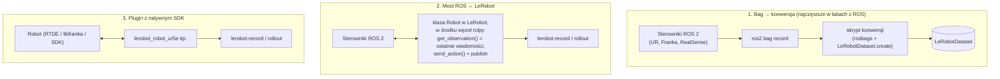

# L6 LeRobot a ROS 2 — integracja i jak o tym mówić

> [!skrot] W 30 sekund
> - **ROS 2** = middleware i ekosystem do **budowania systemu robota** (sterowniki, komunikacja, TF, MoveIt, ros2_control). **LeRobot** = biblioteka do **uczenia z danych** (format datasetu, nagrywanie, trening, uruchamianie polityk). Nie konkurują — **uzupełniają się**.
> - LeRobot sam w sobie **nie używa ROS-a**: rozmawia ze sprzętem bezpośrednio (port szeregowy, OpenCV), w jednej pętli Pythona. Prosto i szybko dla tanich ramion.
> - W labie z robotami przemysłowymi (UR, Franka) sterowniki są często w **ROS 2** → trzy drogi: (1) nagrywaj **bagi** i **konwertuj** do LeRobotDataset; (2) **most** — klasa robota LeRobot, która w środku publikuje/subskrybuje topiki ROS; (3) **plugin** LeRobot z natywnym SDK robota (np. RTDE dla UR, libfranka).
> - Na rozmowie: „ROS do sterowania i integracji, LeRobot/format LeRobot do danych i polityk” + umiesz opisać konwersję i jej pułapki.

> [!intuicja] Po ludzku
> ROS 2 to **instalacja elektryczna i hydraulika w domu** — dzięki niej wszystkie urządzenia mają prąd i wodę i mogą ze sobą współpracować. LeRobot to **szkoła gotowania** — uczy, jak z tych urządzeń zrobić obiad (zadanie) na podstawie nagranych lekcji. Szkoła może działać we własnej małej kuchni bez całej instalacji (SO-101 przez USB), ale w dużej restauracji (lab z UR i Franką) korzysta z istniejącej instalacji — i trzeba umieć „przełożyć” zapis z instalacji (bag) na format lekcji (dataset).

## Porównanie

| | ROS 2 | LeRobot |
|---|---|---|
| Cel | Budowa systemu robota, komunikacja, integracja | Robot learning: dane → polityka → robot |
| Komunikacja | Rozproszona (DDS), wiele procesów i komputerów | Jedna pętla Pythona, bezpośrednio do sprzętu |
| Czas i synchronizacja | Asynchroniczne topiki, `header.stamp`, synchronizacja po fakcie | Synchroniczna pętla o stałym FPS — synchronizacja „z konstrukcji” |
| Zapis danych | rosbag2 (MCAP) — surowy log zdarzeń | LeRobotDataset — równa siatka klatek, gotowa do treningu |
| Sterowanie ruchem | ros2_control, MoveIt, kontrolery czasu rzeczywistego | Proste wysyłanie pozycji zadanych do serw |
| Język | C++ i Python | Python (PyTorch) |
| Sprzęt | Ogromny ekosystem sterowników przemysłowych | Tanie ramiona + rosnąca lista pluginów |
| Bezpieczeństwo/real-time | Lepsze narzędzia (lifecycle, RT, safety controllers) | Minimalne — polegasz na sprzęcie i robocie |

## Trzy sposoby połączenia



| Droga | Plusy | Minusy |
|---|---|---|
| **1. Bag → konwersja** | Nic nie zmieniasz w działającym systemie ROS; bag = pełny surowy zapis (można przekonwertować ponownie inaczej) | Trzeba dobrze zsynchronizować po stampach; dodatkowy krok; duże bagi |
| **2. Most** | Nagrywasz od razu w formacie LeRobot; rollout polityki przez ROS (z kontrolerami ros2_control) | Opóźnienia DDS, „ostatnia wiadomość” może być nieświeża; więcej kodu |
| **3. Plugin SDK** | Najprostsza ścieżka w LeRobot, niskie opóźnienia | Omijasz ROS — tracisz jego narzędzia i bezpieczeństwo integracji |

### Pułapki konwersji bag → LeRobot (powtórka, bo pewne pytanie)
1. **Siatka czasu i tolerancja** — wybór FPS, najbliższa próbka, odrzucanie dziur ([[R7 ROS 2 w labie zbierania danych]]).
2. **Nazwy i kolejność stawów** — po nazwach z `JointState.name`, zapisane w `features.names`.
3. **Jednostki** — ROS: radiany/metry; trzymaj się jednej konwencji w całym datasecie i opisz ją.
4. **Co jest akcją** — komenda teleop/leader, nie stan followera; ewentualnie akcja = stan z $t+1$ (gdy brak komend — zaznacz to).
5. **Kolory i formaty obrazu** — BGR→RGB, rozdzielczość stała, dekodowanie `CompressedImage`.
6. **Granice epizodów** — z sygnałów start/stop (topik zdarzeń, serwis) albo osobne bagi na epizod.
7. **Opis zadania** (`task`) i metadane (operator, sukces, konfiguracja) — z topiku/pliku sesji.
8. **`finalize()`** i walidacja: wczytanie datasetu, wizualizacja, porównanie liczby klatek z `ros2 bag info`.

## Praktyka bez robota — 1–2 godziny (zrób przed rozmową!)

- [ ] **Instalacja** (najlepiej w venv / conda, Python 3.10+ / wg dokumentacji):
  ```bash
  python -m venv ~/lerobot-venv && source ~/lerobot-venv/bin/activate
  pip install lerobot
  lerobot-info
  ```
- [ ] **Wczytaj prawdziwy dataset i obejrzyj:**
  ```python
  from lerobot.datasets import LeRobotDataset
  ds = LeRobotDataset("lerobot/svla_so101_pickplace")
  print(ds.meta.fps, ds.num_episodes, ds.num_frames, list(ds.features))
  print(ds[0]["observation.state"], ds[0]["action"], ds[0]["task"])
  ```
  Otwórz w przeglądarce Space **`lerobot/visualize_dataset`** z tym `repo_id` — obejrzyj 2–3 epizody: jak wygląda akcja vs stan, kiedy zamyka się chwytak.
- [ ] **Policz sam:** średnia długość epizodu (frames / episodes / fps), rozmiar katalogu w `~/.cache/huggingface/lerobot/` vs liczba klatek — ile waży sekunda danych.
- [ ] **Mini-ewaluacja w symulacji** (jeśli masz GPU, ewentualnie CPU wolno): `pip install "lerobot[pusht]"`, potem
  ```bash
  lerobot-eval --policy.path=lerobot/diffusion_pusht --env.type=pusht --eval.n_episodes=10 --policy.device=cuda
  ```
  i obejrzyj zapisane wideo.
- [ ] (Opcjonalnie) **Mini-trening ACT** na `lerobot/pusht` przez 2–5 tys. kroków — tylko żeby zobaczyć, jak spada strata i jak wygląda katalog checkpointów.
- [ ] Zapisz w [[22 Moje projekty — jak o nich opowiadać]] jedno zdanie o tym, co zrobiłeś — **tylko prawdę**.

## Jak o tym mówić na rozmowie

> [!przyda] Gotowe odpowiedzi (EN) — dopasuj do tego, co naprawdę zrobiłeś
> - **„Do you know LeRobot?”** → *"Yes — it's Hugging Face's open-source library for real-world robot learning. I explored its dataset format: Parquet for joint states and actions, MP4 per camera, and metadata like fps, normalization stats and episode offsets — in v3 many episodes share a file. I loaded a dataset, looked at episodes in the visualizer and [ran an evaluation of a pretrained Diffusion Policy in the Push-T sim]."*
> - **„How would you get ROS data into a training dataset?”** → *"Record an explicit set of topics with rosbag2, then convert offline: pick the main camera as the time base, match the nearest joint-state and command samples by header timestamps within a tolerance, decode and convert images to RGB, map joints by name, write frames with LeRobotDataset.create and add_frame, save each episode with its task description and finalize. Then validate frame counts against bag info and check a few episodes visually."*
> - **„What's the difference between ROS and LeRobot?”** → *"ROS 2 is the middleware for building the robot system — drivers, communication, control. LeRobot is about learning from data — dataset format, recording, training and deploying policies. In a lab with industrial arms you'd typically keep ROS for control and use LeRobot's format for the data and models."*
> - **„What can go wrong during recording?”** → *"Dropped frames from USB bandwidth or slow disks, desynchronization between cameras and joint states, a camera that moved, calibration changes mid-session, inconsistent operator strategies and mislabeled failures. I'd catch these with checks before, during and after each session."*

> [!blad] Czego NIE mówić
> - Nie mów, że trenowałeś π0, jeśli nie trenowałeś. Lepiej: *„I understand how it works and how fine-tuning looks in LeRobot; I haven't trained one myself yet.”* — uczciwość + zrozumienie > udawanie.
> - Nie mów „LeRobot zastępuje ROS”. Nie zastępuje.

## Pytania rekrutacyjne
> [!zadanie] Czy LeRobot używa ROS-a?
> > [!odpowiedz]- Odpowiedź
> > Nie — natywnie komunikuje się ze sprzętem bezpośrednio (magistrala serw przez USB, kamery przez OpenCV/RealSense SDK) w jednej synchronicznej pętli Pythona. Z ROS-em łączy się go przez konwersję bagów, własną klasę robota-most do topików ROS albo pluginy z natywnym SDK robota.

> [!zadanie] W labie jest UR5e sterowany przez ROS 2 i trzy kamery RealSense. Jak zbudujesz dataset w formacie LeRobot?
> > [!odpowiedz]- Odpowiedź
> > Najprościej i najbezpieczniej: zostawiam istniejący system ROS 2 (ur_robot_driver, realsense2_camera, węzeł teleop), nagrywam epizody `ros2 bag record` (joint_states, komendy teleop, obrazy skompresowane, camera_info, tf_static, zdarzenia epizodu), a offline konwertuję do LeRobotDataset z synchronizacją po stampach, mapowaniem stawów po nazwach, RGB, opisem zadania i metadanymi. Alternatywa: klasa robota w LeRobot jako most do topików ROS albo plugin z RTDE — wtedy `lerobot-record` zapisuje od razu.

> [!zadanie] Dlaczego format LeRobot zamiast trenowania bezpośrednio z bagów?
> > [!odpowiedz]- Odpowiedź
> > Bagi to surowe, asynchroniczne logi z różnymi częstotliwościami — nieefektywne do losowego dostępu w treningu. LeRobotDataset ma równą siatkę klatek, skompresowane wideo, schemat, statystyki normalizacji, opisy zadań, szybkie ładowanie/streaming i jest od razu zgodny z wieloma politykami i z Hubem. Bag zostaje jako surowe archiwum.

## Fiszki #fiszki/rozmowa-gd/lerobot
ROS 2 vs LeRobot w jednym zdaniu?::ROS 2 — budowa i integracja systemu robota; LeRobot — uczenie z danych (dataset, nagrywanie, trening, polityki).
Czy LeRobot natywnie używa ROS?::Nie — bezpośrednio sprzęt w jednej pętli Pythona.
Trzy sposoby połączenia ROS i LeRobot?::Bag → konwersja; most (klasa robota z węzłem rclpy); plugin z natywnym SDK robota.
Synchronizacja w LeRobot vs ROS?::LeRobot — synchroniczna pętla o stałym FPS; ROS — asynchroniczne topiki, synchronizacja po stampach.
Dlaczego nie trenować wprost z bagów?::Asynchroniczne, różne częstotliwości, wolny losowy dostęp; brak schematu i statystyk.
Pierwsza praktyka z LeRobot bez robota?::pip install lerobot → LeRobotDataset("lerobot/svla_so101_pickplace") → visualize_dataset → lerobot-eval na pusht.

## Moje notatki
> [!ja] Tu piszesz ty — Albert tej sekcji nie rusza.
