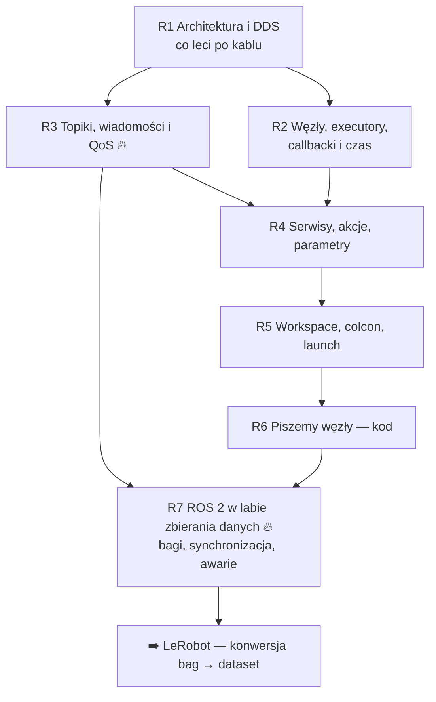

# 🐢 ROS 2 — dokładnie (dział pogłębiony)

> [!skrot] Po co ten dział
> - [[05 ROS 2 — podstawy]] i [[06 ROS 2 — komendy, launch, bagi i debugowanie]] dają **minimum na rozmowę**. Ten dział tłumaczy **dlaczego** to tak działa — od pakietu UDP w sieci aż po linijkę kodu w węźle.
> - Cel: na każde „a dlaczego?” rekrutera mieć jeszcze **jeden poziom głębiej**. To odróżnia „przeczytał tutorial” od „rozumie”.
> - Kolejność: **R1 → R7**. Każda notatka: „W 30 sekund” → „Po ludzku” → szczegóły → typowe błędy → pytania → fiszki.

## Mapa

| # | Notatka | Najważniejsze pytanie, na które odpowiada |
|---|---|---|
| R1 | [[R1 Architektura ROS 2 i DDS — co dzieje się pod spodem]] | Jak węzły się znajdują bez mastera i czemu „nie widzę topiku z drugiego komputera”? |
| R2 | [[R2 Węzły, executory, callbacki i czas]] | Czemu mój węzeł się zawiesił, gdy wołam serwis w callbacku? |
| R3 | [[R3 Topiki, wiadomości i QoS — dogłębnie]] | Czemu subskrybent nic nie dostaje, choć topik istnieje? |
| R4 | [[R4 Serwisy, akcje i parametry — dogłębnie]] | Z czego naprawdę składa się akcja? |
| R5 | [[R5 Workspace, pakiety, colcon i launch]] | Co robi `source install/setup.bash` i czemu „package not found”? |
| R6 | [[R6 Piszemy węzły — kod krok po kroku]] | Jak wygląda prawdziwy węzeł w Pythonie i C++? |
| R7 | [[R7 ROS 2 w labie zbierania danych]] | Jak z ROS-a zrobić dataset do VLA i co się psuje? |

Powiązane działy: [[V0 VLA — mapa działu]] · [[L0 LeRobot — mapa działu]] · wróć do [[00 Rozmowa GD — Start]].

## Jak się uczyć tego działu
1. Przeczytaj **jedną** notatkę, zamknij, narysuj z pamięci jej diagram na kartce.
2. Odpowiedz na głos na pytania z notatki (po angielsku, jeśli dasz radę).
3. Jeśli masz ROS 2 w Dockerze — **przepisz kod z R6** i uruchom. 30 minut praktyki = 3 godziny czytania.
