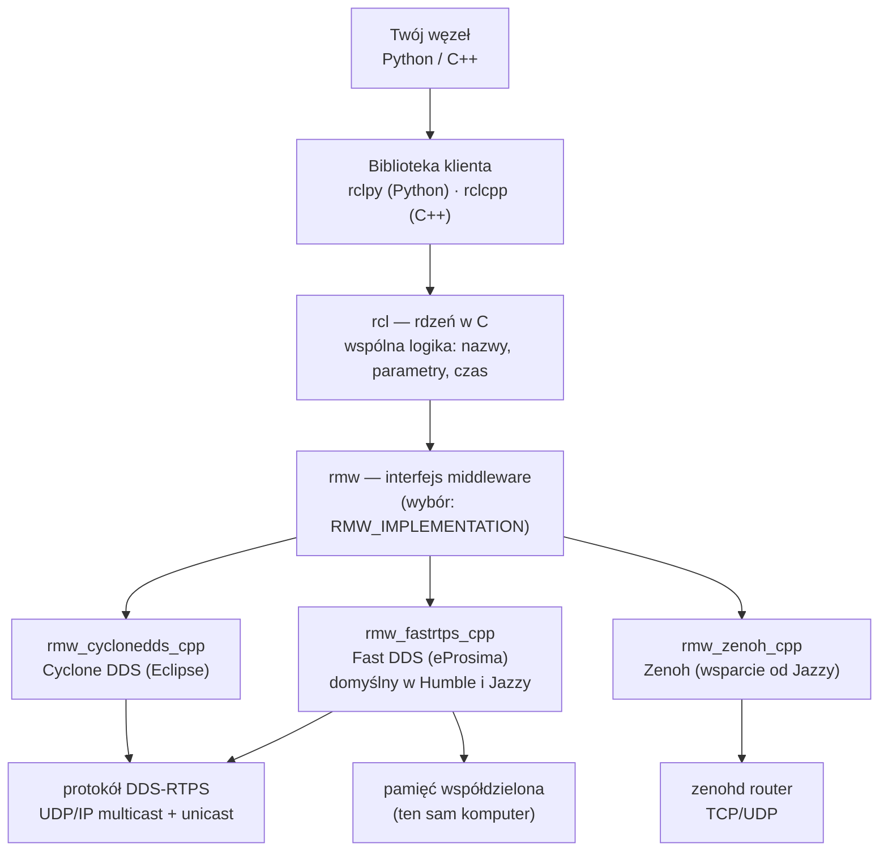
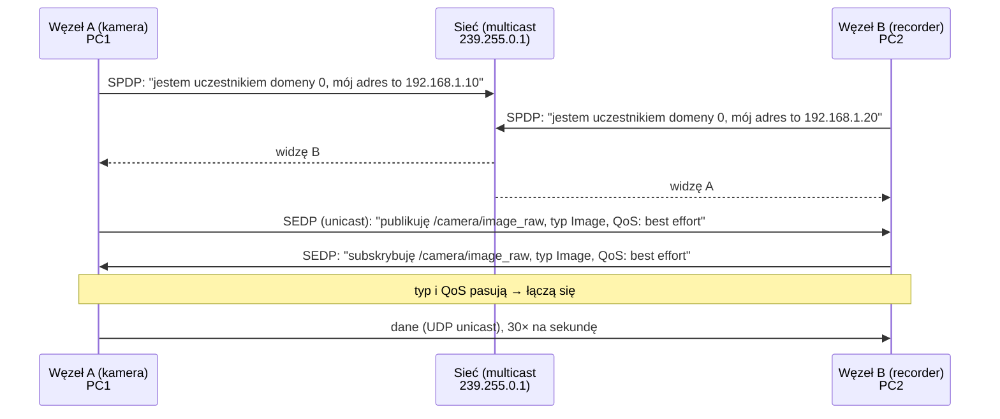

# R1 Architektura ROS 2 i DDS — co dzieje się pod spodem

> [!skrot] W 30 sekund
> - Twój kod (`rclpy`/`rclcpp`) → **rcl** (wspólny rdzeń w C) → **rmw** (*ROS MiddleWare*, „gniazdko” na wymienną implementację) → **DDS** (Fast DDS, Cyclone DDS) albo **Zenoh** → **UDP/IP** albo pamięć współdzielona.
> - **Nie ma mastera.** Węzły same się znajdują: każdy co chwilę **ogłasza się multicastem** w sieci („jestem, publikuję `/joint_states` typu `JointState`”). To się nazywa **discovery**.
> - Widzą się tylko węzły z tym samym **`ROS_DOMAIN_ID`** (0–101 bezpiecznie) i w zasięgu discovery (`ROS_LOCALHOST_ONLY` w Humble, `ROS_AUTOMATIC_DISCOVERY_RANGE` od Jazzy).
> - 90% problemów „nie widzę topiku z drugiego komputera” to: inny domain ID, zablokowany multicast (Wi-Fi, firewall), inny RMW albo Docker bez `--net=host`.

> [!intuicja] Po ludzku
> ROS 1 był jak biuro z **recepcjonistką** (`roscore`): każdy nowy pracownik szedł do recepcji i pytał „kto publikuje obraz z kamery?”. Recepcjonistka idzie na urlop → nikt nikogo nie znajduje.
> ROS 2 to **impreza bez gospodarza**: każdy, kto wchodzi, krzyczy na całą salę „Cześć, jestem Kamera, mam zdjęcia!”, a reszta zapamiętuje. Działa, dopóki wszyscy są w **tej samej sali** (ten sam domain ID, ta sama sieć) i **słychać krzyk** (multicast nie jest blokowany). Na Wi-Fi w biurze często krzyk nie dochodzi — wtedy trzeba „listy gości” (*discovery server* albo statyczne adresy).

## Warstwy — od twojego kodu do kabla



| Warstwa | Co robi | Po co ci to wiedzieć |
|---|---|---|
| **rclpy / rclcpp** | Wygodne API: `create_publisher`, `create_subscription`, `spin` | To piszesz |
| **rcl** | Logika wspólna dla wszystkich języków (napisana w C) | Dlatego Python i C++ zachowują się tak samo |
| **rmw** | Abstrakcja: ROS nie zależy od jednego dostawcy DDS | Zmieniasz middleware zmienną środowiskową, bez zmiany kodu |
| **DDS** | Standard OMG do publish/subscribe w czasie rzeczywistym (lotnictwo, wojsko, fabryki) | Daje discovery, QoS, niezawodność |
| **RTPS** | Protokół „po kablu” dla DDS, zwykle po **UDP** | Dlatego firewall i multicast mają znaczenie |
| **Serializacja CDR** | Zamiana wiadomości na bajty (*Common Data Representation*) | Każda wiadomość jest kopiowana i serializowana — duże obrazy kosztują |

```bash
# który middleware jest używany?
ros2 doctor --report | grep -i middleware
# zmiana (musi być TAKA SAMA na wszystkich maszynach — bezpieczna zasada)
export RMW_IMPLEMENTATION=rmw_cyclonedds_cpp
```

## Discovery — jak węzły się znajdują



1. **SPDP** (*Simple Participant Discovery Protocol*) — „kto jest w domenie?”. Okresowe ogłoszenia **multicastem**.
2. **SEDP** (*Simple Endpoint Discovery Protocol*) — „kto co publikuje i subskrybuje, jakiego typu, z jakim QoS?”.
3. Jeśli **nazwa topiku + typ + QoS** pasują → dane płyną bezpośrednio **peer-to-peer** (unicast). Nikt pośrodku.

> [!wazne] Konsekwencje braku mastera
> - ✅ Nie ma jednego punktu awarii. Węzeł może się zrestartować, reszta działa.
> - ❌ Discovery to **ruch w sieci**. Przy 100 węzłach i słabym Wi-Fi to zauważalne.
> - ❌ Multicast bywa **blokowany** na Wi-Fi korporacyjnym i w sieciach z „client isolation”. Wtedy discovery nie działa w ogóle.
> - 🔧 Rozwiązania: **Fast DDS Discovery Server** (centralny „spis gości”, ale opcjonalny), **`ROS_STATIC_PEERS`** (Jazzy+, podajesz IP ręcznie), **Zenoh** z routerem, albo plik XML z listą peerów.

### Demon `ros2 daemon` (często zaskakuje)
Komendy `ros2 topic list` itp. pytają **demona w tle**, który cache'uje discovery. Gdy zmienisz `ROS_DOMAIN_ID` albo sieć, a `ros2 topic list` pokazuje stare rzeczy lub nic:
```bash
ros2 daemon stop && ros2 daemon start   # albo: ros2 topic list --no-daemon
```

## ROS_DOMAIN_ID — „numer sali”

| Fakt | Szczegół |
|---|---|
| Domyślnie | `0` |
| Bezpieczny zakres | **0–101** (na Linuksie; wyższe kolidują z portami efemerycznymi systemu) |
| Jak działa | Domain ID zmienia **porty UDP**: bazowo `7400 + 250 × domain_id` (+ przesunięcia na uczestnika) |
| Po co | Kilka zespołów/robotów w jednej sieci nie miesza sobie danych |
| W labie | Każde stanowisko teleop może mieć **swój** domain ID, żeby recorder z jednego stanowiska nie nagrał kamer z drugiego |

```bash
export ROS_DOMAIN_ID=42      # w KAŻDYM terminalu (albo w ~/.bashrc)
```

### Ograniczenie zasięgu discovery
| Dystrybucja | Zmienna | Wartości |
|---|---|---|
| **Humble** | `ROS_LOCALHOST_ONLY=1` | tylko ten komputer |
| **Jazzy+** | `ROS_AUTOMATIC_DISCOVERY_RANGE` | `SUBNET` (domyślnie), `LOCALHOST`, `OFF`, `SYSTEM_DEFAULT` |
| **Jazzy+** | `ROS_STATIC_PEERS` | lista IP/hostów oddzielona `;` — połączenie bez multicastu |

## Transport: ta sama maszyna vs sieć

| Sytuacja | Jak płyną dane | Koszt |
|---|---|---|
| Dwa węzły w **jednym procesie** (composition, `use_intra_process_comms=True`) | Przekazanie wskaźnika (`unique_ptr`) — **zero kopii** (C++) | ~0 |
| Dwa procesy na **jednym komputerze** | Fast DDS: **pamięć współdzielona** (SHM) domyślnie; ewentualnie UDP loopback | mały |
| Dwa komputery | UDP przez sieć, duże wiadomości **fragmentowane** | duży dla obrazów |

> [!przyda] Rachunek, który robi wrażenie
> Surowy obraz RGB 640×480, 30 FPS: $640 \cdot 480 \cdot 3 = 921\,600$ B/klatkę $\times 30 \approx 27{,}6$ MB/s $\approx$ **221 Mbit/s**. Trzy kamery = ~660 Mbit/s → **prawie cały gigabit**. Dlatego przez sieć wysyła się `CompressedImage` (JPEG) albo nagrywa **lokalnie** na komputerze, do którego kamery są podpięte. Szczegóły: [[27 Zadania obliczeniowe — liczenie na głos]].

## ROS 2 w Dockerze — pułapki sieciowe
| Problem | Przyczyna | Rozwiązanie |
|---|---|---|
| Kontener nie widzi węzłów hosta | Docker bridge network nie przepuszcza multicastu | `--net=host` |
| Topiki widoczne, ale **brak danych** między hostem a kontenerem | Fast DDS próbuje **pamięci współdzielonej**, a kontener ma osobne `/dev/shm` | `--ipc=host` albo wyłączyć SHM w profilu Fast DDS |
| Różne UID/uprawnienia | Pliki SHM tworzone przez innego użytkownika | ten sam użytkownik lub `--ipc=host` |

Więcej: [[17 Docker dla robotyki]].

## Zenoh — nowa opcja (warto wspomnieć)
`rmw_zenoh_cpp` (oficjalnie wspierany od **Jazzy**) zastępuje DDS protokołem **Zenoh**: discovery przez **router** (`ros2 run rmw_zenoh_cpp rmw_zenohd`), mniej ruchu, lepiej przez Wi-Fi i Internet. Minus: trzeba uruchomić router. Zdanie na rozmowę: *„DDS discovery relies on multicast, which is problematic on Wi-Fi; Zenoh or a discovery server are the usual fixes.”*

## Typowe błędy
> [!blad] „ROS 2 ma mastera, tylko się inaczej nazywa”
> Nie. `ros2 daemon` to **tylko cache dla narzędzi CLI**. Węzły działają bez niego.

> [!blad] Różne RMW na różnych maszynach
> Fast DDS i Cyclone DDS *zwykle* się dogadają (oba mówią RTPS), ale bywają różnice w QoS i typach. W labie: **jeden RMW wszędzie**, zapisany w obrazie Dockera / `.bashrc`.

> [!blad] Zmieniłem `ROS_DOMAIN_ID` w jednym terminalu
> Zmienna środowiskowa działa **tylko w tym terminalu** i w procesach z niego uruchomionych. Drugi terminal dalej jest w domenie 0.

## Pytania rekrutacyjne
> [!zadanie] Jak węzły w ROS 2 się odnajdują, skoro nie ma roscore?
> > [!odpowiedz]- Odpowiedź
> > Przez **discovery w DDS**: każdy uczestnik okresowo rozgłasza się multicastem (SPDP), potem wymieniają informacje o publikatorach i subskrybentach — nazwa topiku, typ, QoS (SEDP). Jeśli pasują, dane płyną bezpośrednio peer-to-peer. Zasięg ogranicza `ROS_DOMAIN_ID` i ustawienia discovery.
> > **EN:** *"ROS 2 has no master. DDS does decentralized discovery: participants announce themselves over multicast, exchange endpoint info — topic, type and QoS — and connect peer-to-peer when they match."*

> [!zadanie] Węzeł na laptopie nie widzi topików z komputera robota. Co sprawdzasz?
> > [!odpowiedz]- Odpowiedź
> > 1) `ping` w obie strony, ta sama podsieć. 2) Ten sam `ROS_DOMAIN_ID` w obu terminalach. 3) `ROS_LOCALHOST_ONLY` / `ROS_AUTOMATIC_DISCOVERY_RANGE` nie ogranicza do localhost. 4) Ten sam `RMW_IMPLEMENTATION` i ta sama dystrybucja. 5) Firewall (`ufw`) przepuszcza UDP; multicast działa (`ros2 multicast receive` na jednej i `ros2 multicast send` na drugiej). 6) `ros2 daemon stop`. 7) Jeśli Docker — `--net=host`, `--ipc=host`. Na Wi-Fi bez multicastu: discovery server lub `ROS_STATIC_PEERS`.

> [!zadanie] Co to jest RMW i po co ta warstwa?
> > [!odpowiedz]- Odpowiedź
> > ROS Middleware interface — abstrakcja między ROS-em a konkretną implementacją komunikacji (Fast DDS, Cyclone DDS, Zenoh). Pozwala zmienić middleware zmienną `RMW_IMPLEMENTATION` bez zmiany kodu węzłów.

> [!zadanie] Topiki widać w kontenerze, ale nie przychodzą dane. Dlaczego?
> > [!odpowiedz]- Odpowiedź
> > Discovery przeszło (metadane przez UDP), ale Fast DDS wybrał transport przez **pamięć współdzieloną**, a kontener ma inne `/dev/shm`. Rozwiązanie: `--ipc=host` lub wyłączenie SHM w profilu XML Fast DDS.

> [!zadanie] Po co ROS_DOMAIN_ID w labie z kilkoma stanowiskami?
> > [!odpowiedz]- Odpowiedź
> > Izoluje grupy węzłów w tej samej sieci: stanowisko 1 nie widzi kamer i robota stanowiska 2, więc recorder nie nagra cudzych danych, a teleop nie wyśle komend do złego ramienia. To też kwestia bezpieczeństwa.

## Fiszki #fiszki/rozmowa-gd/ros-dokladnie
Warstwy ROS 2 od kodu do sieci?::rclpy/rclcpp → rcl (C) → rmw → DDS (Fast DDS / Cyclone) lub Zenoh → RTPS po UDP lub pamięć współdzielona.
Co to jest rmw?::ROS MiddleWare interface — wymienna warstwa komunikacji, wybierana zmienną RMW_IMPLEMENTATION.
Domyślny RMW w Humble i Jazzy?::Fast DDS (rmw_fastrtps_cpp).
Jak działa discovery w DDS?::SPDP — uczestnicy ogłaszają się multicastem; SEDP — wymiana informacji o publikatorach/subskrybentach (topik, typ, QoS); potem peer-to-peer.
Bezpieczny zakres ROS_DOMAIN_ID?::0–101 (na Linuksie).
Jak domain ID wpływa na sieć?::Zmienia porty UDP (bazowo 7400 + 250 × domain_id).
Czym zastąpiono ROS_LOCALHOST_ONLY w Jazzy?::ROS_AUTOMATIC_DISCOVERY_RANGE (SUBNET/LOCALHOST/OFF) i ROS_STATIC_PEERS.
Co robi ros2 daemon?::Cache'uje discovery dla narzędzi CLI; nie jest masterem. Restart: ros2 daemon stop.
Dlaczego DDS bywa problemem na Wi-Fi?::Discovery opiera się na multicaście, który Wi-Fi często blokuje lub gubi; duże wiadomości są fragmentowane.
Rozwiązania braku multicastu?::Fast DDS Discovery Server, ROS_STATIC_PEERS, Zenoh z routerem, lista peerów w XML.
Docker + ROS 2: topiki widać, danych brak?::Pamięć współdzielona Fast DDS — dodaj --ipc=host (i --net=host).
Ile Mbit/s ma surowe RGB 640×480 @30 FPS?::Ok. 221 Mbit/s (27,6 MB/s).
Co to jest intra-process communication?::Węzły w jednym procesie przekazują wiadomości wskaźnikiem, bez serializacji i kopii (C++ composition).

## Moje notatki
> [!ja] Tu piszesz ty — Albert tej sekcji nie rusza.
