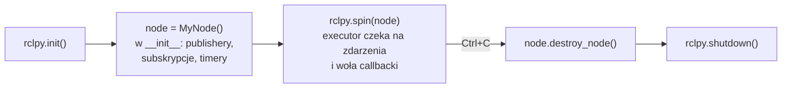
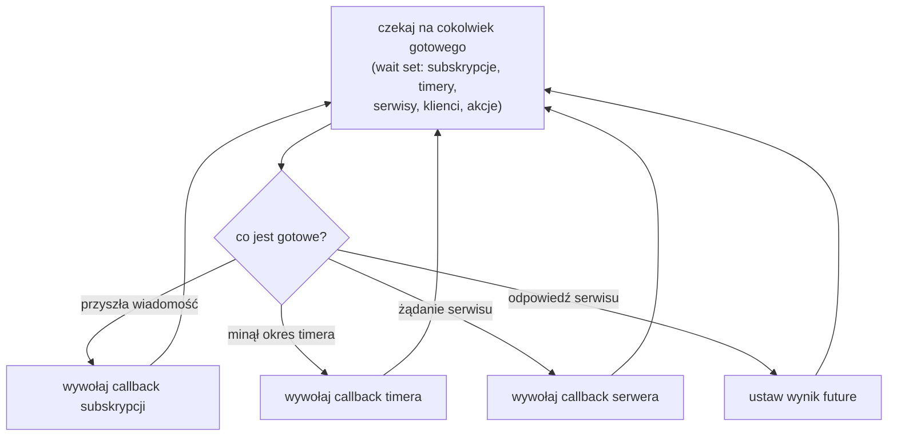
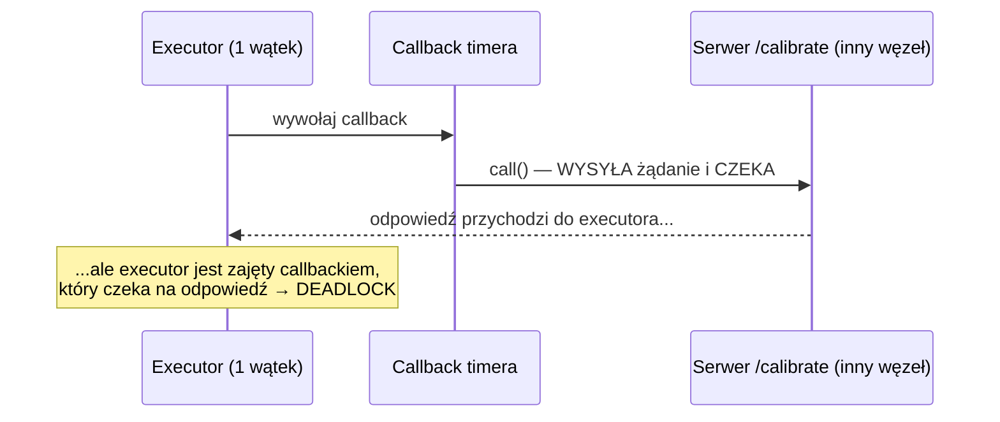
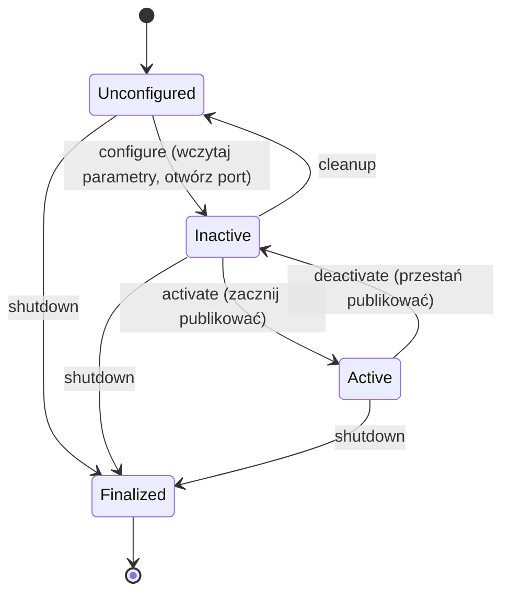

# R2 Węzły, executory, callbacki i czas

> [!skrot] W 30 sekund
> - **Węzeł** sam nic nie robi „w pętli”. Rejestruje **callbacki** (funkcje do wywołania, gdy przyjdzie wiadomość, minie czas timera, przyjdzie żądanie serwisu). **Executor** to pętla, która czeka na zdarzenia i woła odpowiednie callbacki. `rclpy.spin(node)` = „uruchom executor”.
> - **SingleThreadedExecutor**: jeden callback naraz. **MultiThreadedExecutor**: kilka równolegle, ale tylko jeśli pozwolą na to **callback groups** (`MutuallyExclusive` — domyślna, jeden naraz; `Reentrant` — równolegle).
> - Klasyczny **deadlock**: w callbacku czekasz synchronicznie na odpowiedź serwisu, a executor jest zajęty… tym callbackiem. Odpowiedź nigdy nie zostanie przetworzona.
> - **Czas:** *wall/system time* (zegar komputera), *steady time* (monotoniczny, do mierzenia odstępów), *ROS time* (= system albo `/clock` z symulacji/bagu, gdy `use_sim_time=true`). Znacznik `header.stamp` to **chwila pomiaru**, nie chwila wysłania.

> [!intuicja] Po ludzku
> Węzeł to **kelner**, a callbacki to jego obowiązki: „gdy klient podniesie rękę — podejdź”, „co 5 minut — sprawdź stoliki”. **Executor** to sam kelner chodzący po sali i reagujący na sygnały. Jeden kelner (single-threaded) obsługuje jedną rzecz naraz. Jeśli przy stoliku 3 powie „poczekam tu, aż kuchnia odpowie”, a kuchnia czeka, aż **ten sam kelner** odbierze talerz — stoją obaj w nieskończoność. To deadlock. Rozwiązanie: drugi kelner (multi-threaded + osobna grupa) albo „zostaw zamówienie i wróć, gdy zadzwoni dzwonek” (async + future).

## Cykl życia węzła w Pythonie (najprostszy)



Kluczowe: **w `__init__` niczego nie liczysz w pętli**. Rejestrujesz callbacki i oddajesz sterowanie executorowi. Pętla `while True:` z `time.sleep()` w węźle to błąd początkującego — blokuje executor, callbacki nie ruszają.

## Co executor robi w środku



| Executor | Zachowanie | Kiedy |
|---|---|---|
| `SingleThreadedExecutor` | Callbacki **po kolei**, jeden wątek | Domyślny w `rclpy.spin`. Prosty, przewidywalny |
| `MultiThreadedExecutor` | Pula wątków; równolegle **tylko** to, co pozwalają callback groups | Gdy długi callback nie może blokować innych |
| `EventsExecutor` (C++, eksperymentalny w nowych wersjach) | Reaguje na zdarzenia zamiast pętli „wait set” — mniej CPU | Wydajność |
| `StaticSingleThreadedExecutor` (C++) | Szybszy dla stałego zestawu węzłów; w nowszych wersjach wycofywany | Starsze projekty |

> [!wazne] Python i GIL
> W `rclpy` `MultiThreadedExecutor` daje współbieżność, ale przez **GIL** Pythona obliczenia CPU nie idą naprawdę równolegle. Pomaga przy **czekaniu** (I/O, serwisy), nie przy liczeniu. Ciężkie przetwarzanie obrazów → C++, osobny proces albo biblioteki zwalniające GIL (NumPy, OpenCV).

## Callback groups — kto może biec równolegle

| Grupa | Zasada |
|---|---|
| **MutuallyExclusiveCallbackGroup** (domyślna — każdy węzeł ma jedną) | Callbacki z tej grupy **nigdy** nie biegną równocześnie |
| **ReentrantCallbackGroup** | Callbacki mogą biec równolegle, **nawet ten sam** kilka razy naraz |

Callbacki z **różnych** grup mogą biec równolegle (w MultiThreadedExecutor).

### Deadlock krok po kroku i dwa sposoby naprawy



**Naprawa 1 — asynchronicznie (najlepsza):**
```python
future = self.client.call_async(req)
future.add_done_callback(self.on_calibrated)   # callback, gdy przyjdzie odpowiedź
```
**Naprawa 2 — osobna grupa + wiele wątków:**
```python
self.cb_group = MutuallyExclusiveCallbackGroup()
self.client = self.create_client(Trigger, "/calibrate", callback_group=self.cb_group)
# timer w INNEJ grupie (domyślnej); w main:
executor = MultiThreadedExecutor(); executor.add_node(node); executor.spin()
```

## Timery
- `self.create_timer(0.1, self.cb)` → callback co 100 ms (10 Hz).
- Timer **nie gwarantuje** idealnego okresu: jeśli executor jest zajęty, callback się spóźni. To **nie jest** system czasu rzeczywistego.
- Timer korzysta z **zegara węzła** — przy `use_sim_time=true` tyka według `/clock` (np. odtwarzany bag w 2× przyspieszeniu → timer też 2× szybciej).

## Czas w ROS 2 — trzy zegary

| Zegar | Co mierzy | Do czego | Pułapka |
|---|---|---|---|
| **System (wall) time** | Data i godzina komputera (od 1970) | Znaczniki czasu w wiadomościach | Może **skoczyć** (NTP, zmiana strefy) |
| **Steady time** | Monotoniczny, nigdy się nie cofa | Mierzenie odstępów, timeouty | Nie ma sensu między komputerami |
| **ROS time** | = system time, **albo** czas z topiku `/clock`, gdy `use_sim_time:=true` | Symulacja, odtwarzanie bagów | Zapomnisz `use_sim_time` → znaczniki z 2024 w danych z 2026 |

```bash
ros2 bag play my_bag --clock          # bag publikuje /clock
ros2 run my_pkg my_node --ros-args -p use_sim_time:=true
```

> [!wazne] `header.stamp` = kiedy zmierzono, nie kiedy wysłano
> Sterownik kamery powinien wstawić czas **ekspozycji klatki**, a nie czas `publish()`. Różnica bywa 10–50 ms (USB, kompresja). Dla datasetu VLA to ma znaczenie: obraz musi pasować do **stanu robota z tej samej chwili**. Synchronizacja: [[R7 ROS 2 w labie zbierania danych]].

### Synchronizacja zegarów między komputerami
Jeśli kamera jest na PC1, a sterownik robota na PC2, to ich `stamp`-y porównujesz tylko wtedy, gdy zegary są zsynchronizowane: **chrony/NTP** (dokładność ~ms) albo **PTP** (IEEE 1588, ~µs, wymaga wsparcia kart sieciowych). Sprawdzenie: `chronyc tracking`.

## Lifecycle (managed) nodes — węzeł ze stanami



- Po co: **kontrolowany start sprzętu**. Najpierw konfigurujesz wszystkie sterowniki (kamery, robot), sprawdzasz, że się udało, i dopiero wtedy **aktywujesz** wszystkie naraz. Nav2 i część sterowników używa tego mechanizmu.
- Komendy: `ros2 lifecycle get /camera`, `ros2 lifecycle set /camera configure`, `ros2 lifecycle set /camera activate`.
- `ros2_control` ma podobny cykl dla **kontrolerów** (`inactive`/`active`) — patrz [[09 Sterowanie ramieniem, ros2_control i MoveIt]].

## Composition — kilka węzłów w jednym procesie
- **Komponent** = węzeł skompilowany jako biblioteka (C++), ładowany do **kontenera** (`component_container`).
- Zysk: **intra-process communication** → obraz przekazany wskaźnikiem, bez kopiowania i serializacji. Ważne dla kamer o wysokiej rozdzielczości (RealSense potrafi działać jako komponent).
- `ros2 component list`, `ros2 component load /my_container image_proc image_proc::RectifyNode`.

## Typowe błędy
> [!blad] `while True:` + `time.sleep()` w węźle
> Blokuje executor — subskrypcje i serwisy nie działają. Używaj `create_timer`.

> [!blad] Synchroniczne `client.call()` w callbacku
> Deadlock w single-threaded executorze. Używaj `call_async` + callback.

> [!blad] Ciężkie przetwarzanie w callbacku kamery
> Callback trwa 80 ms, a klatki przychodzą co 33 ms → kolejka rośnie, wiadomości są gubione (KEEP_LAST) albo opóźnienie rośnie. Mierz czas callbacku; przenieś liczenie do osobnego wątku/węzła.

> [!blad] `stamp = now()` w momencie publikacji
> Wprowadza systematyczne opóźnienie między obrazem a stanem robota → gorszy dataset.

## Pytania rekrutacyjne
> [!zadanie] Co robi `rclpy.spin()`?
> > [!odpowiedz]- Odpowiedź
> > Uruchamia executor dla węzła: w pętli czeka, aż coś będzie gotowe (wiadomość, timer, żądanie serwisu, odpowiedź), i woła odpowiedni callback. Bez spin callbacki nie są wywoływane.
> > **EN:** *"spin runs an executor that waits on the node's subscriptions, timers and services and dispatches their callbacks."*

> [!zadanie] Węzeł zawiesza się po wywołaniu serwisu w callbacku timera. Dlaczego i jak naprawić?
> > [!odpowiedz]- Odpowiedź
> > Single-threaded executor jest zajęty callbackiem, który synchronicznie czeka na odpowiedź, a odpowiedź może przetworzyć tylko ten sam executor → deadlock. Naprawa: `call_async` z `add_done_callback`, albo klient w osobnej callback group + `MultiThreadedExecutor`.

> [!zadanie] Czym różni się MutuallyExclusive od Reentrant callback group?
> > [!odpowiedz]- Odpowiedź
> > W MutuallyExclusive callbacki z grupy nigdy nie biegną jednocześnie; w Reentrant mogą biec równolegle, nawet kilka instancji tego samego. Ma to znaczenie tylko w MultiThreadedExecutor.

> [!zadanie] Co to jest `use_sim_time` i kiedy go użyć?
> > [!odpowiedz]- Odpowiedź
> > Parametr węzła: zamiast zegara systemowego węzeł bierze czas z topiku `/clock`. Używa się go w symulacji (Gazebo publikuje `/clock`) i przy odtwarzaniu bagów z `--clock`, żeby timery i TF działały w czasie nagrania.

> [!zadanie] Po co lifecycle nodes?
> > [!odpowiedz]- Odpowiedź
> > Dają kontrolowany, deterministyczny start i stop: węzeł najpierw się konfiguruje (parametry, połączenie ze sprzętem), dopiero potem aktywuje (zaczyna publikować). Można zestawić cały system, sprawdzić, że wszystko się skonfigurowało, i aktywować wszystko naraz; łatwiej też restartować pojedynczy sterownik.

> [!zadanie] Jaki znacznik czasu powinien mieć obraz z kamery?
> > [!odpowiedz]- Odpowiedź
> > Czas akwizycji (ekspozycji) klatki, najlepiej z zegara sprzętowego kamery przeliczonego na zegar systemu, a nie czas publikacji. Inaczej obraz i stan robota w datasecie są przesunięte o opóźnienie transportu.

## Fiszki #fiszki/rozmowa-gd/ros-dokladnie
Co to jest executor w ROS 2?::Pętla, która czeka na gotowe zdarzenia (wiadomości, timery, serwisy) i wywołuje callbacki.
Domyślna callback group węzła?::MutuallyExclusive — callbacki nie biegną równocześnie.
Klasyczny deadlock w rclpy?::Synchroniczne wywołanie serwisu w callbacku przy single-threaded executorze.
Dwa sposoby naprawy deadlocku z serwisem?::call_async + add_done_callback; albo osobna callback group + MultiThreadedExecutor.
Czy MultiThreadedExecutor w Pythonie daje równoległe obliczenia?::Nie w pełni — GIL; pomaga przy czekaniu (I/O), nie przy CPU.
Trzy zegary w ROS 2?::System (wall), steady (monotoniczny), ROS time (system lub /clock przy use_sim_time).
Co robi use_sim_time:=true?::Węzeł bierze czas z topiku /clock (symulacja, bag play --clock).
Co powinien oznaczać header.stamp?::Chwilę pomiaru (akwizycji), nie chwilę publikacji.
Stany lifecycle node?::Unconfigured → Inactive → Active, oraz Finalized.
Po co composition?::Kilka węzłów w jednym procesie → intra-process, przekazanie bez kopii (ważne dla obrazów).
Synchronizacja zegarów między PC?::chrony/NTP (~ms) albo PTP IEEE 1588 (~µs).
Dlaczego nie while True w węźle?::Blokuje executor — callbacki nie są wywoływane; używaj create_timer.

## Moje notatki
> [!ja] Tu piszesz ty — Albert tej sekcji nie rusza.
