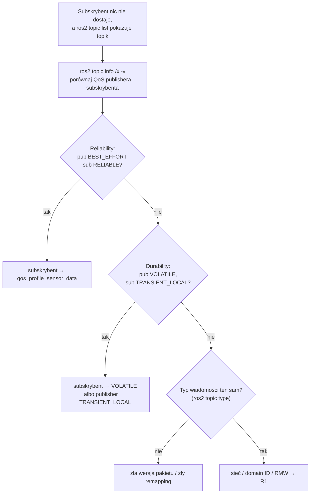

# R3 Topiki, wiadomości i QoS — dogłębnie

> [!skrot] W 30 sekund
> - **Wiadomość** to struktura danych zdefiniowana w pliku `.msg` (np. `sensor_msgs/msg/JointState`). Z pliku generowany jest kod dla Pythona i C++. Prawie każda wiadomość z czujnika ma **`std_msgs/Header`**: `stamp` (czas) + `frame_id` (układ współrzędnych).
> - **QoS** (*Quality of Service*) to umowa „jak dostarczać”: **Reliability** (`RELIABLE` — powtarzaj zgubione / `BEST_EFFORT` — trudno, leci dalej), **Durability** (`VOLATILE` / `TRANSIENT_LOCAL` — spóźnialski dostanie ostatnie wiadomości), **History + Depth** (ile trzymać w kolejce), plus Deadline, Lifespan, Liveliness.
> - Publisher i subscriber muszą mieć **zgodne QoS**, inaczej **nic nie płynie** — bez błędu w kodzie, tylko ostrzeżenie w logach. Zasada: *subskrybent nie może żądać więcej, niż publisher obiecuje*.
> - Sensory zwykle publikują **BEST_EFFORT** (profil `sensor_data`). Subskrybent z domyślnym `RELIABLE` → **niekompatybilne** → klasyczne „topik jest, a danych nie ma”.

> [!intuicja] Po ludzku
> QoS to jak wybór **sposobu wysyłki paczki**. *Reliable* = list polecony: kurier wraca, aż doręczy. *Best effort* = ulotka do skrzynki: zgubi się, trudno, jutro będzie nowa. Dla kamery 30 FPS ulotka jest lepsza — po co doręczać klatkę sprzed sekundy, skoro jest już świeża? *Transient local* = **tablica ogłoszeń przy wejściu**: kto przyjdzie później, i tak zobaczy ostatnie ogłoszenie (tak działa `/tf_static` i `/robot_description`).
> Niekompatybilność: jeśli ty żądasz listu poleconego, a nadawca wysyła tylko ulotki, to poczta mówi „nie obsłużymy” i nic nie dostajesz.

## Anatomia wiadomości

```text
# sensor_msgs/msg/JointState.msg
std_msgs/Header header      # stamp + frame_id
string[]  name              # ["shoulder_pan", "shoulder_lift", ...]
float64[] position          # [rad] lub [m] dla stawów liniowych
float64[] velocity          # [rad/s]
float64[] effort            # [Nm] lub [N]
```

| Element składni `.msg` | Przykład | Znaczenie |
|---|---|---|
| Typ prosty | `float64 x`, `uint8 data`, `bool ok`, `string name` | Pola |
| Tablica dynamiczna | `float64[] position` | Dowolna długość |
| Tablica stała | `float64[9] k` | Dokładnie 9 (np. macierz kamery 3×3) |
| Ograniczona | `float64[<=10] v` | Maksymalnie 10 |
| Stała | `uint8 OPEN=1` | Nazwana wartość |
| Typ zagnieżdżony | `geometry_msgs/Pose pose` | Wiadomość w wiadomości |
| Wartość domyślna | `int32 count 5` | Domyślnie 5 |

### Header — dwa pola, które musisz rozumieć
```text
builtin_interfaces/Time stamp   # sec (int32) + nanosec (uint32)
string frame_id                 # np. "camera_color_optical_frame", "base_link"
```
- `stamp` → **kiedy** zmierzono. Do synchronizacji kamer ze stanem robota.
- `frame_id` → **w jakim układzie** są dane. TF2 używa go do przeliczania pozycji ([[07 TF2, URDF i układy współrzędnych]]).

## Wiadomości, które spotkasz w labie robot learning

| Typ | Najważniejsze pola | Gdzie |
|---|---|---|
| `sensor_msgs/JointState` | `name[]`, `position[]`, `velocity[]`, `effort[]` | `/joint_states` — **propriocepcja** do datasetu |
| `sensor_msgs/Image` | `height`, `width`, `encoding` (`rgb8`, `bgr8`, `16UC1` dla głębi w mm, `32FC1` w m), `step` (bajty na wiersz), `data[]` | surowy obraz |
| `sensor_msgs/CompressedImage` | `format` („jpeg”, „png”), `data[]` | obraz przez sieć / do bagów |
| `sensor_msgs/CameraInfo` | `K` (3×3 intrinsics), `D` (dystorsja), `R`, `P` (3×4 projekcja), `distortion_model` | kalibracja kamery |
| `sensor_msgs/PointCloud2` | `fields`, `point_step`, `data[]` | chmura punktów z kamery głębi |
| `geometry_msgs/PoseStamped` | `header`, `pose.position (x,y,z)`, `pose.orientation (x,y,z,w)` — kwaternion | poza chwytaka, celu |
| `geometry_msgs/TransformStamped` | `header.frame_id` (rodzic), `child_frame_id`, `transform` | TF |
| `geometry_msgs/Twist` | `linear (x,y,z)`, `angular (x,y,z)` | prędkość: baza mobilna, servo ramienia |
| `geometry_msgs/WrenchStamped` | `force`, `torque` | czujnik siła/moment w nadgarstku |
| `trajectory_msgs/JointTrajectory` | `joint_names[]`, `points[]` (positions, velocities, `time_from_start`) | trajektoria dla kontrolera |
| `control_msgs/action/FollowJointTrajectory` | goal: trajektoria; result: kod błędu | akcja ruchu ramienia |
| `std_msgs/String`, `Bool`, `Float64MultiArray` | proste | debug, szybkie prototypy |

> [!przyda] Dlaczego `Float64MultiArray` to zły pomysł w produkcji
> Nie ma `header` (brak czasu i układu) ani nazw pól. Za pół roku nikt nie wie, co oznacza indeks 4. Lepiej własny typ albo standardowy z nazwami.

### Własny interfejs (gdy standardowe nie wystarczają)
Pakiet `my_interfaces` z `msg/EpisodeMarker.msg`:
```text
std_msgs/Header header
uint32 episode_index
string task
bool success
```
W `CMakeLists.txt`: `rosidl_generate_interfaces(${PROJECT_NAME} "msg/EpisodeMarker.msg" DEPENDENCIES std_msgs)`. Interfejsy budujesz **zawsze jako pakiet ament_cmake**, nawet jeśli resztę piszesz w Pythonie.

## QoS — wszystkie ustawienia

| Polityka | Wartości | Co znaczy | Przykład użycia |
|---|---|---|---|
| **History** | `KEEP_LAST` (+ `depth`) / `KEEP_ALL` | Ile wiadomości trzymać w kolejce | `KEEP_LAST 10` — standard |
| **Depth** | liczba | Rozmiar kolejki przy KEEP_LAST | 1 dla „tylko najnowsza” |
| **Reliability** | `RELIABLE` / `BEST_EFFORT` | Czy retransmitować zgubione | Komendy → RELIABLE; obraz → BEST_EFFORT |
| **Durability** | `VOLATILE` / `TRANSIENT_LOCAL` | Czy późny subskrybent dostanie stare wiadomości | `/tf_static`, `/robot_description`, mapa → TRANSIENT_LOCAL |
| **Deadline** | czas | „Spodziewam się wiadomości co najmniej co X” — inaczej zdarzenie | Watchdog dla stanu robota |
| **Lifespan** | czas | Wiadomość starsza niż X jest wyrzucana | Komendy, które się przeterminowują |
| **Liveliness** | `AUTOMATIC` / `MANUAL_BY_TOPIC` + lease duration | Jak stwierdzić, że publisher żyje | Wykrywanie padnięcia sterownika |

### Gotowe profile
| Profil | Ustawienia | Kto używa |
|---|---|---|
| **Default** (`rclpy.qos.qos_profile_default`, albo po prostu `10`) | RELIABLE, VOLATILE, KEEP_LAST 10 | Większość topików |
| **Sensor data** (`qos_profile_sensor_data`) | **BEST_EFFORT**, VOLATILE, KEEP_LAST 5 | Sterowniki kamer, lidarów |
| **Services** | RELIABLE, VOLATILE | Serwisy |
| **Parameters** | RELIABLE, KEEP_LAST 1000 | Serwisy parametrów |
| **System default** | to, co ustawi DDS | rzadko |

### Zgodność — tabela, którą warto narysować na rozmowie
| Publisher \ Subscriber | sub **BEST_EFFORT** | sub **RELIABLE** |
|---|---|---|
| pub **BEST_EFFORT** | ✅ | ❌ **brak danych** |
| pub **RELIABLE** | ✅ (dostaje best effort) | ✅ |

| Publisher \ Subscriber | sub **VOLATILE** | sub **TRANSIENT_LOCAL** |
|---|---|---|
| pub **VOLATILE** | ✅ | ❌ |
| pub **TRANSIENT_LOCAL** | ✅ | ✅ (dostanie ostatnie `depth` wiadomości) |

Zasada: **oferta publishera ≥ żądanie subskrybenta**. Deadline: publisher musi obiecać okres ≤ żądany przez subskrybenta.



```bash
ros2 topic info /camera/color/image_raw -v     # pokaże QoS każdego endpointu
ros2 topic echo /camera/color/image_raw --qos-reliability best_effort --no-arr
ros2 topic hz /joint_states                    # częstotliwość
ros2 topic bw /camera/color/image_raw          # przepustowość (MB/s)
ros2 topic delay /camera/color/image_raw       # opóźnienie: now() - header.stamp
```

> [!przyda] W kodzie
> ```python
> from rclpy.qos import qos_profile_sensor_data, QoSProfile, ReliabilityPolicy, DurabilityPolicy, HistoryPolicy
> self.create_subscription(Image, "/camera/color/image_raw", self.cb, qos_profile_sensor_data)
> latched = QoSProfile(depth=1, reliability=ReliabilityPolicy.RELIABLE,
>                      durability=DurabilityPolicy.TRANSIENT_LOCAL, history=HistoryPolicy.KEEP_LAST)
> self.pub = self.create_publisher(String, "/episode/task", latched)
> ```

## Co się dzieje, gdy subskrybent nie nadąża
| Ustawienie | Efekt |
|---|---|
| `KEEP_LAST depth=1` | Zawsze dostajesz **najnowszą**, stare są nadpisywane → gubisz klatki, ale nie rośnie opóźnienie |
| `KEEP_LAST depth=100` | Bufor 100 wiadomości → przy wolnym callbacku rośnie **opóźnienie**, potem i tak gubisz |
| `KEEP_ALL` + `RELIABLE` | Publisher może być **blokowany** (czeka na wolnego subskrybenta) — może spowolnić cały system |

**Dla recordera danych:** chcesz nie gubić → nagrywaj blisko źródła (ten sam komputer), wystarczająco duży bufor, szybki dysk (NVMe), kompresja w osobnym wątku. Dla **sterowania** chcesz najświeższe → depth 1.

## Image transport — obrazy po sieci
- `image_transport` publikuje ten sam obraz w kilku wersjach: `/image_raw`, `/image_raw/compressed` (JPEG/PNG), `/image_raw/compressedDepth`, ewentualnie `/image_raw/theora` lub nowsze kodeki (`ffmpeg_image_transport`).
- Subskrybent wybiera wersję — przez Wi-Fi bierzesz `compressed`.
- **Uwaga:** głębi **nie kompresuj JPEG-iem** (stratnie zniszczy odległości) — `compressedDepth` (PNG, bezstratnie).

## Typowe błędy
> [!blad] `ros2 topic echo` działa, a mój węzeł nie dostaje danych
> `ros2 topic echo` sam dopasowuje QoS do istniejących publisherów; twój węzeł ma na sztywno RELIABLE. Sprawdź `ros2 topic info -v`.

> [!blad] Późno uruchomiony węzeł nie widzi `/robot_description` albo statycznych TF
> Subskrybent musi mieć `TRANSIENT_LOCAL`. Publisher je ma, ale VOLATILE subskrybent dostanie tylko nowe wiadomości — a nowe nie przyjdą.

> [!blad] Mieszanie jednostek
> ROS używa **SI**: metry, radiany, sekundy (REP 103). Stopnie albo milimetry w `JointState` to błąd, który zepsuje dataset.

## Pytania rekrutacyjne
> [!zadanie] Co to jest QoS w ROS 2 i podaj przykład niekompatybilności.
> > [!odpowiedz]- Odpowiedź
> > Zestaw polityk dostarczania wiadomości: reliability, durability, history/depth, deadline, lifespan, liveliness. Przykład: kamera publikuje BEST_EFFORT, a subskrybent żąda RELIABLE → połączenie się nie zestawi i subskrybent nie dostanie nic. Diagnoza: `ros2 topic info -v`; naprawa: subskrybent z `qos_profile_sensor_data`.
> > **EN:** *"QoS policies define delivery guarantees. If a camera publishes best-effort and my subscriber requests reliable, they're incompatible and no data flows. I'd check with ros2 topic info --verbose."*

> [!zadanie] Kiedy RELIABLE, a kiedy BEST_EFFORT?
> > [!odpowiedz]- Odpowiedź
> > BEST_EFFORT dla strumieni wysokiej częstotliwości, gdzie liczy się najświeższa próbka (kamery, lidar) — retransmisja starej klatki tylko szkodzi. RELIABLE dla komend, zdarzeń, rzadkich i ważnych wiadomości (start/stop epizodu, cel ruchu, konfiguracja).

> [!zadanie] Co daje TRANSIENT_LOCAL i gdzie się go używa?
> > [!odpowiedz]- Odpowiedź
> > Publisher przechowuje ostatnie `depth` wiadomości i wysyła je subskrybentom, którzy dołączą później („latched topic”). Używane dla `/tf_static`, `/robot_description`, map, metadanych epizodu.

> [!zadanie] Co zawiera `sensor_msgs/Image` i ile waży jedna klatka 1280×720 rgb8?
> > [!odpowiedz]- Odpowiedź
> > header, height, width, encoding, is_bigendian, step (bajty na wiersz = width × 3 dla rgb8), data. $1280 \cdot 720 \cdot 3 = 2\,764\,800$ B ≈ **2,76 MB**; przy 30 FPS ≈ 83 MB/s ≈ 660 Mbit/s.

> [!zadanie] Do czego służy `frame_id` w headerze?
> > [!odpowiedz]- Odpowiedź
> > Mówi, w jakim układzie współrzędnych wyrażone są dane (np. optyczny układ kamery). TF2 używa go, żeby przeliczyć dane do innego układu, np. `base_link`.

## Fiszki #fiszki/rozmowa-gd/ros-dokladnie
Co zawiera std_msgs/Header?::stamp (sec, nanosec) i frame_id.
Pola sensor_msgs/JointState?::header, name[], position[], velocity[], effort[].
Encoding głębi w sensor_msgs/Image?::16UC1 (milimetry) lub 32FC1 (metry).
Co zawiera CameraInfo?::K (intrinsics 3×3), D (dystorsja), R, P (projekcja 3×4), distortion_model.
Polityki QoS?::History/depth, Reliability, Durability, Deadline, Lifespan, Liveliness.
Profil sensor_data?::BEST_EFFORT, VOLATILE, KEEP_LAST 5.
Domyślny profil QoS?::RELIABLE, VOLATILE, KEEP_LAST 10.
pub BEST_EFFORT + sub RELIABLE?::Niekompatybilne — brak danych.
pub VOLATILE + sub TRANSIENT_LOCAL?::Niekompatybilne.
Zasada zgodności QoS?::Oferta publishera musi być co najmniej taka, jak żądanie subskrybenta.
Gdzie TRANSIENT_LOCAL?::/tf_static, /robot_description, mapy — „latched”.
Komenda pokazująca QoS endpointów?::ros2 topic info /topik -v
Jakie jednostki w ROS (REP 103)?::SI: metry, radiany, sekundy; kwaterniony dla orientacji.
Dlaczego nie JPEG dla głębi?::Kompresja stratna niszczy wartości odległości; używa się compressedDepth (PNG).
KEEP_LAST depth=1 przy wolnym subskrybencie?::Dostaje najnowszą, gubi stare — opóźnienie nie rośnie.

## Moje notatki
> [!ja] Tu piszesz ty — Albert tej sekcji nie rusza.
