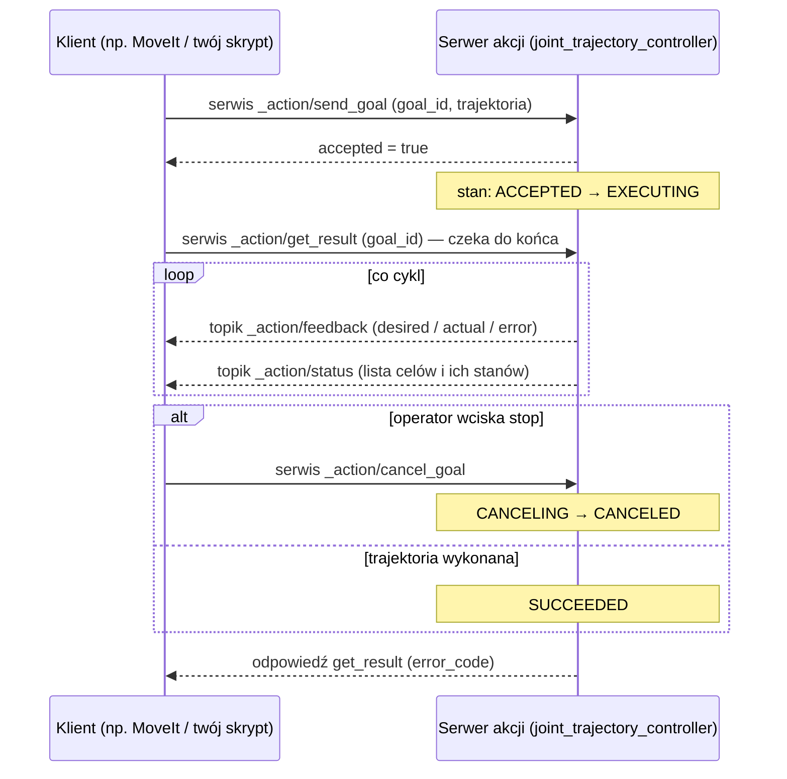
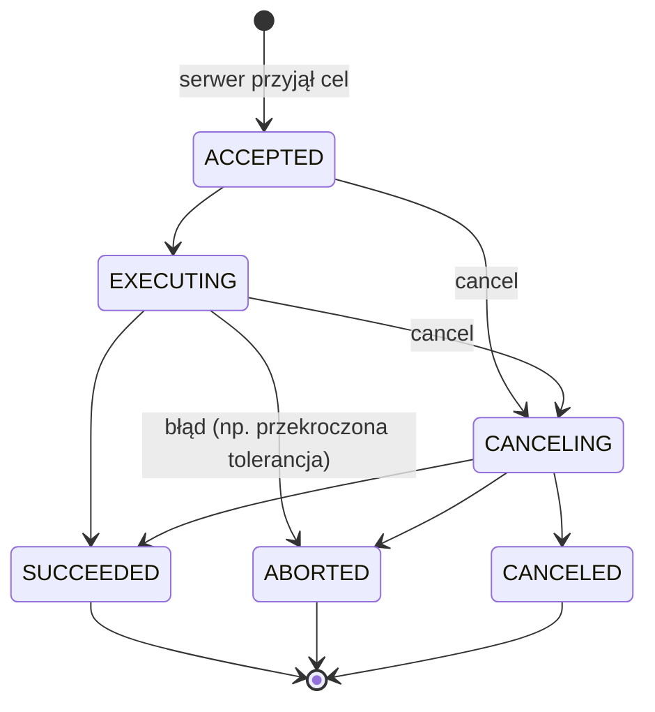
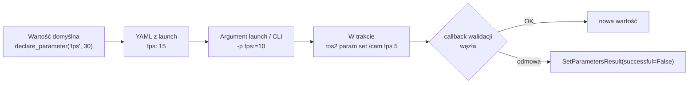

# R4 Serwisy, akcje i parametry — dogłębnie

> [!skrot] W 30 sekund
> - **Serwis** = para „żądanie → odpowiedź” zdefiniowana w `.srv`. Klient wysyła, serwer liczy, odsyła. Brak postępu, brak anulowania, **brak wbudowanego timeoutu** — o timeout dbasz sam.
> - **Akcja** = **3 serwisy + 2 topiki** pod spodem: `send_goal`, `get_result`, `cancel_goal` (serwisy) oraz `feedback` i `status` (topiki). Cel ma stany: ACCEPTED → EXECUTING → SUCCEEDED / ABORTED / CANCELED.
> - **Parametr** = nazwane ustawienie węzła (typ: bool, int, double, string, tablice). Deklarujesz w kodzie, nadpisujesz z YAML/launch/CLI. Pod spodem — też serwisy (`/węzeł/get_parameters`, `set_parameters`…).
> - Ruch ramienia w ROS 2 to prawie zawsze akcja **`control_msgs/action/FollowJointTrajectory`** wysyłana do kontrolera z `ros2_control`.

> [!intuicja] Po ludzku
> - **Serwis** — zadajesz pytanie w okienku urzędu i **stoisz** przy okienku, aż urzędnik odpowie.
> - **Akcja** — zamawiasz meble: dostajesz **numer zamówienia** (goal ID), SMS-y „w produkcji… w drodze…” (feedback), możesz **anulować**, a na końcu „dostarczono” albo „nie udało się” (result). W środku to kilka okienek (serwisy) i tablica z aktualnościami (topiki) — po prostu ładnie opakowane.
> - **Parametr** — pokrętło z tyłu urządzenia: ustawiasz przed startem (YAML), czasem możesz kręcić w trakcie (`ros2 param set`), a urządzenie może odmówić („ta wartość jest niedozwolona”).

## Serwisy

```text
# std_srvs/srv/Trigger.srv
---                     # request jest pusty
bool success
string message
```
```text
# std_srvs/srv/SetBool.srv
bool data
---
bool success
string message
```

| Cecha | Szczegół |
|---|---|
| Plik | `.srv`: request, `---`, response |
| Komunikacja | Pod spodem dwa „topiki” DDS: request i reply, dopasowywane po ID |
| Wielu klientów | Tak, serwer obsługuje po kolei (w zależności od executora/grup) |
| Wiele serwerów o tej samej nazwie | **Niezdefiniowane** — nie rób tego |
| Timeout | **Brak** w protokole — klient: `future` + własny limit czasu |
| Kiedy | Krótkie operacje: „otwórz chwytak”, „zacznij nagrywanie epizodu”, „zresetuj enkoder”, „zrób zdjęcie kalibracyjne” |

```bash
ros2 service list -t                              # z typami
ros2 service type /gripper/open
ros2 interface show std_srvs/srv/SetBool
ros2 service call /recorder/start std_srvs/srv/Trigger "{}"
ros2 service call /gripper/enable std_srvs/srv/SetBool "{data: true}"
```

> [!wazne] Serwis, który trwa 10 sekund, to zapach złego projektu
> Klient czeka bez informacji, nie może przerwać. Jeśli operacja trwa dłużej niż ~1 s albo chcesz ją przerywać → **akcja**.

## Akcje — co naprawdę jest w środku

```text
# control_msgs/action/FollowJointTrajectory.action (uproszczone)
trajectory_msgs/JointTrajectory trajectory   # GOAL
...tolerancje...
---
int32 error_code                             # RESULT  (0 = SUCCESSFUL)
string error_string
---
std_msgs/Header header                       # FEEDBACK
string[] joint_names
trajectory_msgs/JointTrajectoryPoint desired
trajectory_msgs/JointTrajectoryPoint actual
trajectory_msgs/JointTrajectoryPoint error
```



`ros2 action list` pokazuje `/arm_controller/follow_joint_trajectory`, ale `ros2 topic list --include-hidden-topics` i `ros2 service list --include-hidden-services` pokażą „ukryte” elementy pod `/arm_controller/follow_joint_trajectory/_action/...`.

### Stany celu (goal states)

| Stan | Znaczenie w labie |
|---|---|
| **ABORTED** | Serwer sam przerwał: np. kontroler wykrył za duży błąd śledzenia (`PATH_TOLERANCE_VIOLATED`), robot w zatrzymaniu ochronnym |
| **CANCELED** | Klient poprosił o anulowanie i serwer się zgodził |
| **REJECTED** | Serwer w ogóle nie przyjął celu (np. złe nazwy stawów, kontroler nieaktywny) — klient dostaje `accepted=false` |

```bash
ros2 action list -t
ros2 action info /arm_controller/follow_joint_trajectory      # kto jest serwerem/klientem
ros2 action send_goal /arm_controller/follow_joint_trajectory \
  control_msgs/action/FollowJointTrajectory \
  "{trajectory: {joint_names: [shoulder_pan_joint, shoulder_lift_joint, elbow_joint, wrist_1_joint, wrist_2_joint, wrist_3_joint],
    points: [{positions: [0.0, -1.57, 1.57, -1.57, -1.57, 0.0], time_from_start: {sec: 5}}]}}" --feedback
```
> [!blad] Pułapka bezpieczeństwa
> `time_from_start: {sec: 0}` albo bardzo krótki = „dojedź **natychmiast**” → kontroler odrzuci albo robot szarpnie. Zawsze rozsądny czas, prędkość zredukowana na pendancie, ręka przy E-stopie. Patrz [[14 Bezpieczeństwo pracy z robotami]].

## Parametry


Każdy kolejny poziom **nadpisuje** poprzedni.

### Plik YAML — format, który trzeba znać na pamięć
```yaml
camera_node:                # nazwa węzła (albo /** dla wszystkich)
  ros__parameters:          # DWA podkreślenia!
    fps: 30
    serial_number: "123456789012"   # string w cudzysłowie, bo inaczej YAML zrobi int
    resolution: [640, 480]
    enable_depth: true
```
```bash
ros2 run my_pkg cam --ros-args --params-file config/cam.yaml -p fps:=15
ros2 param list /camera_node
ros2 param get /camera_node fps
ros2 param set /camera_node fps 15
ros2 param dump /camera_node > cam_now.yaml        # zapisz aktualny stan — świetne do dokumentacji setupu!
ros2 param load /camera_node cam_now.yaml
```

### W kodzie (Python)
```python
from rcl_interfaces.msg import SetParametersResult

self.declare_parameter("fps", 30)
self.fps = self.get_parameter("fps").value
self.add_on_set_parameters_callback(self.on_params)

def on_params(self, params):
    for p in params:
        if p.name == "fps" and p.value not in (6, 15, 30, 60):
            return SetParametersResult(successful=False, reason="unsupported fps")
    return SetParametersResult(successful=True)
```

| Fakt o parametrach | Szczegół |
|---|---|
| Trzeba deklarować | Domyślnie użycie niezadeklarowanego parametru = wyjątek (można zmienić `allow_undeclared_parameters`) |
| Typ jest stały | Zadeklarowany jako int → `set` stringa da błąd (chyba że `dynamic_typing`) |
| Read-only | `ParameterDescriptor(read_only=True)` — np. numer portu szeregowego |
| Zakresy | `ParameterDescriptor(integer_range=...)`/`floating_point_range` |
| Globalnych parametrów nie ma | W ROS 1 był serwer parametrów; w ROS 2 parametry **należą do węzła** |

> [!przyda] W labie
> `ros2 param dump` dla każdego sterownika (kamery, robot) przed sesją nagrań → zapisujesz w metadanych datasetu. Za miesiąc wiesz dokładnie, z jaką ekspozycją i rozdzielczością nagrywano. Patrz [[04 Jakość danych, organizacja i upload]].

## Porównanie w jednym miejscu
| | Topic | Service | Action | Parameter |
|---|---|---|---|---|
| Pod spodem | DDS topik | 2 topiki DDS (req/rep) | 3 serwisy + 2 topiki | 6 serwisów na węzeł + topik `/parameter_events` |
| Kierunek | 1→N | klient↔serwer | klient↔serwer | ktokolwiek ↔ węzeł |
| Typowy czas | ciągle | ms | s–min | rzadko |
| Anulowanie | — | ❌ | ✅ | — |
| Postęp | — | ❌ | ✅ feedback | — |

## Pytania rekrutacyjne
> [!zadanie] Z czego składa się akcja w ROS 2?
> > [!odpowiedz]- Odpowiedź
> > Z trzech serwisów — send_goal, get_result, cancel_goal — i dwóch topików — feedback i status. Plik `.action` ma trzy sekcje: goal, result, feedback. Cel ma ID i stany (accepted, executing, canceling, succeeded, aborted, canceled).
> > **EN:** *"An action is built from three services — send goal, get result, cancel — and two topics, feedback and status."*

> [!zadanie] Dlaczego ruch ramienia to akcja, a nie serwis?
> > [!odpowiedz]- Odpowiedź
> > Trwa sekundy, chcemy feedback (aktualna vs zadana pozycja, błąd) i możliwość anulowania w każdej chwili. Serwis blokowałby klienta bez informacji i bez możliwości przerwania.

> [!zadanie] Akcja FollowJointTrajectory zwraca ABORTED. Co sprawdzasz?
> > [!odpowiedz]- Odpowiedź
> > `error_code`/`error_string` w wyniku; czy kontroler jest aktywny (`ros2 control list_controllers`); czy robot nie jest w protective stop / nie wymaga odblokowania na pendancie; czy trajektoria nie przekracza limitów i tolerancji (za szybko, za krótki `time_from_start`); czy nazwy stawów i ich liczba się zgadzają; czy stan startowy trajektorii zgadza się z aktualną pozycją robota.

> [!zadanie] Jak przekazać konfigurację do węzła kamery bez zmiany kodu?
> > [!odpowiedz]- Odpowiedź
> > Parametrami: plik YAML z sekcją `nazwa_węzła: ros__parameters:` podany w launchu albo `--params-file`, nadpisania `-p nazwa:=wartość`. W trakcie `ros2 param set`, jeśli węzeł to obsługuje. `ros2 param dump` zapisuje aktualny stan.

> [!zadanie] Serwis nie odpowiada i klient wisi. Co jest nie tak w kliencie?
> > [!odpowiedz]- Odpowiedź
> > Serwisy nie mają wbudowanego timeoutu. Klient powinien najpierw `wait_for_service(timeout_sec=...)`, potem `call_async` i czekać na future z limitem czasu (np. `spin_until_future_complete(node, future, timeout_sec=2.0)`), a po przekroczeniu — obsłużyć błąd.

## Fiszki #fiszki/rozmowa-gd/ros-dokladnie
Akcja ROS 2 pod spodem?::3 serwisy (send_goal, get_result, cancel_goal) + 2 topiki (feedback, status).
Sekcje pliku .action?::goal --- result --- feedback.
Stany końcowe celu akcji?::SUCCEEDED, ABORTED, CANCELED.
ABORTED vs CANCELED?::ABORTED — serwer sam przerwał (błąd); CANCELED — anulowane na prośbę klienta.
Akcja do ruchu ramienia w ros2_control?::control_msgs/action/FollowJointTrajectory.
Czy serwis ma wbudowany timeout?::Nie — klient sam musi go obsłużyć (wait_for_service, future z limitem).
Format YAML parametrów?::nazwa_węzła: → ros__parameters: → klucz: wartość.
Kolejność nadpisywania parametrów?::default w kodzie < YAML < -p z CLI/launch < ros2 param set w trakcie.
Jak zapisać aktualne parametry węzła?::ros2 param dump /węzeł > plik.yaml
Czy ROS 2 ma globalny serwer parametrów?::Nie — parametry należą do węzłów.
Jak odrzucić niepoprawny parametr?::add_on_set_parameters_callback → SetParametersResult(successful=False).
Jak zobaczyć ukryte elementy akcji?::ros2 topic list --include-hidden-topics / ros2 service list --include-hidden-services.

## Moje notatki
> [!ja] Tu piszesz ty — Albert tej sekcji nie rusza.
