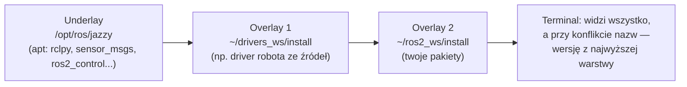

# R5 Workspace, pakiety, colcon i launch

> [!skrot] W 30 sekund
> - **Workspace** = katalog z `src/` (twoje pakiety). `colcon build` tworzy obok `build/` (pliki pośrednie), `install/` (gotowe pakiety) i `log/`.
> - **`source`** dodaje pakiety do środowiska (zmienne `AMENT_PREFIX_PATH`, `PYTHONPATH`, `PATH`, `LD_LIBRARY_PATH`). Kolejność: najpierw **underlay** (`/opt/ros/jazzy/setup.bash`), potem **overlay** (`install/setup.bash`). Overlay **przykrywa** underlay.
> - **Pakiet** = `package.xml` (nazwa, wersja, zależności) + `CMakeLists.txt` (C++, `ament_cmake`) **albo** `setup.py`/`setup.cfg` (Python, `ament_python`).
> - **Launch** (Python/XML/YAML) startuje wiele węzłów naraz z parametrami, remappingami, namespace'ami i argumentami. `ros2 launch pakiet plik.launch.py arg:=wartość`.

> [!intuicja] Po ludzku
> `/opt/ros/jazzy` to **fabryczne wyposażenie mieszkania**. Twój workspace to **twoje meble**. `source /opt/ros/jazzy/setup.bash` = „wejdź do mieszkania”; `source install/setup.bash` = „wnieś swoje meble”. Jeśli masz swoją wersję krzesła (pakiet o tej samej nazwie), to **twoje stoi na wierzchu** i to na nim siadasz (overlay). Każdy nowy terminal to **nowa wizyta** — trzeba znowu wejść i wnieść meble (albo dopisać to do `~/.bashrc`).

## Struktura workspace'u

```text
~/ros2_ws/
├── src/                         ← TYLKO to trzymasz w gicie
│   ├── teleop_recorder/         ← pakiet Python
│   │   ├── package.xml
│   │   ├── setup.py
│   │   ├── setup.cfg
│   │   ├── resource/teleop_recorder
│   │   ├── teleop_recorder/     ← moduł Pythona
│   │   │   ├── __init__.py
│   │   │   └── recorder_node.py
│   │   ├── launch/record.launch.py
│   │   └── config/cameras.yaml
│   └── lab_interfaces/          ← pakiet C++ (ament_cmake) z .msg/.srv
│       ├── package.xml
│       ├── CMakeLists.txt
│       └── msg/EpisodeMarker.msg
├── build/                       ← generowane
├── install/                     ← generowane (to „source'ujesz”)
└── log/                         ← logi budowania
```



## Tworzenie i budowanie — komendy

```bash
mkdir -p ~/ros2_ws/src && cd ~/ros2_ws/src
ros2 pkg create teleop_recorder --build-type ament_python \
    --dependencies rclpy sensor_msgs std_srvs --node-name recorder_node
cd ~/ros2_ws
rosdep install --from-paths src --ignore-src -y     # doinstaluj zależności z package.xml przez apt
colcon build --symlink-install                       # symlinki → zmiana .py bez ponownego build
source install/setup.bash
ros2 run teleop_recorder recorder_node
```

| Flaga `colcon build` | Co robi |
|---|---|
| `--symlink-install` | Pliki Pythona/launch/config jako **symlinki** do `src/` — edytujesz i od razu działa (poza nowymi entry pointami) |
| `--packages-select a b` | Buduje tylko te pakiety |
| `--packages-up-to a` | Buduje `a` i wszystko, od czego zależy |
| `--cmake-args -DCMAKE_BUILD_TYPE=Release` | Optymalizacje C++ (ważne dla wydajności!) |
| `--parallel-workers 2` | Mniej równoległości — gdy brakuje RAM-u (np. na Jetsonie) |
| `--event-handlers console_direct+` | Pełny output kompilatora w terminalu |

`colcon test` + `colcon test-result --verbose` — uruchamia testy pakietów.

## package.xml — co tam jest

```xml
<?xml version="1.0"?>
<package format="3">
  <name>teleop_recorder</name>
  <version>0.1.0</version>
  <description>Records teleop episodes</description>
  <maintainer email="me@example.com">Patryk</maintainer>
  <license>Apache-2.0</license>

  <depend>rclpy</depend>            <!-- potrzebne do budowania i uruchomienia -->
  <depend>sensor_msgs</depend>
  <exec_depend>ros2launch</exec_depend>  <!-- tylko w czasie uruchomienia -->
  <test_depend>ament_flake8</test_depend>

  <export><build_type>ament_python</build_type></export>
</package>
```
| Tag | Znaczenie |
|---|---|
| `<depend>` | build + exec (najczęściej) |
| `<build_depend>` | tylko do kompilacji |
| `<exec_depend>` | tylko w czasie działania |
| `<test_depend>` | tylko do testów |
| `<buildtool_depend>` | narzędzie budowania (`ament_cmake`) |

`rosdep` czyta te tagi i tłumaczy nazwy na pakiety systemowe (`python3-numpy`, `ros-jazzy-sensor-msgs`).

## setup.py (Python) — gdzie rejestrujesz węzły
```python
from setuptools import setup
from glob import glob
package_name = "teleop_recorder"
setup(
    name=package_name,
    packages=[package_name],
    data_files=[
        ("share/ament_index/resource_index/packages", ["resource/" + package_name]),
        ("share/" + package_name, ["package.xml"]),
        ("share/" + package_name + "/launch", glob("launch/*.launch.py")),   # ← bez tego launch nie będzie znaleziony!
        ("share/" + package_name + "/config", glob("config/*.yaml")),
    ],
    entry_points={
        "console_scripts": [
            "recorder_node = teleop_recorder.recorder_node:main",            # nazwa_w_ros2_run = moduł:funkcja
        ],
    },
)
```

## CMakeLists.txt (C++) — minimum
```cmake
cmake_minimum_required(VERSION 3.8)
project(gripper_driver)
find_package(ament_cmake REQUIRED)
find_package(rclcpp REQUIRED)
find_package(std_srvs REQUIRED)

add_executable(gripper_node src/gripper_node.cpp)
ament_target_dependencies(gripper_node rclcpp std_srvs)   # w nowszych: target_link_libraries(... rclcpp::rclcpp ...)

install(TARGETS gripper_node DESTINATION lib/${PROJECT_NAME})   # ← bez tego ros2 run nie znajdzie
install(DIRECTORY launch config DESTINATION share/${PROJECT_NAME})
ament_package()
```

## Launch — plik Python krok po kroku

```python
# launch/record.launch.py
from launch import LaunchDescription
from launch.actions import DeclareLaunchArgument, IncludeLaunchDescription
from launch.substitutions import LaunchConfiguration, PathJoinSubstitution
from launch_ros.actions import Node
from launch_ros.substitutions import FindPackageShare

def generate_launch_description():
    station = LaunchConfiguration("station")                 # wartość argumentu (leniwie)
    cam_cfg = PathJoinSubstitution([FindPackageShare("teleop_recorder"), "config", "cameras.yaml"])

    return LaunchDescription([
        DeclareLaunchArgument("station", default_value="st1", description="ID stanowiska"),

        Node(
            package="teleop_recorder",
            executable="recorder_node",
            name="recorder",
            namespace=station,                                # → /st1/recorder
            parameters=[cam_cfg, {"output_dir": "/data/episodes"}],
            remappings=[("image", "/camera/color/image_raw")],
            output="screen",
            respawn=True, respawn_delay=2.0,                  # restart po crashu
        ),

        IncludeLaunchDescription(                            # wpięcie cudzego launcha (np. kamery)
            PathJoinSubstitution([FindPackageShare("realsense2_camera"), "launch", "rs_launch.py"]),
            launch_arguments={"camera_namespace": station, "enable_depth": "true"}.items(),
        ),
    ])
```
```bash
ros2 launch teleop_recorder record.launch.py station:=st2
ros2 launch teleop_recorder record.launch.py --show-args      # jakie argumenty przyjmuje?
```

| Element | Po co |
|---|---|
| `DeclareLaunchArgument` + `LaunchConfiguration` | Argumenty z linii komend (`station:=st2`) |
| `Node(... parameters=[yaml, dict])` | Parametry z pliku i słownika (słownik nadpisuje) |
| `remappings` | Zmiana nazwy topiku bez zmiany kodu |
| `namespace` | Prefiks — kilka stanowisk/robotów bez konfliktów |
| `IncludeLaunchDescription` | Składanie launchy z klocków |
| `GroupAction` + `PushRosNamespace` | Namespace dla grupy węzłów |
| `IfCondition(LaunchConfiguration("use_rviz"))` | Warunkowe uruchamianie |
| `ComposableNodeContainer` | Uruchomienie komponentów w jednym procesie (intra-process) |
| `TimerAction` | Opóźniony start (np. poczekaj na sterownik) |
| `respawn=True` | Automatyczny restart padniętego węzła |

> [!przyda] XML — ta sama treść, krócej
> ```xml
> <launch>
>   <arg name="station" default="st1"/>
>   <node pkg="teleop_recorder" exec="recorder_node" name="recorder" namespace="$(var station)">
>     <param from="$(find-pkg-share teleop_recorder)/config/cameras.yaml"/>
>     <remap from="image" to="/camera/color/image_raw"/>
>   </node>
> </launch>
> ```
> Python daje logikę (pętle, warunki), XML jest czytelniejszy dla prostych przypadków.

## Najczęstsze problemy i ich przyczyny

| Objaw | Przyczyna | Naprawa |
|---|---|---|
| `Package 'x' not found` | Nie zrobiono `source install/setup.bash` w tym terminalu | `source` (albo do `~/.bashrc`) |
| `No executable found` | Brak entry pointu w `setup.py` / brak `install(TARGETS...)` | Dodaj, `colcon build` |
| Launch file not found | `data_files` nie zawiera `launch/` | Dodaj do `setup.py`, przebuduj |
| Zmiany w kodzie nie działają | Bez `--symlink-install` (Python) albo C++ nie przebudowany | `colcon build` |
| Dziwne błędy po zmianie gałęzi | Stare pliki w `build/`/`install/` | `rm -rf build install log` i build |
| Działa nie ta wersja pakietu | Overlay przykrywa / zła kolejność `source` | `ros2 pkg prefix nazwa` — skąd jest brany |
| `colcon build` zjada RAM i zawiesza maszynę | Równoległa kompilacja C++ | `--parallel-workers 1`, `MAKEFLAGS=-j2` |
| Python: `ModuleNotFoundError` w węźle | Zależność nie zainstalowana / venv nie widziany przez ROS | `rosdep`, albo `pip` w środowisku, którego używa ROS |

## Pytania rekrutacyjne
> [!zadanie] Co robi `source install/setup.bash` i czemu trzeba to robić w każdym terminalu?
> > [!odpowiedz]- Odpowiedź
> > Ustawia zmienne środowiskowe (AMENT_PREFIX_PATH, PATH, PYTHONPATH, LD_LIBRARY_PATH), żeby `ros2` i system widziały pakiety z workspace'u, nakładając je na underlay. Zmienne środowiskowe są per proces/terminal, więc nowy terminal ich nie ma — stąd wpis w `~/.bashrc`.
> > **EN:** *"It sets up environment variables so the shell can find packages from that workspace, layered on top of the underlay. Environment is per shell, so every new terminal needs it."*

> [!zadanie] Co to jest underlay i overlay?
> > [!odpowiedz]- Odpowiedź
> > Underlay to bazowa instalacja (np. `/opt/ros/jazzy`), overlay to workspace „nałożony” na nią. Pakiety z overlay przykrywają te o tej samej nazwie z underlay — np. możesz mieć poprawioną wersję drivera ze źródeł zamiast wersji z apt.

> [!zadanie] Czym różni się pakiet ament_python od ament_cmake?
> > [!odpowiedz]- Odpowiedź
> > ament_python budowany setuptools (`setup.py`, entry points), dla czystego Pythona. ament_cmake — CMake, dla C++ i **dla definicji interfejsów** (msg/srv/action zawsze w ament_cmake, nawet jeśli reszta jest w Pythonie).

> [!zadanie] Masz uruchomić 2 identyczne stanowiska nagraniowe na jednej sieci. Jak w launchu uniknąć konfliktów?
> > [!odpowiedz]- Odpowiedź
> > Argument launch `station`, użyty jako `namespace` wszystkich węzłów (topiki `/st1/...`, `/st2/...`), osobne pliki parametrów (numery seryjne kamer, IP robota) i najlepiej osobny `ROS_DOMAIN_ID` dla każdego stanowiska — pełna izolacja.

> [!zadanie] Co robi `rosdep install --from-paths src --ignore-src -y`?
> > [!odpowiedz]- Odpowiedź
> > Czyta `package.xml` wszystkich pakietów w `src/`, ustala zależności, pomija te, które same są w workspace (`--ignore-src`), i instaluje resztę przez menedżer pakietów systemu (apt, pip).

## Fiszki #fiszki/rozmowa-gd/ros-dokladnie
Katalogi workspace po colcon build?::src (twój kod), build, install, log.
Underlay vs overlay?::Underlay — baza (/opt/ros/…); overlay — workspace nałożony na nią, przykrywa pakiety o tych samych nazwach.
Po co --symlink-install?::Pliki Pythona/launch/config jako symlinki — zmiany bez przebudowy.
Tylko jeden pakiet z zależnościami?::colcon build --packages-up-to nazwa
Co robi rosdep install --from-paths src --ignore-src -y?::Instaluje zależności z package.xml przez apt/pip, pomijając pakiety z workspace.
Gdzie rejestruje się węzeł w pakiecie Pythona?::setup.py → entry_points → console_scripts.
Dlaczego launch nie jest znaleziony w pakiecie Python?::Brak katalogu launch w data_files w setup.py.
Format parametrów w YAML?::węzeł: ros__parameters: klucz: wartość
Jak sprawdzić, skąd brany jest pakiet?::ros2 pkg prefix nazwa_pakietu
Elementy launcha do argumentów?::DeclareLaunchArgument + LaunchConfiguration; podajesz arg:=wartość.
W jakim typie pakietu definiuje się msg/srv?::ament_cmake (rosidl_generate_interfaces).
<depend> vs <exec_depend>?::depend = build + run; exec_depend = tylko w czasie uruchomienia.

## Moje notatki
> [!ja] Tu piszesz ty — Albert tej sekcji nie rusza.
