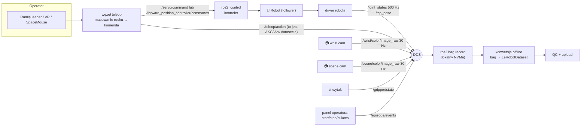
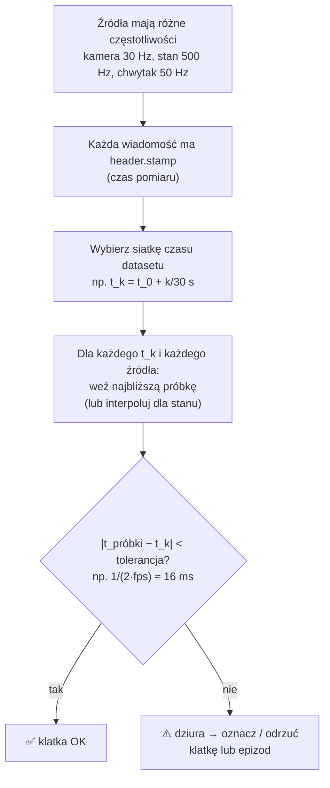

# R7 ROS 2 w labie zbierania danych

> [!skrot] W 30 sekund
> - Typowe stanowisko: **sterownik robota** (np. `ur_robot_driver`, `franka_ros2`) publikuje `/joint_states`; **sterowniki kamer** (`realsense2_camera`, `usb_cam`) publikują obrazy; **węzeł teleop** zamienia ruch operatora (ramię leader, VR, SpaceMouse) na komendy; **recorder** zapisuje wszystko.
> - **rosbag2** nagrywa topiki do pliku: od **Iron/Jazzy domyślnie MCAP** (Humble: SQLite3). `ros2 bag record`, `ros2 bag info`, `ros2 bag play`.
> - Bag to **surowy log zdarzeń** z różnymi częstotliwościami (kamera 30 Hz, stany 500 Hz). Dataset do treningu (np. **LeRobotDataset**) to **równa siatka czasu** (np. 30 FPS), gdzie każda klatka ma obraz + stan + akcję. Przejście bag → dataset = **synchronizacja i resampling** po `header.stamp`.
> - Najczęstsze problemy: zgubione klatki (dysk, USB, sieć), przesunięcie czasowe kamera–stan, złe QoS w recorderze, brak metadanych, za duże pliki.

> [!intuicja] Po ludzku
> Bag to jak **nagranie z kilku dyktafonów i kamer**, które chodziły z różną prędkością: jedna kamera robi 30 zdjęć na sekundę, czujnik robota mówi 500 razy na sekundę. Do treningu potrzebujesz **jednego filmu z napisami**: co 1/30 s — zdjęcie z każdej kamery + „gdzie była ręka” + „co kazał operator”. Konwersja to montaż: dla każdej klatki filmu bierzesz najbliższe w czasie dane z każdego źródła. Jeśli zegary dyktafonów się rozjechały, montaż wyjdzie krzywo — a model nauczy się bzdur.

## Architektura stanowiska teleop w ROS 2



> [!wazne] Co jest obserwacją, a co akcją — musisz to umieć powiedzieć
> - **Obserwacja (state):** to, co robot **faktycznie** robi — `/joint_states` followera, obrazy.
> - **Akcja:** to, co operator **kazał** — pozycja leadera / komenda teleop w tej samej chwili. Zwykle akcja w chwili $t$ ≈ stan w chwili $t+\Delta$ (robot dogania komendę).
> - Nagrywasz **oba** — inaczej nie da się odtworzyć akcji. Szczegóły: [[02 Robot learning — imitation learning i VLA]].

## rosbag2 — komendy, które trzeba umieć

```bash
# nagraj wybrane topiki do katalogu z nazwą epizodu
ros2 bag record -o ep_0042 /joint_states /teleop/action \
  /wrist/color/image_raw/compressed /scene/color/image_raw/compressed /episode/events

ros2 bag record -a                                # wszystko (uwaga na rozmiar!)
ros2 bag record -e "/wrist/.*|/joint_states"      # regex (Jazzy: -e/--regex)
ros2 bag record -s mcap --max-bag-size 4000000000 -o ep_0042 ...   # podział co ~4 GB
ros2 bag record --storage-preset-profile zstd_fast ...              # kompresja MCAP (zstd)

ros2 bag info ep_0042            # czas trwania, liczba wiadomości per topik, typy
ros2 bag play ep_0042 --clock -r 0.5          # odtwórz w połowie prędkości, publikuj /clock
ros2 bag play ep_0042 --topics /joint_states  # tylko wybrane
ros2 bag convert ...                           # konwersja formatu/podział
```

Przykład `ros2 bag info` — na co patrzysz:
```text
Duration:          32.4s
Messages:          21360
Topic: /joint_states            | Type: sensor_msgs/msg/JointState      | Count: 16200 | ...   ← 500 Hz × 32.4 s ✅
Topic: /wrist/color/image_raw/compressed | Type: sensor_msgs/msg/CompressedImage | Count: 958 | ← 30 × 32.4 = 972 → brak 14 klatek ⚠️
```
**Szybki QC:** `Count / Duration` ≈ oczekiwana częstotliwość? Każdy brak = coś do zgłoszenia.

| Format | Zalety | Wady |
|---|---|---|
| **MCAP** (domyślny od Iron/Jazzy) | Szybki zapis, kompresja chunków (zstd/lz4), indeks, czytelny w **Foxglove** | — |
| **SQLite3** (domyślny w Humble) | Prosty, zapytania SQL | Wolniejszy przy dużych obrazach |

> [!przyda] QoS w recorderze
> `ros2 bag record` dopasowuje się do QoS publisherów, ale gdy publishery mają różne QoS albo startują później, możesz podać `--qos-profile-overrides-path overrides.yaml`. Klasyka: brak `/tf_static` w bagu, bo recorder nie miał `TRANSIENT_LOCAL` — w nowszych wersjach jest to obsługiwane automatycznie, ale **sprawdzaj `ros2 bag info`**.

## Synchronizacja — najważniejszy techniczny temat



| Problem | Skąd | Jak wykryć | Jak naprawić |
|---|---|---|---|
| **Stały offset** kamera vs stan (np. obraz „spóźniony” o 40 ms) | Stamp = czas publikacji, nie ekspozycji; bufor USB | Nagraj szybki ruch, porównaj klatkę z kątem stawu; `ros2 topic delay` | Używaj stampów sprzętowych kamery (RealSense: global time), skoryguj offset |
| **Dryf** zegarów między komputerami | Brak NTP/PTP | `chronyc tracking`, porównaj stampy tego samego zdarzenia | chrony / PTP; nagrywaj na jednym PC |
| **Zgubione klatki** | Dysk za wolny, USB 2.0, przeciążony CPU, Wi-Fi | `ros2 topic hz`, liczba wiadomości w `bag info` | NVMe, USB 3 na osobnym kontrolerze, kompresja w sterowniku, nagrywanie lokalne |
| **Różna liczba stawów** w wiadomościach | Kilka publisherów na `/joint_states` | `ros2 topic info /joint_states` → Publisher count | Filtruj po nazwach stawów |
| **Skoki czasu** | Zmiana zegara systemowego w trakcie | Ujemne `dt` w stampach | Nie zmieniaj czasu w trakcie; chrony „slew”, nie „step” |

### Interpolacja czy najbliższa próbka?
- **Stan robota (liczby)** — można **interpolować liniowo** między dwiema próbkami 500 Hz (dla kątów uważaj na przejście ±π).
- **Obrazy** — **nie da się** interpolować → bierzesz najbliższą klatkę. Dlatego siatkę czasu datasetu zwykle **opiera się na klatkach głównej kamery**.
- **Akcje dyskretne** (chwytak otwórz/zamknij) — „ostatnia znana wartość” (*zero-order hold*), nie interpolacja.

## Konwersja bag → LeRobotDataset (szkic)

```python
# szkic — idea, nie gotowiec
from rosbags.highlevel import AnyReader          # pip install rosbags (czyta bagi bez ROS-a)
from pathlib import Path
import numpy as np, cv2
from lerobot.datasets import LeRobotDataset

FPS = 30
JOINTS = ["shoulder_pan", "shoulder_lift", "elbow_flex", "wrist_flex", "wrist_roll", "gripper"]

ds = LeRobotDataset.create(
    repo_id="lab/pick_cup", fps=FPS, robot_type="so101",
    features={
        "observation.state": {"dtype": "float32", "shape": (6,), "names": JOINTS},
        "action":            {"dtype": "float32", "shape": (6,), "names": JOINTS},
        "observation.images.wrist": {"dtype": "video", "shape": (480, 640, 3), "names": ["height", "width", "channels"]},
    },
)

def stamp(msg): return msg.header.stamp.sec + msg.header.stamp.nanosec * 1e-9

with AnyReader([Path("ep_0042")]) as r:
    state, action, frames = [], [], []
    for conn, t, raw in r.messages():
        msg = r.deserialize(raw, conn.msgtype)
        if conn.topic == "/joint_states":
            idx = [list(msg.name).index(j) for j in JOINTS]          # po NAZWACH
            state.append((stamp(msg), np.asarray(msg.position)[idx]))
        elif conn.topic == "/teleop/action":                       # zakładamy też typ JointState
            idx = [list(msg.name).index(j) for j in JOINTS]
            action.append((stamp(msg), np.asarray(msg.position)[idx]))
        elif conn.topic == "/wrist/color/image_raw/compressed":
            img = cv2.imdecode(np.frombuffer(msg.data, np.uint8), cv2.IMREAD_COLOR)[:, :, ::-1]  # BGR→RGB!
            frames.append((stamp(msg), img))

def nearest(series, t):
    ts = np.array([s for s, _ in series]); i = int(np.argmin(np.abs(ts - t)))
    return series[i][1], abs(ts[i] - t)

for t_img, img in frames:                                  # siatka = klatki kamery
    s, ds_ = nearest(state, t_img); a, da = nearest(action, t_img)
    if max(ds_, da) > 0.5 / FPS:                           # tolerancja ~16 ms
        continue                                           # (lepiej: zaloguj i oceń epizod)
    ds.add_frame({"observation.state": s.astype("float32"), "action": a.astype("float32"),
                  "observation.images.wrist": img, "task": "pick up the cup and put it in the box"})
ds.save_episode()
ds.finalize()
```
Na co zwrócić uwagę (= to, o co dopyta rekruter): **nazwy stawów zamiast indeksów**, **BGR vs RGB** (OpenCV dekoduje BGR!), **tolerancja czasu**, **jednostki** (radiany vs stopnie — LeRobot dla SO-101 używa stopni/zakresu znormalizowanego, ROS radianów), **opis zadania** (`task`), `finalize()` na końcu. Więcej: [[L2 LeRobotDataset — format od środka]].

## Scenariusze awarii — „co robisz, gdy…”

| Objaw w trakcie sesji | Pierwsze 3 kroki |
|---|---|
| W podglądzie zacina się kamera nadgarstkowa | `ros2 topic hz /wrist/...`; `dmesg -w` (rozłączenia USB?); kabel w prowadnicy — zgięcia przy nadgarstku; `lsusb -t` (czy USB 3, 5000M) |
| Recorder zgłasza „dropped messages” | `df -h` (miejsce), `iostat -x 1` (dysk 100%?), `htop` (CPU); nagrywaj skompresowane obrazy; mniej topików |
| Robot nie reaguje na teleop, ale `/joint_states` płynie | `ros2 control list_controllers` (aktywny właściwy kontroler?); pendant: tryb remote / protective stop; `ros2 topic echo` komend teleop |
| Po restarcie stanowiska dane wyglądają inaczej | `ros2 param dump` kamer vs zapisane; ekspozycja auto vs manual; kalibracja kamery/robot nie zmieniona? |
| Epizody mają różną długość, choć zadanie to samo | Operator czeka przed/po; brak sygnału start/stop; UI epizodów — popraw protokół |
| `ros2 topic list` pusty na laptopie operatora | Domain ID, sieć, Docker → [[R1 Architektura ROS 2 i DDS — co dzieje się pod spodem]] |

## Narzędzia wizualizacji i debugowania
| Narzędzie | Do czego |
|---|---|
| `rqt_image_view` | Podgląd obrazu z topiku |
| `rqt_graph` | Graf węzłów i topików — kto z kim gada |
| `rqt_plot` / **PlotJuggler** | Wykresy wartości w czasie (np. pozycja chwytaka) — PlotJuggler czyta też bagi |
| **RViz2** | 3D: model robota, TF, chmury punktów, obrazy |
| **Foxglove** | Przeglądanie bagów MCAP w przeglądarce, synchroniczny podgląd kamer i wykresów |
| `ros2 doctor` | Diagnoza środowiska (RMW, sieć, wersje) |
| **Rerun** | Wizualizacja używana też przez LeRobot (`--display_data=true`) |

## Pytania rekrutacyjne
> [!zadanie] Jak nagrasz epizod teleoperacji w ROS 2 i jak sprawdzisz, że jest kompletny?
> > [!odpowiedz]- Odpowiedź
> > `ros2 bag record -o <nazwa_epizodu>` z jawną listą topików: stany stawów, akcje teleop, obrazy (skompresowane), stan chwytaka, zdarzenia epizodu, `/tf_static`, `camera_info`. Potem `ros2 bag info`: czas trwania, liczba wiadomości na topik vs oczekiwana częstotliwość × czas, typy. Szybki podgląd w Foxglove/PlotJuggler: czy obraz pasuje do ruchu, brak dziur.
> > **EN:** *"I'd record an explicit topic list with ros2 bag record, then check ros2 bag info — message counts versus expected rate times duration — and spot-check it in Foxglove."*

> [!zadanie] Kamera 30 Hz, stany 500 Hz. Jak zrobisz z tego dataset 30 FPS?
> > [!odpowiedz]- Odpowiedź
> > Biorę siatkę czasu z klatek głównej kamery; dla każdej klatki szukam najbliższej w czasie (po `header.stamp`) próbki stanu i akcji, ewentualnie interpoluję stan liniowo; dla innych kamer — najbliższa klatka. Odrzucam/oznaczam klatki, gdzie różnica przekracza tolerancję (np. pół okresu, ~16 ms). Warunek: dobre stampy i zsynchronizowane zegary.

> [!zadanie] Model po treningu reaguje „z opóźnieniem”. Co mogło pójść nie tak w danych?
> > [!odpowiedz]- Odpowiedź
> > Systematyczny offset czasu między obrazem a stanem/akcją (stamp publikacji zamiast ekspozycji, opóźnienie USB, niesynchronizowane zegary dwóch komputerów). Sprawdzam na nagraniu szybkiego ruchu, czy obraz i kąt stawu się zgadzają; koryguję offset lub używam stampów sprzętowych.

> [!zadanie] Gdzie fizycznie nagrywać bag z trzech kamer?
> > [!odpowiedz]- Odpowiedź
> > Na komputerze, do którego kamery są podłączone, na szybki lokalny dysk (NVMe), żeby nie przepychać ~0,5–1 Gbit/s surowego obrazu przez sieć; kompresja (JPEG lub kodek wideo) w sterowniku albo w osobnym wątku; upload na serwer po sesji.

> [!zadanie] Jakie metadane zapiszesz obok bagu?
> > [!odpowiedz]- Odpowiedź
> > ID epizodu, zadanie (tekst polecenia), operator, sukces/porażka, data, stanowisko i robot (numer seryjny), wersja oprogramowania/commit, parametry kamer (`ros2 param dump`), wersja kalibracji kamer i hand-eye, uwagi (np. „kubek się przewrócił”). Bez tego dane trudno filtrować i odtworzyć.

## Fiszki #fiszki/rozmowa-gd/ros-dokladnie
Domyślny format bagów w Humble vs Jazzy?::Humble: SQLite3; od Iron/Jazzy: MCAP.
Szybki QC bagu?::ros2 bag info — liczba wiadomości / czas trwania ≈ oczekiwana częstotliwość?
Odtwarzanie bagu z czasem nagrania?::ros2 bag play bag --clock + use_sim_time:=true w węzłach.
Bag vs dataset do treningu?::Bag — surowe zdarzenia z różnymi częstotliwościami; dataset — równa siatka czasu, każda klatka ma obraz+stan+akcję.
Na czym opiera się siatkę czasu przy konwersji?::Zwykle na klatkach głównej kamery (obrazów nie da się interpolować).
Interpolacja stanów vs akcje chwytaka?::Stany — liniowo; dyskretne akcje — zero-order hold (ostatnia wartość).
Typowa tolerancja dopasowania czasu?::Ok. pół okresu klatki (np. ~16 ms przy 30 FPS).
Pułapka OpenCV przy dekodowaniu obrazu?::cv2 daje BGR — trzeba zamienić na RGB.
Biblioteka do czytania bagów bez ROS?::rosbags (Python), ewentualnie mcap.
Narzędzie do przeglądania bagów MCAP?::Foxglove (oraz PlotJuggler do wykresów).
Co jest akcją w teleop leader–follower?::Pozycja/komenda leadera (operatora) — nie stan followera.

## Moje notatki
> [!ja] Tu piszesz ty — Albert tej sekcji nie rusza.
