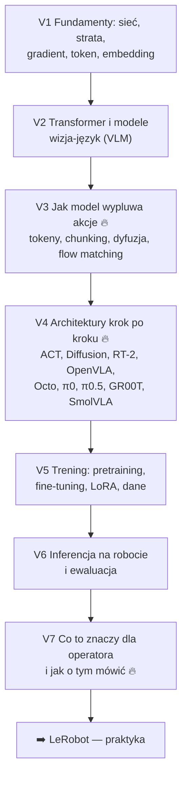

# 🧠 VLA — dokładnie (dział pogłębiony)

> [!skrot] Po co ten dział
> - [[02 Robot learning — imitation learning i VLA]] daje **przegląd**. Tu rozbieramy VLA **na części**: od tego, czym jest sieć neuronowa, przez transformer i model wizja-język, po to, jak liczby z modelu stają się ruchem ramienia 50 razy na sekundę.
> - Zero założonej wiedzy z ML. Każde pojęcie jest wyjaśnione „po ludzku”, zanim pojawi się wzór.
> - Ostatnia notatka (V7) przekłada wszystko na **twoją pracę**: co z tego wynika dla operatora teleoperacji i jak o tym mówić na rozmowie.

## Mapa

| # | Notatka | Najważniejsze pytanie |
|---|---|---|
| V1 | [[V1 Fundamenty — od sieci neuronowej do polityki]] | Czym jest „wytrenowany model” i jak się uczy? |
| V2 | [[V2 Transformer i modele wizja-język]] | Jak model „widzi” obraz i „rozumie” polecenie? |
| V3 | [[V3 Reprezentacja akcji — tokeny, chunking, dyfuzja, flow matching]] | Jak z modelu językowego wyjść do ruchu ramienia? |
| V4 | [[V4 Architektury VLA i polityk krok po kroku]] | Czym różnią się ACT, π0, OpenVLA…? |
| V5 | [[V5 Trening — pretraining, fine-tuning i dane]] | Jak dotrenować VLA na danych z labu? |
| V6 | [[V6 Inferencja na robocie i ewaluacja]] | Jak to działa w pętli w czasie rzeczywistym i jak mierzyć sukces? |
| V7 | [[V7 VLA z perspektywy operatora — co z tego wynika]] | Co ma z tym wspólnego moja praca w labie? |

Powiązane: [[R0 ROS 2 — mapa działu]] · [[L0 LeRobot — mapa działu]] · [[03 Teleoperacja i zbieranie datasetów]] · [[00 Rozmowa GD — Start]].

## Minimalna ścieżka (jeśli masz mało czasu)
**V3 → V4 (tabela + ACT + π0) → V7.** To odpowiada na 80% pytań o VLA, jakie padną na rozmowie stażowej.
