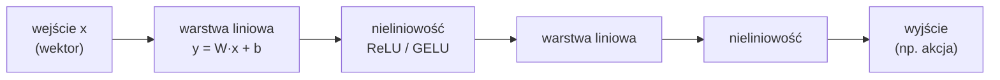
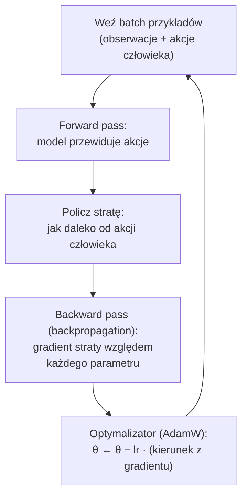
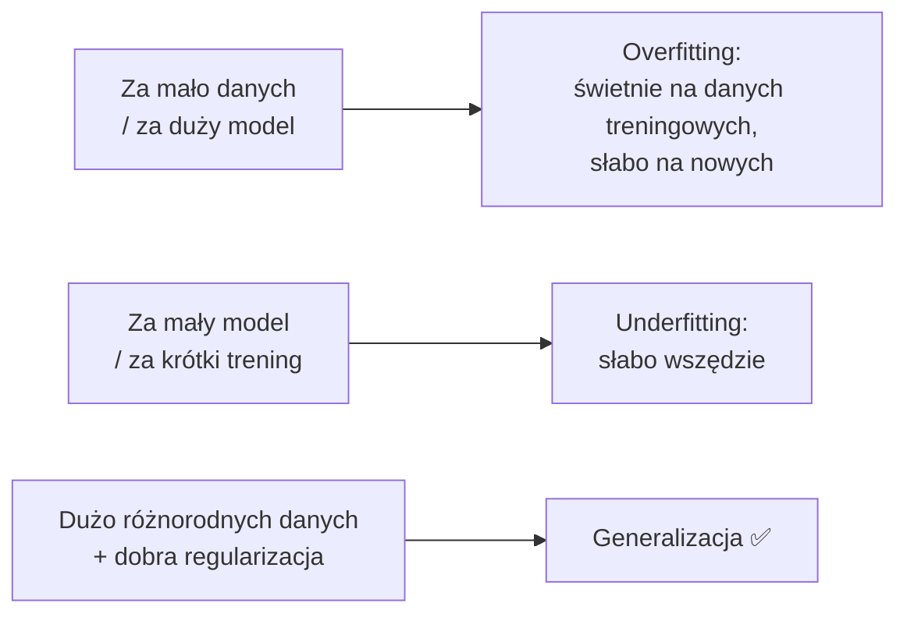

# V1 Fundamenty — od sieci neuronowej do polityki

> [!skrot] W 30 sekund
> - **Sieć neuronowa** = funkcja z milionami/miliardami **parametrów** (liczb), która zamienia wejście (np. obraz jako tablica liczb) na wyjście (np. 7 liczb: ruch stawów). „Trening” = automatyczne dobieranie tych liczb.
> - **Funkcja straty (loss)** mierzy, jak bardzo wyjście modelu różni się od poprawnej odpowiedzi (akcji człowieka). **Gradient** mówi, w którą stronę zmienić każdy parametr, żeby strata zmalała. **Spadek gradientu** robi małe kroki w tę stronę, miliony razy.
> - **Polityka** $\pi_\theta(a \mid o)$ to taka sieć: obserwacja $o$ → akcja $a$, z parametrami $\theta$. Behavior cloning = trening polityki tak, by naśladowała demonstracje.
> - **Token** = kawałek wejścia (słowo/fragment słowa, łatka obrazu, krok akcji). **Embedding** = wektor liczb reprezentujący token. Transformery działają na sekwencjach embeddingów.

> [!intuicja] Po ludzku
> Wyobraź sobie mikser z milionem pokręteł. Wrzucasz zdjęcie stołu z kubkiem, a z drugiej strony wypada „ruch ręki”. Na początku pokrętła są ustawione losowo i wypada bzdura. Pokazujesz mikserowi, co zrobił człowiek, i mierzysz „o ile się pomylił” (strata). Matematyka (gradient) mówi ci, **w którą stronę kręcić każdym pokrętłem**, żeby pomyłka była trochę mniejsza. Powtarzasz to na tysiącach przykładów. Po treningu mikser dla nowego zdjęcia daje sensowny ruch — to jest **wytrenowana polityka**.

## Dane jako liczby

| Co | Jak wygląda dla komputera | Przykładowy kształt |
|---|---|---|
| Obraz RGB | Tablica jasności pikseli 0–255 dla 3 kanałów | `[3, 224, 224]` (kanały, wysokość, szerokość) |
| Batch obrazów | Kilka obrazów naraz | `[32, 3, 224, 224]` |
| Stan robota | Wektor kątów stawów + chwytak | `[7]` (np. 6 stawów + chwytak) |
| Akcja | Wektor docelowych pozycji / delt | `[7]` |
| Chunk akcji | Sekwencja akcji w przyszłość | `[50, 7]` |
| Polecenie | Ciąg tokenów (liczb całkowitych — numerów w słowniku) | `[12]` |

**Tensor** = wielowymiarowa tablica liczb (wektor → macierz → tensor). PyTorch operuje na tensorach, najlepiej na GPU.

## Neuron, warstwa, sieć

- **Warstwa liniowa**: $y = Wx + b$. $W$ (macierz wag) i $b$ (bias) to parametry.
- **Nieliniowość** (ReLU: $\max(0, x)$; GELU — gładsza wersja): bez niej wiele warstw liniowych zwinęłoby się w jedną. Dzięki niej sieć może modelować dowolnie skomplikowane zależności.
- **MLP** (*multi-layer perceptron*) = kilka takich warstw. **CNN** = warstwy splotowe dla obrazów (filtr przesuwany po obrazie, wykrywa krawędzie → kształty → obiekty; np. **ResNet**). **Transformer** = warstwy uwagi (V2).
- „Model 7B” = **7 miliardów parametrów**. W formacie bf16 (2 bajty na parametr) to ~14 GB samych wag.

## Jak sieć się uczy — pętla treningowa

| Pojęcie | Znaczenie | Typowe wartości |
|---|---|---|
| **Loss (strata)** | Liczba „jak bardzo źle” | L2 (MSE): $\lVert \hat a - a \rVert^2$; L1: $\lvert \hat a - a \rvert$ (ACT używa L1) |
| **Gradient** | Wektor „w którą stronę rośnie strata” — idziemy w przeciwną | — |
| **Learning rate (lr)** | Wielkość kroku | 1e-4 – 1e-5 (fine-tuning dużych modeli: mniejszy) |
| **Batch size** | Ile przykładów naraz | 8–256 |
| **Step / iteracja** | Jedna aktualizacja parametrów | trening ACT: ~100 tys. kroków |
| **Epoka** | Jedno przejście przez cały dataset | — |
| **AdamW** | Najpopularniejszy optymalizator | — |
| **Weight decay** | Kara za duże wagi — przeciw przeuczeniu | 1e-4 |

## Uogólnianie i przeuczenie

- **Train / validation split**: część danych odkładasz i sprawdzasz na niej, czy model nie „wkuł na pamięć”.
- ⚠️ W robotyce **dzielisz po epizodach, nie po klatkach**. Sąsiednie klatki są prawie identyczne — gdy trafią do treningu i walidacji, walidacja kłamie (*data leakage*).
- ⚠️ Niska strata walidacyjna **nie gwarantuje** sukcesu na robocie (compounding errors — patrz V6). Ostateczny test to robot.

## Normalizacja — drobiazg, który psuje wszystko
Sieci lubią liczby w okolicach 0 o rozrzucie ~1. Kąt stawu w radianach (±3), szerokość chwytaka w metrach (0–0,08), siła w N (0–100) — zupełnie inne skale. Dlatego przed treningiem:
$$x_{norm} = \frac{x - \mu}{\sigma} \quad \text{albo} \quad x_{norm} = 2\cdot\frac{x - x_{min}}{x_{max} - x_{min}} - 1$$
Statystyki ($\mu, \sigma, min, max$) liczy się **z datasetu** i zapisuje razem z modelem (LeRobot: `meta/stats.json`). Na robocie: wyjście modelu trzeba **odnormalizować**. Zapomnisz → robot dostaje komendy w złej skali. (Ważne: jeden ekstremalny błędny odczyt w danych psuje min/max → stąd w π0/OpenVLA używa się kwantyli 1%/99%.)

## Polityka — wszystko razem
$$\pi_\theta : \underbrace{(\text{obrazy}, \text{stan}, \text{polecenie})}_{o_t} \;\longrightarrow\; \underbrace{a_t \;\text{lub}\; (a_t, a_{t+1}, \dots, a_{t+H-1})}_{\text{akcja lub chunk akcji}}$$
**Behavior cloning:** minimalizuj stratę między akcją modelu a akcją z demonstracji:
$$\mathcal{L}(\theta) = \mathbb{E}_{(o,a) \sim \mathcal{D}} \big[\, \lVert \pi_\theta(o) - a \rVert \,\big]$$
To jest **uczenie nadzorowane** — dokładnie jak klasyfikacja zdjęć kotów, tylko etykietą jest ruch.

## Tokeny i embeddingi — przygotowanie do V2

| Pojęcie | Po ludzku | Przykład |
|---|---|---|
| **Tokenizer** | Kroi tekst na kawałki i zamienia na numery ze słownika | „pick up the cup” → np. `[5839, 709, 279, 10747]` (numery zmyślone dla przykładu) |
| **Słownik (vocabulary)** | Lista wszystkich tokenów modelu | 32 tys. (Llama 2), 256 tys. (Gemma) |
| **Embedding** | Każdy numer tokenu → wektor np. 2048 liczb (wyuczony) | „cup” i „mug” mają podobne wektory |
| **Token obrazu** | Łatka obrazu 14×14 lub 16×16 px zamieniona na wektor | obraz 224×224 / łatki 16×16 → 196 tokenów |
| **Token akcji** | Akcja zamieniona na tokeny (RT-2) albo na wektor (π0) | V3 |

> [!wazne] Dlaczego to ważne
> Gdy wszystko — tekst, obraz, stan, akcja — zamieni się w **ciąg wektorów**, jeden **transformer** może to przetwarzać razem. To jest cały trik VLA.

## Typowe błędy
> [!blad] „Model uczy się reguł”
> Nie — dopasowuje funkcję do danych. Nie wie, „dlaczego” chwyta kubek od góry; robi tak, bo tak było w demonstracjach.

> [!blad] „Mniejsza strata = lepszy robot”
> Niekoniecznie. Strata mierzy błąd jednego kroku na danych z demonstracji; robot w pętli trafia w nowe stany. Liczy się success rate na robocie.

## Pytania rekrutacyjne
> [!zadanie] Wytłumacz w prostych słowach, jak trenuje się politykę z demonstracji.
> > [!odpowiedz]- Odpowiedź
> > Mamy pary: co robot widział i co zrobił operator. Model dostaje obserwację, przewiduje akcję, liczymy różnicę względem akcji operatora (strata), gradientem korygujemy parametry, żeby różnica malała. Powtarzamy na wielu batchach. To uczenie nadzorowane — behavior cloning.
> > **EN:** *"We collect observation–action pairs from teleoperation. The network predicts an action, we compute a loss against the human action and update the weights with gradient descent. It's supervised learning — behavior cloning."*

> [!zadanie] Dlaczego dzieli się dane na train/val po epizodach, a nie losowo po klatkach?
> > [!odpowiedz]- Odpowiedź
> > Sąsiednie klatki jednego epizodu są niemal identyczne. Losowy podział klatek wrzuca prawie te same dane do obu zbiorów — walidacja zawyża wyniki (wyciek danych). Podział po epizodach sprawdza generalizację na nowe wykonania.

> [!zadanie] Po co normalizacja stanów i akcji?
> > [!odpowiedz]- Odpowiedź
> > Różne wymiary mają różne skale (radiany, metry, niutony); sieć uczy się stabilniej, gdy wszystko ma podobny zakres. Statystyki z datasetu zapisuje się z modelem, a na robocie wyjście trzeba odnormalizować tymi samymi statystykami.

> [!zadanie] Ile pamięci GPU zajmą same wagi modelu 3B w bf16?
> > [!odpowiedz]- Odpowiedź
> > 3·10⁹ × 2 B = **~6 GB**. Do treningu potrzeba wielokrotnie więcej (gradienty, stany optymalizatora AdamW — razem ~16 B/parametr przy mieszanej precyzji, plus aktywacje), dlatego stosuje się LoRA, zamrażanie części modelu itp.

## Fiszki #fiszki/rozmowa-gd/vla-dokladnie
Co to jest funkcja straty?::Liczba mierząca, jak bardzo wyjście modelu różni się od poprawnej odpowiedzi (np. akcji człowieka).
Co robi gradient descent?::Zmienia parametry małymi krokami w kierunku, w którym strata maleje.
Co to jest learning rate?::Wielkość kroku aktualizacji parametrów.
Forward vs backward pass?::Forward — liczenie predykcji; backward — liczenie gradientów (backpropagation).
Dlaczego nieliniowości w sieci?::Bez nich wiele warstw liniowych sprowadza się do jednej — sieć nie modelowałaby złożonych zależności.
Overfitting?::Model świetny na danych treningowych, słaby na nowych.
Jak dzielić dane robotyczne na train/val?::Po epizodach, nie po klatkach (wyciek danych).
Co to jest token?::Kawałek wejścia (fragment słowa, łatka obrazu, krok akcji) reprezentowany numerem/wektorem.
Co to jest embedding?::Wyuczony wektor liczb reprezentujący token.
Ile tokenów daje obraz 224×224 przy łatkach 16×16?::14 × 14 = 196.
Ile GB zajmują wagi modelu 7B w bf16?::~14 GB.
Po co zapisuje się statystyki normalizacji z modelem?::Żeby na robocie znormalizować wejścia i odnormalizować wyjścia tak samo jak w treningu.
Czy niska strata = wysoki success rate?::Nie zawsze — compounding errors w pętli; liczy się test na robocie.

## Moje notatki
> [!ja] Tu piszesz ty — Albert tej sekcji nie rusza.
