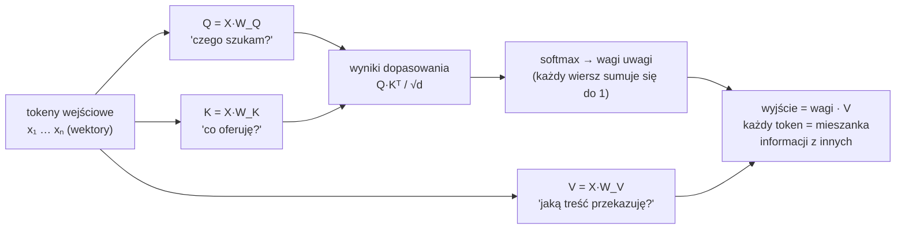
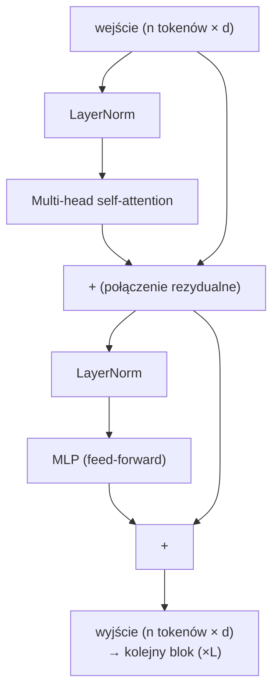
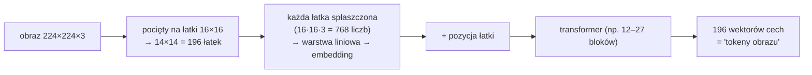
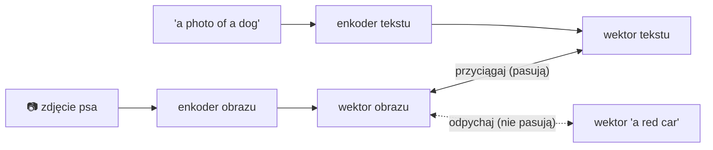
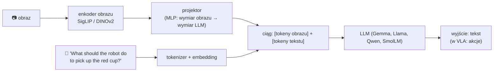

# V2 Transformer i modele wizja-język

> [!skrot] W 30 sekund
> - **Transformer** (2017, „Attention Is All You Need”) przetwarza **ciąg tokenów**. Serce: **self-attention** — każdy token „pyta” wszystkie inne, które są dla niego ważne, i miesza ich informację. Wzór: $\text{softmax}\!\left(\frac{QK^\top}{\sqrt{d}}\right)V$.
> - **ViT** (Vision Transformer): obraz kroimy na łatki 16×16 (lub 14×14), każda łatka = token. **CLIP / SigLIP** uczą enkoder obrazu i tekstu tak, by pasujące pary (zdjęcie + podpis) miały podobne wektory → enkoder obrazu „rozumie” semantykę.
> - **LLM** (np. Llama, Gemma) to transformer przewidujący **następny token** tekstu, wytrenowany na ogromnych ilościach tekstu.
> - **VLM** (*vision-language model*, np. **PaliGemma** = SigLIP + Gemma, **LLaVA**, **Prismatic**) = enkoder obrazu → **projektor** (mała sieć dopasowująca wymiary) → LLM. Obraz staje się „słowami”, które LLM czyta razem z poleceniem.
> - **VLA** = VLM + sposób na wyprowadzenie **akcji** (V3). Wiedza o świecie z internetu + umiejętności z danych robota.

> [!intuicja] Po ludzku
> **Uwaga (attention)** to jak praca w grupie: każde słowo w zdaniu „pick up the **red** cup” rozgląda się po innych słowach i zbiera to, co dla niego ważne. Słowo „cup” mocno patrzy na „red” (jaki kubek?) i „pick” (co z nim zrobić?). W VLA tokeny obrazu też biorą udział w tej rozmowie: token tekstu „red cup” patrzy na łatki obrazu, gdzie jest coś czerwonego i okrągłego. Tak model **łączy słowa z miejscami na obrazie** — bez żadnego ręcznie napisanego detektora.

## Self-attention krok po kroku

$$\text{Attention}(Q,K,V) = \text{softmax}\!\left(\frac{QK^\top}{\sqrt{d_k}}\right)V$$

| Element | Po ludzku |
|---|---|
| **Query (Q)** | Pytanie tokenu: „czego potrzebuję?” |
| **Key (K)** | Etykieta tokenu: „to mam” |
| **Value (V)** | Treść tokenu, którą przekaże, jeśli ktoś na niego patrzy |
| $QK^\top$ | Jak bardzo każde pytanie pasuje do każdej etykiety (macierz n×n) |
| $/\sqrt{d_k}$ | Skalowanie, żeby softmax nie był zbyt „ostry” |
| **softmax** | Zamienia wyniki na wagi 0–1 sumujące się do 1 |
| **Multi-head** | Kilka „głów” uwagi równolegle — każda patrzy na inny rodzaj zależności |
| **Koszt** | $O(n^2)$ względem liczby tokenów — dlatego liczba tokenów obrazu ma znaczenie dla prędkości |

### Blok transformera

Model to **L takich bloków** jeden na drugim (np. 18 w Gemma 2B, 32 w Llama 2 7B).

| Dodatek | Po co |
|---|---|
| **Kodowanie pozycji** (positional encoding, RoPE) | Attention samo nie wie, który token jest pierwszy — trzeba dodać informację o kolejności/miejscu |
| **Maska przyczynowa (causal mask)** | W LLM token widzi tylko poprzednie — żeby przewidywać następny bez „podglądania” |
| **Maska dwukierunkowa** | W enkoderach (ViT) każdy widzi każdego |
| **Cross-attention** | Tokeny jednego ciągu patrzą na tokeny **innego** (np. akcje na obraz) — ACT, Octo, GR00T |

## Jak model widzi obraz — ViT

- **ResNet** (CNN) to starsza alternatywa — używa go m.in. ACT (ResNet-18) i Diffusion Policy.
- **DINOv2** (Meta) — ViT uczony bez etykiet; dobre cechy **przestrzenne/geometryczne** (gdzie co jest).
- **SigLIP** (Google) — ViT uczony na parach obraz-tekst; dobre cechy **semantyczne** (co to jest).
- OpenVLA łączy **oba** (DINOv2 + SigLIP), bo robot potrzebuje i „co”, i „gdzie”.

## CLIP i SigLIP — jak obraz poznaje słowa

- **CLIP** (OpenAI, 2021): 400 mln par obraz-podpis, strata **kontrastowa** (softmax po całym batchu).
- **SigLIP** (Google, 2023): to samo, ale strata **sigmoidalna** dla każdej pary osobno → prostsze skalowanie. Enkoder w PaliGemma, SmolVLM, OpenVLA, π0.
- Efekt: enkoder obrazu „wie”, że czerwony okrągły kształt z uchem to *cup*, bez danych z robota.

## LLM — przewidywanie następnego tokenu
- Trening: tekst z internetu, zadanie „zgadnij następny token”. Strata: **cross-entropy** (jak bardzo model był zaskoczony prawdziwym tokenem).
- Generowanie: **autoregresyjnie** — token po tokenie, każdy nowy dopisywany do wejścia. Konsekwencja dla robotów: generowanie 7 tokenów akcji = **7 przejść** przez model → wolno (problem RT-2/OpenVLA, V3).

## VLM — sklejamy obraz i tekst

| VLM | Skład | Gdzie w robotyce |
|---|---|---|
| **PaliGemma** (Google, 2024) | SigLIP (~400M) + Gemma 2B ≈ 3B | **π0, π0.5** |
| **Prismatic** (Stanford, 2024) | DINOv2 + SigLIP + Llama 2 7B | **OpenVLA** |
| **PaLI-X / PaLM-E** (Google) | duże, zamknięte | **RT-2** |
| **SmolVLM2** (Hugging Face, 2025) | mały SigLIP + SmolLM2 | **SmolVLA** |
| **Eagle 2** (NVIDIA) | SigLIP + LLM | **GR00T N1** |
| **Qwen2.5-VL / Qwen-VL** | Alibaba | wiele nowych VLA |

## Dlaczego VLM to dobry punkt startowy dla robota

| VLM wnosi | Robot potrzebuje dodatkowo |
|---|---|
| Rozpoznawanie obiektów, kolorów, relacji („na lewo od”) | Precyzyjnej geometrii 3D (mm, nie „mniej więcej tu”) |
| Rozumienie poleceń, synonimów („mug” = „cup”) | Mapowania na **ruchy konkretnego ramienia** (kinematyka, dynamika) |
| Wiedzę zdroworozsądkową („szklanka jest krucha”) | Wysokiej częstotliwości (VLM: ~kilka Hz; ruch: 10–50+ Hz) |
| Generalizację na obiekty z internetu | Danych z robota — tego **nie ma** w internecie |

To ostatnie to **twój** wkład: dane z teleoperacji. Patrz [[V7 VLA z perspektywy operatora — co z tego wynika]].

## Typowe błędy
> [!blad] „Transformer czyta obraz piksel po pikselu”
> Nie — czyta **łatki** (np. 16×16 px) jako tokeny. Liczba tokenów rośnie z rozdzielczością (kwadratowo kosztowo), dlatego obrazy w VLA są zwykle małe (224×224).

> [!blad] „VLM sam z siebie umie sterować robotem”
> Nie. Bez fine-tuningu na danych robotycznych VLM może najwyżej opisać scenę. Akcje trzeba wyuczyć.

## Pytania rekrutacyjne
> [!zadanie] Wytłumacz self-attention prostymi słowami.
> > [!odpowiedz]- Odpowiedź
> > Każdy token tworzy zapytanie, klucz i wartość. Zapytanie tokenu porównujemy z kluczami wszystkich tokenów, softmax daje wagi „jak ważny jest dla mnie każdy inny token”, a wynik to ważona suma ich wartości. Dzięki temu każdy token zbiera kontekst z całego ciągu — np. słowo „cup” łączy się z łatkami obrazu, gdzie jest kubek.
> > **EN:** *"Each token produces a query, key and value. Queries are compared with all keys, softmax turns the scores into weights, and the output is a weighted sum of values — so every token gathers context from the whole sequence."*

> [!zadanie] Jak obraz trafia do transformera?
> > [!odpowiedz]- Odpowiedź
> > Dzielimy go na łatki (np. 16×16 px), każdą spłaszczamy i rzutujemy warstwą liniową na wektor, dodajemy informację o pozycji — to tokeny obrazu (ViT). W VLM wychodzą z enkodera, przechodzą przez projektor i trafiają do LLM obok tokenów tekstu.

> [!zadanie] Czym jest VLM i dlaczego VLA buduje się na VLM?
> > [!odpowiedz]- Odpowiedź
> > Model łączący enkoder obrazu z modelem językowym, trenowany na danych obraz-tekst z internetu. Daje wiedzę semantyczną i rozumienie poleceń, więc VLA lepiej generalizuje na nowe obiekty i sformułowania. Akcji i precyzji ruchu trzeba go nauczyć danymi z robota.

> [!zadanie] Dlaczego OpenVLA używa dwóch enkoderów obrazu?
> > [!odpowiedz]- Odpowiedź
> > SigLIP daje cechy semantyczne (co to za obiekt, zgodność z tekstem), DINOv2 — cechy przestrzenne (gdzie, kształt). Robot potrzebuje obu.

## Fiszki #fiszki/rozmowa-gd/vla-dokladnie
Wzór na attention?::softmax(Q·Kᵀ / √d) · V
Q, K, V po ludzku?::Query — czego szukam; Key — co oferuję; Value — jaką treść przekażę.
Koszt self-attention względem liczby tokenów?::Kwadratowy, O(n²).
Po co maska przyczynowa?::W LLM token widzi tylko poprzednie, żeby przewidywać następny.
Co to jest cross-attention?::Tokeny jednego ciągu patrzą na tokeny innego (np. akcje na obraz).
ViT — jak powstają tokeny obrazu?::Obraz dzielony na łatki (16×16), spłaszczone i zrzutowane liniowo + pozycja.
CLIP vs SigLIP?::Oba uczą obraz-tekst kontrastowo; CLIP — softmax po batchu, SigLIP — sigmoid dla każdej pary.
DINOv2 vs SigLIP w robotyce?::DINOv2 — cechy przestrzenne/geometryczne; SigLIP — semantyczne.
Z czego składa się VLM?::Enkoder obrazu → projektor → LLM.
PaliGemma = ?::SigLIP + Gemma 2B (~3B), baza π0.
Prismatic/OpenVLA = ?::DINOv2 + SigLIP + Llama 2 7B.
Dlaczego autoregresja jest wolna dla akcji?::Każdy token akcji to osobne przejście przez model.
Czego VLM nie wie z internetu?::Jak ruszać konkretnym ramieniem — precyzji i dynamiki uczy się z danych robota.

## Moje notatki
> [!ja] Tu piszesz ty — Albert tej sekcji nie rusza.
