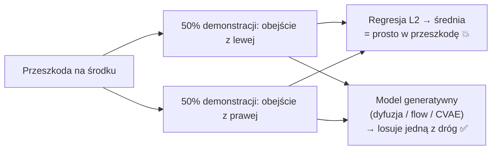
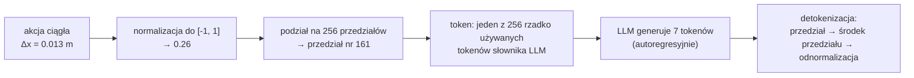
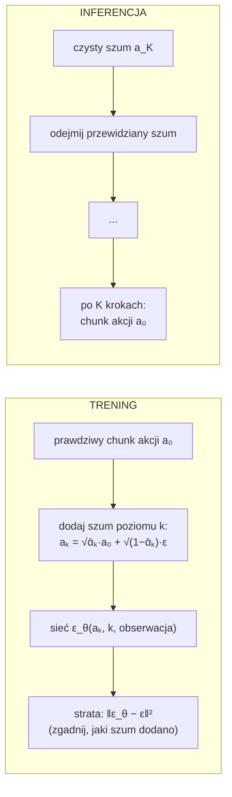
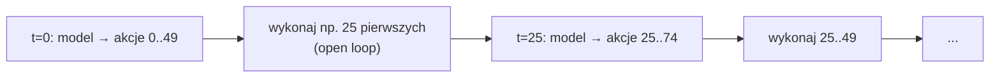

# V3 Reprezentacja akcji — tokeny, chunking, dyfuzja, flow matching

> [!skrot] W 30 sekund
> - **Co jest akcją?** Najczęściej: docelowe **pozycje stawów** (absolutne) albo **przesunięcie końcówki** (delta pozycji xyz + delta rotacji) + **chwytak**. Wybór = *action space*. Musi być **spójny** w całym datasecie.
> - **Cztery sposoby, jak model „wypluwa” akcję:**
>   1. **Regresja** — sieć zwraca liczby wprost (BC, ACT z L1). Proste, ale uśrednia różne strategie.
>   2. **Tokeny dyskretne** — każdy wymiar dzielony na 256 przedziałów, akcja = 7 „słów” (**RT-2, OpenVLA**). Działa z LLM bez zmian, ale wolno i zgrubnie. Ulepszenie: **FAST** (kompresja chunku DCT).
>   3. **Dyfuzja** — zaczynasz od szumu i w ~10–100 krokach „odszumiasz” do akcji (**Diffusion Policy, Octo**). Świetnie modeluje kilka strategii.
>   4. **Flow matching** — jak dyfuzja, ale model uczy się **prostej drogi** od szumu do akcji; ~10 kroków (**π0, SmolVLA, GR00T**).
> - **Action chunking:** zamiast 1 akcji przewiduj **H** kolejnych (np. 50). Gładszy ruch, mniej nawarstwiania błędów, model wołany rzadziej.

> [!intuicja] Po ludzku
> Pomyśl o rysowaniu linii z kropek.
> - **Regresja** to zgadnięcie jednej kropki. Gdy połowa ludzi omija drzewo z lewej, a połowa z prawej, „średnia” kropka trafia w drzewo.
> - **Tokeny** to wybór kropki z siatki 256 kratek — jak pisanie liczb literami. Prosto, ale siatka jest zgrubna, a pisanie po jednej literze zajmuje czas.
> - **Dyfuzja** to rzeźbienie: zaczynasz od bryły szumu i stopniowo usuwasz to, co zbędne, aż wyjdzie cała trajektoria. Rzeźbiarz może wyrzeźbić **albo** obejście z lewej, **albo** z prawej — nigdy „środka”.
> - **Flow matching** to rzeźbienie z instrukcją „idź prosto od bryły do rzeźby” — mniej kroków, ten sam efekt.
> - **Chunking** to planowanie całego zdania zamiast słowa po słowie — mówisz płynniej.

## Krok 1: Co w ogóle jest akcją (action space)

| Przestrzeń | Wektor akcji (przykład 7D) | Plusy | Minusy |
|---|---|---|---|
| **Absolutne pozycje stawów** | $[q_1 \dots q_6, g]$ | Naturalne dla leader–follower (ALOHA, SO-101), bez IK | Zależne od konkretnego robota |
| **Delta stawów** | $[\Delta q_1 \dots \Delta q_6, g]$ | Małe liczby | Błędy się kumulują |
| **Delta końcówki (EE delta)** | $[\Delta x, \Delta y, \Delta z, \Delta r_x, \Delta r_y, \Delta r_z, g]$ | Łatwiej przenieść między robotami; RT-2, OpenVLA (Bridge) | Potrzebny IK/kontroler kartezjański; osobliwości |
| **Absolutna poza końcówki** | $[x, y, z, \text{rot}, g]$ | Intuicyjna | Zależy od układu odniesienia (kalibracja!) |

**Reprezentacja rotacji:** kąty Eulera (proste, ale gimbal lock i skoki ±π), **kwaternion** (4 liczby, $q$ i $-q$ to ta sama rotacja → niejednoznaczność), **axis-angle** (3 liczby), **6D** (dwie pierwsze kolumny macierzy rotacji — ciągła, lubiana w uczeniu). Patrz [[08 Manipulatory — kinematyka]].

**Chwytak:** ciągły (szerokość 0–1) albo binarny (otwórz/zamknij). W modelach z tokenami — często binarny.

> [!wazne] Dla operatora / data engineera
> Action space jest ustalony **przy zbieraniu**. Jeśli połowa danych ma akcje w stawach, a połowa w kartezjanach, albo zmieniono kalibrację w trakcie — dataset jest niespójny. Dlatego wersja konfiguracji i kalibracji trafia do metadanych.

## Krok 2: Normalizacja akcji
Przed treningiem każdy wymiar akcji skaluje się do ~[-1, 1] (statystyki z datasetu). OpenVLA i π0 używają **kwantyli** (1. i 99. percentyl) zamiast min/max — odporność na pojedyncze skrajne wartości (np. skok czujnika). Po predykcji — odwrotne przekształcenie. Patrz [[V1 Fundamenty — od sieci neuronowej do polityki]].

## Sposób A: Regresja (najprostszy)
Ostatnia warstwa sieci zwraca $D$ liczb (albo $H \times D$ dla chunku). Strata L2 lub L1.
- **ACT** używa **L1** (mniej wrażliwa na odstające próbki, ostrzejsze predykcje).
- Problem **multimodalności**:

ACT łagodzi to **CVAE** (zmienna „stylu” z) i chunkingiem; reszta — modele generatywne.

## Sposób B: Akcje jako tokeny (RT-2, OpenVLA)

- **RT-2:** 256 przedziałów na wymiar; akcja = 8 tokenów (flaga końca epizodu + 6 delta pozy + chwytak). Akcje traktowane **jak tekst** — model trenowany wspólnie na danych webowych i robotycznych (*co-fine-tuning*).
- **OpenVLA:** 7 wymiarów × 256 przedziałów; nadpisuje **256 najrzadziej używanych tokenów** słownika Llamy; przedziały wg kwantyli 1–99%.
- ✅ Zero zmian w architekturze LLM — „po prostu kolejne słowa”. Strata = cross-entropy.
- ❌ **Rozdzielczość** — 256 przedziałów na zakres; ❌ **prędkość** — 7 przejść autoregresyjnych na akcję (OpenVLA ~6 Hz na RTX 4090); ❌ brak chunków (pierwotnie).

### FAST — sprytna tokenizacja chunków (Physical Intelligence, 2025)
Problem: chunk 50 kroków × 7 wymiarów z naiwnymi tokenami = 350 tokenów, mocno skorelowanych (sąsiednie kroki prawie identyczne) → model uczy się słabo.
FAST: na każdym wymiarze chunku robi **DCT** (dyskretną transformatę kosinusową — jak w JPEG), kwantyzuje współczynniki, potem kompresuje **BPE**. Gładki ruch = kilka współczynników → **dużo mniej tokenów**. Model **π0-FAST** — autoregresyjny, trenuje się szybciej niż π0 z flow matching, ale inferencja wolniejsza.

## Sposób C: Dyfuzja (Diffusion Policy, Octo)

- **Trening:** bierzesz prawdziwą akcję, psujesz ją szumem o losowej sile, sieć uczy się **przewidywać ten szum** (warunkowana obserwacją).
- **Inferencja:** zaczynasz od szumu i iteracyjnie odszumiasz. DDPM: ~100 kroków, DDIM: ~10 (szybciej).
- **Diffusion Policy (Chi i in., 2023):** horyzont obserwacji 2 klatki, przewiduje 16 kroków, wykonuje 8, potem replanuje (*receding horizon*). Sieć: 1D U-Net (CNN) albo transformer.
- ✅ Doskonale obsługuje **multimodalność**, gładkie trajektorie. ❌ Wiele kroków = wolniej.

## Sposób D: Flow matching (π0, SmolVLA, GR00T N1)

$$a^\tau = \tau \cdot a + (1-\tau)\cdot \varepsilon, \qquad \text{cel sieci: } v_\theta(a^\tau, o) \approx a - \varepsilon$$

- Prosta linia między szumem $\varepsilon$ ($\tau=0$) a prawdziwą akcją $a$ ($\tau=1$). Sieć uczy się **pola prędkości** — „w którą stronę iść z tego miejsca”.
- **Inferencja:** start od szumu, ~**10 kroków** całkowania (Euler): $a \leftarrow a + \frac{1}{10} v_\theta(a, o)$.
- **π0:** chunk **H = 50** akcji, osobny moduł **„action expert”** (~300M parametrów) obok VLM (PaliGemma 3B), który przy każdym kroku całkowania patrzy (attention) na tokeny obrazu i tekstu z VLM. Zadania do **50 Hz**.
- ✅ Mniej kroków niż dyfuzja, ciągłe i precyzyjne akcje, multimodalność. ❌ Trochę bardziej skomplikowana inferencja niż regresja.

## Action chunking i jak wykonywać chunk

| Strategia | Jak | Gdzie |
|---|---|---|
| **Wykonaj cały chunk** | H kroków bez patrzenia | Proste; reaguje wolno na zmiany |
| **Receding horizon** | Przewiduj H, wykonaj $H_a < H$, replanuj | Diffusion Policy (16/8) |
| **Temporal ensembling** | Model wołany **co krok**; dla chwili $t$ masz kilka predykcji z różnych chunków → średnia ważona $w_i = e^{-m \cdot i}$ | **ACT** (k = 100) — gładkie ruchy |
| **Real-Time Chunking (RTC)** | Kolejny chunk liczony **w trakcie** wykonywania obecnego, „dopasowany” do akcji, które i tak się wykonają (inpainting) | Physical Intelligence 2025; LeRobot `--inference.type=rtc` |
| **Async inference** | Inferencja w osobnym wątku/maszynie, kolejka akcji nie pustoszeje | SmolVLA/LeRobot |

**Dlaczego chunking pomaga:**
1. **Mniej decyzji** → mniej okazji do błędu (compounding errors maleją ~H razy).
2. **Pauzy w demonstracjach** — model z pojedynczą akcją „nie wie”, kiedy ruszyć po pauzie; chunk zawiera całą sekwencję.
3. **Wolny model, szybki robot** — VLA liczy 5–10 razy na sekundę, robot dostaje 50 akcji/s.

## Porównanie zbiorcze

| | Regresja | Tokeny (RT-2/OpenVLA) | FAST | Dyfuzja | Flow matching |
|---|---|---|---|---|---|
| Multimodalność | ❌ (ACT: CVAE łagodzi) | ✅ (rozkład po tokenach) | ✅ | ✅✅ | ✅✅ |
| Precyzja | ✅ | ⚠️ 256 przedziałów | ✅ | ✅ | ✅ |
| Prędkość inferencji | ✅✅ 1 przejście | ❌ D przejść | ⚠️ autoregresja | ⚠️ 10–100 kroków | ✅ ~10 lekkich kroków |
| Integracja z LLM | osobna głowica | ✅✅ natywnie | ✅ natywnie | osobna głowica | osobny „expert” |
| Przykłady | BC, ACT | RT-2, OpenVLA | π0-FAST | Diffusion Policy, Octo | π0, π0.5, SmolVLA, GR00T |

## Pytania rekrutacyjne
> [!zadanie] Jak VLA zamienia wyjście modelu językowego na akcje robota?
> > [!odpowiedz]- Odpowiedź
> > Dwie główne drogi. (1) Dyskretyzacja: każdy wymiar akcji dzielony na 256 przedziałów mapowanych na tokeny słownika — LLM generuje akcje jak słowa (RT-2, OpenVLA), ewentualnie z kompresją chunków (FAST). (2) Osobna głowica ciągła: dyfuzja albo flow matching, warunkowana reprezentacją z VLM, generuje chunk ciągłych akcji (Octo, π0, SmolVLA).
> > **EN:** *"Either you discretize each action dimension into bins and treat them as tokens — like RT-2 and OpenVLA — or you attach a continuous action head, diffusion or flow matching, that generates a chunk of actions conditioned on the VLM features, like π0."*

> [!zadanie] Dlaczego zwykła regresja ma problem z demonstracjami, które omijają przeszkodę raz z lewej, raz z prawej?
> > [!odpowiedz]- Odpowiedź
> > Strata L2 jest minimalizowana przez średnią — model przewiduje „środek”, czyli jazdę prosto w przeszkodę. Modele generatywne (dyfuzja, flow matching, CVAE) modelują cały rozkład i losują jedną ze strategii. Praktycznie: spójny protokół zbierania danych zmniejsza ten problem.

> [!zadanie] Co to jest action chunking i temporal ensembling?
> > [!odpowiedz]- Odpowiedź
> > Chunking: model przewiduje sekwencję H przyszłych akcji naraz. Temporal ensembling (ACT): model wywoływany co krok, a akcja w danej chwili to średnia ważona (wykładniczo) predykcji z kilku nakładających się chunków — gładszy ruch.

> [!zadanie] Czym różni się flow matching od dyfuzji?
> > [!odpowiedz]- Odpowiedź
> > Oba generują akcje z szumu. Dyfuzja uczy się przewidywać szum dodany w procesie stopniowego zaszumiania i wymaga wielu kroków odszumiania. Flow matching uczy pola prędkości wzdłuż (zwykle prostej) ścieżki od szumu do danych — wystarcza mniej kroków (π0: ~10), prostszy trening.

> [!zadanie] Dlaczego OpenVLA jest wolny na robocie i jak to poprawiono?
> > [!odpowiedz]- Odpowiedź
> > Generuje akcję token po tokenie (7 przejść 7B modelu) i bez chunków → ~kilka Hz. OpenVLA-OFT (2025) zmienia to na równoległe dekodowanie całych chunków z ciągłymi akcjami i stratą L1 — wielokrotnie szybciej i lepiej. Inne podejścia: FAST, flow matching.

## Fiszki #fiszki/rozmowa-gd/vla-dokladnie
Cztery sposoby generowania akcji?::Regresja, tokeny dyskretne, dyfuzja, flow matching.
Jak RT-2/OpenVLA reprezentują akcje?::Każdy wymiar w 256 przedziałach → tokeny słownika LLM; generowane autoregresyjnie.
Które tokeny nadpisuje OpenVLA?::256 najrzadziej używanych tokenów słownika Llamy.
Co to jest FAST?::Tokenizacja chunków akcji przez DCT + kwantyzację + BPE (Physical Intelligence 2025) — mniej tokenów.
Strata w ACT?::L1 (+ KL dla CVAE).
Co przewiduje sieć w dyfuzji?::Szum dodany do akcji (ε), warunkowana obserwacją.
Diffusion Policy — horyzonty?::Obserwacja 2 klatki, predykcja 16 kroków, wykonanie 8 (receding horizon).
Co przewiduje sieć w flow matching?::Pole prędkości od szumu do akcji (a − ε dla prostej ścieżki).
π0 — długość chunku i kroki całkowania?::H = 50 akcji, ~10 kroków.
Temporal ensembling?::Średnia ważona wykładniczo predykcji tej samej chwili z nakładających się chunków (ACT).
Real-Time Chunking (RTC)?::Liczenie następnego chunku w trakcie wykonywania obecnego, spójnie z akcjami w toku.
Dlaczego chunking zmniejsza compounding errors?::Mniej decyzji modelu na czas zadania i lepsza obsługa pauz.
Reprezentacja rotacji lubiana w uczeniu?::6D (dwie kolumny macierzy rotacji) — ciągła.
Po co kwantyle 1–99% w normalizacji?::Odporność na pojedyncze skrajne wartości.

## Moje notatki
> [!ja] Tu piszesz ty — Albert tej sekcji nie rusza.
