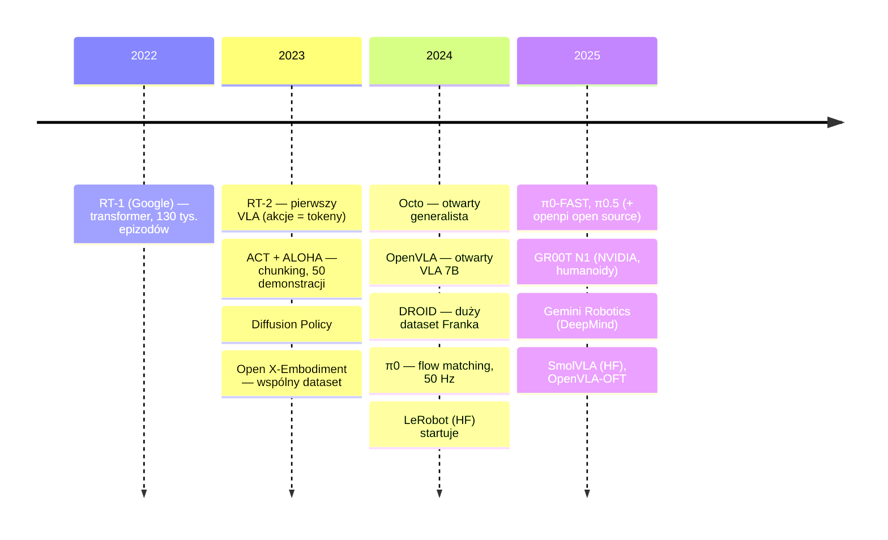
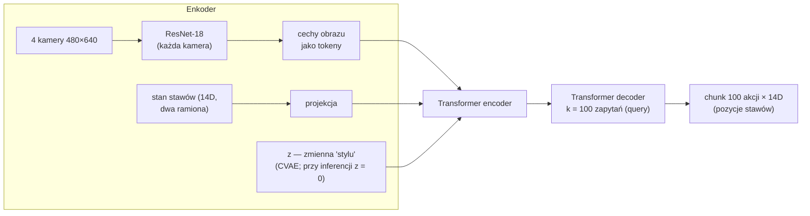
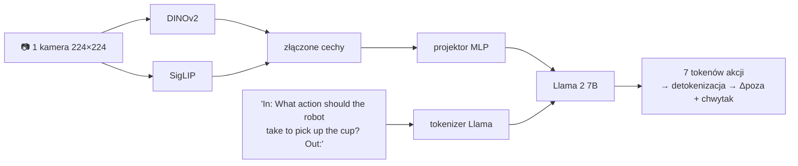
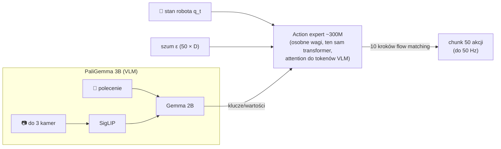

# V4 Architektury VLA i polityk krok po kroku

> [!skrot] W 30 sekund
> - **Małe polityki „od zera”** (trenowane na jednym zadaniu, kilkadziesiąt–kilkaset demonstracji): **ACT** (transformer + CVAE + chunking, 2023), **Diffusion Policy** (dyfuzja, 2023).
> - **Duże modele robotyczne (generalist policies):** **RT-1** (2022), **Octo** (2024, otwarty, dyfuzja).
> - **VLA (na bazie VLM):** **RT-2** (2023, pierwszy, akcje jako tokeny), **OpenVLA** (2024, otwarty 7B), **π0** (2024, flow matching, 50 Hz), **π0.5** (2025, generalizacja na nowe domy), **GR00T N1** (2025, NVIDIA, humanoidy, „System 1/2”), **SmolVLA** (2025, HF, mały 0,45B), **Gemini Robotics** (2025, DeepMind).
> - Wspólny trend: **VLM jako „mózg semantyczny”** + **szybka głowica akcji** (flow matching / dyfuzja) + **chunki akcji** + **pretraining na danych wielu robotów** → fine-tuning na twoim robocie.

> [!intuicja] Po ludzku
> ACT i Diffusion Policy to **specjaliści** — uczysz jednego robota jednej rzeczy na 50 przykładach i robi ją świetnie, ale nic więcej. VLA to **absolwent studiów** (VLM wie dużo o świecie) po **praktykach w wielu fabrykach** (pretraining na danych z wielu robotów). Przychodzi do twojego labu, dostaje kilkadziesiąt pokazów (fine-tuning) i ogarnia zadanie — a do tego rozumie polecenia i nowe przedmioty.

## Oś czasu

## 1. ACT — Action Chunking with Transformers (Zhao i in., Stanford, 2023)

| Cecha | Wartość |
|---|---|
| Rozmiar | ~80M parametrów |
| Dane | ~50 demonstracji na zadanie, ALOHA (dwa ramiona ViperX, leader–follower), 50 Hz |
| Wyjście | Chunk k = 100 absolutnych pozycji stawów |
| Strata | L1 rekonstrukcji + KL (CVAE) |
| Inferencja | Temporal ensembling (model co krok, ważona średnia) |
| Wynik | ~80–90% sukcesu w precyzyjnych zadaniach dwuręcznych (np. założenie baterii, otwarcie kubeczka) |
| Znaczenie | **Udowodnił, że tani sprzęt + dobre dane + chunking = zręczne zadania.** Domyślna polityka w LeRobot |

**CVAE w ACT:** w treningu enkoder patrzy na **prawdziwy chunk akcji** i wyciąga z niego „styl” $z$ (np. szybko/wolno, od której strony). Dekoder uczy się odtwarzać akcje z obserwacji + $z$. W inferencji $z = 0$ (średni styl) → model nie miesza dwóch stylów w bezsensowną średnią tak mocno jak czysta regresja.

## 2. Diffusion Policy (Chi i in., Columbia/TRI, 2023)
- Obserwacja (2 ostatnie klatki + stan) → warunek dla sieci odszumiającej (1D U-Net lub transformer) → chunk 16 akcji, wykonuje 8.
- Przewaga nad BC w zadaniach z multimodalnością (Push-T: popchnij klocek w kształcie T do celu).
- W LeRobot: `--policy.type=diffusion`. Wolniejszy trening niż ACT, często bardziej odporny.

## 3. RT-1 (Google, 2022)
- EfficientNet (obraz, warunkowany tekstem przez FiLM) → TokenLearner (kompresja do kilku tokenów) → transformer → **dyskretne akcje**.
- ~35M parametrów, **~3 Hz**, 130 tys. epizodów, 700+ instrukcji, 13 robotów (Everyday Robots), 17 miesięcy zbierania.
- Lekcja: **skala i różnorodność danych** dają generalizację.

## 4. RT-2 (Google DeepMind, 2023) — pierwszy VLA
- Bierze gotowy VLM (**PaLI-X 55B** lub **PaLM-E 12B**) i dotrenowuje go **jednocześnie** na danych webowych (pytania o obrazy) i robotycznych (RT-1) — *co-fine-tuning*.
- Akcje jako **tokeny tekstowe** (256 przedziałów).
- Efekt: **emergentne umiejętności** — „podnieś przedmiot, który może służyć jako młotek” (wybiera kamień), „przesuń puszkę do Taylor Swift” (zdjęcie). Wiedza z internetu przechodzi na akcje.
- Minus: ogromny, zamknięty, wolny (1–3 Hz, w chmurze).

## 5. Open X-Embodiment i RT-X (2023)
- **Dataset**: > 1 mln trajektorii, **22 typy robotów**, wspólny format (RLDS), 34 laboratoria.
- RT-1-X i RT-2-X trenowane na nim → lepsze niż modele trenowane na danych jednego labu. Lekcja: **dane z innych robotów pomagają** (*positive transfer*).

## 6. Octo (Berkeley i in., 2024)
- Otwarty transformer (27M „Small”, 93M „Base”), trenowany na **800 tys.** trajektorii z Open X.
- **Readout tokens** — specjalne tokeny, które „czytają” z obrazu i zadania, a na nich siedzi **głowica dyfuzyjna** → chunk akcji.
- Polecenie: tekst **albo** obraz celu. Łatwy fine-tuning do nowych sensorów i przestrzeni akcji.

## 7. OpenVLA (Stanford, Berkeley, TRI i in., 2024)

| Cecha | Wartość |
|---|---|
| Rozmiar | 7B (Prismatic VLM) |
| Dane | ~970 tys. epizodów z Open X |
| Akcje | 7D (Δxyz, Δrotacja, chwytak), 256 przedziałów |
| Wynik | Przewyższył RT-2-X (55B) przy 7× mniejszym rozmiarze |
| Fine-tuning | **LoRA** na pojedynczym GPU klasy A100; kwantyzacja 4-bit do inferencji |
| Słabość | Wolny (~6 Hz na RTX 4090), jedna kamera, brak chunków |
| **OpenVLA-OFT** (2025) | Recepta fine-tuningu: równoległe dekodowanie, chunki, ciągłe akcje, L1 → kilkadziesiąt razy szybsza generacja akcji, lepsze wyniki (LIBERO ~97%) |

## 8. π0 (Physical Intelligence, 2024)

| Cecha | Wartość |
|---|---|
| Rozmiar | ~3,3B (VLM 3B + action expert ~300M) |
| Mechanizm | **Flow matching**, chunk H = 50, ~10 kroków całkowania |
| Dane pretrainingu | ~10 tys. godzin własnych danych z **7 konfiguracji robotów** (68 zadań) + Open X |
| Zadania | Składanie prania, sprzątanie stołu, składanie pudełek, pakowanie jajek — długie, zręczne |
| Cross-embodiment | Jeden model na ramiona jedno- i dwuręczne, mobilne; akcje dopełniane zerami do wspólnego max. wymiaru |
| Otwartość | **openpi** (luty 2025): wagi π0, π0-FAST, potem π0.5; dostępne też w LeRobot |
| Recepta | **Pretraining** (różnorodność, recovery) → **post-training** na wysokiej jakości danych konkretnego zadania |

> [!wazne] Lekcja z π0 dla zbierającego dane
> Physical Intelligence podkreśla: pretraining na **różnorodnych, także „brudnych”** danych uczy odporności i wychodzenia z błędów, a post-training na **starannych, spójnych** demonstracjach uczy płynnego, pewnego wykonania. Obie warstwy danych są potrzebne — i obie zbiera ktoś taki jak ty.

## 9. π0.5 (Physical Intelligence, 2025)
- Cel: **open-world generalization** — sprzątanie kuchni i sypialni w **domach, których model nigdy nie widział**.
- **Co-training** na heterogenicznych danych: dane z wielu robotów, dane webowe (opisy obrazów, VQA), **wysokopoziomowe adnotacje słowne** („podnieś talerz”), werbalne instrukcje od ludzi.
- **Hierarchia w jednym modelu:** najpierw generuje **tekst podzadania** („pick up the pillow”), potem akcje dla tego podzadania (flow matching).
- Lekcja: dane z **wielu różnych środowisk** + **opisy słowne** epizodów → generalizacja. Adnotacje językowe zbiera się często przy teleop.

## 10. GR00T N1 (NVIDIA, 2025)
- **Model fundamentowy dla humanoidów** (otwarte wagi), kolejne wersje N1.5, N1.6…
- **System 2** — VLM (Eagle-2) interpretuje scenę i polecenie (wolniej, ~10 Hz).
- **System 1** — **Diffusion Transformer (DiT)** z flow matching generuje akcje silników szybko (rząd 100+ Hz).
- Dane: „piramida” — na dole ogromne ilości wideo ludzi i danych **syntetycznych** (symulacja, generowane wideo), w środku dane symulacyjne robotów, na górze prawdziwe dane z teleoperacji.

## 11. SmolVLA (Hugging Face, 2025)
- **~450M parametrów** — działa na konsumenckim GPU, a nawet CPU/MacBooku.
- VLM: **SmolVLM2** (przycięty — używa tylko części warstw), mało tokenów obrazu; **action expert z flow matching** (naprzemiennie cross- i self-attention).
- Pretraining **wyłącznie na danych społeczności** (setki datasetów LeRobot z ramion SO-100 itp., ~10 mln klatek).
- **Asynchroniczna inferencja** — robot wykonuje chunk, a następny liczy się równolegle.
- Lekcja: **dobrze dobrane, spójne dane** pozwalają małym modelom konkurować z dużymi. Natywny w LeRobot: `--policy.path=lerobot/smolvla_base`.

## 12. Gemini Robotics (Google DeepMind, 2025)
- VLA na bazie Gemini 2.0; plus **Gemini Robotics-ER** (embodied reasoning: wskazywanie punktów, wykrywanie 3D, trajektorie). Zamknięty; wersja on-device. Warto znać nazwę.

## Tabela zbiorcza (naucz się kolumn „Wyjście” i „Lekcja”)

| Model | Rok | Rozmiar | Backbone wizyjny / VLM | Wyjście akcji | Lekcja |
|---|---|---|---|---|---|
| ACT | 2023 | ~80M | ResNet-18 | Regresja L1, chunk 100, CVAE | Chunking + 50 dobrych demo = zręczność |
| Diffusion Policy | 2023 | ~100M | ResNet | Dyfuzja, chunk 16 | Multimodalność |
| RT-1 | 2022 | 35M | EfficientNet | Tokeny | Skala danych |
| RT-2 | 2023 | 12–55B | PaLI-X / PaLM-E | Tokeny | Wiedza z internetu → akcje |
| Octo | 2024 | 27–93M | własny transformer | Dyfuzja | Otwarty generalista |
| OpenVLA | 2024 | 7B | DINOv2+SigLIP+Llama 2 | Tokeny (OFT: ciągłe chunki) | Otwarty VLA, LoRA |
| π0 | 2024 | 3,3B | PaliGemma | Flow matching, chunk 50 | Zręczne, długie zadania; pretrain + post-train |
| π0.5 | 2025 | ~3B+ | PaliGemma | Tekst podzadania + flow matching | Generalizacja na nowe domy |
| GR00T N1 | 2025 | ~2B | Eagle-2 | DiT + flow matching | Humanoidy, dane syntetyczne |
| SmolVLA | 2025 | 0,45B | SmolVLM2 | Flow matching, async | Mały model + dane społeczności |

## Pytania rekrutacyjne
> [!zadanie] Porównaj ACT i π0.
> > [!odpowiedz]- Odpowiedź
> > ACT to mała polityka (~80M, ResNet + transformer z CVAE) trenowana od zera na kilkudziesięciu demonstracjach jednego zadania; zwraca chunk pozycji stawów regresją L1; nie rozumie języka. π0 to VLA (~3B) na bazie PaliGemma, pretrenowany na tysiącach godzin danych z wielu robotów, przyjmuje polecenia tekstowe i generuje chunki akcji flow matchingiem do 50 Hz; dotrenowuje się go na konkretnym zadaniu. ACT — szybko i tanio na jedno zadanie; π0 — generalizacja i wiele zadań.
> > **EN:** *"ACT is a small task-specific policy trained from scratch on ~50 demos; π0 is a pretrained VLA with a flow-matching action expert that follows language instructions and is fine-tuned per task."*

> [!zadanie] Co pokazał RT-2?
> > [!odpowiedz]- Odpowiedź
> > Że można dotrenować duży model wizja-język, by generował akcje robota jako tokeny, i że wiedza z internetu przenosi się na sterowanie — model wykonuje polecenia z pojęciami, których nie było w danych robotycznych (semantyczna generalizacja).

> [!zadanie] Czym jest Open X-Embodiment i po co?
> > [!odpowiedz]- Odpowiedź
> > Wspólny dataset ponad miliona trajektorii z 22 typów robotów z ponad 30 labów, w ujednoliconym formacie. Pokazał, że trening na danych z wielu robotów poprawia wyniki na każdym z nich — podstawa pretrainingu Octo, OpenVLA i innych.

> [!zadanie] Co to jest action expert w π0?
> > [!odpowiedz]- Odpowiedź
> > Osobny zestaw wag (~300M) w tym samym transformerze co VLM, przetwarzający stan robota i zaszumione akcje; przez attention korzysta z reprezentacji obrazu i tekstu z VLM i flow matchingiem generuje chunk 50 ciągłych akcji. Dzięki temu duży VLM nie musi generować akcji token po tokenie.

> [!zadanie] Dlaczego SmolVLA jest ciekawy dla laboratorium?
> > [!odpowiedz]- Odpowiedź
> > Jest mały (~0,45B), działa na zwykłym GPU, jest w pełni otwarty i zintegrowany z LeRobot, wspiera asynchroniczną inferencję; pretrenowany na danych społeczności — pokazuje, że jakość i spójność danych są równie ważne jak rozmiar modelu.

## Fiszki #fiszki/rozmowa-gd/vla-dokladnie
ACT — rozmiar, backbone, chunk?::~80M, ResNet-18 + transformer z CVAE, chunk 100 pozycji stawów.
Po co CVAE w ACT?::Zmienna „stylu” z łagodzi uśrednianie różnych sposobów wykonania; w inferencji z = 0.
RT-1 — kluczowe liczby?::35M parametrów, ~3 Hz, 130 tys. epizodów, 13 robotów, 17 miesięcy.
RT-2 — backbone?::PaLI-X 55B lub PaLM-E 12B, akcje jako tokeny, co-fine-tuning z danymi webowymi.
Open X-Embodiment?::>1 mln trajektorii, 22 typy robotów, 30+ labów (2023).
Octo — rozmiary i głowica?::27M/93M, readout tokens + głowica dyfuzyjna, 800 tys. trajektorii.
OpenVLA — skład?::Prismatic 7B: DINOv2 + SigLIP + Llama 2; ~970 tys. epizodów; tokeny akcji.
OpenVLA-OFT?::Recepta fine-tuningu 2025: równoległe dekodowanie, chunki, ciągłe akcje, L1 — dużo szybciej.
π0 — skład?::PaliGemma 3B + action expert ~300M, flow matching, chunk 50, do 50 Hz.
π0 — dane pretrainingu?::~10 tys. godzin z 7 konfiguracji robotów (68 zadań) + Open X.
π0.5 — nowość?::Co-training na heterogenicznych danych, generuje tekst podzadania i akcje; generalizacja na nowe domy.
GR00T N1 — System 1 i 2?::System 2: VLM (Eagle-2) wolno; System 1: DiT z flow matching szybko.
SmolVLA?::HF 2025, ~450M, SmolVLM2 + flow-matching action expert, dane społeczności LeRobot, async inference.
openpi?::Repozytorium Physical Intelligence z otwartymi wagami π0/π0-FAST/π0.5.

## Moje notatki
> [!ja] Tu piszesz ty — Albert tej sekcji nie rusza.
