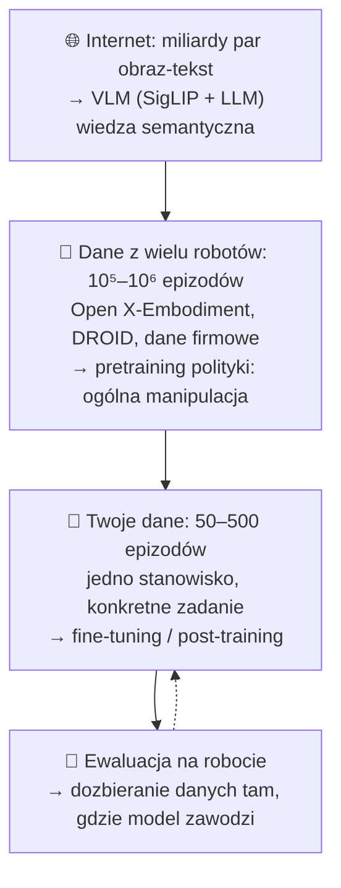
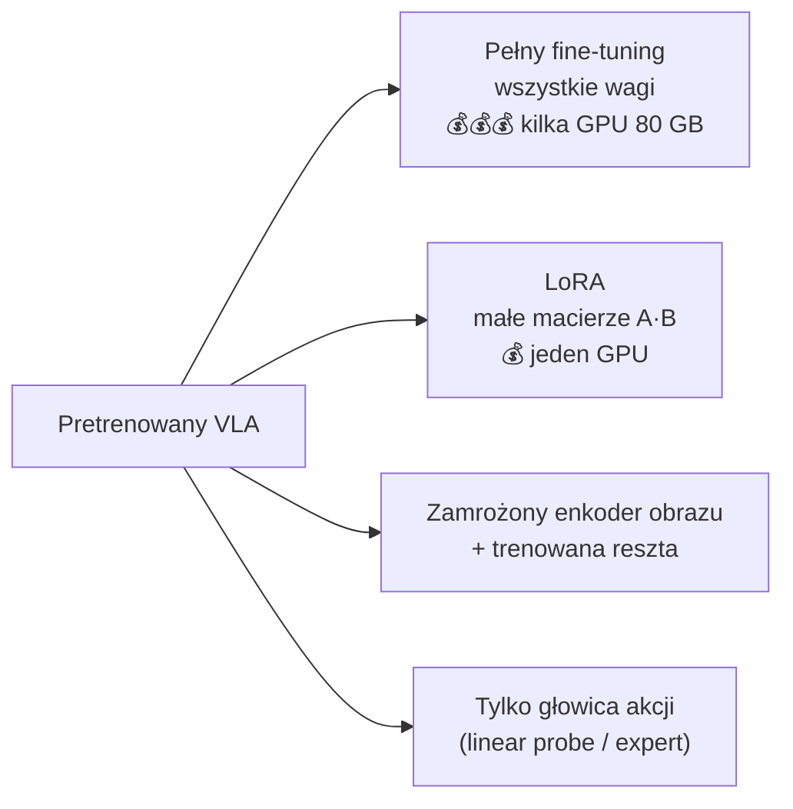

# V5 Trening — pretraining, fine-tuning i dane

> [!skrot] W 30 sekund
> - **Trzy piętra:** (1) VLM trenowany na **internecie** (obrazy + tekst) → (2) **pretraining robotyczny** na setkach tysięcy epizodów z wielu robotów (Open X, DROID, dane własne) → (3) **fine-tuning / post-training** na kilkudziesięciu–kilkuset demonstracjach **twojego zadania na twoim robocie**.
> - **Fine-tuning pełny** (wszystkie wagi) vs **LoRA** (małe macierze „łatki”, ~1% parametrów — mieści się na jednym GPU) vs **zamrożenie** części modelu (np. enkoder obrazu).
> - **Co-training:** miesza się dane robotyczne z danymi webowymi, żeby model **nie zapomniał** wiedzy z internetu (*catastrophic forgetting*).
> - Najważniejsze dla wyniku nie są hiperparametry, tylko **dane**: spójność, jakość, pokrycie przypadków, poprawne etykiety, synchronizacja. Model „dziedziczy” każdy błąd zbierania.

> [!intuicja] Po ludzku
> (1) **Szkoła i studia** — ogólna wiedza o świecie (VLM). (2) **Staże w wielu firmach** — ogólne „jak się rusza ramieniem i chwyta rzeczy” (pretraining robotyczny). (3) **Szkolenie stanowiskowe** u ciebie w labie — „tak u nas pakujemy kubki do pudełek” (fine-tuning). LoRA to jak dać pracownikowi **notes z firmowymi skrótami** zamiast przeprogramowywać mu cały mózg — tanio i szybko, a podstawowa wiedza zostaje.

## Piramida danych

| Dataset | Co | Liczby (orientacyjnie) |
|---|---|---|
| **Open X-Embodiment** (2023) | Zbiór z 34 labów, format RLDS | >1 mln trajektorii, 22 typy robotów |
| **DROID** (2024) | Franka Panda, teleop VR (Oculus Quest), 3 kamery, różne budynki | ~76 tys. trajektorii, ~350 h, 564 sceny, 86 zadań, 13 instytucji |
| **BridgeData V2** | WidowX, tani robot, kuchnie-zabawki | ~60 tys. trajektorii |
| **LIBERO** | Benchmark symulacyjny (zestawy zadań) | używany do porównań VLA |
| **Społeczność LeRobot** | Setki datasetów SO-100/101 na HF Hub | baza SmolVLA |
| **AgiBot World**, **Galaxea** i in. (2025) | Duże zbiory firmowe, często humanoidy/dwuręczne | 10⁵–10⁶ trajektorii |

> [!przyda] Skala „przemysłowa”
> Firmy (Physical Intelligence, Google, NVIDIA, Tesla, Figure) i laboratoria zbierające dane teleoperacyjne do VLA — takie jak to, do którego aplikujesz — zbierają **tysiące godzin** teleoperacji. Wąskim gardłem robotyki jest dziś **dane**, nie architektura — dlatego laby teleop istnieją.

## Fine-tuning — opcje

### LoRA — Low-Rank Adaptation
Zamiast zmieniać ogromną macierz wag $W$ ($d \times d$), dodajesz poprawkę niskiego rzędu:
$$W' = W + \Delta W = W + B A, \quad B \in \mathbb{R}^{d \times r},\; A \in \mathbb{R}^{r \times d},\; r \ll d$$
Przykład: $d = 4096$, $r = 32$ → zamiast 16,8 mln liczb trenujesz $2 \cdot 4096 \cdot 32 \approx 262$ tys. (**~1,6%**). $W$ zamrożone. OpenVLA fine-tunuje się LoRA na 1 GPU; π0 w openpi też ma wariant LoRA.

| Opcja | Pamięć | Jakość | Kiedy |
|---|---|---|---|
| Pełny | najwięcej | najlepsza przy dużej ilości danych | Dużo danych i GPU |
| LoRA | mało | bliska pełnemu przy małych danych | Typowy fine-tuning w labie |
| Zamrożony wizyjny | średnio | dobra, mniej przeuczenia | Mało danych, podobne obrazy |
| Mała polityka od zera (ACT) | bardzo mało | świetna na jedno zadanie | Jedno zadanie, szybka iteracja |

## Przepis treningowy — co ustawia się w praktyce

| Element | Typowo | Uwaga |
|---|---|---|
| Normalizacja | mean/std lub kwantyle z **twojego** datasetu | Te statystyki idą z modelem na robota |
| Augmentacja obrazu | losowe przycięcie (random crop ~90–95%), jitter jasności/kontrastu/koloru | Odporność na drobne przesunięcia kamery i światło. W LeRobot: `image_transforms` |
| Długość treningu | ACT: ~100 tys. kroków; fine-tuning VLA: 10–30 tys. kroków | Zależy od danych |
| Learning rate | 1e-5 – 1e-4, warmup + cosine decay | Za duży → „rozwalenie” pretrenowanej wiedzy |
| Batch size | 8–256 | Większy z gradient accumulation |
| Precyzja | bf16 (mixed precision) | Połowa pamięci |
| Checkpointy | co N kroków; **ewaluować kilka** | Ostatni nie zawsze najlepszy |
| Logowanie | Weights & Biases (`wandb`), TensorBoard | Krzywe strat, przykładowe predykcje |

### Podział danych (powtórka, bo ważne)
- Po **epizodach**, nie klatkach.
- Rozważ walidację **„held-out”**: inne pozycje obiektów / inny operator / inny dzień — to mówi o generalizacji.

## Co-training i zapominanie
- Fine-tuning tylko na danych robotycznych → model **traci** część wiedzy z VLM (np. przestaje rozumieć rzadkie słowa) — *catastrophic forgetting*.
- Rozwiązanie (RT-2, π0.5): **mieszać** w batchach dane webowe (VQA, opisy) z robotycznymi.
- π0.5 dodatkowo uczy się z **adnotacji słownych** podzadań — dane z teleop z opisem „co teraz robię” są cenniejsze.

## Cross-embodiment — jak jeden model obsługuje różne roboty
| Problem | Rozwiązanie |
|---|---|
| Różna liczba stawów (6 vs 7 vs 14) | Dopełnianie zerami do wspólnego max. wymiaru (π0), osobne głowice per robot, lub wspólna przestrzeń (EE delta) |
| Różne kamery i ich liczba | Maskowanie brakujących widoków, nazwy kamer jako tokeny |
| Różne częstotliwości | Resampling, osobne horyzonty |
| Różne konwencje (radiany/stopnie, kierunek osi) | **Normalizacja + spójne metadane** — to robi data engineer |

## Mity i fakty o danych

| Mit | Fakt |
|---|---|
| „Więcej danych zawsze pomaga” | Niespójne/złe dane **pogarszają** model. Najpierw jakość i spójność |
| „Porażki trzeba wyrzucić” | Oznaczone porażki i **recovery** (odzyskanie po błędzie) pomagają odporności; nieoznaczone — szkodzą |
| „Jedna pozycja startowa wystarczy” | Model nauczy się tylko tej. Pokrycie przestrzeni (pozycje, obiekty, światło) wg protokołu |
| „Operator może robić po swojemu” | Różne strategie = multimodalność = trudniej. Spójny protokół, chyba że różnorodność jest celem |
| „Kamera może się trochę przesunąć” | Dla małych polityk to inna dystrybucja obrazów. Mocowania stałe; jeśli zmiana — zanotować |

## Pytania rekrutacyjne
> [!zadanie] Jak dostosować pretrenowany VLA do nowego zadania w labie?
> > [!odpowiedz]- Odpowiedź
> > Zebrać kilkadziesiąt–kilkaset spójnych demonstracji zadania na docelowym robocie (ten sam action space, kamery jak w konfiguracji modelu), policzyć statystyki normalizacji, fine-tunować (pełnie albo LoRA), z augmentacją obrazów; wybrać checkpoint na podstawie ewaluacji na robocie; tam gdzie model zawodzi — dozbierać dane i powtórzyć.
> > **EN:** *"Collect a few dozen to a few hundred consistent demos on the target robot, fine-tune — fully or with LoRA — with proper normalization and augmentation, then evaluate on the robot and collect more data where it fails."*

> [!zadanie] Co to jest LoRA i dlaczego jest popularna?
> > [!odpowiedz]- Odpowiedź
> > Low-Rank Adaptation: zamrażamy oryginalne wagi i uczymy małą poprawkę w postaci iloczynu dwóch wąskich macierzy (rząd r). Trenuje się ~1% parametrów — mniej pamięci, szybciej, mieści się na jednym GPU, a pretrenowana wiedza zostaje.

> [!zadanie] Co to jest catastrophic forgetting i jak mu zapobiegać?
> > [!odpowiedz]- Odpowiedź
> > Utrata wcześniej nauczonej wiedzy przy dotrenowaniu na wąskich danych. Zapobieganie: co-training z danymi ogólnymi (web, inne roboty), mniejszy learning rate, LoRA / zamrożenie części modelu.

> [!zadanie] Dlaczego dane z wielu robotów pomagają, skoro roboty są różne?
> > [!odpowiedz]- Odpowiedź
> > Wiele umiejętności jest wspólnych — rozpoznawanie obiektów, chwytanie, podejście, relacje przestrzenne. Model uczy się ich z różnorodnych danych i przenosi na nowego robota; Open X i π0 pokazały pozytywny transfer.

## Fiszki #fiszki/rozmowa-gd/vla-dokladnie
Trzy piętra trenowania VLA?::VLM na internecie → pretraining na danych wielu robotów → fine-tuning na twoim zadaniu.
LoRA — wzór?::W' = W + B·A, gdzie B (d×r), A (r×d), r ≪ d; W zamrożone.
Ile parametrów trenuje LoRA dla d=4096, r=32?::~262 tys. zamiast 16,8 mln (~1,6%).
Catastrophic forgetting?::Utrata wiedzy pretrenowanej przy dotrenowaniu na wąskich danych.
Co-training?::Mieszanie danych robotycznych z webowymi w treningu, by zachować wiedzę VLM.
DROID — co to?::Dataset Franka, teleop VR, ~76 tys. trajektorii, 564 sceny, 86 zadań.
Typowa augmentacja obrazu w treningu polityk?::Random crop + jitter jasności/kontrastu/koloru.
Jak cross-embodiment radzi sobie z różną liczbą stawów?::Dopełnianie zerami do max. wymiaru, osobne głowice lub wspólna przestrzeń EE.
Czy wyrzucać nieudane demonstracje?::Nieoznaczone szkodzą; oznaczone porażki i recovery mogą pomóc odporności.
Typowy rząd liczby demo do fine-tuningu?::Dziesiątki–setki epizodów na zadanie.

## Moje notatki
> [!ja] Tu piszesz ty — Albert tej sekcji nie rusza.
