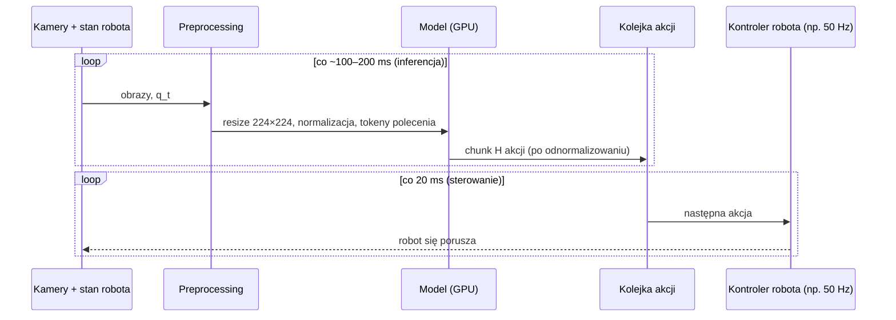
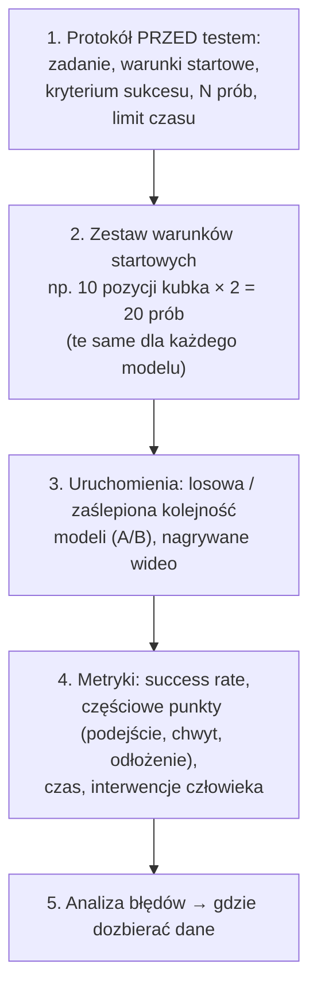

# V6 Inferencja na robocie i ewaluacja

> [!skrot] W 30 sekund
> - **Pętla sterowania:** odczytaj kamery + stan → przygotuj (resize, normalizacja) → model (GPU) → odnormalizuj → wyślij akcje do kontrolera robota z **stałą częstotliwością** (np. 30–50 Hz). Model jest wolniejszy niż pętla → **chunki**, **async**, **RTC**.
> - **Budżet opóźnień:** jeśli model liczy 100 ms, a robot potrzebuje akcji co 20 ms, musisz mieć zapas akcji w kolejce. Opóźnienie = robot reaguje na świat sprzed chwili.
> - **Ewaluacja = success rate na N próbach na prawdziwym robocie**, w ustalonych warunkach startowych, z kryterium sukcesu ustalonym **przed** testem. Mała liczba prób = duża niepewność (20 prób → ±~20 p.p.).
> - **Bezpieczeństwo:** polityka może zrobić coś nieprzewidzianego → ograniczenia prędkości/przestrzeni, człowiek przy E-stopie, start na zredukowanej prędkości.

> [!intuicja] Po ludzku
> Model to **nawigator, który myśli 0,1 s**, a robot to **kierowca, który co 0,02 s musi wiedzieć, jak skręcić**. Nawigator mówi więc od razu „przez następne 2 sekundy: prosto, lekko w lewo, hamuj…” (chunk). Kierowca jedzie wg planu, a nawigator w tym czasie liczy kolejny plan, pamiętając, co kierowca już robi (RTC). Ewaluacja to **egzamin na prawo jazdy**: ustalona trasa, ustalone kryteria zdania, wiele podejść — a nie „raz przejechał, działa”.

## Pętla inferencji

| Krok | Szczegół | Typowy błąd |
|---|---|---|
| Odczyt | Najświeższe klatki ze **wszystkich** kamer + stan z tej samej chwili | Stara klatka z bufora → model reaguje na przeszłość |
| Preprocessing | **Dokładnie** jak w treningu: rozdzielczość, crop, RGB vs BGR, kolejność kamer, normalizacja | Inny crop / BGR → model „ślepnie” |
| Model | GPU, bf16/fp16, czasem kwantyzacja (int8/4-bit), `torch.compile` | Za wolno → kolejka pustoszeje, robot „przycina” |
| Postprocessing | Odnormalizowanie, ograniczenie (clip) do limitów stawów i prędkości | Brak clipa → komenda poza zakresem |
| Wysyłanie | Stała częstotliwość, interpolacja między akcjami | Nierówny rytm → szarpanie |

## Budżet czasu — przykład do policzenia na głos
- Robot 50 Hz → akcja co **20 ms**.
- π0 na RTX 4090: inferencja ~**75–100 ms** (rząd wielkości) → w tym czasie robot zużywa **4–5 akcji**.
- Chunk 50 akcji = 1 s ruchu. Jeśli replanujesz co 25 akcji (0,5 s), model ma 500 ms zapasu — OK.
- OpenVLA (bez chunków) ~6 Hz → akcja co ~170 ms → **za wolno** na 50 Hz bez chunków; dlatego OFT/FAST/flow.

### Strategie radzenia sobie z opóźnieniem
| Strategia | Jak działa | Wada |
|---|---|---|
| **Synchroniczna** | Robot stoi, czeka na model, wykonuje chunk, znowu czeka | Ruch „stop-and-go” |
| **Asynchroniczna** (SmolVLA/LeRobot) | Model liczy następny chunk, gdy kolejka spada poniżej progu | Szwy między chunkami (skoki) |
| **Temporal ensembling** (ACT) | Model co krok, uśrednianie nakładających się chunków | Model musi być szybki; uśrednianie może rozmywać decyzje |
| **Real-Time Chunking (RTC)** | Nowy chunk generowany jako „dokończenie” akcji już zaplanowanych do wykonania (inpainting w flow matching) | Bardziej złożone; działa z modelami dyfuzyjnymi/flow |
| **Hierarchia** (GR00T, π0.5, Gemini Robotics) | Wolny „mózg” (VLM) + szybki „rdzeń ruchowy” | Dwa modele do zgrania |

LeRobot: `lerobot-rollout ... --inference.type=rtc` dla wolnych VLA (π0, π0.5, SmolVLA). Patrz [[L5 Trening i ewaluacja polityk w LeRobot]].

## Typowe awarie polityki na robocie — i co oznaczają dla danych

| Objaw | Prawdopodobna przyczyna | Co z danymi |
|---|---|---|
| Robot **zamarza** w połowie | W demonstracjach były pauzy/wahanie; model nie wie, kiedy ruszyć | Płynniejsze demo, chunking |
| Robot **oscyluje** przy chwycie | Multimodalność (raz z lewej, raz z prawej), regresja uśrednia | Spójna strategia |
| Robot trafia **obok** obiektu o kilka cm | Przesunięta kamera / zmieniona kalibracja vs trening; za mało różnorodnych pozycji | Stałe mocowania, pokrycie pozycji |
| Działa rano, nie działa wieczorem | Oświetlenie inne niż w danych | Różnorodność światła lub stałe oświetlenie; augmentacja |
| Po chwycie nie umie **poprawić** | Brak demonstracji recovery | Zbierz recovery (wg protokołu) |
| „Szarpie” między chunkami | Synchroniczna inferencja / brak RTC | Inżynieria inferencji, nie dane |
| Ignoruje polecenie (VLA) | Mało różnorodnych poleceń w danych / zawsze ten sam tekst | Różne sformułowania, adnotacje |

## Ewaluacja — jak się to robi porządnie

| Pojęcie | Znaczenie |
|---|---|
| **Success rate** | Liczba sukcesów / N prób |
| **Partial success / progress score** | Punkty za etapy: dojechał, chwycił, podniósł, odłożył |
| **In-distribution (ID)** | Warunki jak w danych treningowych |
| **Out-of-distribution (OOD)** | Nowe obiekty, pozycje, tło, światło, polecenia → generalizacja |
| **Interwencje** | Ile razy człowiek musiał przejąć/zatrzymać |
| **A/B, zaślepienie** | Oceniający nie wie, który model jedzie — mniej stronniczości |
| **Benchmarki symulacyjne** | **LIBERO**, **SimplerEnv**, CALVIN, Meta-World — powtarzalne, ale *sim ≠ real* |

### Ile prób wystarczy? (pytanie „na myślenie”)
Odchylenie standardowe proporcji: $\sigma = \sqrt{p(1-p)/N}$. Dla $p = 0{,}7$, $N = 20$: $\sigma = \sqrt{0{,}21/20} \approx 0{,}10$ → 95% przedział ≈ **±20 p.p.** (≈ 50–90%).
Wniosek: **„model A 70%, model B 60% na 20 próbach” to nie jest dowód**, że A jest lepszy. Potrzeba więcej prób albo tych samych warunków (paired comparison). Takie zdanie na rozmowie robi bardzo dobre wrażenie.

## Bezpieczeństwo przy uruchamianiu polityk
- Pierwsze uruchomienie: **zredukowana prędkość** (speed slider na pendancie), **ograniczona przestrzeń robocza** (safety planes/strefy w kontrolerze), **ręka na E-stopie / enabling device**.
- Clip akcji do limitów stawów i prędkości w oprogramowaniu (niezależnie od modelu).
- Nikt w zasięgu ramienia. Nowe obiekty — najpierw niełamliwe.
- Szczegóły: [[14 Bezpieczeństwo pracy z robotami]].

## Pytania rekrutacyjne
> [!zadanie] Jak sprawdzisz, czy nowy checkpoint jest lepszy od poprzedniego?
> > [!odpowiedz]- Odpowiedź
> > Ustalony protokół: te same warunki startowe (np. 20 pozycji obiektu), to samo kryterium sukcesu, losowa/zaślepiona kolejność modeli, nagrania wideo. Porównuję success rate i postęp częściowy, osobno in-distribution i OOD. Przy małym N pamiętam o niepewności (±~20 p.p. dla 20 prób) — jeśli różnica jest mała, zwiększam N.
> > **EN:** *"A fixed evaluation protocol — same initial conditions, predefined success criteria, randomized or blind order — then compare success rates, keeping in mind that with 20 trials the confidence interval is around ±20 percentage points."*

> [!zadanie] Model działa w symulacji/na danych walidacyjnych, ale robot się myli. Co sprawdzasz po stronie inferencji?
> > [!odpowiedz]- Odpowiedź
> > Zgodność preprocessingu z treningiem (rozdzielczość, crop, RGB/BGR, kolejność i nazwy kamer), normalizację i odnormalizowanie (te same statystyki), jednostki i kolejność stawów, opóźnienia (stare klatki), częstotliwość sterowania vs treningowa, pozycje kamer i kalibrację vs dane. Dopiero potem winię model.

> [!zadanie] Robot „zamarza” w połowie zadania. Co to może mówić o danych?
> > [!odpowiedz]- Odpowiedź
> > W demonstracjach były pauzy lub wahanie — dla tych obserwacji „nic nie rób” było poprawną akcją, więc model się zatrzymuje. Pomaga płynniejsze wykonywanie demo, przycinanie pauz, chunking akcji.

> [!zadanie] Po co asynchroniczna inferencja albo Real-Time Chunking?
> > [!odpowiedz]- Odpowiedź
> > Duże modele liczą dłużej niż jeden okres sterowania. Async liczy kolejny chunk w tle, zanim skończy się obecny, więc robot nie stoi; RTC dodatkowo dba, by nowy chunk był spójny z akcjami już wykonywanymi — bez szarpnięć na szwach.

## Fiszki #fiszki/rozmowa-gd/vla-dokladnie
Kroki pętli inferencji polityki?::Odczyt kamer i stanu → preprocessing jak w treningu → model → odnormalizowanie + clip → wysyłanie akcji ze stałą częstotliwością.
Najczęstszy błąd preprocessingu na robocie?::Niezgodność z treningiem: rozdzielczość/crop, BGR vs RGB, kolejność kamer, normalizacja.
Robot 50 Hz, model 100 ms — ile akcji zużyje robot w trakcie inferencji?::5.
Co to jest RTC?::Real-Time Chunking — generowanie następnego chunku spójnie z akcjami już w toku (inpainting).
Główna metryka ewaluacji?::Success rate na N próbach z ustalonym protokołem.
Niepewność success rate 70% przy N=20?::σ ≈ 0,10 → 95% CI ≈ ±20 p.p.
ID vs OOD w ewaluacji?::In-distribution — warunki jak w treningu; OOD — nowe obiekty/pozycje/światło/polecenia.
Benchmarki symulacyjne VLA?::LIBERO, SimplerEnv, CALVIN, Meta-World.
Robot zamarza w połowie — przyczyna w danych?::Pauzy/wahanie operatora w demonstracjach.
Zasady bezpiecznego pierwszego uruchomienia polityki?::Zredukowana prędkość, strefy bezpieczeństwa, ręka na E-stopie, clip akcji, nikt w zasięgu.

## Moje notatki
> [!ja] Tu piszesz ty — Albert tej sekcji nie rusza.
