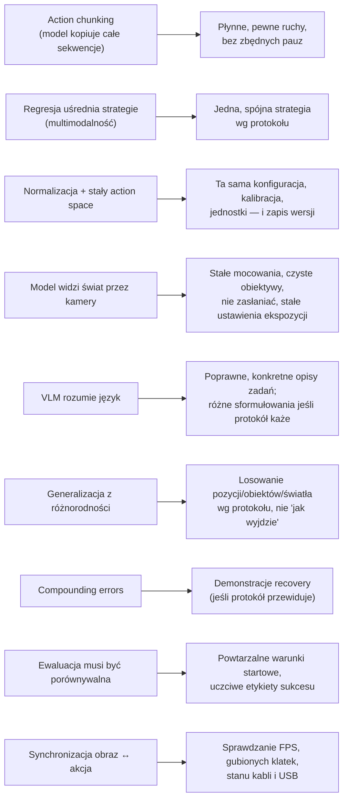

# V7 VLA z perspektywy operatora — co z tego wynika

> [!skrot] W 30 sekund
> - Każda decyzja w modelu ma **konsekwencję dla zbierania danych**: chunking → płynność demo; multimodalność → spójna strategia; normalizacja i action space → spójna konfiguracja i kalibracja; VLM → różnorodne, poprawne opisy zadań; generalizacja → różnorodność warunków **wg protokołu**; ewaluacja → powtarzalne warunki startowe.
> - Na rozmowie nie musisz umieć wytrenować π0. Musisz pokazać, że **rozumiesz, dlaczego dane mają być takie, a nie inne**, i że **dbasz o sprzęt i powtarzalność**.
> - Gotowe zdania po angielsku są niżej — wypowiedz je na głos 3 razy.

> [!intuicja] Po ludzku
> Jesteś **nauczycielem**, a model to uczeń, który kopiuje **dokładnie** to, co widzi — łącznie z tym, że się drapiesz po głowie przed każdym zadaniem. Jeśli raz piszesz „7” z kreską, a raz bez, uczeń nie wie, jak ma być. Jeśli tablica raz wisi tu, a raz tam, uczeń się gubi. Dobry nauczyciel jest **spójny, płynny, pokazuje różne przykłady, kiedy trzeba, i uczciwie mówi, kiedy coś mu nie wyszło**.

## Mapa: cecha modelu → zasada zbierania danych

## Checklista operatora przed sesją (wynika wprost z V1–V6)

- [ ] Kamery: obiektywy czyste, mocowania dokręcone, pozycja = referencyjna (zdjęcie porównawcze), podgląd OK, FPS OK.
- [ ] Ekspozycja/balans bieli **ręczne i zapisane** (auto zmienia obraz między epizodami).
- [ ] Robot: home position, brak błędów, kalibracja aktualna (data w logu), chwytak działa pełnym zakresem.
- [ ] Teleop: leader skalibrowany, brak opóźnień, mapowanie stawów poprawne (krótki test).
- [ ] Oprogramowanie: właściwa konfiguracja/wersja, poprawne ID zadania i opis (`task`), dysk ma miejsce.
- [ ] Scena: obiekty zgodnie z protokołem (lista, pozycje startowe), oświetlenie jak w protokole.
- [ ] Log sesji: operator, data, stanowisko, uwagi.

## Checklista w trakcie i po epizodzie
- Ruch **płynny**, bez „szukania”, zaczynasz szybko po starcie, kończysz zaraz po wykonaniu.
- Nie zasłaniasz kamer ręką/ciałem/kablem.
- Coś poszło nie tak (upadek, kolizja, przerwa) → **oznacz albo nagraj ponownie** (LeRobot: ← / `r` = re-record).
- Co ~10–20 epizodów: szybki przegląd 1 nagrania (wideo + wykres stanów).
- Po sesji: QC (liczba klatek, długości, braki), upload, wpis w logu, zgłoszenie usterek.

## Najczęstsze pytania „sytuacyjne” na rozmowie

> [!zadanie] W połowie sesji zauważasz, że kamera nadgarstkowa się lekko obróciła. Co robisz?
> > [!odpowiedz]- Odpowiedź
> > Przerywam nagrywanie, oznaczam epizody od momentu, kiedy mogło się to stać (porównuję z obrazem referencyjnym), przywracam pozycję wg znaczników/zdjęcia referencyjnego i dokręcam mocowanie; jeśli nie da się przywrócić dokładnie — zgłaszam i zapisuję w metadanych, że od epizodu X jest nowa konfiguracja (ewentualnie potrzebna ponowna kalibracja). Nie mieszam po cichu dwóch konfiguracji w jednym datasecie.
> > **EN:** *"I'd stop recording, flag the affected episodes, restore the camera to the reference position and tighten the mount, and if I can't restore it exactly, log it as a new configuration in the metadata — never silently mix the two."*

> [!zadanie] Dwóch operatorów wykonuje zadanie inaczej (jeden chwyta kubek za ucho, drugi od góry). Czy to problem?
> > [!odpowiedz]- Odpowiedź
> > Może być — to multimodalność; prostsze polityki uśrednią strategie i będą się wahać. Zgłaszam to i ustalamy z zespołem jedną strategię w protokole — chyba że różnorodność jest celowa (wtedy przynajmniej opisujemy strategię w metadanych).

> [!zadanie] Epizod nie udał się w 80% — kubek wypadł tuż przed pudełkiem. Zapisać czy wyrzucić?
> > [!odpowiedz]- Odpowiedź
> > Zgodnie z protokołem: domyślnie oznaczam jako porażkę (albo nagrywam ponownie), nigdy nie oznaczam jako sukces. Jeśli protokół zbiera recovery, mogę kontynuować — podnieść kubek i dokończyć — i oznaczyć epizod jako zawierający odzyskanie.

> [!zadanie] Ile demonstracji potrzeba, żeby wytrenować zadanie?
> > [!odpowiedz]- Odpowiedź
> > Zależy od modelu i zróżnicowania zadania. ACT: ~50 demonstracji dla jednego, wąskiego zadania; LeRobot zaleca start od ~50 epizodów (np. 10 na każdą z 5 pozycji). Fine-tuning dużych VLA: dziesiątki–setki epizodów na zadanie. Pretraining: setki tysięcy+. Ważniejsza od liczby jest spójność i pokrycie warunków.

> [!zadanie] Dlaczego dane z teleoperacji, a nie po prostu symulacja albo filmy z YouTube?
> > [!odpowiedz]- Odpowiedź
> > Teleop daje dokładnie te obserwacje i akcje, które robot ma potem wykonać — na prawdziwym sprzęcie, z prawdziwą fizyką i obrazem. Symulacja ma *reality gap* (fizyka kontaktu, wygląd), a wideo ludzi nie zawiera akcji robota i ma inne „ciało”. W praktyce łączy się źródła, ale teleop to najbardziej bezpośredni sygnał — szczególnie do fine-tuningu.

## Gotowe zdania na rozmowę (EN) — powiedz na głos
1. *"A VLA is a policy built on a pretrained vision-language model: it takes camera images, the robot state and a language instruction, and outputs a chunk of future actions."*
2. *"The model literally imitates the operator, so hesitation, inconsistent strategies or bad labels end up in the policy."*
3. *"Action chunking means predicting, say, 50 future actions at once — it gives smoother motion and fewer compounding errors."*
4. *"Older VLAs like RT-2 and OpenVLA output discretized action tokens; newer ones like π0 and SmolVLA use a flow-matching action expert for continuous actions at high frequency."*
5. *"From the data side, what matters most is consistency — same camera setup, calibration and action space — then coverage of the conditions, then sheer quantity."*
6. *"I'd always check the recording quality — frame rates, dropped frames, synchronization — because a model can't learn from misaligned images and actions."*
7. *"I've looked at LeRobot: datasets are Parquet for states and actions plus MP4 videos per camera, with metadata like fps and normalization stats."*

## Pytania, które TY możesz zadać na końcu (pokazują zrozumienie)
- *"Which models are you collecting data for — task-specific policies like ACT, or fine-tuning large VLAs?"*
- *"How do you decide the task protocol — do you aim for consistency or diversity across operators?"*
- *"Do you collect recovery demonstrations or language annotations alongside the episodes?"*
- *"What's the dataset format — LeRobot, RLDS, or rosbag-based — and how is QC done?"*
- *"How is feedback from model evaluation brought back to data collection?"*

## Fiszki #fiszki/rozmowa-gd/vla-dokladnie
Chunking → zasada dla operatora?::Płynne, pewne ruchy bez zbędnych pauz.
Multimodalność → zasada dla operatora?::Jedna spójna strategia wg protokołu.
Normalizacja/action space → zasada?::Ta sama konfiguracja, kalibracja i jednostki; wersje w metadanych.
Generalizacja → zasada?::Różnorodność warunków zgodnie z protokołem (pozycje, obiekty, światło).
Kamera się przesunęła w trakcie sesji — co robisz?::Stop, oznacz epizody, przywróć pozycję referencyjną, zapisz zmianę w metadanych; nie mieszaj po cichu.
Epizod nieudany — co robisz?::Oznacz jako porażkę lub nagraj ponownie; nigdy nie oznaczaj jako sukces.
Ile demo na start w LeRobot?::~50 epizodów, np. 10 na każdą z 5 pozycji.
Dlaczego teleop zamiast tylko symulacji?::Prawdziwe obserwacje i akcje docelowego robota; brak reality gap.
Ustawienia kamer podczas zbierania?::Ręczna ekspozycja i balans bieli, zapisane; auto zmienia obraz.

## Moje notatki
> [!ja] Tu piszesz ty — Albert tej sekcji nie rusza.
