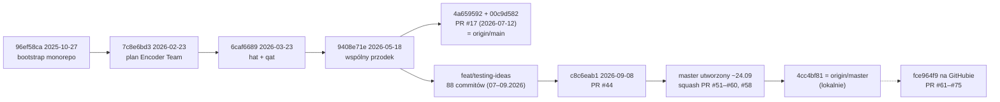

# Branche — szczegóły

> [!skrot] W 30 sekund
> - Są **dwie linie główne**: `origin/main` (00c9d582, 2026-07-12) i `origin/master` (4cc4bf81, 2026-09-24). Ich wspólny przodek to `9408e71e` (2026-05-18, Karolina, „create training based on umarly-poeta notebooks”). Po rozjeździe `main` dostał 2 commity (PR #17), a `master` 90.
> - **Aktywna jest linia `master`.** Utworzono ją ok. 23–24.09.2026 z `feat/testing-ideas` @ `c8c6eab1` i ustawiono jako domyślną na GitHubie (`docs/project/team-plan/Plan_zespolu_SNN.md:9-21`). `gh api` z 2026-10-05 zwraca `default_branch = master`. Lokalne `origin/HEAD → main` to nieaktualny ślad z klonowania.
> - Do `master` wchodzi się tylko przez PR z zielonym `pr-gate` i squashem (`docs/project/W0_START_HERE.md:17-22`). Dlatego zmergowane gałęzie zespołu **nie są przodkami** `master`. Scalenie potwierdzam identycznym drzewem lub numerem PR.
> - Lokalne referencje pochodzą z fetcha z 2026-09-27. Stan GitHuba sprawdziłem przez `gh` (tylko odczyt, 2026-10-05), patrz [[#Stan na GitHubie po ostatnim fetchu]].

> [!wazne] Lokalne gałęzie są nieaktualne
> - `main` (lokalna) @ `9408e71e`: **2 commity za** `origin/main`.
> - `feat/testing-ideas` (lokalna) @ `c8c6eab1`: **11 commitów za** `origin/feat/testing-ideas`.
> - `feat/patryk-telemetry-p3` (wymeldowana) @ `ef42c20e`: zgodna z `origin/…` na dzień fetcha. Na GitHubie została już scalona (PR #64, 2026-09-27) i usunięta.
> - Sam `origin/master` też jest nieaktualny: na GitHubie `master` = `fce964f9`, czyli 11 commitów dalej (PR #61–#75).

## Dwie linie: main vs master

- **`origin/main`**: zawiera tylko szkielet monorepo (Wiktor/vityk-dev, 2025-10 – 2026-02), `hat + qat 1 iteration` (Patryk, 2026-03-23), trening Karoliny (2026-05-18) i PR #17 z `snn_pipeline/build_combined_dataset.py` (Patryk, 2026-07-12). Na najwyższym poziomie ma `docs encoder experiments snn_pipeline snn_simulator software tests` i pliki luźne (`git ls-tree origin/main`).
- **`origin/master`**: pierwsza linia rodzica to praca z `feat/testing-ideas` od 2026-07-09: architektury 10/14 neuronów, GA, kontrakt danych v1/v2, FA/h, poprawki przecieku (PR #44). Dalej są squashe W0 (PR #51–#60) i P1 (PR #58). Dochodzą katalogi `architecture_*`, `contracts`, `dataset`, `ga_neuron_search`, `lu.i-neuron-pcb` (submoduł), `models`, `rpi_agents`, `snn_runtime`, `.github`.
- Rozbieżność: `git rev-list --left-right --count origin/main...origin/master` = `2 90`. Plan zespołu podaje „brakuje mu 80 commitów” (`Plan_zespolu_SNN.md:29`), bo liczył względem `c8c6eab1`, przed squashami W0.
- Jedyna własna zmiana `main` (`build_combined_dataset.py`) jest też w `master` w nowszej wersji (+339/−197 linii różnicy), więc `main` nie wnosi nic unikalnego. Plan zespołu: „Nie nadpisujemy nowszego pipeline'u starym plikiem” (`Plan_zespolu_SNN.md:29`).

## Skróty etapów

Źródło: `docs/project/team-plan/Plan_zespolu_SNN.md` (nagłówki z numerami linii) oraz `docs/project/team-plan/taski/T01–T06`. Litera oznacza właściciela pakietu, numer kolejny krok.

| Skrót | Właściciel | Znaczenie (linia w planie) |
|---|---|---|
| **W0** | Wiktor | Kontrakty v1.0, fixtures, mock API, root CI `pr-gate` (169; `W0_START_HERE.md:3-5`) |
| W1 / W2 | Wiktor | Bridge Uno ↔ RPi 5 (184) / trwałe zdarzenia i polecenia (202) |
| W3 / W4 / W5 | Wiktor | Foundry i reguła alarmu (217) / Azure i wspólny login (235) / odbiór i wersja demo (250) |
| **P1** | Patryk | Model i wejście runtime: `SNNRuntime` + walidacja `ModelManifest` (270) |
| **P2** | Patryk | Stanowy streaming i dekoder (283) |
| **P3** | Patryk | Telemetria i edytowalna topologia (299) |
| P4 / P5 | Patryk | Porównanie z fizycznym Lu.i (312) / zamrożony runtime i golden replay (325) |
| C1–C5 | Karolina | C1 szkielet i logowanie (343), C2 płytki i edytor sieci (356), C3 potencjał LED, raster, replay (372), C4 zdarzenia, metryki, energia (385), **C5** odbiór UI na realnych danych (398) |
| M0–M5 | Marcel | M0 profil treningu M5 Max (416), M1 protokół eksperymentu (431), M2 naprawa final eval i eksportu (447), **M3** kontrolowany trening (462), M4 ocena strumienia ciągłego (478), M5 pakiet championa (491) |
| **K1**–K5 | Kacper | K1 zamrożenie wariantu enkodera (509), K2 firmware i test zgodności (522), K3 continuous dataset (538), K4 baseline FFT na Uno (553), K5 PR i instrukcja dla Wiktora (566) |
| A1–A5 | Andrzej | Inwentaryzacja (584), kalibracja neuronów (597), pomiar energii (613), sieć fizyczna/dane partnerskie (628), odbiór sprzętu (641) |
| D1–D3 | — | Kolejne dni wspólnej pracy, nie daty kalendarzowe (`Plan_zespolu_SNN.md:134-142`) |
| **N8** | — | Topologia sieci z **N=8** neuronami w układzie 7-4-3-1, zwycięzca GA na `feat/training_N8` (commity `8f41c6ea`, `e36bc467`) |
| E1–E8, PB1–PB4 | — | Eksperymenty i pytania badawcze z materiałów konferencyjnych (`docs/konferencja_2026/_build/doc1.py:74-82, 236-270`) |
| Kontrakt danych v1/v2 | Patryk | Wersje głównego zbioru `dataset/versions/v1.0.0` i `v2.0.0` (`docs/DATASET_CONTRACT.md`) |

> [!wazne] Kolizje nazw
> - `K1`–`K9` i `O1`–`O5` w `docs/DATASET_CONTRACT.md:321-339` to **kontrole walidatora zbioru**, nie kroki Kacpra. Commit „adds K8/K9/O5 validator checks” (6398209f) dotyczy walidatora, a „ukonczono K1” (470286a5) kroku Kacpra.
> - `feat(rpi): P0…P5` na `feat/rpi` (Wiktor, 2026-06-05) to fazy starego planu agenta RPi, **nie** P1–P3 Patryka. **niepewne:** co dokładnie oznaczały, bo commity nie mają opisu.

## Kamienie milowe (chronologicznie)

| Data | Wydarzenie | Gałąź / commit / PR | Kto |
|---|---|---|---|
| 2025-10-27 | Bootstrap monorepo (frontend+backend+rag+llm+infra) | `96ef58ca` (wspólna historia) | Wiktor (vityk-dev) |
| 2026-02-08 | Podział na warstwy hardware/software/firmware | `006797e3` | Wiktor |
| 2026-02-23 | Struktura początkowa, plan Encoder Team; start `feat/decoder`, `docs` | `a12e4866`, `7c8e6bd3` | Wiktor, Kacper |
| 2026-03-23 | „hat + qat 1 iteration” (HAT/QAT w `snn_pipeline`), dokumenty BOM/SPI/synapsy | `6caf6689` | Patryk |
| 2026-05-18 | Trening na notebookach Patryka, **punkt rozjazdu main/master** | `9408e71e` | Karolina |
| 2026-06-01 – 06-30 | Enkoder (mock, testy C++, statystyki, PWM) przez PR #8–#16 do `dev` | `feat/encoder` → `dev` | Kacper |
| 2026-06-05 | Agent RPi, fazy P0–P5 (systemd, kamera USB) | `feat/rpi` | Wiktor |
| 2026-07-09 | Architektury 10 neuronów (ADR-0001) i 14 neuronów Patryka | `8e4b0cdb`, `1142b237` (linia master) | Wiktor, Patryk |
| 2026-07-12 | PR #17: builder połączonego zbioru, **ostatni commit `main`** | `worktree-dataset-expansion` → `main` | Patryk |
| 2026-07-14 | Dashboard/Azure, ADR rpi_agents 0001–0018 | `feat/dashboard` | Wiktor |
| 2026-08-13 | GA v1.2 (Karolina), wyniki GA | linia master `4f6411ed`, `7fde86df` | Karolina |
| 2026-08-19 | PR #18: bank cech enkodera do `dev` (ostatni ruch na `dev`) | `feat/encoder` → `dev` | Kacper |
| 2026-08-24 | **N8**: zwycięzca GA N=8 (7-4-3-1), clip-F1 0.658 / FA 0.158 (wg treści commita) | `feat/training_N8` (PR #23 otwarty; commity przeniesione cherry-pickiem do master) | Wiktor |
| 2026-08-26 | **Kontrakt danych v1** (wersjonowany zbiór, walidator) | `feat/dataset-contract-v1`, PR #33 (scalony 08-30) | Patryk |
| 2026-08-27 | **Kontrakt danych v2.0.0**: etykiety VOICe z katalogu ekstrakcji (+1412 klipów szkła odzyskanych, −241), kontrole K8/K9/O5 | `feat/voice-label-fix-dataset-contract-v2`, PR #42 | Patryk |
| 2026-08-30 | FA/h jako metryka selekcji + próg akceptacji (#37) | `7861316d` (linia master) | Karolina |
| 2026-08-31 | PR #46: wersje zbioru w repo, wycofanie liczb ze `spikes_manifest7` | `feat/rebuild-clean-benchmark` | Patryk |
| 2026-09-01 | PR #45: usunięcie cech niedostępnych na sprzęcie | `feat/dataset-remove-atrifacts` | Kacper |
| 2026-09-08 | PR #44: poprawki przecieku val/test i raportowania → **baza master** `c8c6eab1` | `fix/snn-pipeline-leakage-and-reporting` (gałąź usunięta) | Marcel |
| ~2026-09-24 | Utworzenie `master`, PR #51 (dokumentacja), **#52 W0**, #53 (założenia), #54–#57 edge-cloud 01–04, #59 CI, #60 backend | gałęzie Wiktora, squash | Wiktor |
| 2026-09-24 | **P1**: kontrakt pakietu modelu i walidujący loader (PR #58) | `feat/patryk-lui-runtime` (gałąź usunięta) | Patryk |
| 2026-09-25 | **K1**: zamrożenie enkodera w `.json` | `feat/encoder-features` `470286a5` | Kacper |
| 2026-09-25 | **P2**: integrator II rzędu, dekoder k-of-w, stan między batchami | `feat/patryk-state-stream-decoder` (PR #61, scalony 09-26) | Patryk |
| 2026-09-26 | **M3 pkt 2–3**: atomowy zapis manifestu/checkpointu, ranking championa | `feat/master-pipeline` `93808d40` (PR #47 otwarty) | Marcel |
| 2026-09-26 | **C5**: ograniczone renderowanie, a11y, responsywność | `feat/karolina-dashboard` `11a084b5` (PR #63, scalony 09-27) | Karolina |
| 2026-09-27 | **P3**: telemetria NeuronFrame + kontrakt `TopologyDraft` | `feat/patryk-telemetry-p3` (PR #64, scalony 09-27) | Patryk |
| 2026-09-27 – 09-29 | PR #62/#75 (enkoder K1), #65–#73 (poprawki treningu/firmware/backend), #74 (SNN vs Fourier) | tylko na GitHubie | Kacper, Wiktor, Patryk |

## Tabela zbiorcza

Kolumny „vs main” i „vs master”: `+A/−B`, gdzie A to commity gałęzi spoza linii, a B to commity linii, których gałąź nie ma (`git rev-list --left-right --count`, refy z fetcha 2026-09-27). Autorzy według nicków z gita: vityk-dev = Wiktor Goszczyński (potwierdzone w `gh pr list`), kuleczkomen = Kacper Kulka, knocek = Karolina Nocek, marcel/MarcelDoro = Marcel, UmarlyPoeta/Patryk/patryk_kozlowski = Patryk.

| Gałąź | Ostatni commit | Autor | Baza | vs main | vs master | Scalenie | Status |
|---|---|---|---|---|---|---|---|
| `master` | 4cc4bf81 2026-09-24 | Patryk (PR #58) | — | +90/−2 | 0/0 | — | **główna, aktywna** |
| `main` | 00c9d582 2026-07-12 | Patryk (PR #17) | — | 0/0 | +2/−90 | — | dawna domyślna, zamrożona |
| `feat/patryk-telemetry-p3` | ef42c20e 2026-09-27 | Patryk | master 4cc4bf81 | +97/−2 | +7/0 | PR #64 → master (GH) | scalona, usunięta na GH |
| `feat/patryk-state-stream-decoder` | 2051dab4 2026-09-25 | Patryk | master 4cc4bf81 | +96/−2 | +6/0 | PR #61 → master (GH) | scalona |
| `feat/karolina-dashboard` | 11a084b5 2026-09-26 | Karolina | master 4cc4bf81 | +97/−2 | +7/0 | PR #63 → master (GH) | scalona; na GH dalsze commity |
| `feat/master-pipeline` | 93808d40 2026-09-26 | Marcel | master 02521fde | +124/−2 | +37/−3 | PR #47 **otwarty** | **aktywna** |
| `feat/encoder-features` | 5ab343d1 2026-09-26 | Kacper | master 637989ee | +91/−2 | +9/−8 | PR #50 → testing-ideas; #62, #75 → master (GH) | **aktywna** (GH 09-28) |
| `feat/continuous-dataset` | a009acec 2026-09-23 | Kacper | 2055fb44 | +58/−2 | +8/−40 | PR #48 **otwarty** | **aktywna** (GH 09-29) |
| `feat/testing-ideas` | 23e207fd 2026-09-26 | Kacper (merge #50) | master 637989ee | +91/−2 | +9/−8 | linia integracyjna przed master | wygaszona (baza #49, #23) |
| `feat/wiktor-edge-cloud-05` | d74a7008 2026-09-24 | Wiktor | master 2c25ccbc | +98/−2 | +10/−2 | squash PR #60 (drzewo = b7cc0a69) | scalona |
| `chore/pr-gate-runtime-paths` | f46c7244 2026-09-24 | Wiktor | master 02521fde | +88/−2 | +1/−3 | squash PR #59 | scalona |
| `feat/wiktor-edge-cloud` | 3b957e33 2026-09-24 | Wiktor | master 64471f63 | +84/−2 | +1/−7 | squash PR #54 | scalona |
| `feat/w0-integration-foundation` | b27afdf3 2026-09-24 | Wiktor | master a5153c6f | +83/−2 | +2/−9 | squash PR #52 (drzewo = 637989ee) | scalona |
| `feat/project-documentation` | 6e1cac3f 2026-09-24 | Wiktor | c8c6eab1 | +81/−2 | +1/−10 | squash PR #51 | scalona |
| `fah-metric-kn` | e09456a8 2026-09-14 | Karolina | c8c6eab1 | +83/−2 | +3/−10 | PR #49 **otwarty** (→ testing-ideas) | zawieszona |
| `feat/rebuild-clean-benchmark` | 6a93deb8 2026-08-31 | Patryk | — | +24/−2 | 0/−66 | PR #46, przodek master | scalona |
| `feat/dataset-remove-atrifacts` | b8a4ac1e 2026-09-01 | Kacper | — | +49/−2 | 0/−41 | PR #45, przodek master | scalona |
| `feat/voice-label-fix-dataset-contract-v2` | 6398209f 2026-08-27 | Patryk | — | +19/−2 | 0/−71 | PR #42, przodek master | scalona |
| `feat/dataset-contract-v1` | 2a5a5e2f 2026-08-26 | Patryk | — | +18/−2 | 0/−72 | PR #33, przodek master | scalona |
| `feat/training_N8` | e36bc467 2026-08-24 | Wiktor | 30f5bccd | +19/−2 | +3/−74 | PR #23 **otwarty**; treść cherry-pickiem w master | historyczna |
| `dev` | f1b5f07f 2026-08-19 | Kacper | 7c8e6bd3 | +106/−7 | +106/−95 | nie | porzucona (stara integracja) |
| `feat/encoder` | 3bf5b300 2026-08-14 | Kacper | 7c8e6bd3 | +105/−7 | +105/−95 | do `dev` (#8–#18) | porzucona |
| `feat/dashboard` | bb1dbe02 2026-08-13 | Wiktor | 9408e71e | +22/−2 | +22/−90 | nie (selektywny import w W0) | porzucona / źródło |
| `snn_marcel_meeting` | 4f48fc98 2026-07-15 | Marcel | 7c8e6bd3 | +45/−7 | +45/−95 | nie | porzucona |
| `feat/rpi` | 9c329a9f 2026-07-14 | Wiktor | 9408e71e | +14/−2 | +14/−90 | zawarta w `feat/dashboard` | porzucona |
| `worktree-dataset-expansion` | 4a659592 2026-07-12 | Patryk | 9408e71e | 0/−1 | +1/−90 | PR #17 → main | scalona do main |
| `snn/ready-for-test-pipeline` | da0dba32 2026-06-14 | Patryk | 7c8e6bd3 | +54/−7 | +54/−95 | nie | porzucona |
| `feat/ci-cd-pipeline` | e81faaa4 2026-06-12 | Karolina | 7c8e6bd3 | +65/−7 | +65/−95 | nie | porzucona |
| `dataset/proposed-dataset` | a6b76ee8 2026-06-08 | Patryk | 7c8e6bd3 | +35/−7 | +35/−95 | zawarta w `snn_marcel_meeting` | porzucona |
| `integration/ci-cd-test` | 22313da5 2026-06-02 | Karolina | 9408e71e | +31/−2 | +31/−90 | nie | porzucona |
| `hat-metrics-work` | b4cd2711 2026-05-17 | Marcel | 6caf6689 | +2/−3 | +2/−91 | PR #15 zamknięty | porzucona |
| `docs` | d3ddae3f 2026-02-23 | Wiktor | a12e4866 | +1/−8 | +1/−96 | nie | porzucona |
| `feat/decoder` | cf644e1a 2026-02-23 | Wiktor (+Kacper) | 7c8e6bd3 | +5/−7 | +5/−95 | zawarta w `dev` | porzucona |

## Gałęzie — szczegóły

### Aktywne i ostatnio scalone (linia master)

#### `origin/master`
- **Ostatni commit:** `4cc4bf81` 2026-09-24, Patryk: „feat(runtime): model package contract and validating loader (P1) (#58)”.
- **Historia:** od `c8c6eab1` same squashe PR: #51 dokumentacja → #52 W0 → #53 założenia → #54–#57 edge-cloud 01–04 → #59 CI → #60 backend → #58 P1 (`git log --first-parent origin/master`).
- **Status:** główna linia integracyjna, chroniona rulesetem „master PR only” (ID 23904463, `Plan_zespolu_SNN.md:21`).

#### `feat/patryk-telemetry-p3` (wymeldowana lokalnie)
- **Ostatni commit:** `ef42c20e` 2026-09-27, UmarlyPoeta: „P3: telemetria NeuronFrame i kontrakt szkicu topologii”. Bazuje na `4cc4bf81` i zawiera całe P2 (7 commitów).
- **Co zmienia** (22 pliki, +2388/−16): ponad P2 dodaje `snn_runtime/telemetry.py` (ramki NeuronFrame), `snn_runtime/topology.py`, `snn_runtime/TELEMETRY.md`, `snn_runtime/tools/make_demo_frames.py`, schemat `contracts/v1/TopologyDraft.schema.json`, fixture `contracts/fixtures/topology-draft.json`, walidację w `contracts/validation.py` i testy `tests/runtime/test_telemetry.py`, `test_topology_draft.py`.
- **Scalenie:** PR #64 „T02-P3” → master, 2026-09-27 (gh). Na GitHubie gałąź już nie istnieje.
- **Status:** scalona. Lokalnie wciąż wymeldowana. Szczegóły w [[snn_runtime]] i [[contracts]].

#### `feat/patryk-state-stream-decoder`
- **Ostatni commit:** `2051dab4` 2026-09-25, UmarlyPoeta: „record what P2 turned from a note into a number”.
- **Co zmienia** (12 plików, +1311/−11): `snn_runtime/integrator.py` (integrator II rzędu, kompilacja manifestu do planu, commit `49e6d2ca`), `snn_runtime/decoder.py` (strumieniowy dekoder k-of-w, `8e24c73f`), przenoszenie stanu membrany, synaps i dekodera między batchami, „so batch size stops changing the answer” (`e61e4b0a`), runtime za ścieżką ingest backendu (`48328c91`), `snn_runtime/MAPPING.md`, testy `tests/runtime/test_integrator.py`, `test_decoder.py`, `test_streaming.py`, `test_backend_integration.py`.
- **Scalenie:** PR #61 „T02-P2” → master, 2026-09-26 (gh). **Status:** scalona.

#### `feat/karolina-dashboard`
- **Ostatni commit lokalnie:** `11a084b5` 2026-09-26, Karolina Nocek: „feat(dashboard): C5 bounded rendering, a11y, responsive and docs”.
- **Co zmienia** (22 pliki, +10127): nowy dashboard w `rpi_agents/cloud/app/` (`routes_dashboard.py`, `templates/index.html`, `static/js/{app,auth,c4,data,inspector,network,raster,runtime,ui}.js`, `static/css/dashboard.css`), dane demo `static/demo/*.json` (w tym `neuron-frames.json`, 6491 linii), dokumenty `DASHBOARD.md`, `DASHBOARD_DATA.md`, testy `tests/dashboard/test_dashboard.py`. Commity idą po krokach C1 (ciemna powłoka + logowanie) → C2 (płytki Lu.i, edytor sieci) → C3 (LED potencjału, inspektor, replay) → C4 (zdarzenia, metryki, energia) → C5.
- **Scalenie:** PR #63 → master, 2026-09-27 (gh). Na GitHubie tip to `c49630cb` („premium graphite/gold palette…”). **niepewne:** czy ten commit wszedł w PR #63.
- **Status:** scalona. Szczegóły w [[rpi_agents]].

#### `feat/master-pipeline`
- **Ostatni commit:** `93808d40` 2026-09-26, MarcelDoro: „M3 pkt 2-3: atomowy zapis manifest/checkpoint, ranking championa między runami z jawnym 'infeasible' dla nieosiągalnego budżetu FA/h”.
- **Co zmienia** (36 plików, +22390/−72): nowy katalog `master_pipeline/`: `pipeline.py` (CLI), `pipeline_config.py`, `config.json`, `hardware.py` (wybór urządzenia, benchmark workerów), `tracker.py` (RunTracker / manifest eksperymentów), `ga_runner.py`, `champion.py`, `rank_runs.py`, `m0_env_report.py`, `freeze_manifest*.json`, smoke testy. Do tego zmiany w `ga_neuron_search/ga.py` (checkpoint/resume), import `dataset/continuous` i zamrożone manifesty `continuous_eval_seed42/43/44`, `encoder/encoder_config.json` z K1, limit neuronów zmieniony z 10 na **8** (`3a545937`).
- **Etapy w commitach:** M0 kroki 1–4, M1 pkt 1–2 (zamrożenie train/val/test + `encoder_hash`, usunięcie aliasingu test/val), M2 (eksport hardware bez ponownego treningu, korzysta z `winner.train_full`), M3 pkt 2–3.
- **Scalenie:** PR #47 „Dodanie master pipelinu” → master, **otwarty**. Na GitHubie trafiają do niego poprawki Wiktora: #65, #66 (`decoder_k=1`), #69, #73 (tip `47d768f0`, 2026-09-28).
- **Status:** **aktywna** (Marcel + Wiktor). Szczegóły w [[ga_neuron_search]].

#### `feat/encoder-features`
- **Ostatni commit lokalnie:** `5ab343d1` 2026-09-26, kuleczkomen: „dostosowanie encoder_hash na wynik K1”.
- **Co zmienia** (25 plików, +4912/−115): `encoder/features-improvement/` (README, RUNBOOK, WNIOSKI, firmware `encoder_v2_swap.ino`, cyfrowy bliźniak `twin/encoder_twin_swap.py`, analiza fazy 0, `measurements.json`, `parity.json`, narzędzia `parity_test.py`, `isr_cycles.py`, `simharness.c` + binarka), jawny kontrakt `encoder/contract/encoder_config.json`, `frame_example.md`, aktualizacja `contracts/fixtures/encoder-profile.json`. Commit `470286a5`: „ukonczono K1: zamroziłem wersję enkodera w plikach .json”.
- **Scalenie:** PR #50 → `feat/testing-ideas` (2026-09-26), potem PR #62 „encoder features - zrobione K1” (2026-09-27) i #75 (2026-09-29) → master (gh). Gałąź żyje dalej (GH tip `43ff577c`, 2026-09-28).
- **Status:** **aktywna** (Kacper). Szczegóły w [[encoder]].

#### `feat/continuous-dataset`
- **Ostatni commit lokalnie:** `a009acec` 2026-09-23, kuleczkomen: „poprawa load_train_group i collect_background_pool”.
- **Co zmienia** (11 plików, +1745): `dataset/continuous/` z generatorem ciągłych strumieni ewaluacyjnych (`eval/stream_builder.py`, `annotations.py`, `manifest.py`, `cli.py`, `validate.py`, `audio_io.py`), README i testy. Commity dodają: grupowanie tła i `group_id` zgodne z `dataset_contract.py`, sprawdzanie rozłączności eval/train, min gap, tło z ESC-50.
- **Scalenie:** PR #48 → master, **otwarty** (aktualizowany 2026-09-29, GH tip `97cc1601`). Architektura wskazuje niespójność README z kodem co do overlapu tła (`Architektura_SNN_Agent.md:53`).
- **Status:** **aktywna** (Kacper). Szczegóły w [[dataset]].

#### `feat/testing-ideas`
- **Ostatni commit:** `23e207fd` 2026-09-26, Kacper Kulka: „Merge pull request #50 from …/feat/encoder-features”.
- **Rola:** linia integracyjna od 2026-07-09 do 2026-09-08 (architektury, GA, kontrakty danych, PR #33, #42, #44–#46). Jej `c8c6eab1` stał się bazą `master` (`Plan_zespolu_SNN.md:25-27`). Później dostała jeszcze merge `origin/master` (W0) i PR #50.
- **Status:** wygaszona. Nadal jest celem otwartych PR #49 i #23. Lokalna kopia jest 11 commitów za.

#### Gałęzie W0 Wiktora (scalone squashem)
- **`feat/project-documentation`** `6e1cac3f` 2026-09-24: `docs/project/` (architektura MD/DOCX + diagramy `assets/*.dot|svg|png`, plan zespołu MD/DOCX, taski T01–T06, `zadania.json`, `analiza_branchy.json`, hooki git i `install-hooks.sh`), 67 plików, +4512. Drzewo identyczne z `a5153c6f` (PR #51).
- **`feat/w0-integration-foundation`** `b27afdf3` 2026-09-24: `contracts/v1` (schematy JSON), `contracts/fixtures`, `contracts/validation.py`, mock API `rpi_agents/cloud/app`, porty `rpi_agents/agent` i `rpi_agents/runtime`, `requirements-w0.in/.lock`, `ruff-w0.toml`, testy `tests/w0/`, wpis `.gitmodules` dla Lu.i. 59 plików, +4921. Drzewo = `637989ee` (PR #52).
- **`feat/wiktor-edge-cloud`** `3b957e33`: parser protokołu liniowego Uno v1 + tracker ciągłości (`rpi_agents/agent`, `tests/w0/test_serial_protocol.py`), +471. Squash PR #54.
- **`chore/pr-gate-runtime-paths`** `f46c7244`: `.github/workflows/pr.yml` uruchamia `snn_runtime` i `tests/runtime` w `pr-gate`. PR #59.
- **`feat/wiktor-edge-cloud-05`** `d74a7008`: backend produkcyjny (sesje, ingest, polecenia, obrazy, zdarzenia, worker, klient vision z profilem gpt-5, auth operatora i urządzenia, porty storage z adapterami pamięć/Azure), aktuacja alarmu, jakość obrazu kamery, obraz kontenera, szablon Azure, skrypt deploy (`rpi_agents/cloud/infra`). 71 plików, +11153/−59. Drzewo = `b7cc0a69` (PR #60).
- Gałęzie `feat/wiktor-edge-cloud-02/-03/-04` (PR #55–#57) i `feat/current-assumptions-docs` (PR #53) nie istnieją już na zdalnym repo.

### Scalone wcześniej do linii master (przodkowie `master`)

#### `feat/dataset-contract-v1`
- `2a5a5e2f` 2026-08-26, patryk_kozlowski: „issue completed + fixes described in DATASET_CONTRACT”. Wprowadza wersjonowany główny zbiór (`snn_pipeline/build_dataset_version.py`, `validate_dataset.py`, `dataset_contract.py`, `docs/DATASET_CONTRACT.md`, `dataset/versions/v1.0.0`).
- PR #33 „Ustandaryzowanie i wersjonowanie głównego datasetu SNN” → `feat/testing-ideas`, scalony 2026-08-30. **Status:** scalona (0 własnych commitów względem master). Szczegóły w [[dataset]] i [[Dane i zbiory]].

#### `feat/voice-label-fix-dataset-contract-v2`
- `6398209f` 2026-08-27, UmarlyPoeta: etykiety VOICe brane z katalogu ekstrakcji zamiast max-overlap. Odzyskuje 1412 klipów szkła z klasy negatywnej, usuwa 241 nie-szkła z pozytywnej, dodaje kontrole K8/K9/O5 i wydaje **v2.0.0** (treść commita; zgodnie z `docs/DATASET_CONTRACT.md:341-346`).
- PR #42 → `feat/testing-ideas`, 2026-08-30. **Status:** scalona.

#### `feat/rebuild-clean-benchmark`
- `6a93deb8` 2026-08-31, UmarlyPoeta: „document the local audio prerequisites and how to check them before building”. W historii jest też `439d28e3`: przebudowa artefaktu spike'owego z v2.0.0, strażniki przecieku i kolejności strumienia.
- PR #46 „Patryk emergency: Wersje zbioru do repo, wycofanie liczb ze spikes_manifest7, pochodzenie modelu”, 2026-08-30. **Status:** scalona.

#### `feat/dataset-remove-atrifacts`
- `b8a4ac1e` 2026-09-01, kuleczkomen: „ostatnie poprawki”. PR #45 „usunięcie skrótów, których na sprzęcie nie ma”, czyli usunięcie cech niedostępnych na Uno. **Status:** scalona.

#### `fah-metric-kn`
- `e09456a8` 2026-09-14, Karolina Nocek: „Add training results and model files for speaker 05 with precision weights”. Baza `c8c6eab1`.
- **Co zmienia** (18 plików, +2028/−21): testy FA/h i parametru k (`ga_neuron_search/fitness.py`, `run_search.py`, `snn_pipeline/stream_eval.py`), wyniki i modele `models/WYNIKI.md`, `models/hw_v2_*.json`, `models/v2_*.pt` (~7 KB każdy), logi `train_v2_*`.
- PR #49 → `feat/testing-ideas`, **otwarty**, ostatnia aktualizacja 2026-09-14. Plan: „tylko po audycie wyników i zakresu” (`Plan_zespolu_SNN.md:39`). **Status:** zawieszona (Karolina). Wyniki opisuje [[Wyniki i metryki]].

#### `feat/training_N8`
- `e36bc467` 2026-08-24, Wiktor Goszczyński: „Best-parameter campaign: new champion clip-F1 0.658 / FA 0.158 (pw=1.4, k=3, N=8 7-4-3-1)”. Wcześniejsze commity: `8f41c6ea` (sweep GA: wygrywa N=8 7-4-3-1, clip-F1 0.605), `0d95b049` (równoległa ewaluacja GA, pw=1.5/k=3, clip-F1 0.605→0.654, FA 0.229→0.170). Liczby pochodzą z treści commitów.
- **Co zmienia** (18 plików, +4413/−61): `ga_neuron_search/` (`TRAINING_REPORT.md`, `validate_hw_config.py`, `fitness.py`, `run_search.py`, `winner.py`, `wyniki_real*.csv/log`, `wyniki_best.csv`).
- Wszystkie 3 commity są w `master` jako cherry-picki (`4938d180`, `7a47a283`, `2edb9087`). PR #23 → `feat/testing-ideas` nadal **otwarty**. Plan: „Historyczne wyniki; nie scalać PR #23 automatycznie” (`Plan_zespolu_SNN.md:40`). Architektura zastrzega, że starsze wyniki okienkowe nie są ewaluacją końcową (`Architektura_SNN_Agent.md:56`). **Status:** historyczna.

### Linia `main` i stara integracja `dev`

#### `origin/main`
- `00c9d582` 2026-07-12, Patryk: „Merge pull request #17 from …/worktree-dataset-expansion”. Ostatni ruch na linii. Do 23–24.09 była gałęzią domyślną (`Plan_zespolu_SNN.md:13`: „main pozostaje zachowany”). **Status:** zamrożona, bez unikalnej treści.

#### `worktree-dataset-expansion`
- `4a659592` 2026-07-12, UmarlyPoeta: „feat(snn_pipeline): add combined-dataset builder merging ESC-50, DataSEC, notebooks, VOICe” (`snn_pipeline/build_combined_dataset.py`, +279). PR #17 → main. Plik żyje w master w nowszej wersji, a `dataset/combined/manifest.csv` jest wycofany (`DATASET_CONTRACT.md:382`). **Status:** scalona do main, historyczna.

#### `dev`
- `f1b5f07f` 2026-08-19, Kacper Kulka: „Merge pull request #18 from …/feat/encoder”. Integracja zespołu enkodera od 2026-02-23: PR #8–#16 i #18 z `feat/encoder`, #11 (Marcel: testy `snn_model`, `snn_pipeline/tests/test_snn_model.py`).
- **Co zawiera** względem 7c8e6bd3 (52 pliki): `encoder/py_encoder` (mock enkodera w Pythonie, algorytmy), `encoder/encoder_output/*/{positive,negative}.csv` (statystyki cech: crest_factor, delta_energy, peak_counting, welford_v2, zcr; łącznie ~3,5 mln linii CSV), `encoder/feature_bank` (cyfrowy bliźniak enkodera, metryki cech, analiza czasu ESOS), firmware `.ino` (`snn_encoder_params_hpf`, `fixed_encoder_08_06_26`, `encoder_2/params.h`), testy C++ enkodera, `experiments/decoder.py`.
- 106 własnych commitów, nie w master. `feature_bank` zaimportowano do master osobno (`30f5bccd`, Marcel, 2026-08-17). Plan: „Stara integracja; nie używać jako nowej bazy” (`Plan_zespolu_SNN.md:50`). **Status:** porzucona.

#### `feat/encoder`
- `3bf5b300` 2026-08-14, kuleczkomen: „info jak importować w README”. Źródło PR do `dev`; `dev` = `feat/encoder` + merge #18 (identyczny zakres plików). Plan: „Źródło porównania firmware, bez pełnego merge” (`Plan_zespolu_SNN.md:38`). **Status:** porzucona (Kacper).

#### `feat/decoder`
- `cf644e1a` 2026-02-23, vityk-dev: „simulated encoder with decoder”. Skrypt dekodera komunikującego się z enkoderem (`experiments/decoder.py`, `encoder_sim.py`, `encoder.ino`), testy `tests/test_decoder.py`, `docs/TESTING.md`. 9 plików, +1705. Zawarta w `dev`. **Status:** porzucona (Wiktor, Kacper).

#### `docs`
- `d3ddae3f` 2026-02-23, vityk-dev: „Added system summary structure”, czyli jeden plik `SYSTEM_SUMMARY.md` (+493). **Status:** porzucona („Starszy opis; źródło kontekstu”, `Plan_zespolu_SNN.md:51`).

### Stare eksperymenty i porzucone gałęzie

#### `feat/dashboard`
- `bb1dbe02` 2026-08-13, vityk-dev: „feat(dashboard): tested end-to-end on RPI”. Zawiera całe `feat/rpi`.
- **Co zmienia** (129 plików, +14210/−23): pełny `rpi_agents/` w starej wersji: agent (kamera, maszyna stanów, prefilter, vision Gemini, powiadomienia, kolejka synchronizacji), `cloud/app` (ingest API, dashboard, HTTP Basic auth), `cloud/infra` (Terraform), `deploy` (systemd), plany T03–T06, ADR 0001–0018, testy.
- Z tego commita W0 selektywnie zaimportował część plików (`rpi_agents/MIGRATION.md:3`). Architektura opisuje go jako stan do zastąpienia, bo wyjątek vision mógł wywołać alarm (`Architektura_SNN_Agent.md:51`). Plan: auth.py ma domyślne `ids/ids`, nie publikować (`Plan_zespolu_SNN.md:130`). **Status:** porzucona / źródło (Wiktor).

#### `feat/rpi`
- `9c329a9f` 2026-07-14, vityk-dev: „feat(alarm): added a blinking led when the person is detected in frame”. Fazy P0–P5 agenta RPi (2026-06-05), backend kamery USB, próg ruchu 0.05→0.08, LED na GPIO17 bez buzzera. 55 plików, +4121. Przodek `feat/dashboard`. **Status:** porzucona.

#### `snn_marcel_meeting`
- `4f48fc98` 2026-07-15, marcel: „Adding confusion matrix + fixing hardware mapping”. Zawiera `dataset/proposed-dataset`. Własne commity Marcela: wektoryzacja warstw LIF, realne `max_vals`, próbkowanie zbalansowane, mapowanie na hardware, skrypt przewidywalności cech, wyniki ze spotkania (07-01 – 07-15). Głównie `experiments/` (`train_snn.py`, `extract_voic_events.py`). **Status:** porzucona (Marcel).

#### `dataset/proposed-dataset`
- `a6b76ee8` 2026-06-08, UmarlyPoeta: „okej teraz lfs przejdzie...”. Dodaje `positive.zip`/`negative.zip` przez LFS (`.gitattributes`), `experiments/extract_voic_events.py`, `experiments/train_snn.py`, testy enkodera C++ i workflow `cpp.yml`. 27 plików, +3211. Plan: „Historyczny builder; nie importować całego brancha” (`Plan_zespolu_SNN.md:49`). **Status:** porzucona.

#### `snn/ready-for-test-pipeline`
- `da0dba32` 2026-06-14, Patryk: „dump z lokala mojego pipeline + poprawki z czata”. Na wczesnym stanie enkodera dokłada jednoplikowy `snn_pipeline.py` (+361) i `snn_pipeline_req.txt`. **Status:** porzucona („Starszy zrzut pipeline'u”, `Plan_zespolu_SNN.md:61`).

#### `feat/ci-cd-pipeline`
- `e81faaa4` 2026-06-12, knocek: „ci/cd documentation”. `.github/workflows/ci.yml` (+202, opcjonalny job symulacji SNN, artefakty CI), `docs/ci-cd-plan.md` (+627), `docs/summary.md`, `tests/test_ci_basics.py`, plus kopia prac enkodera. **Status:** porzucona (Karolina). Aktualne CI to `pr-gate` z W0.

#### `integration/ci-cd-test`
- `22313da5` 2026-06-02, knocek: „add mockup transition pipeline”. Uruchamianie CI na gałęzi integracyjnej, poprawki lint w `snn_pipeline/*` i `snn_simulator/*`, `tests/test_ci_basics.py`. 46 plików, +3409/−286. **Status:** porzucona („Eksperyment integracyjny”, `Plan_zespolu_SNN.md:58`).

#### `hat-metrics-work`
- `b4cd2711` 2026-05-17, marcel: „adding polish comments”. Metryka rezystancji termicznej w `snn_pipeline/metrics.py` (+29). PR #15 „Old hat metrics work” → dev **zamknięty** bez scalenia. **Status:** porzucona.

## Stan na GitHubie po ostatnim fetchu

Odczyt `gh pr list` i `gh api …/branches` z 2026-10-05. Bez `git fetch`, więc lokalne refy pozostają z 2026-09-27.

- `master` na GitHubie: `fce964f9` (2026-09-29, „Feat/encoder features (#75)”), 11 commitów po `4cc4bf81`: #61 P2, #63 dashboard, #62 K1, #67 enkoder (Mega, brakujący protokół Uno→Pi, błąd preskalera ADC 2×), #68 wnioski z sesji 27.09, #64 P3, #70 montaż dashboardu w backendzie, #71 LED+buzzer na płytce enkodera (MH-ET Tiny), #72 prawdziwy champion we wdrożeniu Azure, #74 SNN vs Fourier (Patryk), #75 enkoder.
- **Nowe zdalne gałęzie, których nie ma lokalnie:** `feat/azure-real-snn-inference` (Wiktor, 09-28), `feat/patryk-snn-vs-fourier` (Patryk + poprawki Wiktora, 09-28), `feat/tiny-led-buzzer-alarm` (Wiktor, 09-28), `fix/hw-export-channel-labels` i `fix/winner-qat-collapse-retry` (Wiktor, 09-27, PR do `feat/master-pipeline`). Wszystkie mają scalone PR.
- **Otwarte PR:** #47 `feat/master-pipeline` (Marcel), #48 `feat/continuous-dataset` (Kacper), #49 `fah-metric-kn` (Karolina), #23 `feat/training_N8` (Wiktor).
- Usunięte zdalnie: `feat/patryk-telemetry-p3`, `feat/patryk-lui-runtime`, `fix/snn-pipeline-leakage-and-reporting`, `feat/wiktor-edge-cloud-02/03/04`, `feat/current-assumptions-docs`.

> [!przyda] Jak odświeżyć tę notatkę
> Po `git fetch --prune` porównaj z `git branch -a -vv`, `git rev-list --left-right --count origin/master...<gałąź>` i `gh pr list --state all`. Gałęzie scalone squashem wykryjesz przez `git diff --shortstat <gałąź> <commit-squasha>`: pusty wynik oznacza identyczne drzewo.

## Niepewne
- **niepewne:** znaczenie faz `P0–P5` na `feat/rpi` (commity bez opisu).
- **niepewne:** czy commit `c49630cb` na `feat/karolina-dashboard` wszedł do PR #63.
- **niepewne:** dokładna godzina utworzenia `master` (plan z 24.09; PR #51 scalony 2026-09-23 22:30 UTC).
- Branche `feat/andrzej-hardware-energy` (A1–A5) nie ma ani lokalnie, ani na GitHubie, choć plan go przewiduje (`W0_START_HERE.md:33`).

Powiązane: [[Dokumentacja projektu]], [[Struktura repozytorium]], [[Wyniki i metryki]], [[Dane i zbiory]], [[Sprzęt i wdrożenie]].

## Moje notatki
> [!ja] Tu piszesz ty — Albert tej sekcji nie rusza.
