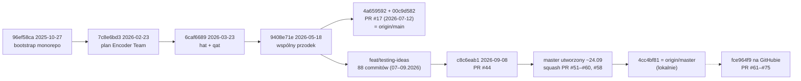

# Branche — szczegóły

> [!skrot] W 30 sekund
> - Są **dwie linie główne**: `origin/main` (00c9d582, 2026-07-12) i `origin/master` (4cc4bf81, 2026-09-24). Ich wspólny przodek to `9408e71e` (2026-05-18, Karolina, „create training based on umarly-poeta notebooks”). Po rozjeździe `main` dostał 2 commity (PR #17), a `master` 90.
> - **Aktywna jest linia `master`.** Utworzono ją ok. 23–24.09.2026 z `feat/testing-ideas` @ `c8c6eab1` i ustawiono jako domyślną na GitHubie (`docs/project/team-plan/Plan_zespolu_SNN.md:9-21`). `gh api` z 2026-10-05 zwraca `default_branch = master`. Lokalne `origin/HEAD → main` to nieaktualny ślad z klonowania.
> - Do `master` wchodzi się tylko przez PR z zielonym `pr-gate` i squashem (`docs/project/W0_START_HERE.md:17-22`). Dlatego zmergowane gałęzie zespołu **nie są przodkami** `master`. Scalenie potwierdzam identycznym drzewem lub numerem PR.
> - Lokalne referencje pochodzą z fetcha z 2026-09-27. Stan GitHuba sprawdziłem przez `gh` (tylko odczyt, 2026-10-05), patrz [[#Stan na GitHubie po ostatnim fetchu]].

> [!wazne] Lokalne gałęzie są nieaktualne
> - `main` (lokalna) @ `9408e71e`: **2 commity za** `origin/main`.
> - `feat/testing-ideas` (lokalna) @ `c8c6eab1`: **11 commitów za** `origin/feat/testing-ideas`.
> - `feat/patryk-telemetry-p3` (wymeldowana) @ `ef42c20e`: zgodna z `origin/…` na dzień fetcha. Na GitHubie została już scalona (PR #64, 2026-09-27) i usunięta.
> - Sam `origin/master` też jest nieaktualny: na GitHubie `master` = `fce964f9`, czyli 11 commitów dalej (PR #61–#75).

## Dwie linie: main vs master

- **`origin/main`**: zawiera tylko szkielet monorepo (Wiktor/vityk-dev, 2025-10 – 2026-02), `hat + qat 1 iteration` (Patryk, 2026-03-23), trening Karoliny (2026-05-18) i PR #17 z `snn_pipeline/build_combined_dataset.py` (Patryk, 2026-07-12). Na najwyższym poziomie ma `docs encoder experiments snn_pipeline snn_simulator software tests` i pliki luźne (`git ls-tree origin/main`).
- **`origin/master`**: pierwsza linia rodzica to praca z `feat/testing-ideas` od 2026-07-09: architektury 10/14 neuronów, GA, kontrakt danych v1/v2, FA/h, poprawki przecieku (PR #44). Dalej są squashe W0 (PR #51–#60) i P1 (PR #58). Dochodzą katalogi `architecture_*`, `contracts`, `dataset`, `ga_neuron_search`, `lu.i-neuron-pcb` (submoduł), `models`, `rpi_agents`, `snn_runtime`, `.github`.
- Rozbieżność: `git rev-list --left-right --count origin/main...origin/master` = `2 90`. Plan zespołu podaje „brakuje mu 80 commitów” (`Plan_zespolu_SNN.md:29`), bo liczył względem `c8c6eab1`, przed squashami W0.
- Jedyna własna zmiana `main` (`build_combined_dataset.py`) jest też w `master` w nowszej wersji (+339/−197 linii różnicy), więc `main` nie wnosi nic unikalnego. Plan zespołu: „Nie nadpisujemy nowszego pipeline'u starym plikiem” (`Plan_zespolu_SNN.md:29`).

## Skróty etapów

Źródło: `docs/project/team-plan/Plan_zespolu_SNN.md` (nagłówki z numerami linii) oraz `docs/project/team-plan/taski/T01–T06`. Litera oznacza właściciela pakietu, numer kolejny krok.

| Skrót | Właściciel | Znaczenie (linia w planie) |
|---|---|---|
| **W0** | Wiktor | Kontrakty v1.0, fixtures, mock API, root CI `pr-gate` (169; `W0_START_HERE.md:3-5`) |
| W1 / W2 | Wiktor | Bridge Uno ↔ RPi 5 (184) / trwałe zdarzenia i polecenia (202) |
| W3 / W4 / W5 | Wiktor | Foundry i reguła alarmu (217) / Azure i wspólny login (235) / odbiór i wersja demo (250) |
| **P1** | Patryk | Model i wejście runtime: `SNNRuntime` + walidacja `ModelManifest` (270) |
| **P2** | Patryk | Stanowy streaming i dekoder (283) |
| **P3** | Patryk | Telemetria i edytowalna topologia (299) |
| P4 / P5 | Patryk | Porównanie z fizycznym Lu.i (312) / zamrożony runtime i golden replay (325) |
| C1–C5 | Karolina | C1 szkielet i logowanie (343), C2 płytki i edytor sieci (356), C3 potencjał LED, raster, replay (372), C4 zdarzenia, metryki, energia (385), **C5** odbiór UI na realnych danych (398) |
| M0–M5 | Marcel | M0 profil treningu M5 Max (416), M1 protokół eksperymentu (431), M2 naprawa final eval i eksportu (447), **M3** kontrolowany trening (462), M4 ocena strumienia ciągłego (478), M5 pakiet championa (491) |
| **K1**–K5 | Kacper | K1 zamrożenie wariantu enkodera (509), K2 firmware i test zgodności (522), K3 continuous dataset (538), K4 baseline FFT na Uno (553), K5 PR i instrukcja dla Wiktora (566) |
| A1–A5 | Andrzej | Inwentaryzacja (584), kalibracja neuronów (597), pomiar energii (613), sieć fizyczna/dane partnerskie (628), odbiór sprzętu (641) |
| D1–D3 | — | Kolejne dni wspólnej pracy, nie daty kalendarzowe (`Plan_zespolu_SNN.md:134-142`) |
| **N8** | — | Topologia sieci z **N=8** neuronami w układzie 7-4-3-1, zwycięzca GA na `feat/training_N8` (commity `8f41c6ea`, `e36bc467`) |
| E1–E8, PB1–PB4 | — | Eksperymenty i pytania badawcze z materiałów konferencyjnych (`docs/konferencja_2026/_build/doc1.py:74-82, 236-270`) |
| Kontrakt danych v1/v2 | Patryk | Wersje głównego zbioru `dataset/versions/v1.0.0` i `v2.0.0` (`docs/DATASET_CONTRACT.md`) |

> [!wazne] Kolizje nazw
> - `K1`–`K9` i `O1`–`O5` w `docs/DATASET_CONTRACT.md:321-339` to **kontrole walidatora zbioru**, nie kroki Kacpra. Commit „adds K8/K9/O5 validator checks” (6398209f) dotyczy walidatora, a „ukonczono K1” (470286a5) kroku Kacpra.
> - `feat(rpi): P0…P5` na `feat/rpi` (Wiktor, 2026-06-05) to fazy starego planu agenta RPi, **nie** P1–P3 Patryka. **niepewne:** co dokładnie oznaczały, bo commity nie mają opisu.

## Kamienie milowe (chronologicznie)

| Data | Wydarzenie | Gałąź / commit / PR | Kto |
|---|---|---|---|
| 2025-10-27 | Bootstrap monorepo (frontend+backend+rag+llm+infra) | `96ef58ca` (wspólna historia) | Wiktor (vityk-dev) |
| 2026-02-08 | Podział na warstwy hardware/software/firmware | `006797e3` | Wiktor |
| 2026-02-23 | Struktura początkowa, plan Encoder Team; start `feat/decoder`, `docs` | `a12e4866`, `7c8e6bd3` | Wiktor, Kacper |
| 2026-03-23 | „hat + qat 1 iteration” (HAT/QAT w `snn_pipeline`), dokumenty BOM/SPI/synapsy | `6caf6689` | Patryk |
| 2026-05-18 | Trening na notebookach Patryka, **punkt rozjazdu main/master** | `9408e71e` | Karolina |
| 2026-06-01 – 06-30 | Enkoder (mock, testy C++, statystyki, PWM) przez PR #8–#16 do `dev` | `feat/encoder` → `dev` | Kacper |
| 2026-06-05 | Agent RPi, fazy P0–P5 (systemd, kamera USB) | `feat/rpi` | Wiktor |
| 2026-07-09 | Architektury 10 neuronów (ADR-0001) i 14 neuronów Patryka | `8e4b0cdb`, `1142b237` (linia master) | Wiktor, Patryk |
| 2026-07-12 | PR #17: builder połączonego zbioru, **ostatni commit `main`** | `worktree-dataset-expansion` → `main` | Patryk |
| 2026-07-14 | Dashboard/Azure, ADR rpi_agents 0001–0018 | `feat/dashboard` | Wiktor |
| 2026-08-13 | GA v1.2 (Karolina), wyniki GA | linia master `4f6411ed`, `7fde86df` | Karolina |
| 2026-08-19 | PR #18: bank cech enkodera do `dev` (ostatni ruch na `dev`) | `feat/encoder` → `dev` | Kacper |
| 2026-08-24 | **N8**: zwycięzca GA N=8 (7-4-3-1), clip-F1 0.658 / FA 0.158 (wg treści commita) | `feat/training_N8` (PR #23 otwarty; commity przeniesione cherry-pickiem do master) | Wiktor |
| 2026-08-26 | **Kontrakt danych v1** (wersjonowany zbiór, walidator) | `feat/dataset-contract-v1`, PR #33 (scalony 08-30) | Patryk |
| 2026-08-27 | **Kontrakt danych v2.0.0**: etykiety VOICe z katalogu ekstrakcji (+1412 klipów szkła odzyskanych, −241), kontrole K8/K9/O5 | `feat/voice-label-fix-dataset-contract-v2`, PR #42 | Patryk |
| 2026-08-30 | FA/h jako metryka selekcji + próg akceptacji (#37) | `7861316d` (linia master) | Karolina |
| 2026-08-31 | PR #46: wersje zbioru w repo, wycofanie liczb ze `spikes_manifest7` | `feat/rebuild-clean-benchmark` | Patryk |
| 2026-09-01 | PR #45: usunięcie cech niedostępnych na sprzęcie | `feat/dataset-remove-atrifacts` | Kacper |
| 2026-09-08 | PR #44: poprawki przecieku val/test i raportowania → **baza master** `c8c6eab1` | `fix/snn-pipeline-leakage-and-reporting` (gałąź usunięta) | Marcel |
| ~2026-09-24 | Utworzenie `master`, PR #51 (dokumentacja), **#52 W0**, #53 (założenia), #54–#57 edge-cloud 01–04, #59 CI, #60 backend | gałęzie Wiktora, squash | Wiktor |
| 2026-09-24 | **P1**: kontrakt pakietu modelu i walidujący loader (PR #58) | `feat/patryk-lui-runtime` (gałąź usunięta) | Patryk |
| 2026-09-25 | **K1**: zamrożenie enkodera w `.json` | `feat/encoder-features` `470286a5` | Kacper |
| 2026-09-25 | **P2**: integrator II rzędu, dekoder k-of-w, stan między batchami | `feat/patryk-state-stream-decoder` (PR #61, scalony 09-26) | Patryk |
| 2026-09-26 | **M3 pkt 2–3**: atomowy zapis manifestu/checkpointu, ranking championa | `feat/master-pipeline` `93808d40` (PR #47 otwarty) | Marcel |
| 2026-09-26 | **C5**: ograniczone renderowanie, a11y, responsywność | `feat/karolina-dashboard` `11a084b5` (PR #63, scalony 09-27) | Karolina |
| 2026-09-27 | **P3**: telemetria NeuronFrame + kontrakt `TopologyDraft` | `feat/patryk-telemetry-p3` (PR #64, scalony 09-27) | Patryk |
| 2026-09-27 – 09-29 | PR #62/#75 (enkoder K1), #65–#73 (poprawki treningu/firmware/backend), #74 (SNN vs Fourier) | tylko na GitHubie | Kacper, Wiktor, Patryk |

## Tabela zbiorcza

Kolumny „vs main” i „vs master”: `+A/−B`, gdzie A to commity gałęzi spoza linii, a B to commity linii, których gałąź nie ma (`git rev-list --left-right --count`, refy z fetcha 2026-09-27). Autorzy według nicków z gita: vityk-dev = Wiktor Goszczyński (potwierdzone w `gh pr list`), kuleczkomen = Kacper Kulka, knocek = Karolina Nocek, marcel/MarcelDoro = Marcel, UmarlyPoeta/Patryk/patryk_kozlowski = Patryk.

| Gałąź | Ostatni commit | Autor | Baza | vs main | vs master | Scalenie | Status |
|---|---|---|---|---|---|---|---|
| `master` | 4cc4bf81 2026-09-24 | Patryk (PR #58) | — | +90/−2 | 0/0 | — | **główna, aktywna** |
| `main` | 00c9d582 2026-07-12 | Patryk (PR #17) | — | 0/0 | +2/−90 | — | dawna domyślna, zamrożona |
| `feat/patryk-telemetry-p3` | ef42c20e 2026-09-27 | Patryk | master 4cc4bf81 | +97/−2 | +7/0 | PR #64 → master (GH) | scalona, usunięta na GH |
| `feat/patryk-state-stream-decoder` | 2051dab4 2026-09-25 | Patryk | master 4cc4bf81 | +96/−2 | +6/0 | PR #61 → master (GH) | scalona |
| `feat/karolina-dashboard` | 11a084b5 2026-09-26 | Karolina | master 4cc4bf81 | +97/−2 | +7/0 | PR #63 → master (GH) | scalona; na GH dalsze commity |
| `feat/master-pipeline` | 93808d40 2026-09-26 | Marcel | master 02521fde | +124/−2 | +37/−3 | PR #47 **otwarty** | **aktywna** |
| `feat/encoder-features` | 5ab343d1 2026-09-26 | Kacper | master 637989ee | +91/−2 | +9/−8 | PR #50 → testing-ideas; #62, #75 → master (GH) | **aktywna** (GH 09-28) |
| `feat/continuous-dataset` | a009acec 2026-09-23 | Kacper | 2055fb44 | +58/−2 | +8/−40 | PR #48 **otwarty** | **aktywna** (GH 09-29) |
| `feat/testing-ideas` | 23e207fd 2026-09-26 | Kacper (merge #50) | master 637989ee | +91/−2 | +9/−8 | linia integracyjna przed master | wygaszona (baza #49, #23) |
| `feat/wiktor-edge-cloud-05` | d74a7008 2026-09-24 | Wiktor | master 2c25ccbc | +98/−2 | +10/−2 | squash PR #60 (drzewo = b7cc0a69) | scalona |
| `chore/pr-gate-runtime-paths` | f46c7244 2026-09-24 | Wiktor | master 02521fde | +88/−2 | +1/−3 | squash PR #59 | scalona |
| `feat/wiktor-edge-cloud` | 3b957e33 2026-09-24 | Wiktor | master 64471f63 | +84/−2 | +1/−7 | squash PR #54 | scalona |
| `feat/w0-integration-foundation` | b27afdf3 2026-09-24 | Wiktor | master a5153c6f | +83/−2 | +2/−9 | squash PR #52 (drzewo = 637989ee) | scalona |
| `feat/project-documentation` | 6e1cac3f 2026-09-24 | Wiktor | c8c6eab1 | +81/−2 | +1/−10 | squash PR #51 | scalona |
| `fah-metric-kn` | e09456a8 2026-09-14 | Karolina | c8c6eab1 | +83/−2 | +3/−10 | PR #49 **otwarty** (→ testing-ideas) | zawieszona |
| `feat/rebuild-clean-benchmark` | 6a93deb8 2026-08-31 | Patryk | — | +24/−2 | 0/−66 | PR #46, przodek master | scalona |
| `feat/dataset-remove-atrifacts` | b8a4ac1e 2026-09-01 | Kacper | — | +49/−2 | 0/−41 | PR #45, przodek master | scalona |
| `feat/voice-label-fix-dataset-contract-v2` | 6398209f 2026-08-27 | Patryk | — | +19/−2 | 0/−71 | PR #42, przodek master | scalona |
| `feat/dataset-contract-v1` | 2a5a5e2f 2026-08-26 | Patryk | — | +18/−2 | 0/−72 | PR #33, przodek master | scalona |
| `feat/training_N8` | e36bc467 2026-08-24 | Wiktor | 30f5bccd | +19/−2 | +3/−74 | PR #23 **otwarty**; treść cherry-pickiem w master | historyczna |
| `dev` | f1b5f07f 2026-08-19 | Kacper | 7c8e6bd3 | +106/−7 | +106/−95 | nie | porzucona (stara integracja) |
| `feat/encoder` | 3bf5b300 2026-08-14 | Kacper | 7c8e6bd3 | +105/−7 | +105/−95 | do `dev` (#8–#18) | porzucona |
| `feat/dashboard` | bb1dbe02 2026-08-13 | Wiktor | 9408e71e | +22/−2 | +22/−90 | nie (selektywny import w W0) | porzucona / źródło |
| `snn_marcel_meeting` | 4f48fc98 2026-07-15 | Marcel | 7c8e6bd3 | +45/−7 | +45/−95 | nie | porzucona |
| `feat/rpi` | 9c329a9f 2026-07-14 | Wiktor | 9408e71e | +14/−2 | +14/−90 | zawarta w `feat/dashboard` | porzucona |
| `worktree-dataset-expansion` | 4a659592 2026-07-12 | Patryk | 9408e71e | 0/−1 | +1/−90 | PR #17 → main | scalona do main |
| `snn/ready-for-test-pipeline` | da0dba32 2026-06-14 | Patryk | 7c8e6bd3 | +54/−7 | +54/−95 | nie | porzucona |
| `feat/ci-cd-pipeline` | e81faaa4 2026-06-12 | Karolina | 7c8e6bd3 | +65/−7 | +65/−95 | nie | porzucona |
| `dataset/proposed-dataset` | a6b76ee8 2026-06-08 | Patryk | 7c8e6bd3 | +35/−7 | +35/−95 | zawarta w `snn_marcel_meeting` | porzucona |
| `integration/ci-cd-test` | 22313da5 2026-06-02 | Karolina | 9408e71e | +31/−2 | +31/−90 | nie | porzucona |
| `hat-metrics-work` | b4cd2711 2026-05-17 | Marcel | 6caf6689 | +2/−3 | +2/−91 | PR #15 zamknięty | porzucona |
| `docs` | d3ddae3f 2026-02-23 | Wiktor | a12e4866 | +1/−8 | +1/−96 | nie | porzucona |
| `feat/decoder` | cf644e1a 2026-02-23 | Wiktor (+Kacper) | 7c8e6bd3 | +5/−7 | +5/−95 | zawarta w `dev` | porzucona |

## Gałęzie — szczegóły

