# Model SNN — od dźwięku do decyzji

> [!skrot] W 30 sekund
> - **Łańcuch:** audio (WAV 44,1 kHz) → resampling do 19 231 Hz i kody ADC 10-bit → enkoder (7 kanałów binarnych, ramka 10 ms) → sieć Lu.i 7→4→3→1 (8 neuronów: H0–H3, G0–G2, D) → reguła dekodera „≥ k spików D w oknie w ramek” → alarm → metryki (recall @ budżet FA/h).
> - **Model aktualny w kodzie:** `LuiNet` w `architecture_14_neurons_patryk_09_07/snn_hw_pipeline.py:244`. To NIE jest `snn.Leaky`, tylko własny neuron z synapsą prądową, $\tau_{syn}$, $\tau_{mem}$, $V_{leak}$ i resetem do zera.
> - **Uczenie:** backprop z surogatem gradientu (arctan), dwie fazy HAT → QAT (kwantyzacja do 20 działek trymera). Algorytm genetyczny (`ga_neuron_search`) szuka **tylko topologii**, wagi zawsze uczy backprop.
> - **Na sprzęt:** eksport `hw_config.json` z nastawami dla każdej płytki: % trymera, znak ±, $\tau_{syn}$/$\tau_{mem}$, pasek LED (= $V_{leak}$) oraz test „impulsy do odpalenia przy 100 Hz”.
> - **Stan wyników:** na czystym zbiorze `spikes_v2` budżet 6 FA/h jest **nieosiągalny** (najlepiej recall 86,3% przy 219 FA/h). Szczegóły: [[Wyniki i metryki]].

## Cały łańcuch (diagram)

```mermaid
flowchart LR
  A[WAV 44,1 kHz<br/>ESC-50 / DataSEC / VOICe] --> B[resampling 19 231 Hz<br/>kody ADC 0..1023, bias 511,5]
  B --> C[usunięcie DC<br/>EMA k=1/512]
  C --> D[ramka 192 próbki = 10 ms<br/>cechy: peak, peak_cnt, cv, zcr, flux, hf_ratio]
  D --> E[kodowanie w spiki<br/>z-score adaptacyjny floor/MAD<br/>hf_lo/hf_hi: próg bezwzględny 0,28/0,35]
  E -->|7 kanałów TTL, 1 impuls/ramkę 6 ms| H[warstwa H: 4 płytki Lu.i<br/>fan-in 3]
  H --> G[warstwa G: 3 płytki]
  G --> O[neuron D<br/>dokładnie 3 wejścia]
  O --> R[dekoder: ≥k spików D w oknie w ramek<br/>refrakcja 500 ramek = 5 s]
  R --> M[alarm → recall, FA/h per kind]
```

## 1. Audio → cechy (enkoder)

Źródło prawdy w Pythonie to cyfrowy bliźniak `architecture_14_neurons_patryk_09_07/encoder_twin.py`, wzorowany na firmware `encoder_v2.ino` (Arduino Uno). Szczegóły w [[encoder]] i [[Architektury sieci]].

- `FS_HZ = 19231`, `HOP_SAMPLES = 192`, czyli ramka trwa 10 ms. Jest to jednocześnie krok czasowy sieci, `DT = 0.010` (`encoder_twin.py:77-78`, `snn_hw_pipeline.py:45`).
- Audio jest **resamplowane** do 19 231 Hz, a nie przeliczane, żeby stałe firmware przenosiły się 1:1 (`encoder_twin.py:9-16`, `DECYZJE_SESJI.md` A1).
- Cechy w ramce (`encoder_twin.py:265-362`):
  - `peak` = max |x|
  - `peak_cnt` = liczba próbek powyżej `spike_thr` (3× floor kanału peak)
  - `cv` = σ(|x|)/mean(|x|)
  - `zcr` = przejścia przez zero / 192
  - `flux` = max(0, log1p(rms) − log1p(rms_prev))
  - `hf_ratio` = energia pasma górnego (filtr 1-biegunowy, odcięcie ok. 2,2 kHz) / energia ramki
- **Kodowanie w spiki:**
  - kanały 0–4 przez z-score względem adaptacyjnego floora (rośnie wolno `A_UP=0.0015`, spada szybko `A_DN=0.03`) i MAD. Progi `THR_Z = [4.0, 3.5, 3.0, 2.5, 3.5]` (`encoder_twin.py:95`);
  - `hf_lo`/`hf_hi` progiem **bezwzględnym** 0,28 i 0,35 (kod termometrowy), tylko gdy ramka jest zdarzeniem (`peak > 1.5×floor`) (`encoder_twin.py:97`, `:134`);
  - refrakcja 1 ramka na kanał.
- Stan enkodera **nie jest resetowany** między plikami. Jeden ciągły stan jest rozgrzewany przez 30 s na tle stacjonarnym (`DECYZJE_SESJI.md` A4, `encoder_twin.py:363`).
- W 7 kanałach v3 cecha `crest` została zastąpiona przez `hf_lo`/`hf_hi`. Stara wersja miała 6 kanałów i nazywała się „14 neuronów” (6 wejść + 8 płytek), nowa ma 7 kanałów i nazywa się „15 neuronów” (7 + 8). W obu wariantach **płytek Lu.i jest 8** (`hw7_config.json` → `model_provenance.topology`).

## 2. Sieć: topologia

Wąski wariant domyślny 7→4→3→1, maski łączności wpisane w graf od pierwszej epoki (`snn_hw_pipeline.py:68-73`):

| neuron | wejścia |
|---|---|
| H0 | peak, peak_cnt, hf_lo |
| H1 | cv, zcr, hf_hi |
| H2 | peak, flux, hf_lo |
| H3 | peak_cnt, flux, hf_hi |
| G0 / G1 / G2 | (H0,H1,H2) / (H1,H2,H3) / (H2,H3,H0) |
| D | G0, G1, G2 |

- Twarde ograniczenie: fan-in ≤ 3, bo płytka ma wejścia J1/J2/J3 (asercja w `dense_mask`, `snn_hw_pipeline.py:108-114`).
- Wariant szeroki `--wide`: 7→8→3→1, H=8 płytek (12 neuronów) (`snn_hw_pipeline.py:82-93`).
- Ręcznie zaprojektowane maski powyżej różnią się od topologii znalezionej przez GA. Zwycięzca GA N=8 też ma kształt `7-4-3-1`, ale inne okablowanie: H: [peak_cnt, flux], [hf_lo, hf_hi], [cv, zcr], [peak, hf_lo] (`ga_neuron_search/wyniki_fine_tuned_hw_config_N8.json` → `topology`).

## 3. Model neuronu (dokładnie wg kodu)

`LuiLayer.forward`, `snn_hw_pipeline.py:212-241`:

> [!wzor] Neuron Lu.i w symulacji
> $a = e^{-\Delta t/\tau_{syn}}, \quad b = e^{-\Delta t/\tau_{mem}}, \quad \Delta t = 10\ \text{ms}$
>
> $I[t] = a\, I[t-1] + \sum_j W_{ij}\, s_j[t]$
>
> $V[t] = b\, V[t-1] + (1-b)\, V_{leak} + I[t]$
>
> $s[t] = H(V[t] - V_{th}), \quad V_{th} = 1{,}0 \text{ (stały, VDD/2)}$
>
> po spiku: $V[t] \leftarrow 0$ (reset do zera); start: $V = V_{leak}$, $I = 0$

- **Uwaga:** docstring (`snn_hw_pipeline.py:9`) zapisuje $V[t] = bV[t-1] + (1-b)(V_{leak} + I[t])$, a kod (`:236`) dodaje $I[t]$ **bez** czynnika $(1-b)$. Obowiązuje kod.
- Zakresy fizyczne (`:45-57`):
  - $\tau_{syn} \in [5, 220]$ ms (C_syn = 10 µF), $\tau_{mem} \in [20, 2200]$ ms (C_mem = 22 µF);
  - $V_{leak} \in [0, 0{,}9 V_{th}]$;
  - |W| ≤ 1,6, martwa strefa 0,05, 20 działek trymera.
- Uczone są: W, $V_{leak}$ i τ (przez sigmoidę na zakres). Gdy podano `--hw-params` (τ zmierzone na płytkach), τ są zamrażane (`:173-178`).
- Surogat gradientu: w przód Heaviside, w tył $\frac{1}{1+(\alpha x)^2}$ z $\alpha = 5$ (`SpikeFn`, `:119-133`).
- Kwantyzacja STE: $q = \text{round}(w/0{,}08)\cdot 0{,}08$, zero gdy |q| < 0,05, przycięcie do ±1,6 (`quantize_ste`, `:138-144`).
- Szum sprzętowy w HAT: ±½ działki trymera (σ_W = 0,04), τ ×exp(N(0, 0,1)), V_leak ±0,02 (`:55-57`, `:218-223`). Szum dotyczy tylko istniejących synaps.

> [!intuicja] Dlaczego nie `snn.Leaky`
> `architektura_i_kalibracja.md` §0: Lu.i ma synapsę prądową z własną stałą czasową, a membrana relaksuje do $V_{leak}$, nie do 0. Próg jest sprzętowo nieruchomy, więc o czułości decyduje zapas $V_{th} - V_{leak}$ (pasek LED) i wagi. Starsze modele (`snn_pipeline/snn_model.py`, `architecture_10/14_marcel`) używają `snntorch.Leaky` z uczonym progiem, którego płytka fizycznie nie ma.

## 4. Uczenie

`train()`, `snn_hw_pipeline.py:625-849`:

- **Dane:** okna T=200 ramek (2 s), stride 50, jeden CSV = jeden klip (`SpikeClips`, `:277`). `WeightedRandomSampler` losuje 12 000 zbalansowanych okien na epokę (`make_sampler`, `--num-samples`).
- **Strata** (`loss_fn`, `:383-416`):

> [!wzor] Strata treningowa
> $\text{logit} = 6\,(\max_t V_D[t] - V_{th})$
>
> $L = \text{BCE}_{pw}(\text{logit}, y) + w_m \cdot \overline{(\max_t V_D - 0{,}8)_+^2}\big|_{neg} + 0{,}2 \cdot \text{reg}_{rate} + w_{spk} \cdot L_{spk}$
>
> $\text{reg}_{rate}$ utrzymuje częstość spików warstw H i G w przedziale $[0{,}02;\ 0{,}30]$. $L_{spk}$ (opcjonalne, `--spk-w`): szkło ≥ 2 spiki D, tło 0.

- **Harmonogram:**
  - HAT = pierwsze `hat_frac·epochs` epok (domyślnie 0,4 × 120), pełna precyzja i szum sprzętowy;
  - potem QAT z kwantyzacją, przy czym `best` jest resetowane (`:686-704`);
  - znaki wag zamrażane od 80% epok, co odpowiada przełącznikom ± (`:687`, `:705-707`);
  - Adam z lr 3e-3, CosineAnnealing, `clip_grad_norm` 1,0;
  - augmentacja: gubienie 5% spików i przesunięcie o ±3 ramki (`:715-720`).
- **Selekcja checkpointu:** w QAT domyślnie `recall_fa`, czyli recall @ 6 FA/h na val (wymaga `--val-data` z `files.csv`), w HAT ramkowe F1 (`:665-683`, `:732-745`).
- **Po treningu:**
  - ramkowe F1;
  - Monte Carlo odporności (5 przebiegów z szumem);
  - ensemble potrójnego D z głosowaniem 2 z 3;
  - metryki klipowe dla k=1,2,3;
  - raport recall @ 1 i 6 FA/h z bootstrapem CI po `group_id` (`:778-847`).
- **GA** (`ga_neuron_search`) ewoluuje maski (genom = lista warstw, neuron = 1–3 indeksy wejść). Fitness to krótki proxy-trening tym samym `LuiLayer` (`ga_neuron_search/net.py`). Zob. [[ga_neuron_search]].

## 5. Decyzja (dekoder)

- W treningu i ewaluacji okienkowej klip/okno jest pozytywne, gdy $\max_t V_D \ge V_{th}$ (D strzelił choć raz) (`evaluate`, `:419-433`).
- W metryce strumieniowej (`snn_pipeline/stream_eval.py:59-72`, `count_alarms`):
  - alarm, gdy k kolejnych spików D mieści się w oknie < w ramek;
  - po alarmie refrakcja `DEFAULT_REFRAC = 500` ramek (5 s).
  - Siatka reguł (k, w) od (1,1) do (4,500) (`:47-52`).
- Na sprzęcie dekoder ma liczyć impulsy z wyjścia J4 płytki D na Arduino/RPi. Rekomendacje kampanii lipcowej to k=1 (`hw_config.json` → `decoder`), a GA w sierpniu wybrał `tuned_k=3`. Implementacja w runtime: [[snn_runtime]].

## 6. Metryki

Definicje (wg kodu) i wszystkie liczby: [[Wyniki i metryki]]. Metryka decyzyjna wg `docs/DATASET_CONTRACT.md`: **recall @ ≤ 6 FA/h na teście, każdy `kind` ≤ 6 FA/h, próg „gotowe” recall ≥ 0,70**.

## 7. Mapowanie na sprzęt Lu.i

`export_config`, `snn_hw_pipeline.py:557-622`. Dla każdej płytki:

- skalowanie $k = \min(W_{max}/\max|w|,\ k_{allow})$, tak żeby najsilniejsza waga była na pełnej skali trymera;
- kompensacja $V_{leak}' = V_{th} - k\,(V_{th} - V_{leak})$, z dolnym ograniczeniem $V_{leak}' \ge 0{,}2\,V_{th}$ (`:575-582`). Niezmienniczość jest ścisła tylko dla pierwszego spiku ze spoczynku (komentarz `:571-574`);
- synapsa: `port` J1–J3, `sign` ±, `pot_pct` = 100·|w|·k/1,6 (poniżej 5% synapsa jest nieaktywna), `pulses_to_fire_100Hz`, czyli ile impulsów 100 Hz potrzeba do spiku. To jest test binarny kalibracji (`pulses_to_fire`, `:513-527`);
- płytka: `tau_syn_ms`, `tau_mem_ms`, `v_leak`, `led_bar_pct = 50·V_leak/V_th` (próg odpowiada 50% paska LED, `:607`);
- porównanie symulacja ↔ sprzęt: `snn_hw_pipeline.py compare` (zgodność spike-trainów i odległość van Rossuma, poniżej 85% oznacza powrót do kalibracji, `:852-873`).

Procedura ręcznej kalibracji płytek: `PORADNIK_ZLOZENIE.md` i `kalibracja_sciaga_v3.md`. Sprzęt: [[lu.i-neuron-pcb]], [[Sprzęt i wdrożenie]].

> [!wazne] Stan wdrożenia (CURRENT_ASSUMPTIONS)
> `docs/project/CURRENT_ASSUMPTIONS.md` (24.09.2026): demonstrator symuluje SNN w Azure (Uno → USB → RPi 5 → Azure). Fizyczne płytki Lu.i są „rozszerzeniem”, jeśli będzie dość sprawnych egzemplarzy. Champion ma być „zamrożony” i porównany z baseline FFT na Uno. **Niepewne:** czy jakikolwiek eksport `hw_config` został już fizycznie wykręcony na płytkach i zmierzony (w repo nie ma nagrań `compare`).

## 8. Starsze modele (kontekst)

- `snn_pipeline/snn_model.py:35`, `GlassBreakSNN`: 4 neurony `snn.Leaky` (N1 HF, N2 temporal, N_inh hamujący, N3 wyjście), wejście uśrednione do 1 kanału, wagi w E24 (rezystory). Pierwsza iteracja HAT/QAT z marca 2026. Zob. [[snn_pipeline]].
- `architecture_10_marcel` (7 L0 → 2 kombinatory → D, `snn.Leaky`), `architecture_10_marcel_2` / `architecture_14_marcel` (3 → 10 ukrytych w pełni połączonych → 1). Zob. [[Architektury sieci]].
- `snn_simulator/` to szkic z danymi syntetycznymi, niedziałający import. Zob. [[snn_simulator]].

## Powiązania
[[snn_pipeline]] · [[encoder]] · [[ga_neuron_search]] · [[Architektury sieci]] · [[Dane i zbiory]] · [[Wyniki i metryki]] · [[models]] · [[contracts]] · [[snn_runtime]] · [[lu.i-neuron-pcb]] · [[Sprzęt i wdrożenie]]

## Moje notatki
> [!ja] Tu piszesz ty — Albert tej sekcji nie rusza.
