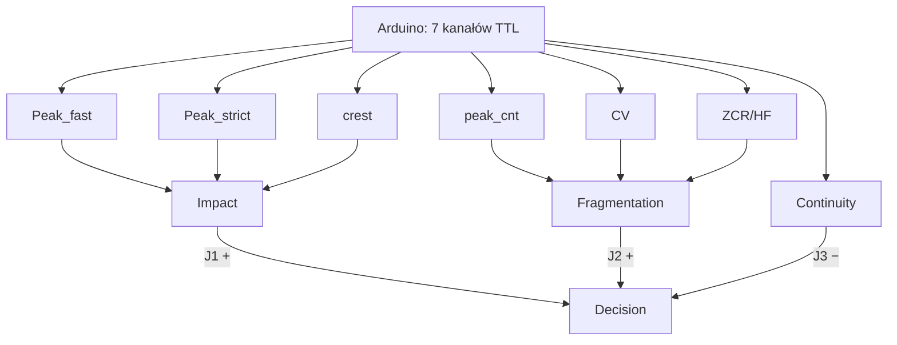

# Architektury sieci

> [!skrot] W 30 sekund
> - **Co to:** pięć katalogów z propozycjami architektury SNN. **Aktualny jest tylko `architecture_14_neurons_patryk_09_07`**: model Lu.i `LuiNet` 7→4→3→1 (8 płytek), enkoder-bliźniak, eksport nastaw, kalibracja. Tego kodu używają GA, `master_pipeline` i trening na `spikes_v2`.
> - **Pozostałe są historyczne:**
>   - `architecture_10_neurons`: projekt 10 płytek (dokument + ADR, bez kodu);
>   - `architecture_10_marcel`: kod tej idei na snntorch;
>   - `architecture_10_marcel_2` i `architecture_14_marcel`: sieć 3 → 10 ukrytych → 1, w pełni połączona, niezgodna z fan-in 3.
> - **Gdzie działa:** PC (trening, symulacja); docelowo płytki Lu.i + Arduino Uno (`encoder_v2.ino`).

## Porównanie

| katalog | data / autor | wejścia (kanały) | topologia | neuronów Lu.i | model neuronu | fan-in ≤ 3? | status |
|---|---|---|---|---|---|---|---|
| `architecture_10_neurons` | 2026-07-09, vityk-dev (8e4b0cdb) | 7 kanałów TTL z Arduino (Peak_fast, Peak_strict, crest, peak_cnt, CV, ZCR/HF, Continuity) | 7 L0 → 2 kombinatory (Impact, Fragmentation) → D; Continuity hamuje D | **10** | (dokument, bez kodu) | tak, bez fan-out | ADR-0001 „accepted”; projekt laboratoryjny |
| `architecture_10_marcel` | 2026-08-10, marcel (e788a041) | 7 | 7 L0 LIF → Impact(3) + Fragmentation(3) → D(Impact, Fragmentation, −Continuity) | 10 | `snn.Leaky`, uczone β i próg | tak (strukturalnie) | historyczny; inne cechy (hf_ratio, zcr, crest…) liczone z WAV |
| `architecture_10_marcel_2` | 2026-08-13, marcel (77b13d47) | 3 (hf_ratio, zcr, crest) | 3 LIF wejściowe → `n_hidden=10` w pełni połączonych → 1 | 3+10+1 | `snn.Leaky`, macierze dense | **nie** (fan-in do 10) | historyczny |
| `architecture_14_marcel` | 2026-07-17, marcel (8adbb96f) | 3 (hf_ratio, zcr, crest) | 3 → 10 → 1 (kod prawie identyczny z `_2`) | jw. | jw. | **nie** | historyczny; nazwa „14” = 3+10+1 |
| **`architecture_14_neurons_patryk_09_07`** | 2026-07-09 → 2026-09-08, UmarlyPoeta / Patryk | 7 v3: peak, peak_cnt, cv, zcr, flux, hf_lo, hf_hi (wcześniej 6 z crest) | **7→4→3→1** (H0–H3, G0–G2, D); `--wide` 7→8→3→1 | **8** (wide: 12) | własny Lu.i: τ_syn, τ_mem, V_leak, reset do 0, V_th stały | **tak, maska w grafie** | **aktualny** |

> [!definicja] Skąd „14” i „15 neuronów”
> W `architecture_14_neurons_patryk_09_07` liczba „neuronów” obejmuje kanały enkodera: 6 wejść + 8 płytek = 14 (wersja v2, `hw_config.json`) oraz 7 wejść + 8 płytek = 15 (v3 widmowa, `hw7_config.json` → `model_provenance.topology = "7->4->3->1 (15 neuronów, 8 płytek Lu.i)"`). Płytek Lu.i jest w obu przypadkach 8. W `architecture_14_marcel` „14” to 3 + 10 + 1.

---

## architecture_14_neurons_patryk_09_07 (aktualna)

### Struktura
```
architecture_14_neurons_patryk_09_07/   (1,9 GB lokalnie, głównie dane)
├── snn_hw_pipeline.py      ★ LuiLayer/LuiNet, SpikeClips, loss, train (HAT→QAT), export_config, compare
├── encoder_twin.py         ★ cyfrowy bliźniak encoder_v2.ino: build / build-manifest / preview
├── encoder_v2.ino          firmware Arduino Uno: ADC free-running, 7 kanałów, impuls 6 ms na D2..D8
├── eval_stream.py          ewaluacja całych klipów regułą (k, w) + raport stream_eval; --d-leak-delta
├── g_tap_eval.py           test reguły liniowej na warstwie G (nie pobiła k=1)
├── report_baseline.py      raport bazowy
├── voice_extract.py        wycinanie klipów z miksów VOICe → voice_extracted/{glass,hard_negative}
├── hw_config.json          eksport v2 (6 kanałów) — liczby WYCOFANE
├── hw7_config.json         eksport v3 (7 kanałów, seed 2) — liczby WYCOFANE
├── hw7_s*.{csv,json}, hw15_s*.{csv,json}, sweep_*.{csv,json}, train_log.csv   logi i eksporty sweepów (lipiec)
├── DECYZJE_SESJI.md        dziennik decyzji A–E (decyzja → alternatywy → dlaczego → dowód)
├── architektura_i_kalibracja.md, kalibracja_sciaga.md, kalibracja_sciaga_v3.md, PORADNIK_ZLOZENIE.md
├── PRZEWODNIK_KOMPLETNY.md, NAUKA_projekt.md   materiały do nauki
├── 2026-07-14-…txt         zrzut sesji z asystentem
├── spikes_manifest/, spikes_manifest7/  artefakty spike'owe (172/184 MB, 13 495 plików) — WYCOFANE
└── voice_extracted/        8888 WAV (1,5 GB) — źródło VOICe dla dataset v2.0.0
```

### Jak działa
Pełny opis modelu, wzorów, straty i eksportu: [[Model SNN — od dźwięku do decyzji]]. Najważniejsze miejsca w kodzie:
- stałe sprzętowe `snn_hw_pipeline.py:45-57`, maski `:68-93`;
- `LuiLayer.forward` `:212-241`, `LuiNet` `:244-274`;
- `loss_fn` `:383-416`, `evaluate_events` `:436-465`, `robustness_check(_ensemble)` `:468-510`;
- `export_config` `:557-622`, `train` `:625-849`, `compare` `:852-873`.
- Blok `model_provenance` (seed, pos_weight, commit gita, pochodzenie artefaktu z `channels.json`) jest zapisywany automatycznie (`_data_provenance`, `:530-546`).
- `encoder_twin.py`:
  - `encode_file` (`:265-361`);
  - `build_manifest` (`:566`) z `_assert_groups_disjoint` (przerywa przy przecieku), `_interleave_by_class` (przeplot klas w strumieniu) i rozgrzewką floora tylko na `kind == stationary`.
  - Gain globalny: percentyl 99,9 amplitudy wszystkich plików (`GAIN_PERCENTILE`, `:143-150`).
- `encoder_v2.ino`:
  - kanały 0–5 na D2–D7 (PORTD), kanał 6 na D8 (PORTB), impuls 6 ms (`:15`, `:30-37`);
  - prescaler ADC 32, w komentarzu „fs ≈ 19231 Hz” (`:18`, `:102`).

### Jak uruchomić
```bash
cd architecture_14_neurons_patryk_09_07
python encoder_twin.py build-manifest --manifest ../dataset/versions/v2.0.0/manifest.csv --root .. --out spikes_v2 --warmup-seconds 30
python snn_hw_pipeline.py train --data spikes_v2/train --val-data spikes_v2/val --test-data spikes_v2/test \
    --out hw_config.json --ckpt best.pt --select-metric recall_fa --stream-budget 6
python snn_hw_pipeline.py train --data ./spikes_csv --limit 200 --epochs 8      # smoke test
python eval_stream.py --ckpt best.pt --data spikes_v2/test [--rules 1:1 2:100 3:250]
python snn_hw_pipeline.py compare --sim sim.npz --hw hw_spikes.csv --layer H
```
Domyślne parametry treningu (`:879-926`): epochs 120, bs 128, lr 3e-3, T 200, stride 50, pos_weight 1,0, margin_w 0,5, spk_w 0, hat_frac 0,4, patience 20, num_samples 12 000, select_metric `recall_fa`, stream_budget 6.

### Wyniki
Wszystkie liczby z `hw_config.json`/`hw7_config.json` są **wycofane** (artefakt `spikes_manifest7`). Liczby na czystym `spikes_v2` są w `models/WYNIKI.md` na gałęzi `origin/fah-metric-kn`. Zob. [[Wyniki i metryki]].

### Historia decyzji (z `DECYZJE_SESJI.md`)
- A4: ciągły stan enkodera zamiast resetu per plik (przy resecie glass 25% vs negative 27% ramek ze spikiem, czyli brak rozróżnienia).
- B1–B3: checkpoint po F1, fazy HAT→QAT, split po plikach.
- D2: strata `spk_w` odrzucona w lipcu (na sierpniowym `spikes_v2` testowana ponownie).
- D3: reguła k=1.
- D4: sufitem był enkoder pełnopasmowy.
- E6: próg bezwzględny dla hf_ratio. Z-score odwracał sygnał: 1,05% szkło vs 3,39% datasec.
- E3: topologia 7→4→3→1, 8 płytek.

### Na gałęziach
- Na `origin/main` katalogu nie ma (powstał 2026-07-09, commit 1142b237, „architekture 14 neuronow patryk spotkanie”).
- `origin/feat/encoder-features`: wariant enkodera `swap` (`peak_cnt`→`hjorth_mobility`, `cv`→`autocorr_lag1`), nowy `train_log.csv`. Zob. [[encoder]].
- `origin/feat/master-pipeline`: drobna zmiana `snn_hw_pipeline.py` (4 linie); `master_pipeline/` używa tego modelu.

### Znane problemy / TODO
- Docstring mówi „6->4->3->1” (`snn_hw_pipeline.py:4`), a kod ma 7 kanałów. Docstring wzoru V (`:9`) różni się od kodu (`:236`).
- Docstring `encoder_twin.py` mówi „frame,s0..s5”, a kod ma 7 kanałów (s0..s6).
- `hw7_config.json` deklaruje `source_checkpoint: hw7_s2.pt`, którego nie ma w repo (`models/README.md`).
- **Sprzeczność co do fs:** `encoder_v2.ino:18` twierdzi, że prescaler 32 daje 19 231 Hz. Pomiar na gałęzi `feat/encoder-features` (`encoder/features-improvement/README.md`, krok 1) dał przy prescalerze 32 ok. 27 050 Hz i 99,73% CPU w ISR. 19 230,5 Hz uzyskano dopiero przy prescalerze 64.

---

## architecture_10_neurons (projekt, bez kodu)
- **Pliki:**
  - `architecture/01-lui-10-neuron-architecture.md` (377 linii);
  - `adr/0001-lui-10-neuron-no-fanout.md` (status accepted, 2026-07-09, „lab team”);
  - `diagrams/lui-10-neuron-architecture.{mmd,dot,svg}`. SVG ma 0 bajtów (pusty).
- **Idea:** trzy typy dowodu: Impact (Peak_fast, Peak_strict, crest), Fragmentation (peak_cnt, CV, ZCR/HF) i Continuity (hamuje D przez J3 z „−”). Bez fan-out J4, impulsy TTL 15 ms.
- **Dlaczego zastąpiony:** `architecture_14_neurons_patryk_09_07/architektura_i_kalibracja.md` §0. Hamowanie jest tam wyuczone (znak wagi), a nie ręcznie dolutowany neuron Continuity. Fan-in 3 jest wpisany w maskę, nie wymaga przycinania. Wystarcza 8 płytek zamiast 10.



## architecture_10_marcel
- `training.py` (946 linii), `max_vals.json`, `experiments/max_vals.json`. Te pliki normalizują maksima cech: hf_ratio 0,852, zcr 0,778, crest 8,62.
- `TenNeuronGlassBreakSNN` (`training.py:417`): 7 neuronów L0 `snn.Leaky` (po jednym na kanał), `impact_head`/`fragmentation_head`/`decision_head` jako `nn.Linear(3,1)`. Continuity wchodzi do D ze znakiem minus.
- Logit to średnia membrany D w czasie.
- Enkoder `EncoderConfig` (`:104`): okno 20 ms, filtry HP α 0,99/0,85, rate coding 5–200 Hz lub TTFS, dt 1 ms. Dane z WAV albo z manifestu (`--manifest`, `ManifestAudioSpikeDataset`).
- CLI: `--epochs 20`, `--lr 5e-4`, `--hidden-size 10` (nieużywane strukturalnie), `--encoder-mode rate|ttfs`.

## architecture_10_marcel_2 i architecture_14_marcel
- Ten sam szkielet co wyżej, model `GlassBreakSNN` 3 → `n_hidden` (domyślnie 10) → 1. Macierze `w_input_hidden`, `w_hidden_output` są dense, β i progi uczone i clampowane do [0,01; 0,999] / [0,05; 5,0].
- `diff` pierwszych 400 linii obu plików różni się tylko komentarzami. `_2` ma w nazwie „10”, a `14_marcel` „14”, ale kod i topologia są te same. **Niepewne:** skąd różnica nazw (prawdopodobnie liczba neuronów przy innym `--hidden-size`).
- Brak zapisanych wyników w repo.

## Które aktualne
- **Aktualne:** `architecture_14_neurons_patryk_09_07` (model, enkoder, eksport). Topologię 7-4-3-1 potwierdził też GA (N=8 zwycięzcą sweepu, z innym okablowaniem). Zob. [[ga_neuron_search]].
- `CURRENT_ASSUMPTIONS.md` każe przy kilku liczbach neuronów raportować **krzywą kompromisu** zamiast wybierać „optymalną” liczbę z wczesnych prób.

## Powiązania
[[Model SNN — od dźwięku do decyzji]] · [[encoder]] · [[ga_neuron_search]] · [[snn_pipeline]] · [[Dane i zbiory]] · [[Wyniki i metryki]] · [[lu.i-neuron-pcb]] · [[praca_wtorek_2026_08_04]] · [[Sprzęt i wdrożenie]]

## Moje notatki
> [!ja] Tu piszesz ty — Albert tej sekcji nie rusza.
