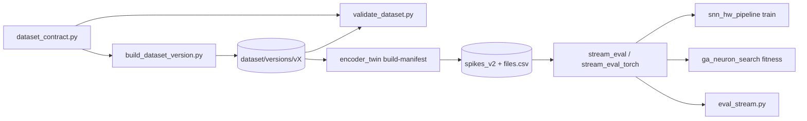

# snn_pipeline

> [!skrot] W 30 sekund
> - **Co to:** pakiet Pythona z dwiema warstwami.
>   - **Stara** (marzec 2026): 4-neuronowy `GlassBreakSNN` na snntorch, pipeline ESC-50 → HAT → QAT (wagi w E24) → eksport na PCB z rezystorami.
>   - **Aktualna** (sierpień 2026): **kontrakt danych** (budowa i walidacja wersji zbioru) oraz **wspólna metryka strumieniowa** recall @ FA/h, importowana przez `snn_hw_pipeline.py`, `eval_stream.py` i GA.
> - **Wejście → wyjście:** WAV/manifest → `dataset/versions/<v>/` (manifest.csv, dataset.json, stats.md); ciągi spików D + `files.csv` → raport recall @ budżet FA/h (dict/JSON).
> - **Gdzie działa:** PC (CPU, `DEVICE = cpu`, `config.py:331`).

## Struktura
```
snn_pipeline/
├── __init__.py              wersja 1.0.0, opis pakietu
├── config.py                stałe: E24, HardwareConfig (R_syn 10k–470k, V_th 0,3–1,5 V), LIFConfig (τ_m 20 ms, dt 1 ms), BASELINE_NEURONS, AudioConfig (22 050 Hz, pasmo 500–8000), TrainConfig, ESC-50 (klasa szkła 39)
├── snn_model.py             GlassBreakSNN — 4 neurony snn.Leaky (N1, N2, N_inh → N3)
├── spike_encoders.py        RateCodingEncoder (5–200 Hz), TTFSEncoder
├── data_pipeline.py         pobranie ESC-50, filtr pasmowy, RMS/MFCC, augmentacja (stretch, pitch, szum, RIR), DataLoadery
├── e24_quantizer.py         kwantyzacja do E24: STE, Gumbel-softmax, mixed precision, waga ↔ rezystancja
├── losses.py                HardwareAwareLoss (BCE + soft-F1 + precision/recall penalty + E24), FocalLoss
├── hat_trainer.py           HATTrainer (kalibracja progów, annealing temperatury, checkpoint po F1)
├── qat_trainer.py           QATTrainer (N3 6 bit, N1/N2 5 bit, N_inh 4 bit)
├── evaluation.py            benchmark, dryf termiczny, histogram błędów wag, estymacja mocy
├── sensitivity.py           wrażliwość recall na zaokrąglenie wag → kandydaci na MCP4151
├── hil_validation.py        Monte Carlo ±1% rezystorów, tabela SPI dla MCP4151
├── export.py                JSON/CSV/Arduino .h z wagami i rezystancjami E24
├── run_pipeline.py          orkiestracja faz A–E
├── metrics.py               precision/recall/F1/accuracy/FNR, confusion matrix, latencja
├── dataset_contract.py      ★ schemat manifestu, reguły grup, taksonomia kind, licencje, wersjonowanie
├── build_dataset_version.py ★ buduje niezmienną wersję zbioru (manifest + dataset.json + stats.md)
├── validate_dataset.py      ★ brama K1–K10 / O1–O5
├── build_combined_dataset.py stary builder dataset/combined (wycofany)
├── stream_eval.py           ★ metryka strumieniowa (numpy): count_alarms, recall @ FA/h, CI bootstrap
├── stream_eval_torch.py     ★ warstwa torch: ciągi spików D dowolnym modelem (LuiNet/GenomeNet)
└── tests/                   conftest + test_spike_artifact.py (7 testów) + test_voice_labels.py (4 testy)
```

## Jak działa

### Warstwa aktualna (kontrakt danych i metryka)
- **`dataset_contract.py`**:
  - `MANIFEST_COLUMNS` (`:42-58`), `KINDS`, `SOURCE_LICENSE`;
  - `group_id_for(source, path)` (`:111`) z regexami ESC-50/VOICe/Freesound;
  - `make_id` (sha1 ścieżki, 12 znaków), `sha256_of`.
  - Zmiana tego pliku oznacza nową wersję zbioru.
- **`build_dataset_version.py`**:
  - zbiera pliki przez `collect_esc50`, `collect_datasec`, `collect_voice` (`:99-235`);
  - `unify_groups_by_content` scala grupy o identycznym sha256 (union-find, `:235`);
  - `assign_splits` robi `GroupShuffleSplit` per źródło, VOICe według oficjalnych list (`:296-396`);
  - `build_stats` generuje `stats.md`. Odmawia nadpisania istniejącej wersji.
- **`validate_dataset.py`**: klasa `Report` (error/warn/ok), `main()` z kontrolami K1–K10 i O1–O5 (opis: [[Dane i zbiory]]). Kod wyjścia ≠ 0, gdy jest błąd krytyczny. Opcja `--quick` pomija sha256.
- **`stream_eval.py`** (szczegóły definicji: [[Wyniki i metryki]]):
  - `count_alarms(s, k, w, refrac=500)` (`:59`);
  - `ClipMeta`, `load_files_meta(split_dir)` czyta `files.csv` (`:86`);
  - `stream_report(...)` (`:158`) zwraca `{budżet: OperatingPoint}`;
  - `primary_recall`, `report_to_dict`, `format_report`;
  - self-test w `__main__` na danych syntetycznych.
  - Stałe: `DEFAULT_DT=0.01`, `DEFAULT_REFRAC=500`, `DEFAULT_BUDGETS=(1.0, 6.0)`, 13 reguł (k, w).
- **`stream_eval_torch.py`**: `load_clip_spikes(split_dir, ch_in)`, `evaluate_stream(model, split_dir, ch_in, dev, budgets, n_boot, clips)`. Model musi zwracać `model(x)["so"]` = [B,T,1].

### Warstwa stara (GlassBreakSNN)
- `snn_model.py:35` `GlassBreakSNN`:
  - wejście (B, C, T) jest **uśredniane po kanałach** do jednego sygnału (`:208-214`);
  - N1/N2/N_inh = `snn.Leaky(beta=exp(-dt/τ))` z uczonym progiem;
  - N3 dostaje $w_1 s_{N1} + w_2 s_{N2} + w_{inh} s_{inh}$ (`:266`);
  - trigger = średnia częstość spików N3 (`:281`).
  - Tryby kwantyzacji: none, hat (E24 STE), gumbel, qat (`:146-154`). Mismatch ±1% wag, ±5 mV progu (`:156-182`). Clamp chroni inhibitor (`:337-362`).
- Wartości startowe wag z „branch sim_train” (`config.py:166-195`): N1 w=0,7, V_th 0,6; N2 0,5/0,5; N3 [0,72; 0,44]/0,8; N_inh 0,33/0,4.
- `run_pipeline.py`, fazy:
  - A: setup ESC-50 + baseline;
  - B: HAT 50 epok;
  - C: QAT 20 epok;
  - D: ewaluacja (dryf, moc);
  - E: eksport JSON/CSV/.h + HIL + tabela MCP4151.
- To jest **inny model sprzętu** niż Lu.i: rezystory E24 10 k–470 k, potencjometr MCP4151, V_th 0,3–1,5 V. Aktualny model Lu.i: [[Architektury sieci]] (`snn_hw_pipeline.py`).

## Jak uruchomić
```bash
# kontrakt danych
python snn_pipeline/build_dataset_version.py --version v2.0.0 [--dry-run]
python snn_pipeline/validate_dataset.py --version v2.0.0 [--quick]
# self-test metryki
python snn_pipeline/stream_eval.py
# stary pipeline
python snn_pipeline/run_pipeline.py --phase all | --phase A --data-limit 20 | --phase B --epochs 5
# testy (domyślnie v2.0.0 i spikes_v2)
pytest snn_pipeline/tests --dataset-version v2.0.0 --spikes-dir architecture_14_neurons_patryk_09_07/spikes_v2
```
Zależności: torch, snntorch, librosa, scipy, sklearn, soundfile, pandas, tqdm, matplotlib.

> [!blad] Testy nie uruchomione
> 2026-10-05: `.venv/bin/python -m pytest` daje „No module named pytest” (w `.venv` brak pytest). Testy artefaktu i tak wymagają `spikes_v2`, którego nie ma lokalnie. Testy niczego nie sprawdziły.

## Konfiguracja i parametry
- `config.py`: `RANDOM_SEED=42`, `HW_CONFIG`, `LIF_CONFIG` (β = e^{-1/20} ≈ 0,951), `TRAIN_CONFIG` (`lambda_recall=2.0`, `recall_target=0.85`, `temp 5.0→0.1`).
- `PathConfig.__post_init__` **tworzy katalogi** `data/`, `output/`, `checkpoints/` już przy imporcie `config.py` (`config.py:293-297`). Efekt uboczny importu.

## Wyniki
Moduł nie przechowuje wyników. `stream_eval` liczy metrykę decyzyjną, liczby są w [[Wyniki i metryki]].

## Powiązania
- `architecture_14_neurons_patryk_09_07/snn_hw_pipeline.py` i `eval_stream.py` importują `stream_eval`/`stream_eval_torch` (sys.path hack, `snn_hw_pipeline.py:670-675`).
- `ga_neuron_search/fitness.py` (metryka `recall_fa`).
- `test_forward.py` w korzeniu testuje `GlassBreakSNN` (zob. [[main.py i test_forward.py]]).
- Dane: [[dataset]], [[Dane i zbiory]]. Testy ogólne: [[tests]].



## Na gałęziach
- `origin/main` (2026-07-12): tylko stara warstwa. Brak `dataset_contract`, `build_dataset_version`, `validate_dataset`, `stream_eval*`, `tests/`. `config.py` ma tam ESC-50 klasę **38** (błąd: clock_tick).
- `origin/feat/dataset-contract-v1` (2a5a5e2f) wprowadza kontrakt z K1–K7. `origin/feat/voice-label-fix-dataset-contract-v2` (6398209f) dodaje K8/K9/O5 i `tests/test_voice_labels.py`.
- `stream_eval.py` i K10 pochodzą z 7861316d (2026-08-30). W `origin/master` i na bieżącej gałęzi `snn_pipeline/` jest identyczny (`git diff origin/master HEAD -- snn_pipeline` pusty).
- Najstarszy commit modułu: 6caf6689 (2026-03-23, Patryk, „hat + qat 1 iteration”).

## Znane problemy / TODO
- Stary `GlassBreakSNN` uśrednia kanały wejściowe do jednego (`snn_model.py:208-210`), więc N1 „HF” i N_inh „<500 Hz” dostają ten sam sygnał. Specjalizacja neuronów istnieje tylko z nazwy.
- `metrics.precision_score` zwraca 1,0, gdy nie ma predykcji pozytywnych (`metrics.py:41-42`). Może to zawyżać F1 przy martwej sieci.
- `build_combined_dataset.py` jest wycofany (`DATASET_CONTRACT.md`), ale nadal leży w pakiecie.
- Kontrola K10 nie jest opisana w `docs/DATASET_CONTRACT.md` (tabela kończy się na K9).

## Moje notatki
> [!ja] Tu piszesz ty — Albert tej sekcji nie rusza.
