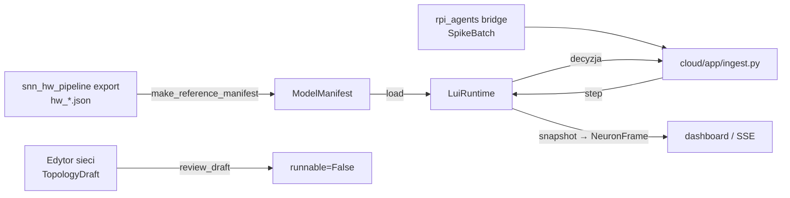

# snn_runtime

> [!skrot] W 30 sekund
> - **Co to:** stanowy symulator sieci płytek Lu.i i kontrakt „cyfrowego bliźniaka” (zadanie T02 Patryka). P1 — walidujący loader pakietu modelu (`ModelManifest`), P2 — ciągła sesja strumieniowa (integrator II rzędu + dekoder k-of-w), P3 — telemetria `NeuronFrame` i przegląd szkicu topologii (`TopologyDraft`).
> - **Wejście → wyjście:** `ModelManifest` (JSON) + strumień `SpikeBatch` → decyzja `{trigger, status, score, score_kind, provenance}` (backend dopełnia ją do `SNNDecision`) oraz `NeuronFrame` na żądanie (`snapshot()`).
> - **Gdzie działa:** w backendzie (`rpi_agents/cloud`, lokalnie albo Azure Container Apps), podpinany przez `SNN_RUNTIME=snn_runtime.runtime:from_environment`. Czysty Python, bez torch i numpy (`snn_runtime/__init__.py:1-7`), więc uruchamia się też w środowisku W0, w pr-gate i na Pi.

## Struktura (drzewo z opisem plików)
Stan gałęzi `feat/patryk-telemetry-p3` (ef42c20e, 2026-09-27):

```
snn_runtime/
├── __init__.py            # eksport: LuiRuntime, load_manifest, KOfWDecoder, LuiIntegrator, build_plan, błędy
├── errors.py              # RuntimeLoadError / RuntimeStateError ze stałym `code`
├── units.py               # jednostki: dt, a.u. vs V, znane integratory, tolerancja zegara 1%
├── manifest.py            # P1: load_manifest() → LoadedModel (346 linii)
├── integrator.py          # P2: NetworkPlan, LuiIntegrator — dynamika Lu.i ramka po ramce
├── decoder.py             # P2: KOfWDecoder — reguła k-of-w z cooldownem, strumieniowo
├── runtime.py             # P2+P3: LuiRuntime (load/reset/step/snapshot/stop), from_environment()
├── telemetry.py           # P3: build_frame() i TelemetryFeed (przerzedzanie po czasie źródłowym)
├── topology.py            # P3: review_draft(), looks_like_a_draft() — szkic z edytora ≠ model
├── MAPPING.md             # mapowanie eksportu hw_*.json → ModelManifest, pułapki P1–P8
├── TELEMETRY.md           # przekazanie dla dashboardu (T03) i backendu (T01): jak czytać NeuronFrame
└── tools/
    ├── make_reference_manifest.py  # konwerter hw_*.json → ModelManifest (powstał nim fixture lui8)
    └── make_demo_frames.py         # golden replay NeuronFrame dla dashboardu
```

## Jak działa

### P1 — loader pakietu (`manifest.py`)
`load_manifest(manifest, *, artifact_root=None, require_artifacts=False)` (`manifest.py:258`) pracuje na prywatnej głębokiej kopii, najpierw wywołuje `contracts.validation.validate("ModelManifest", …)`, a potem sprawdza rzeczy, które może ocenić tylko runtime. Każde odrzucenie to `RuntimeLoadError(code, message)` rzucone, zanim powstanie jakikolwiek stan:

| Kod | Warunek (linia) |
|---|---|
| `EMPTY_TOPOLOGY` | zero neuronów (`:280`) |
| `UNKNOWN_INTEGRATOR` | `runtime.integrator` ∉ {`none`, `lui-order2-hard-reset`} (`:287`, `units.py:427`) |
| `DT_ENCODER_MISMATCH` | \|dt_us − round(1e6·hop/fs)\| / oczekiwane > 1% (`:113-126`, `units.py:422`) |
| `DT_NOT_STABLE` | `tau_mem_us` lub `tau_syn_us` ≤ `dt_us` (`:129-138`) |
| `DECODER_WINDOW` / `DECODER_COOLDOWN` / `DECODER_THRESHOLD` | okno nie jest wielokrotnością dt, cooldown < okno, próg ≤ 0 lub niecałkowity (`:141-161`) |
| `NO_DECISION_NEURON` / `AMBIGUOUS_DECISION_NEURON` | neuron decyzyjny = jedyny bez połączeń wychodzących (`:164-185`) |
| `PORT_OUT_OF_RANGE` / `PORT_FANIN` | port ∉ {1,2,3} (`PHYSICAL_PORTS`, `:45`) albo > 3 wejścia (`:188-217`) |
| `CALIBRATION_MISSING` | `potential_unit = "V"` bez `provenance.calibration_id` (`:220-231`) |
| `ARTIFACT_MISSING` / `ARTIFACT_HASH_MISMATCH` | artefakt (np. `.pt`) nie istnieje albo sha256 się nie zgadza, liczone strumieniowo (`:234-246`) |
| `ARTIFACT_ROOT_REQUIRED` | pakiet ma artefakty, ale nie podano katalogu, a `require_artifacts=True` (`:308`) |
| `DELAY_NOT_ON_GRID`, `CYCLIC_TOPOLOGY` | z `build_plan` w integratorze (MAPPING.md §6) |

Wynikiem jest zamrożony `LoadedModel` (`:71-106`): `model_hash = content_hash(manifest)`, `decision_neuron`, `bindings` (wejścia posortowane po porcie), `channel_index`, `unused_channels`, `plan` oraz `score_kind` (`unavailable` dla integratora `none`, `spike_count` po kalibracji, w przeciwnym razie `uncalibrated`). `PortBinding.signed_weight` (`:60-68`) z powrotem nakłada znak, bo kontrakt trzyma osobno `weight ≥ 0` i `sign`.

### P2 — integrator (`integrator.py`)
Przy każdej ramce, dla każdego neuronu w porządku topologicznym po krawędziach z zerowym opóźnieniem (Kahn, `integrator.py:156`):

$$I \leftarrow \alpha I + \sum w_{\pm}\, s_{in}, \qquad V \leftarrow \beta V + (1-\beta)V_{leak} + I$$

Spike, gdy $V \ge V_{th}$, a potem $V \leftarrow V_{reset}$; $\alpha = e^{-dt/\tau_{syn}}$, $\beta = e^{-dt/\tau_{mem}}$ (`integrator.py:11-20`, pętla `step` `:235-283`). Membrana startuje od `V_leak`. Refrakcja jest zaokrąglana w górę do pełnych ramek (`:145`), a w jej trakcie prąd synaptyczny dalej się ładuje (`:262-268`).

> [!wazne] Kod kontra docstring treningu
> Prąd synaptyczny **nie** jest mnożony przez $(1-\beta)$. Tak liczy kod treningu (`snn_hw_pipeline.py:236` i `:524`), a jego docstring podaje coś innego. Runtime naśladuje kod, bo według kodu ustawiono trymery (`units.py:400-417`). Szczegóły w [[Model SNN — od dźwięku do decyzji]].

### P2 — dekoder (`decoder.py`)
`KOfWDecoder` (`decoder.py:42`) to strumieniowa wersja `count_alarms` ze `snn_pipeline/stream_eval.py`, czyli reguły, od której pochodzą liczby FA/h. Dowód równoważności opisuje docstring (`decoder.py:24-30`), a sprawdza ją test `tests/runtime/test_decoder.py::test_equals_count_alarms`. Metody: `from_manifest` (µs → ramki), `step`, `skip`, `flush`.

### P2 — sesja (`runtime.py`)
- `load(manifest)` (`runtime.py:110`) odrzuca szkic (`DRAFT_NOT_A_MODEL`), a potem woła `load_manifest(…, require_artifacts=not allow_unverified)`.
- `reset(*, epoch, source_time_us, device_id=None, session_id=None)` (`:126`) tworzy nowy integrator i dekoder. `settle_frames = ceil(3·max τ_mem / dt)` (`GAP_SETTLE_TAUS = 3`, `:53`).
- `step(batch)` (`:168`) wymaga pól `epoch, encoder_hash, source_start_us, source_end_us, spikes`. Kody: `EPOCH_MISMATCH`, `ENCODER_MISMATCH`, `SESSION_MISMATCH`, `INVALID_BATCH`. Zegarem jest **czas źródłowy, a nie `batch_seq`**: dziura `start > consumed` przechodzi przez `_absorb_gap` (`:281`). Krótka dziura jest całkowana jako cisza, a dłuższa niż `settle_frames` resetuje stan do spoczynku. W obu przypadkach włącza się warmup i flaga `gap`. Spike'i są układane na siatce ramek `frame = dt_us // model.dt_us`, a kanał to poziom, nie licznik (`:245-258`).
- Batch z niewłaściwą siatką albo nakładający się zwraca `status: invalid` (`:203-208`). W trakcie warmupu `trigger` jest wstrzymany (`:218-222`).
- Celowo nie robi: deduplikacji `batch_seq`, `StreamGap`, sprawdzania `boot_id`. To zadania backendu `rpi_agents/cloud/app/ingest.py` (`runtime.py:3-18`).
- `checkpoint()` i `restore()` rzucają `NotImplementedError("…task P5")` (`:360-366`).
- `from_environment()` (`:384`) czyta `SNN_MODEL_ARTIFACT_ROOT` i `SNN_ALLOW_UNVERIFIED_ARTIFACTS=1`.

### P3 — telemetria (`telemetry.py`, `runtime.snapshot()`)
`snapshot()` (`runtime.py:319`) niczego nie przelicza. Zmienia tylko jedno: kasuje flagę `gap` po klatce, która ją zgłosiła, więc każda dziura jest ogłaszana dokładnie raz. Bez `device_id`/`session_id` rzuca `NO_STREAM_IDENTITY`. Statusy (`runtime.py:307-317`): `stopped` > `gap` > `warmup` (warmup albo brak obserwacji) > `running`.

**Format `NeuronFrame` v1.0** (`contracts/v1/NeuronFrame.schema.json`, budowa `telemetry.py:43-93`):

| Pole | Typ / zakres |
|---|---|
| `schema_version` | const `"1.0"` |
| `device_id`, `session_id`, `topology_version` | string `^[A-Za-z0-9][A-Za-z0-9_.-]{0,63}$` |
| `epoch` | int ≥ 1 |
| `source_time_us` | int ≥ 0, koniec ostatnio przetworzonej paczki (czas źródłowy) |
| `model_hash` | `sha256:<64 hex>` |
| `frame_seq` | int ≥ 0, numer **wysłanej** klatki, rośnie od 0 po `reset` |
| `status` | `running` \| `warmup` \| `gap` \| `stopped` |
| `provenance` | `demo` (integrator `none`) \| `simulated` \| `measured` (po kalibracji) |
| `potential_unit` | `a.u.` \| `V` |
| `neurons[]` (≤ 50) | `{neuron_id, v_mem: number\|null, v_threshold, v_reset, spiked: bool}` w kolejności z manifestu |

`v_mem` to potencjał **przed** resetem, tak jak zapisuje go trening (`integrator.py:219-224`). `TelemetryFeed(min_interval_us=100_000)` (`telemetry.py:96-135`) przerzedza strumień po czasie źródłowym. Klatka ze zmienionym statusem przechodzi zawsze, `skipped` liczy klatki pominięte. Trasa SSE `GET /v1/sessions/{id}/telemetry` (zdarzenie `snapshot`) należy do backendu. Dziś istnieje tylko w mocku (`rpi_agents/cloud/app/mock_api.py:214-227`), w produkcyjnym `api.py` jej nie ma.

### P3 — szkic topologii (`topology.py`)
`TopologyDraft` (`contracts/v1/TopologyDraft.schema.json`): `boards` 0–50, `connections` z `target_port ∈ {1,2,3}`, jeden przewód na port. `review_draft` zawsze zwraca `runnable=False` z listą `MISSING_FOR_A_SESSION` (`topology.py:35-41`): wagi, τ/V, dekoder, profil enkodera, checkpoint.

## Jak uruchomić
```sh
# testy (środowisko W0, bez numpy)
.venv-w0/bin/python -m pytest tests/runtime -q -p no:cacheprovider
# golden replay NeuronFrame (TELEMETRY.md §5)
.venv-w0/bin/python -m snn_runtime.tools.make_demo_frames \
    --manifest tests/runtime/fixtures/lui8-v2-manifest.json --frames 200 --every-us 50000 --out neuron-frames.json
# odtworzenie fixture'u z eksportu treningu: komenda w MAPPING.md §5 (eksport jest na gałęzi fah-metric-kn)
# w backendzie:
SNN_RUNTIME=snn_runtime.runtime:from_environment SNN_MODEL_ARTIFACT_ROOT=<katalog z .pt>
```
Zależności: tylko `contracts` (jsonschema, rfc8785 z `requirements-w0.lock`).

## Konfiguracja i parametry
- `units.py`: `DT_TOLERANCE_FRACTION = 0.01`, `CALIBRATED_POTENTIAL_UNITS = {"V"}`, `KNOWN_INTEGRATORS = {"none","lui-order2-hard-reset"}`.
- Zmienne środowiskowe: `SNN_MODEL_ARTIFACT_ROOT`, `SNN_ALLOW_UNVERIFIED_ARTIFACTS`.
- Fixture referencyjny `tests/runtime/fixtures/lui8-v2-manifest.json`: model `lui8-v2-recallfa-s0`, `status: sandbox`, `dt_us 10000`, enkoder `encoder-v2-atmega328p` (fs 19231 Hz, hop 192, `pulse_width_us 500` jako placeholder), 7 kanałów `peak, peak_cnt, cv, zcr, flux, hf_lo, hf_hi`, 8 neuronów `H0..H3, G0..G2, D` (np. D: τ_mem 45 ms, τ_syn 43,3 ms), 24 połączenia, `topology_version lui8-7-4-3-1`, dekoder `k=1, okno 10 ms, cooldown 5 s`.

## Wyniki
Moduł nie produkuje metryk jakości. MAPPING.md §6 wylicza, że placeholderowy dekoder z fixture'u („alarm na pierwszy spike D, potem 5 s ciszy”) daje w najgorszym razie **720 alarmów/h**. Liczby jakości modelu: [[Wyniki i metryki]].

## Powiązania

- Kontrakty: [[contracts]]. Model i trening (`architecture_14_neurons_patryk_09_07/snn_hw_pipeline.py`): [[Architektury sieci]], [[Model SNN — od dźwięku do decyzji]]. Reguła FA/h: [[snn_pipeline]] (`stream_eval.count_alarms`). Wagi: [[models]].
- Backend i edge: [[rpi_agents]]. Testy i CI: [[tests]]. Całość: [[Sprzęt i wdrożenie]].

## Na gałęziach
| Gałąź | Stan `snn_runtime/` |
|---|---|
| `origin/master` (4cc4bf8, #58) | tylko P1: `manifest.py`, `units.py`, `errors.py`, `MAPPING.md` §1–5, `tools/make_reference_manifest.py`. `LuiRuntime` ma `load`, a pozostałe metody to stub |
| `feat/patryk-state-stream-decoder` (2051dab4) | P2: `integrator.py`, `decoder.py`, pełne `step()`, test integracji z backendem, MAPPING §6 |
| `feat/patryk-telemetry-p3` (ef42c20e, wymeldowana) | P3: `telemetry.py`, `topology.py`, `TELEMETRY.md`, `make_demo_frames.py`, `snapshot()/stop()`, schemat `TopologyDraft` + walidacja w `contracts/validation.py` |
| `chore/pr-gate-runtime-paths` | dodaje `snn_runtime` i `tests/runtime` do pr-gate (scalone jako #59) |
| `feat/karolina-dashboard` | konsumuje NeuronFrame z `static/demo/neuron-frames.json` (6491 linii) |

`git diff --stat origin/master...HEAD`: 22 pliki, +2388/−16. P2 i P3 nie są jeszcze w `master` (stan z fetchu 2026-09-27).

## Znane problemy / TODO
- Brak pola `topology.decision_neuron` w kontrakcie, runtime je zgaduje (MAPPING P6, do zgłoszenia Wiktorowi).
- Eksport treningu nie zawiera reguły `decoder.*`, więc manifest i zmierzone FA/h opisują różne detektory (MAPPING P5, §6). To najpoważniejsza pozycja.
- `dt_us` 10000 kontra 192/19231 s = 9984 µs, rozjazd 0,16% (P3), rozstrzyga K1.
- Żaden model nie może dziś być `evaluated_champion`, bo brakuje `training_run_id` i `evaluation_hash` (P7).
- `checkpoint/restore` = zadanie P5. Rozgrzewka enkodera nie jest modelowana (pytanie do K1, MAPPING §6).
- `rpi_agents/runtime/ports.py` (Protocol `SNNRuntime.reset`) nie ma opcjonalnych `device_id/session_id` dodanych w P3. Jest to kompatybilne, ale niezsynchronizowane.

## Moje notatki
> [!ja] Tu piszesz ty — Albert tej sekcji nie rusza.
