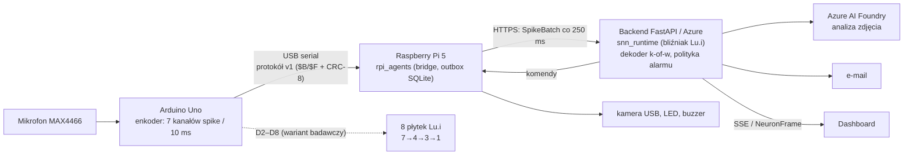

# SNN_Agent (IDS AGH): bunkier wiedzy

> [!skrot] W 30 sekund
> - **Co to:** „Wake-Up AI”: ciągła detekcja **stłuczenia szkła** z dźwięku. Impulsowa sieć neuronowa (SNN) z neuronów **Lu.i** (7→4→3→1, 8 neuronów) porównywana z detektorem FFT na Arduino Uno. Demonstrator: Uno → Raspberry Pi 5 → Azure (runtime SNN, analiza zdjęcia) → LED, buzzer, e-mail, dashboard.
> - **Repo:** `~/github/SNN_Agent` (GitHub `Industrial-Data-Science-AGH/SNN_Agent`). **Aktywna linia to `master`**, a `main` jest zamrożony. Zespół: Wiktor, Patryk, Karolina, Marcel, Kacper, Andrzej.
> - **Stan wyników:** na czystym zbiorze `spikes_v2` budżet 6 FA/h jest dziś nieosiągalny, a dawny „champion” (clip-F1 0,658) jest **wycofany** przez przeciek danych. Szczegóły: [[Wyniki i metryki]].
> - **Spisane z kodu 2026-10-05**, lokalne refy z fetcha 2026-09-27 (stan GitHuba sprawdzony przez `gh` tylko do odczytu). Źródło prawdy o założeniach: `docs/project/CURRENT_ASSUMPTIONS.md`.

## Jak to działa (od dźwięku do alarmu)

Trening i dane (offline): audio (ESC-50, DataSEC, VOICe; manifest v2.0.0) → [[encoder]] (bliźniak enkodera Uno) → spike'i → [[snn_pipeline]] i architektury (`LuiNet`, HAT → QAT, surogat gradientu) → [[ga_neuron_search]] (topologia) → eksport `hw_config.json` na płytki Lu.i → [[snn_runtime]]. Pełny opis: [[Model SNN — od dźwięku do decyzji]].

## Notatki zbiorcze
- [[Model SNN — od dźwięku do decyzji]]: łańcuch, model neuronu (wzory), uczenie, mapowanie na sprzęt.
- [[Dane i zbiory]]: manifest v2.0.0, kontrakt danych, walidator K1–K10/O1–O5, etykiety `kind`.
- [[Wyniki i metryki]]: definicje (recall @ FA/h), historia kampanii ze źródłami, dlaczego nie ma championa.
- [[Sprzęt i wdrożenie]]: Uno, Pi 5, Azure, Lu.i, protokoły (serial v1, SpikeBatch, NeuronFrame), wdrożenie na RPi.
- [[Dokumentacja projektu]]: cel badawczy, protokół, role, harmonogram, ADR-y, materiały na konferencję 2026.
- [[Branche — szczegóły]]: `main` vs `master`, 33 gałęzie (co zmienia każda, PR, status), kamienie milowe W/P/C/M/K.
- [[Struktura repozytorium]]: drzewo katalogów z rozmiarami i linkami.

## Moduły
| Obszar | Notatki |
|---|---|
| Model i trening | [[snn_pipeline]], [[snn_simulator]], [[encoder]], [[ga_neuron_search]], [[Architektury sieci]], [[experiments]], [[main.py i test_forward.py]] |
| Dane i artefakty | [[dataset]], [[models]], [[contracts]] |
| Runtime i edge | [[snn_runtime]], [[rpi_agents]], [[software]] |
| Sprzęt i pomiary | [[lu.i-neuron-pcb]], [[praca_wtorek_2026_08_04]] |
| Jakość | [[tests]] (z opisem PR gate i CI) |

## Twoja część (Patryk)
- **P1–P3 w `snn_runtime`:** P1 to loader manifestu (#58, jest w `master`), P2 to dekoder strumieniowy k-of-w (#61), P3 to telemetria NeuronFrame i szkic topologii (#64). P2 i P3 są już scalone na GitHubie. Lokalnie wymeldowana `feat/patryk-telemetry-p3` jest nieaktualna, a na GitHubie gałąź jest usunięta.
- `feat/patryk-snn-vs-fourier` scalona jako PR #74 (2026-09-28).
- Architektura `architecture_14_neurons_patryk_09_07` zawiera `LuiNet`, czyli aktualny model w kodzie.
- `praca_wtorek_2026_08_04/` jest całkowicie **nieśledzony**: nie ma go w gicie i na żadnej gałęzi, a pomiarów w nim brak (same README).

## Na co uważać
- Lokalna kopia jest **11 PR za** `master` na GitHubie (`4cc4bf81` lokalnie, `fce964f9` na GitHubie). Lokalne `main` i `feat/testing-ideas` też są nieaktualne. Zanim zaczniesz pracę: `git fetch` i nowa gałąź od `origin/master`.
- Żaden firmware Uno w repo nie mówi jeszcze protokołem serial v1. Emituje go tylko zastępczy `mega_standin.ino`.
- Trasa SSE telemetrii istnieje tylko w mock API, a w produkcyjnym `cloud/app/api.py` jej nie ma.
- Submoduł `lu.i-neuron-pcb` nie jest zainicjowany (pusty katalog).
- PR gate testuje tylko `tests/w0` i `tests/runtime` (lokalnie: 1021 passed, 33 skipped). Testy ML i dashboardu są poza CI.

## Jak szukać
- Ctrl+O i nazwa modułu albo gałęzi; w [[Branche — szczegóły]] Ctrl+F po nazwie gałęzi lub numerze PR.
- Albert: *„ej albert, co robi gałąź feat/master-pipeline?”*, *„jak działa dekoder k-of-w?”*, *„jaki jest stan wyników SNN?”*.
- `materialy szukaj "NeuronFrame"` przeszukuje notatki i kod.

## Moje notatki
> [!ja] Tu piszesz ty — Albert tej sekcji nie rusza.
