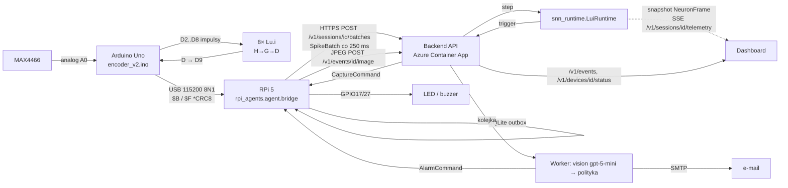

# Sprzęt i wdrożenie

> [!skrot] W 30 sekund
> - **Łańcuch:** mikrofon MAX4466 → **Arduino Uno** (enkoder, 7 kanałów spike co ok. 10 ms) → USB serial → **Raspberry Pi 5** (bridge `rpi_agents.agent`) → HTTPS → **backend** (FastAPI, lokalnie albo **Azure** Container Apps) z runtime'em SNN, vision gpt-5-mini, polityką alarmu i e-mailem → komendy wracają na Pi (zdjęcie z kamery USB, LED i buzzer na GPIO) → **dashboard** (gałąź Karoliny).
> - **Lu.i** (8 fizycznych płytek, sieć 7→4→3→1) to wariant badawczy podpinany do wyjść D2–D8 Uno, a w chmurze jego cyfrowym bliźniakiem jest [[snn_runtime]].
> - **Zweryfikowane na sprzęcie:** Pi 5 + Arduino Mega udające Uno + kamera D415 + Azure (cloud/README). **Niezweryfikowane:** prawdziwy Uno z mikrofonem w protokole v1, prawdziwy GPIO, prawdziwy runtime SNN w Azure.

## Architektura fizyczna

| Element | Rola | Źródło |
|---|---|---|
| MAX4466 | mikrofon ze wzmacniaczem (ręczny gain) → A0 Uno | `praca_wtorek_2026_08_04/README.md`, decyzja D1 |
| Arduino Uno (ATmega328P) | enkoder `encoder_v2.ino`: fs 19231 Hz, hop 192 próbki (≈ 9,984 ms), 7 kanałów `peak, peak_cnt, cv, zcr, flux, hf_lo, hf_hi` na pinach D2–D8, tryb `CALIB` | `tests/runtime/fixtures/lui8-v2-manifest.json`, `praca_wtorek…/README.md` |
| Lu.i ×8 | analogowe neurony LIF: H0–H3, G0–G2, D. Wyjście D → Uno **D9** | [[lu.i-neuron-pcb]] |
| Arduino Mega 2560 | **stand-in**, emituje protokół v1 z syntetycznymi maskami, bez mikrofonu | `rpi_agents/agent/hwtest/README.md` |
| Raspberry Pi 5 | usługa `snn-edge` (systemd), kamera USB (RealSense D415, serial w TOML), LED GPIO17 i buzzer GPIO27 (BCM, do potwierdzenia) | `rpi_agents/deploy/` |
| Azure | Storage (Tables, Blob `images`, 4 kolejki, bez shared key), Key Vault (RBAC), AI Services `gpt-5-mini`, ACR Basic, Container Apps `-api` i `-worker` (0,25 vCPU / 0,5 GiB), jedna managed identity, region francecentral (students) | `rpi_agents/cloud/README.md`, `infra/main.bicep` |
| Dashboard | ciemny UI z płytkami Lu.i, edytor 0–50 płytek, raster, inspektor; serwowany z backendu (`routes_dashboard.py`, `static/`) | gałąź `feat/karolina-dashboard` |

Pi Zero jest celem migracji: na Zero instaluje się system i zależności od nowa, bez kopiowania venv z Pi 5 (`docs/project/architecture/Architektura_SNN_Agent.md` §7).

## Przepływ danych i protokoły



### 1. Uno ↔ Pi: serial line protocol v1 (z `feat/wiktor-edge-cloud`, #54)
```
$B,<ver=1>,<build_id 8×HEX>,<fs_hz>,<hop>,<n_ch ≤8>,<pulse_us>,<chset [a-z0-9_]{1,12}>*<CRC 2×HEX>
$F,<seq u32>,<t_us u32 micros()>,<n 1..65535>,<mask 2×HEX>,<flags 1-2×HEX; bit0=priming>,<txdrop u16>*<CRC>
```
CRC-8: poly 0x07, init 0, bez odbicia i bez XOR końcowego, liczone po bajtach między `$` i `*`. Linia ma maks. 48 B i kończy się LF lub CRLF, `#` oznacza komentarz. Pi → Uno: `I` = wydrukuj ponownie linię boot. Szczegóły, kody odrzuceń i anomalie: [[rpi_agents]]. Na żadnej gałęzi nie ma firmware'u Uno z protokołem v1, emituje go tylko `mega_standin.ino`. Dzisiejszy `encoder_v2.ino` wypisuje CSV `frame,s0..s6` (czyta go `capture_serial.py`).

> [!przyda] Starsze pomysły (historyczne)
> `feat/rpi`: `rpi_agents/docs/spi_protocol_status.md` opisywał 2-bajtowy pakiet SPI co 10 ms (bajt 0: magic `0b101`, trigger, N1, N2, N3; bajt 1: LSB czasu). Architektura proponowała ramkę binarną z magic, sekwencją i CRC (`Architektura_SNN_Agent.md` ok. l. 100). Ostatecznie przyjęto tekstowy protokół v1.

### 2. Pi → chmura: `SpikeBatch` v1.0
`{schema_version "1.0", request_id "<session>.b<seq>", device_id, session_id, epoch ≥1, boot_id, batch_seq, encoder_hash "sha256:…", source_start_us, source_end_us, spikes[≤4096]{dt_us, channel}, quality{dropped_events, adc_clipped=false}}`. Paczki to całkowite liczby hopów na siatce `micros()` Uno. Dziura w danych jest jawna, backend emituje `StreamGap{reason ∈ missing_batch | dropped_events | restart | adc_clipped}`. Odpowiedź to `BatchAck`, a decyzja ma postać `SNNDecision{trigger, status ∈ valid|warmup|gap|invalid, score, score_kind ∈ spike_count|uncalibrated|unavailable, provenance ∈ demo|simulated|measured, …}`. Pełna lista endpointów: [[rpi_agents]].

### 3. Runtime → UI: `NeuronFrame` v1.0 i stan sesji (state stream)
Klatka: `{schema_version, device_id, session_id, epoch, source_time_us, model_hash, frame_seq, topology_version, status ∈ running|warmup|gap|stopped, provenance, potential_unit ∈ a.u.|V, neurons[≤50]{neuron_id, v_mem|null, v_threshold, v_reset, spiked}}`. Strumień jest przerzedzany po czasie źródłowym (domyślnie 100 ms, czyli 10 kl./s), a zmiana statusu przechodzi zawsze. Stan sesji (membrana, prądy, refrakcja, dekoder) jest przenoszony między paczkami (P2). Opis: [[snn_runtime]], `snn_runtime/TELEMETRY.md`. Trasa SSE istnieje dziś tylko w mocku W0.

### 4. Chmura → Pi: komendy
`CaptureCommand` / `AlarmCommand` (TTL ≤ 30 s, `duration_ms` ≤ 30000) pobierane przez `GET /v1/devices/{id}/commands`. Potwierdzenie `POST /v1/commands/{id}/ack` (completed / failed / expired, przy restarcie `AGENT_RESTARTED`). Epoka chroni przed wykonaniem komendy, która przyszła dla starszej sesji.

## Jak wdrożyć na RPi
Według `docs/project/RASPBERRY_PI_DEVELOPMENT.md` i `rpi_agents/deploy/README.md`:

1. **Stanowisko:** zanotuj model Pi, `uname -m`, wersję Pythona, kamerę, numer seryjny Uno i pinout LED/buzzera. Włącz SSH na osobnym koncie z kluczem, ustaw lokalny `Host snn-pi` w `~/.ssh/config` (bez prawdziwych wartości w repo). Spoza LAN tylko przez VPN lub tunel.
2. **Kod:** z `origin/master` na gałąź `feat/`, szybkie testy lokalnie, na Pi kopiowane są wyłącznie potrzebne pliki aplikacji albo commit z hashem (bez `.git`, datasetów, modeli i sekretów, bez przypadkowego `git pull`).
3. **Venv na Pi:** `python3 -m venv .venv`. Bridge potrzebuje biblioteki standardowej oraz Pillow (`python3-pil`). Nie instalować tam stosu W0.
4. **Konfiguracja:** `rpi_agents/deploy/edge.example.toml` → `/etc/snn-edge/edge.toml` (ścieżka `/dev/serial/by-id/...`, kanały w kolejności z firmware'u, serial kamery, `model_hash` i `encoder_hash` wydania). Token w pliku `chmod 600`, poza checkoutem. Test na pierwszym planie: `python -m rpi_agents.agent.bridge --config /etc/snn-edge/edge.toml` (exit 2 = błąd konfiguracji).
5. **Usługa systemowa:**
```sh
sudo useradd --system --home /var/lib/snn-edge --shell /usr/sbin/nologin snn-edge
sudo usermod -aG dialout,video snn-edge
sudo install -d -m 0750 -o root -g snn-edge /etc/snn-edge
sudo install -m 0640 -o root -g snn-edge edge.toml /etc/snn-edge/edge.toml
sudo cp rpi_agents/deploy/snn-edge.service /etc/systemd/system/
sudo systemctl daemon-reload && sudo systemctl enable --now snn-edge
journalctl -u snn-edge -f
```
Unit uruchamia `/opt/snn-edge/.venv/bin/python -m rpi_agents.agent.bridge`, ma `Restart=on-failure`, `RestartPreventExitStatus=2` i sandbox (`ProtectSystem=strict`, `DeviceAllow` dla ttyUSB, ttyACM, video4linux, usb_device), a `SNN_EDGE_VERSION` trafia do `DeviceStatus.agent_version`. Wersja deweloperska: `snn-edge.user.service` w `~/.config/systemd/user`.
6. **Kolejność testów na Pi:** serial i timestampy na fixture'ach W0 → kamera → GPIO w trybie kontrolowanym (OFF w `finally`) → mock API → sesja z Azure → pełne E2E. Zapisz commit, model Pi, firmware Uno, wersję kontraktu, model SNN i log. Testy na mocku nie są wynikami naukowymi.
7. **Bez Uno:** wgraj `mega_standin.ino` (`arduino-cli compile/upload --fqbn arduino:avr:mega:cpu=atmega2560`) i sprawdź port przez `python -m rpi_agents.agent.probe --port … --seconds 10`.
8. **Rollback:** wdrażaj wydany commit, trzymaj poprzedni katalog wydania, przełączaj `ExecStart` i restartuj usługę.

Backend i Azure: `rpi_agents/cloud/infra/deploy.sh` (faza 1: zasoby, potem `az acr build` i sekrety do Key Vault, faza 2: Container Apps). Prawdziwy runtime: `SNN_RUNTIME=snn_runtime.runtime:from_environment`, `SNN_ALLOW_DEMO_RUNTIME=0`. Wszystkie sekrety zostają w Key Vault (`‹ukryte›`).

## Środowiska i pliki w korzeniu repo

| Rzecz | Co to | Stan |
|---|---|---|
| `.venv` (57 MB) | środowisko **uv** (`pyvenv.cfg`: uv 0.11.28, prompt `snn-agent`) z `pyproject.toml`. Zawiera tylko numpy 2.5.3, bez pytesta i bez torcha | lokalne |
| `pyproject.toml` | `snn-agent` 0.1.0, `requires-python >=3.12`, `dependencies = ["numpy>=2.5.2"]`, opis „Add your description here” | śledzony (commity a12e4866, 96f4363a) |
| `uv.lock` | lock uv (revision 3): pakiety `numpy` 2.5.3 i `snn-agent` | **nieśledzony** |
| `.venv-w0` (73 MB) | `python3.12 -m venv` + `requirements-w0.lock`: fastapi, jsonschema, rfc8785, httpx, pytest 9.1.1, ruff 0.16.8… | lokalne, tożsame z CI |
| `requirements-w0.in/.lock` | dev i CI (29 pakietów z hashami), „never on the Pi” | śledzone |
| `requirements-backend.in/.lock` | obraz backendu: fastapi, uvicorn, jsonschema, rfc8785, azure-data-tables, -storage-blob, -storage-queue, azure-identity (38 pakietów). Regeneracja: `uv pip compile requirements-backend.in --universal --python-version 3.12 --generate-hashes` | śledzone |
| `requirements.txt` | stary stos ML (torch, snntorch, librosa, numpy, scipy, scikit-learn, matplotlib, tqdm, soundfile) dla `snn_pipeline/` | śledzony, legacy |
| `ruff-w0.toml` | py312, długość linii 110, `E4 E7 E9 F I` | zob. [[tests]] |
| `debug_hat.txt` (3 KB) | zrzut konsoli z `snn_pipeline`: faza B (HAT), kodowanie ttfs, CPU, seed 42, tryb quick, 50 plików ESC-50 (12 pozytywów glass_break), 1 epoka. Wynik po HAT: P 1,00 / R 0,00 / F1 0,00, TN 12, FN 4. Kodowanie znaków zepsute (Windows, ścieżka `C:\Users\Patryk\…`) | śledzony, commit 6caf6689 „hat + qat 1 iteration” |
| `tmp_out.txt` (0,5 KB) | RMS i dB 5 plików klasy HVAC (np. Max RMS 0,4609, Max dB −6,7) | śledzony, ten sam commit |

Oba pliki `.txt` to przypadkowe artefakty debugowania. Ich wynik (F1 = 0 po jednej epoce na 50 plikach) nie jest metryką projektu, zob. [[Wyniki i metryki]].

## Powiązania
Moduły: [[rpi_agents]], [[snn_runtime]], [[lu.i-neuron-pcb]], [[praca_wtorek_2026_08_04]], [[tests]], [[software]], [[contracts]], [[encoder]]. Szerzej: [[Model SNN — od dźwięku do decyzji]], [[Dokumentacja projektu]], [[Branche — szczegóły]].

## Znane problemy / TODO
- Nie ma firmware'u Uno w protokole v1. Wszystkie testy sprzętowe łańcucha zrobiono na Mega stand-in.
- `deploy/README.md` twierdzi, że brak adaptera alarmu, co jest nieaktualne od #60.
- Produkcyjne API nie ma trasy telemetrii SSE.
- Rozjazd `dt_us` 10 000 kontra 9984 µs (enkoder) i niepotwierdzona szerokość impulsu (500 µs kontra ok. 15 ms dla Lu.i).
- Według repo pomiary prądu i energii płytek Lu.i i Uno nie zostały wykonane, `pomiary/` jest pusty.

## Moje notatki
> [!ja] Tu piszesz ty — Albert tej sekcji nie rusza.
