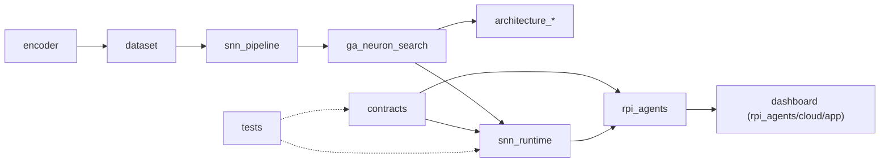

# Struktura repozytorium

> [!skrot] W 30 sekund
> - Mapa dotyczy drzewa roboczego `~/github/SNN_Agent` na gałęzi `feat/patryk-telemetry-p3` (= `origin/master` 4cc4bf81 + P2/P3), stan 2026-10-05. Rozmiary z `du -sh`.
> - **Kod produkcyjny W0+:** `contracts`, `rpi_agents`, `snn_runtime`, `tests`. **Badania i trening:** `snn_pipeline`, `ga_neuron_search`, `encoder`, `dataset`, `architecture_*`, `models`. **Historyczne:** `software`, `snn_simulator`, `experiments`, pliki luźne w roocie.
> - Największy jest `architecture_14_neurons_patryk_09_07` (**1,9 GB**, w tym artefakty spike'owe `spikes_manifest` 172 MB i `spikes_manifest7` 184 MB). Lokalny `.venv` zajmuje 57 MB i nie jest opisywany.
> - Katalogu `master_pipeline/` nie ma w tym drzewie. Istnieje tylko na gałęzi `feat/master-pipeline`, patrz [[Branche — szczegóły]].

## Drzewo (poziom 1–2)

```
SNN_Agent/
├── .github/workflows/pr.yml          12K
├── architecture_10_marcel/           52K
├── architecture_10_marcel_2/         40K
├── architecture_10_neurons/          76K   adr/ architecture/ diagrams/
├── architecture_14_marcel/           40K
├── architecture_14_neurons_patryk_09_07/  1,9G
├── contracts/                        232K  v1/ fixtures/ validation.py demo.py
├── dataset/                          6,7M  versions/v1.0.0 versions/v2.0.0
├── docs/                             18M   project/ konferencja_2026/ + pliki .md/.pdf
├── encoder/                          76K   feature_bank/ snn_encoder/ snn_decoder/
├── experiments/                      4K    decoder.py encoder.py
├── ga_neuron_search/                 520K
├── lu.i-neuron-pcb/                  (submoduł, niepobrany)
├── models/                           8K    README.md
├── praca_wtorek_2026_08_04/          388K  (nieśledzony) narzedzia/ pomiary/ software/
├── rpi_agents/                       1,2M  agent/ cloud/ deploy/ runtime/
├── snn_pipeline/                     328K  tests/
├── snn_runtime/                      248K  tools/
├── snn_simulator/                    48K   neurons/ training/ utils/
├── software/                         268K  host_agent/ infra/ web_dashboard/
├── tests/                            2,4M  runtime/ w0/
└── (pliki luźne: README.md, main.py, test_forward.py, debug_hat.txt, tmp_out.txt,
     pyproject.toml, uv.lock, requirements*.txt/.in/.lock, ruff-w0.toml, .gitmodules, .python-version)
```

## Katalogi

### Integracja W0 i system (aktualny kod)
- **`contracts/`** (232K): wspólne kontrakty danych v1.0. `v1/` zawiera 18 schematów JSON (m.in. `SpikeBatch`, `NeuronFrame`, `ModelManifest`, `EncoderProfile`, `TopologyDraft`, `VisionResult`, `AlarmCommand`). `fixtures/` to przykładowe komunikaty (spike, gap, silence, duplicate, trigger, vision-unavailable…). `validation.py` jest walidatorem, `demo.py` odtwarza fixtures na mock API. Właściciel: Wiktor (`W0_START_HERE.md:61`). → [[contracts]]
- **`rpi_agents/`** (1,2M): serwis edge i backend chmurowy.
  - `agent/` (436K): most Uno↔Pi: `serial_protocol.py`, `batching.py`, `bridge.py`, `camera.py`, `alarm.py`, `gpio.py`, `outbox.py`, `ports.py`.
  - `cloud/` (652K): `app/` (mock API, produkcyjne API, sesje, ingest, worker, vision, auth, storage Azure, dashboard) i `infra/` (Dockerfile, `main.bicep`, `deploy.sh`).
  - `deploy/` (24K): jednostki systemd `snn-edge.service` i przykładowy `edge.example.toml`.
  - `runtime/` (24K): porty `SNNRuntime` dla Patryka.
  - `MIGRATION.md`: co przeniesiono ze starego `feat/dashboard`.
  
  → [[rpi_agents]], [[Sprzęt i wdrożenie]]
- **`snn_runtime/`** (248K): runtime symulacji Lu.i (P1–P3 Patryka). `manifest.py` (walidujący loader pakietu modelu), `integrator.py`, `decoder.py` (k-of-w), `runtime.py`, `telemetry.py` (NeuronFrame), `topology.py`, `units.py`, `errors.py`, dokumenty `MAPPING.md` i `TELEMETRY.md`, `tools/make_demo_frames.py`. → [[snn_runtime]]
- **`tests/`** (2,4M): `w0/` (2,1M) testuje kontrakty, mock API, bridge, backend i E2E bez sprzętu. `runtime/` (348K) testuje `snn_runtime`. `neuron_characterization_20260322.md` to notatka z charakteryzacji neuronu. → [[tests]]
- **`.github/workflows/pr.yml`**: jedyny workflow, check `pr-gate` (ruff + pytest W0 i runtime; `chore/pr-gate-runtime-paths`).
- **`lu.i-neuron-pcb/`**: submoduł git `https://github.com/giant-axon/lu.i-neuron-pcb.git` (`.gitmodules`), commit `0b2c0193…`. W tym klonie jest pusty (niezainicjalizowany, 4K). → [[lu.i-neuron-pcb]]

### Model, trening, dane
- **`snn_pipeline/`** (328K): pipeline SNN świadomy sprzętu. Model `snn_model.py` (`GlassBreakSNN`), trening HAT/QAT, kwantyzacja E24, eksport, walidacja HIL, ewaluacja strumieniowa (`stream_eval*.py`), kontrakt i wersjonowanie zbioru (`dataset_contract.py`, `build_dataset_version.py`, `validate_dataset.py`), `build_combined_dataset.py`. → [[snn_pipeline]], [[Model SNN — od dźwięku do decyzji]]
- **`ga_neuron_search/`** (520K): algorytm genetyczny szukający topologii i parametrów sieci Lu.i (`ga.py`, `genome.py`, `fitness.py`, `winner.py`, `export_winner.py`, `validate_hw_config.py`), raporty (`TRAINING_REPORT.md`, `WYNIKI.md`, `WYJASNIENIE_dla_zespolu.md`), wyniki `wyniki_*.csv/json` i konfiguracje HW N5/N7/N8/N9. → [[ga_neuron_search]], [[Wyniki i metryki]]
- **`encoder/`** (76K): enkoder audio→impulsy. `feature_bank/` to cyfrowy bliźniak enkodera i metryki cech, `snn_encoder/snn_encoder.ino` i `snn_decoder/snn_decoder.ino` to firmware Arduino, `ENCODER_PLAN.md` to plan zespołu enkodera. Wersja K1 (`features-improvement/`) jest na `feat/encoder-features`. → [[encoder]]
- **`dataset/`** (6,7M): wersjonowane manifesty głównego zbioru `versions/v1.0.0` (3,8M) i `versions/v2.0.0` (2,9M), każdy z `manifest.csv`, `dataset.json`, `stats.md`. Samego audio nie ma w repo (`DATASET_CONTRACT.md:161`). → [[dataset]], [[Dane i zbiory]]
- **`models/`** (8K): tylko `README.md`. Katalog na checkpointy, celowo śledzony wbrew `.gitignore`. Pliki `.pt` są na gałęzi `fah-metric-kn`. → [[models]]
- **`architecture_10_neurons/`** (76K): architektura 10 płytek Lu.i z ADR-0001 (`adr/`), opisem (`architecture/01-lui-10-neuron-architecture.md`) i diagramami `.dot/.mmd/.svg`.
- **`architecture_10_marcel/`** (52K), **`architecture_10_marcel_2/`** (40K), **`architecture_14_marcel/`** (40K): skrypty `training.py` Marcela dla wariantów 10 i 14 neuronów (w pierwszym też `max_vals.json`, `experiments/`).
- **`architecture_14_neurons_patryk_09_07/`** (1,9G): architektura 14 neuronów ze spotkania 09.07. Zawiera `snn_hw_pipeline.py`, `encoder_twin.py`, `encoder_v2.ino`, `eval_stream.py`, poradniki kalibracji i dokumenty sesji, wyniki sweepów `hw7_*`, `hw15_*`, `sweep_*`. Artefakty spike'owe `spikes_manifest/` i `spikes_manifest7/` mają podkatalogi train/val/test.

  Wszystkie warianty architektur opisuje → [[Architektury sieci]]

### Dokumentacja i praca zespołu
- **`docs/`** (18M): `project/` (18M: założenia, W0, RPi, architektura, plan zespołu z diagramami i DOCX), `konferencja_2026/` (512K, nieśledzone PDF-y), `DATASET_CONTRACT.md`, starsze BOM/backplane/SPI/synapsy i PDF propozycji. → [[Dokumentacja projektu]]
- **`praca_wtorek_2026_08_04/`** (388K, **nieśledzony**): materiały na sesję pracy 04.08. Review projektu, decyzje, zadania A–D, FAQ, literatura, protokół pomiarowy, narzędzia `capture_serial.py` i `mic_check.ino`, pakiet szkoleniowy `software/`. → [[praca_wtorek_2026_08_04]]

### Historyczne / szkielet
- **`software/`** (268K): szkielet monorepo z 2025-10 opisany w README. `host_agent/` (RAG `ingest.py`/`query.py`, `run.py`), `infra/` (docker-compose, Dockerfile backend/frontend), `web_dashboard/` (`api/app.py` FastAPI + `ui/` React/Vite). Aktualny dashboard i backend to `rpi_agents/cloud/app`. → [[software]]
- **`snn_simulator/`** (48K): wczesny symulator. `neurons/lif.py`, `training/` (`loss.py`, `train_torch.py`), `utils/` (cechy audio, dane syntetyczne), `main.py`, `config.py`. → [[snn_simulator]]
- **`experiments/`** (4K): `decoder.py`, `encoder.py`. Wczesne prototypy z linii `main`. → [[experiments]]

## Pliki luźne w roocie
- `README.md`: opis „Wake-Up AI”. Od linii 3 to historyczny szkic, linki prowadzą do aktualnych dokumentów (opis w [[Dokumentacja projektu#README — co jest historyczne]]).
- `main.py`: szablon z `uv init` (`print("Hello from snn-agent!")`). Nie jest punktem wejścia projektu.
- `test_forward.py`: ręczny skrypt diagnostyczny. Tworzy `GlassBreakSNN(quantize_mode="none")` z `snn_pipeline`, wypisuje progi i wagi i puszcza burst impulsów (`test_forward.py:1-30`). Nie jest testem pytest.
- `debug_hat.txt`: zrzut logu z uruchomienia pipeline'u HAT (faza B, kodowanie ttfs, CPU, 50 plików ESC-50, ścieżki Windows). Ostatnio zmieniany w `6caf6689` (2026-03-23).
- `tmp_out.txt`: zrzut statystyk RMS/dB nagrań (np. kategoria HVAC). Plik tymczasowy, ostatnio zmieniany w `6caf6689`.
- `pyproject.toml`: projekt `snn-agent` 0.1.0, Python ≥3.12, jedyna zależność `numpy>=2.5.2`. Opis „Add your description here” to szablon `uv`.
- `uv.lock`: lock `uv` do `pyproject.toml`. W drzewie roboczym jest **nieśledzony** (`git status`: `??`).
- `requirements.txt`: zależności pipeline'u ML (torch ≥2.0, snntorch, librosa, numpy, scipy, scikit-learn, matplotlib, tqdm, soundfile).
- `requirements-w0.in` / `.lock`: stos tylko do developmentu i CI W0 (fastapi, uvicorn, jsonschema, rfc8785, httpx, pytest, ruff). Lock z hashami. Komentarz: „Never install this full stack on the Pi or into GA venv”.
- `requirements-backend.in` / `.lock`: zależności obrazu backendu (fastapi, uvicorn, jsonschema, rfc8785, SDK Azure: data-tables, storage-blob/queue, identity…) z instrukcją regeneracji przez `uv pip compile`.
- `ruff-w0.toml`: konfiguracja ruff dla `contracts`, `rpi_agents`, `tests/w0`.
- `.gitmodules`: wpis submodułu Lu.i dodany w W0. `.python-version`: wersja Pythona dla `uv`.

## Powiązania


Notatki zbiorcze: [[Dokumentacja projektu]] · [[Branche — szczegóły]] · [[Model SNN — od dźwięku do decyzji]] · [[Dane i zbiory]] · [[Wyniki i metryki]] · [[Sprzęt i wdrożenie]] · [[Architektury sieci]]

## Moje notatki
> [!ja] Tu piszesz ty — Albert tej sekcji nie rusza.
