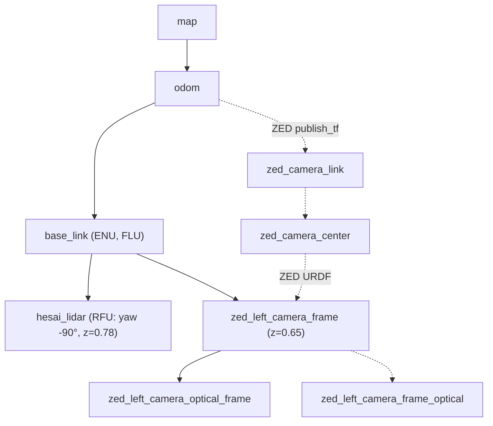

# Drzewo TF i układy współrzędnych

> [!skrot] W 30 sekund
> - **Na prawdziwej łodzi stos L0–L3 nie publikuje żadnej transformaty.** Jedyne `TransformBroadcaster`/`StaticTransformBroadcaster` poza symulacją i vendorowanym kodem są w `zed-ros2-wrapper` i w [[Pakiety/sbt_transforms|sbt_transforms]] (`sbt_tf_bridge`), a tego drugiego nic nie uruchamia.
> - Konwencja „domowa” (`sbt_transforms/README.md`, `REVIEW.md`): świat **NEU** (x = North, y = East, z = Up), ciało **FRU** (x = Forward, y = Right, z = Up), kurs **COMPASS** (0 na północy, zgodnie z zegarem). Oba układy są **lewoskrętne** (det = −1), czyli są odbiciami REP-103, a nie jego obrotami. Dlatego nie da się ich wyrazić jako TF.
> - `/odom` z `l2dp/odometry` ma pozycję w NEU, a orientację to kwaternion odniesiony do NWU. Z tego bierze się powtarzane w ~30 plikach `-std::atan2(siny_cosp, cosy_cosp)` (wg `REVIEW.md` §1.1, sprawdzone tam na 2026-08-09).

## Kto nadaje transformacje (grep po `~/solar`)
Szukano `TransformBroadcaster`, `StaticTransformBroadcaster`, `sendTransform`, `static_transform_publisher`, `robot_state_publisher` oraz plików `*.urdf`/`*.xacro`/`*.sdf`. Pominięto `build`, `install`, `node_modules`, `.git`.

| źródło | plik | transformacje | kiedy działa |
|---|---|---|---|
| `sbt_tf_bridge` | `sbt_transforms/src/tf_bridge_node.cpp:71-252` | `map→odom` (identyczność), `odom→base_link` (z `/odom`, NEU+NWU → ENU); statyczne `base_link→hesai_lidar` (z=0.78, RFU = −90°), `base_link→zed_left_camera_frame` (z=0.65), `zed_left_camera_frame→zed_left_camera_optical_frame` | tylko po ręcznym `ros2 launch sbt_transforms sbt_transforms.launch.py`; żaden launch łodzi go nie dołącza |
| ZED wrapper | `zed-ros2-wrapper-humble-v5.1.0/zed_wrapper/launch/zed_camera.launch.py:403-415`, `config/common_stereo.yaml:104-107`, `urdf/zed_macro.urdf.xacro` | domyślnie `publish_tf=true`: `odom→zed_camera_link`; `publish_map_tf=true`: `map→odom`; `publish_urdf=true` (robot_state_publisher): `zed_camera_link→zed_camera_center→zed_left_camera_frame→zed_left_camera_frame_optical` (i prawa kamera) | `zed-service/zed-pls-dont-die.sh:39-41` uruchamia `zed_wrapper zed_camera.launch.py camera_model:=zedx` z domyślnymi TF (`camera_name` domyślnie `zed`). **Niepewne**, czy na łodzi z tymi ustawieniami |
| `odom_to_tf` (sim) | `bash_do_uruchomienia/l4sim/src/odom_to_tf/src/OdomToTf.cpp:4-23` | `odom→wamv/wamv/base_link` z `/odom2` | symulacja VRX |
| VRX | `bash_do_uruchomienia/l4sim/src/vrx/vrx_ros/src/pose_tf_broadcaster.cc`, `optical_frame_publisher.cc`, `vrx_gz/src/vrx_gz/launch.py:368-379` (robot_state_publisher dla WAM-V z `vrx_urdf/wamv_*/urdf/*.xacro`) | ramki WAM-V z Gazebo | symulacja |
| `pointcloud_to_laserscan` (vendor) | `l2dp/pointcloud_to_laserscan/launch/sample_laserscan_to_pointcloud_launch.py:31-36` | `static_transform_publisher map→scan` | tylko przykładowy launch; ten pakiet ma też jedyne w stosie `TransformListener` (`pointcloud_to_laserscan_node.cpp`) |

URDF/xacro samej łodzi (barki) **nie istnieje** w `~/solar`. Są tylko URDF ZED i WAM-V z VRX. Słuchaczy TF (`tf2_ros::Buffer`, `TransformListener`, `lookupTransform`) poza `pointcloud_to_laserscan` i ZED brak. `REVIEW.md` §1.2 mówi to samo: jedyne użycia `tf2_ros` w `l3nav` to nieużywane `#include`.

## Drzewo docelowe (sbt_tf_bridge) i to, co doda ZED

Linie ciągłe to `sbt_tf_bridge` (`config/sbt_transforms.yaml`), przerywane to ZED z ustawieniami domyślnymi. `KURS_OSI_I_MIGRACJA.md` §18 dorysowuje jeszcze `base_link → gnss_antenna`, ale `sbt_tf_bridge` go nie publikuje.

> [!blad] Konflikty, gdyby oba działały naraz
> - `map → odom` publikowałyby dwa węzły (`sbt_tf_bridge`, ZED `publish_map_tf`).
> - `zed_left_camera_frame` miałaby dwóch rodziców (`base_link` z bridge'a i `zed_camera_center` z URDF ZED), a tf2 tego nie dopuszcza.
> - Nazwy ramki optycznej są różne: bridge ma `zed_left_camera_optical_frame`, ZED ma `zed_left_camera_frame_optical`.
> - Rozwiązanie wymaga `publish_tf:=false publish_map_tf:=false` w ZED albo zawieszenia bridge'a pod `zed_camera_link`. Żaden plik tego dziś nie robi.

## Układy współrzędnych w stosie (skrót z REVIEW.md i frames.yaml)
- **Świat:** NEU w `/odom.position` i większości węzłów L2/L3. Wyjątki:
  - `l2dp/gps_calculator` emituje `MetricPosition` jako (East, North) (B8);
  - `/trajectory` z odometrii jest w ENU;
  - `l2dp/mapper` po zamianie pracuje w (East, North) i jest wewnętrznie niespójny (B5).
- **Ciało:**
  - FRU: `l1od/vision_detector` (`detector_utils.py:161-165` zwraca `(x, -y, z)`) i fuzja w trybie `real`;
  - FLU: fuzja w trybie `sim`, co daje rozjazd sim/real (B6);
  - lidar `hesai_lidar` montowany jako RFU (`frames.yaml`: `/l1/obstacle_detection` RFU).
- **Kurs:**
  - `/filter/euler` z XSENS (`vector.z`), używany w [[regulator]];
  - kwaternion IMU w NWU (`frames.yaml`: `/imu/data` „mislabelled”);
  - `/true_heading/data` (COMPASS, stopnie) jest zakomentowany w [[can_driver]].
- **`frame_id` są dekoracyjne** (B12): `hesai_lidar`, `wamv/wamv/base_link`, `wamv/wamv/base_link/lidar_wamv_sensor`, `camera_det_frame`, `odom`. Żadna z tych ramek nie ma transformaty na łodzi.
- **Najpoważniejsze według REVIEW.md:**
  - **B1**: `/tracked_detections` publikują `l2dp/mapper` i `l2dp/pose_graph` w odbitych względem siebie konwencjach, więc kierunek skrętu zależy od tego, który węzeł działa;
  - **B2**: brak minusa przy kursie, m.in. w `l0hwd/regulator` (`end_heading` z `+atan2`, `regulator.cpp:161-169`, przy `heading` z `/filter/euler`).
  - Obie tezy pochodzą z audytu, w tej grupie zweryfikowano tylko część L0 (regulator, can_driver).

## Luźne pliki w `~/solar`
- **`transform_test.cpp`** (1094 B): ćwiczenie z Eigena. `T_boat_lidar` (przesunięcie (0.4, 0, −0.4)), `T_map_boat` (obrót 90° wokół Z), transformacja punktu (5,0,0) lidar → łódź → mapa i z powrotem przez `inverse()`, na końcu wypisanie macierzy obrotu 120° wokół X. Nie jest częścią żadnego pakietu.
- **`main`** (639 352 B): według `file` to „ELF 64-bit LSB executable, x86-64, dynamically linked, … not stripped”. `strings` pokazuje symbole Eigen `Transform`/`inverse` i kompilator „GCC: (GNU) 15.2.1 20260123 (Red Hat 15.2.1-7)”. To prawdopodobnie skompilowany `transform_test.cpp`, zbudowany na Fedorze/RHEL, a nie na Jetsonie (**niepewne**; nie uruchamiano). Bez prawa wykonania (`-rw-r--r--`).
- **`log.log`** (16 linii, 2026-08-05 18:14): log startu sterownika lidaru Hesai (`/home/solar/lidar_ws/HesaiLidar_ROS_2.0/…/HesaiLidar_SDK_2.0`):
  - `SocketSource::Open succeed`, ale „Multicast IP error, set correct multicast ip address or keep it empty”;
  - połączenie PTC z lidarem `192.168.10.203:9347` udane, „Read correction file from lidar success”;
  - ostrzeżenia „Open firetime file failed” i „distance_correction_lidar_type … null”;
  - parser GPU (`general_parser_gpu.cu`), czyli build z CUDA;
  - identyfikatory wątków (`281473…`) wskazują na aarch64, czyli Jetsona (**niepewne**).
  - To ten driver, który dołącza [[l0_launch]] (`hesai_ros_driver/launch/start.py`).

## Moje notatki
> [!ja] Tu piszesz ty — Albert tej sekcji nie rusza.
