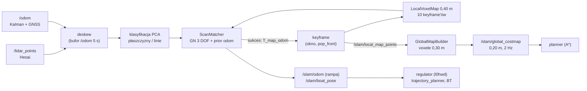

# L2 SLAM — start (dla maintainera)

> [!skrot] W 30 sekund
> - **Co to:** pakiet `pose_graph` w repo `l2dp`, jeden proces `feature` (`FeatureExtractor` + `GlobalMapBuilder`). LiDAR Hesai (`/lidar_points`) + `/odom` (Kalman z GNSS) → deskew → cechy (płaszczyzny/linie) → dopasowanie do lokalnej mapy voxelowej (Gauss–Newton, 3 DOF: x, y, yaw) → korekta `T_map_odom` → `/slam/odom`, `/slam/boat_pose`, mapa globalna i `/slam/global_costmap` (2 Hz).
> - **Czego NIE ma** (mimo nazwy pakietu): grafu poz, optymalizacji, loop closure, archiwum keyframe'ów (okno 10 keyframe'ów, ok. 8 m), kowariancji z matchera i publikacji TF.
> - **Stan produkcyjny:** `~/solar/l2dp_docking_fix`, gałąź `feat/dock_costmap_fix` + niezacommitowane zmiany (slip, korytarz doku). Szczegóły w [[SLAM — historia i gałęzie]].

## Mapa notatek
**Front-end**
- [[SLAM — architektura węzła i przepływ danych]]: proces, wątki, grupy callbacków, topiki.
- [[SLAM — deskewing]]: kompensacja ruchu w trakcie obrotu lidaru (wzory).
- [[SLAM — cechy i klasyfikacja]]: PCA, progi płaszczyzn i linii, próbkowanie.
- [[SLAM — lokalna mapa voxelowa]]: struktura, kowariancje, wyszukiwanie sąsiadów.
- [[SLAM — predykcja pozy, keyframe’y i odporność]]: keyframe'y, recovery, stan bez wyjścia, **gdzie wpiąć loop closure**.
- [[SLAM — parametry front-endu]]: 82 parametry (kod, slam.yaml, baseline).

**Back-end**
- [[SLAM — scan matching (matematyka)]]: residua, jakobiany, solver.
- [[SLAM — degeneracja i jakość dopasowania]]: obserwowalność (Schur), bramki akceptacji.
- [[SLAM — global map builder i costmapy]]: trwała mapa, warstwa żywa, inflacja, gaszenie w slipie.
- [[SLAM — parametry back-endu]]
- [[SLAM — plan testów i weryfikacja]]: plan autora, `math_checks.py` (3× PASS).

**Otoczenie i dane**
- [[L2 — odometria, sensory i fuzja]]: `/odom` (GNSS, σ ≈ 7 cm), Xsens, SBG na Celce.
- [[L2 — konsumenci pozy i mapy (co się stanie po korekcie)]]: progi skoków, które system dziś zniesie.
- [[SLAM — TF map-odom-base]]
- [[SLAM — historia i gałęzie]]: LIO-SAM (`origin/lio_sam`), slam_toolbox w l4sim, obie porzucone.
- [[SLAM — dane testowe i rosbagi]]: `bag_islamista` z powrotami w to samo miejsce.

**Loop closure (twój projekt)**
- [[Loop closure — projekt]]
- [[Loop closure — plan wdrożenia (PR po PR)]]
- [[Loop closure — testy i metryki]]

## Najważniejsze rzeczy do naprawy (zebrane ze wszystkich notatek)
> [!wazne] Najpierw to, potem loop closure
> 1. **Stan bez wyjścia:** gdy zaufane keyframe'y wypadną z okna, matcher już nigdy nie zaakceptuje dopasowania aż do restartu (`feature_extractor.cpp:2571`, `:2608-2621`, `scan_matcher.cpp:908`).
> 2. **Brak kowariancji / informacji** w `AlignmentResult` (`scan_matcher.hpp:31-76`), potrzebnej jako waga krawędzi w grafie.
> 3. **`converged` nie wchodzi do bramek akceptacji** (`scan_matcher.cpp:878-936`), a tłumienie jest stałe, bez odrzucania kroku.
> 4. **Mapa globalna bez id keyframe'u**: po korekcie pozy powstaną podwójne ściany (`global_map_builder.hpp:97-120`).
> 5. **Wątki:** 3 wątki na 5 grup callbacków. Builder i `/used_detections` są w grupie domyślnej, a `trackedDetections` nie ma mutexu.
> 6. **Wydajność:** 343 voxele na zapytanie (promień o 1 za duży), nieużywane `NormalEstimationOMP`.
> 7. **Konfiguracja:** wagi 0,5/0,5 w yaml przesuwają progi obserwowalności, filtr trwałości mapy jest wyłączony (`minimum_*: 1`), wielokąty slipu nigdy nie wygasają.

## Moje notatki
> [!ja] Tu piszesz ty — Albert tej sekcji nie rusza.
