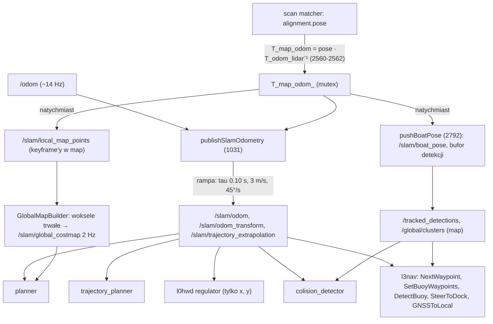

# L2 — konsumenci pozy i mapy (co się stanie po korekcie)

> [!skrot] W 30 sekund
> - Korekta pozy w SLAM-ie to zmiana `T_map_odom_` (`feature_extractor.cpp:822-864`). Reszta systemu widzi ją na **dwa sposoby**:
>   - **natychmiast**: poza „dokładna” (`/slam/boat_pose`, bufor póz detekcji, `/global/clusters`, `/tracked_detections`, mapa i costmapa);
>   - **wygładzona rampą**: `/slam/odom`, ≤ 3 m/s i ≤ 45°/s przy domyślnych parametrach, bo `slam.yaml` ich nie ustawia (`feature_extractor.cpp:295-311`, `867-1028`).
> - Konsumenci trzymają wiele **absolutnych współrzędnych w `map`**, których nikt nie przelicza po korekcie: cele planera (`/goal`), cele z GNSS przeliczone raz przez `/slam/odom_transform`, waypointy z `MoveAlongHeading` liczone z **`/odom`**, wielokąt doku, śledzone boje, trajektorie obcych łodzi.
> - Regulator `l0hwd/regulator` bierze **pozycję z `/slam/odom`, a kurs z `/filter/euler`** (surowy Xsens). Każdy obrót `T_map_odom` o $\psi_c$ daje mu stały błąd kursu $\psi_c$.
> - Wymagania minimalne przed loop closure: skok translacji ≤ ~1 m i obrót ≤ ~2° na jedną korektę, rozłożone w czasie (rampa jest już gotowa). Większe korekty wymagają „kotwiczenia” celów i detekcji do keyframe'ów oraz przebudowy mapy. Szczegóły w tabeli [[#Wymagania od reszty systemu]].

Powiązane: [[L2 — odometria, sensory i fuzja]], [[SLAM — TF map-odom-base]], [[planner]], [[trajectory_planner]], [[colision_detector]], [[regulator]], [[basic_controller]], [[Nawigacja i autonomia — przepływ]].

Stan: drzewo robocze `l2dp_docking_fix` (L2), `l0hwd` na `master` + niezacommitowane zmiany Jetsona (regulator), `l3nav` na `waypoint_first` + zmiany robocze (drzewa Njord). Wnętrza scan matchera i `GlobalMapBuilder` tu nie opisuję, tylko ich wejścia i wyjścia.

## Jak korekta wychodzi z SLAM-u

### Filtr `/slam/odom` (`updateStableSlamOdomPose`, `feature_extractor.cpp:867-1028`)

> [!wzor] Rampa korekty — tak liczy kod
> Wejścia: `T_odom_boat` z bieżącego `/odom` (`raw_odom_pose`) i `exact_T_map_boat = T_map_odom · T_odom_boat` (`1039-1044`).
> 1. Propagacja pełnym przyrostem odometrii: $\Delta = T^{-1}_{raw,k-1}\,T_{raw,k}$, $\hat T = T_{out,k-1}\,\Delta$ (`923-927`).
> 2. $\alpha_0 = 1 - e^{-\Delta t/\tau}$, gdzie $\tau$ = `slam_odom.correction_time_constant` = 0.10 s (`937-942`, domyślna `299`).
> 3. Translacja: $e_t = t_{exact} - \hat t$, $\alpha_t = \min\!\left(\alpha_0, \dfrac{v_{max}\,\Delta t}{\lVert e_t\rVert}\right)$, gdzie $v_{max}$ = `maximum_translation_correction_rate` = 3.0 m/s (`944-957`, domyślna `305`).
> 4. Obrót: $\theta$ = kąt $q_{\hat T}^{*} q_{exact}$, $\alpha_r = \min\!\left(\alpha_0, \dfrac{\omega_{max}\,\Delta t}{\theta}\right)$, gdzie $\omega_{max}$ = 45°/s (`966-998`, domyślna `311`).
> 5. $t_{out} = \hat t + \alpha_t e_t$, $q_{out} = \mathrm{slerp}(q_{\hat T}, q_{exact}, \alpha_r)$ (`1012-1021`).
> Wyjątek: gdy $|\Delta t|$ > `slam_odom.timestamp_reset_gap` = 1.0 s, wyjście **od razu skacze** do pozy dokładnej (`894-903`). Tak samo jest przy pierwszej próbce (`880-888`).

Żaden z parametrów `slam_odom.*` nie występuje w `pose_graph/config/slam.yaml` (sprawdzone grepem), więc na łodzi działały domyślne wartości z kodu. Wejście jest przy tym ~14 Hz (bag), a nie 400 Hz z komentarzy. Przy $\Delta t$ ≈ 70 ms mamy $\alpha_0 = 1 - e^{-0.7}$ ≈ 0.50 na próbkę, a limit 3 m/s daje maksymalnie ~0.21 m na próbkę.

> [!przyklad] Korekta loop closure o 5 m i 4°
> Translacja: limit 3 m/s, czyli ~1.7 s rampy (~24 próbki przy 14 Hz). Obrót 4° przy 45°/s mieści się w ~0.09 s, czyli praktycznie od razu (1–2 próbki).
> W tym czasie:
> - costmapa (2 Hz) i detekcje są już w nowym układzie;
> - `/slam/odom` jest jeszcze „w połowie drogi”;
> - planer startuje A* z komórki przesuniętej o resztę rampy.

## Konsument po konsumencie

### `planner` (A*) — `l2dp_docking_fix/planner/src/planner.cpp`
- Poza: `/slam/odom` (`173-185`), zamiana osi na wewnętrzne (x = wschód, y = północ), kurs `-atan2` (`181`).
- Mapa: `/slam/global_costmap`. **Każda costmapa (2 Hz, `slam.yaml` `publish_rate_hz: 2.0`) wyzwala pełne przeplanowanie** od bieżącej pozy (`195-199`, `238-310`).
- Cele: `/goal` (`PoseArray`) zapisane raz w `goalPoses` (`187-193`), w układzie `map`, bez stempla odniesienia.
- `goalIndex++`, gdy łódź jest bliżej niż `goalThreshold = 1.0` m (`planner.h:39`, `planner.cpp:251`). Przesunięcie jest **nieodwracalne**.
- Planowanie nie startuje, gdy poza = (0, 0) (`240`).

> [!wazne] Co robi skok
> - Ścieżka sama się „naprawia”, bo za 0.5 s planer przelicza ją od nowej pozy. Planer nie ma stanu, który by się psuł, poza `goalIndex`.
> - Psują się **cele**. Jeśli `/goal` pochodził z boi wykrytej przed korektą, po korekcie mapa i boja (śledzona w `map`) przesuwają się, a cel w `goalPoses` zostaje stary. Łódź płynie o wektor korekty obok boi.
> - Skok, który „przeniesie” łódź w promień 1 m od celu, zaliczy go bez dopłynięcia.
> - W czasie rampy (do ~2 s) start A* jest w innym układzie niż costmapa. Przy wąskim przejściu (slip ~1–3 m) może to dać chwilowo ścieżkę przez inflację.

### `trajectory_planner` — `l2dp_docking_fix/trajectory_planner/src/trajectory_planner.cpp`
- Poza i kurs z `/slam/odom` (`trajectory_planner.hpp:52`, `trajectory_planner.cpp:299-314`). Kurs jest skorygowany przez SLAM, więc układ jest spójny.
- Pętla 200 ms (`440`). Regulator P kursu: `angle = heading_angle/180`, prędkość `exp(0.015·d) − 0.95` (`108-150`). Brak całkowania, więc skok pozy daje tylko natychmiastową zmianę kąta do celu.
- Przełączenie waypointa przy `dist ≤ THRESHOLD_WAYPOINT = 1.5` m (`utils.hpp:9`, `trajectory_planner.cpp:219-235`). `/path_points` co 0.5 s resetuje `pathIndex = 0` (`315-327`).
- `Timeout(30 s)` to `sleep_for` w callbacku timera (`290-295`). W tym czasie węzeł nie widzi żadnej pozy.

Wymaganie: skok < 1.5 m blisko waypointa, inaczej możliwe fałszywe „osiągnięto” (`/l3/waypoint_reached`).

### `l0hwd/regulator` (pure pursuit z Simulinka) — `l0hwd/regulator/src/regulator.cpp`
- **Pozycja**: `/slam/odom` (`48-49`, `110-115`). W HEAD było `/odom`, zmiana jest niezacommitowana (`git diff` w `l0hwd`).
- **Kurs**: `/filter/euler` `vector.z` (`58-59`, `128-131`), czyli surowy Xsens, bez korekty SLAM-u. Prędkość: `/filter/velocity` (`51-52`).
- Ścieżka: `/path_points` → stała tablica 100 punktów `waypoint_x/y` (`133-159`). Pure pursuit (`code_gen_1_ert_rtw/code_gen_1.c:625-880`) pamięta `ProjectionLineIndex`, ale resetuje go przy każdej zmianie waypointów (`code_gen_1.c:663-669`), a ta zachodzi co 0.5 s.
- Pętla 20 ms (`regulator.cpp:36-39`).

> [!blad] Niespójność układów w regulatorze
> Pozycja i ścieżka są w `map`, a kurs w układzie IMU/`odom`. Jeśli `T_map_odom` ma składową obrotu $\psi_c$, kąt do punktu lookahead jest liczony z kursem przesuniętym o $\psi_c$. Regulator ma wtedy stały błąd kursu $\psi_c$ i płynie łukiem. Dziś $\psi_c$ jest małe (matcher przyjmuje ≤ 3° na skan, `slam.yaml:89`, ale suma narasta bez ograniczenia). Po loop closure z obrotem może być duże.
> Poprawka: kurs z `/slam/odom` (kwaternion; uwaga na konwencję `-atan2` i znak `-heading` w `code_gen_1.c:568`) albo jawna kompensacja $\psi_c$ z `/slam/odom_transform`.

Uboczne znalezisko (nie SLAM): w konstruktorze jest lokalne `bool use = true;` (`regulator.cpp:30`), które przesłania pole `use` (`regulator.hpp:48`). Pole zostaje niezainicjalizowane, dopóki nie przyjdzie `/regulator_or_thrust_driver` (`64-68`).

### `colision_detector` — `l2dp_docking_fix/colision_detector/src/colision_detector.cpp`
- Własny tunel: z `/slam/trajectory_extrapolation` (`16-18`, `49-80`), czyli wygładzonej historii `/slam/odom`. Tunel obcej łodzi: z kolejnych pozycji `/global/clusters` (już w `map`, liczonych z dokładnej pozy SLAM w chwili skanu).
- Prędkość obcej łodzi $= \sum \lVert p_i - p_{i-1}\rVert / dt_i$ z 3 próbek co ≥ 0.2 s (`123-162`). Bramka „nowy obiekt”, gdy przesunięcie > 6 m/s · dt (`129-134`).

> [!blad] Skok = fałszywa prędkość
> Korekta $\delta$ przesuwa klastry w `map` natychmiast. Przy dt = 0.2 s daje to pozorną prędkość $\delta / 0.2$. Skok 0.5 m wygląda jak obiekt płynący 2.5 m/s, czyli możliwy fałszywy alarm kolizji (`/colision_detector` → L3 `NextWaypoint`). Skok > 1.2 m zeruje historię (bramka), więc przez ~0.6 s detektor jest ślepy.
> Wymaganie: klastry dla detektora liczyć w układzie `odom` (bez korekty) albo wstrzymać estymację na ~3 próbki po korekcie (flaga/stempel korekty).

### `GlobalMapBuilder` i costmapa (tylko interfejs)
- Wejście: `/slam/local_map_points` (latched, keyframe'y przetransformowane do `map`), `/slam/boat_pose`, cechy na żywo + `/slam/debug/predicted_lidar_pose`, wielokąt `/dock_polygon` przeliczany do `map` z bufora `/slam/odom` (`global_map_builder.cpp:697-790`, `895-970`, `1621-1700`).
- Mapa trwała (`global_map.*` w `slam.yaml:114-140`) zbiera woksele w **absolutnych współrzędnych `map`**.

> [!wazne] Konsekwencja dla loop closure
> Jeśli pętla przesunie stare keyframe'y, woksele już zebrane zostaną w starym miejscu. Nowe przyjdą w nowym, więc powstanie „podwójna ściana”. Planer zobaczy wtedy przeszkody, których nie ma. Potrzebny jest interfejs „mapa przebudowana”: woksele trzymane per keyframe/submapa i przeliczane po optymalizacji, albo pełny reset i odbudowa z keyframe'ów.
> Wielokąt doku (`/slam/dock_polygon_map`) i korytarz są zapisane w `map` (drzewo robocze). Po korekcie trzeba je przesunąć razem z keyframe'em, z którego je wykryto.

### `segment_scan`
Nie używa pozy: subskrypcja `/odom` jest zakomentowana (`segment_scan.cpp:101-112`), `boat_yaw = 0.0`. Pracuje w ramce lidaru na `/scan`. W drzewie roboczym stempel wielokąta = stempel skanu (`segment_scan.cpp:61`, `381`), dzięki czemu `GlobalMapBuilder` interpoluje pozę w czasie skanu. Korekta dotyczy go tylko pośrednio (przez przeliczenie do `map`).

### `fast_scan`, `pointcloud_to_laserscan`
Nie używają pozy (brak subskrypcji odometrii). `fast_scan` domyślnie czyta `/debug/deskewed` (`fast_scan.cpp:53-55`). Tego topiku SLAM nie publikuje (ma `/slam/debug/deskewed_scan`, tylko przy `debug.publish_clouds: true`, a w `slam.yaml:8-9` jest `false`). **Niepewne**, skąd na łodzi szedł `/scan`. Przykładowy launch `pointcloud_to_laserscan` mapuje `/lidar_points` → `/scan` (`launch/sample_pointcloud_to_laserscan_launch.py:18-19`).

### `mapper` (stary) i `obstacle_avoidance`
- `mapper` czyta `/odom` (`mapper.cpp:119`) i publikuje `costmap`, `global_map`, `local_map` oraz **`tracked_detections`** (`mapper.cpp:170-173`). Planer w stanie Njord czyta wyłącznie `/slam/global_costmap`, więc `costmap` z mappera nie ma odbiorcy w L2.
- Bag z 2026-08-08 (`docking_regulator_2`) ma jednak `/costmap` (333×333, 0.30 m, origin −49.95) i `/path`, ale nie ma żadnego `/slam/*`. Tego dnia (przed `2a4dbf6` z 2026-08-09) dokowanie szło więc jeszcze przez `mapper`.
- **Mapper i pose_graph nie mogą działać razem**: oba publikują `/tracked_detections`, w odbitych konwencjach (B1 z `sbt_transforms/REVIEW.md`).
- `obstacle_avoidance` (`obstacle_avoidance.cpp:26-33`, `100-101`): `/odom` + `/trajectory` z odometrii. Poprzednik `colision_detector`, nieużywany w drzewach Njord (**niepewne**, czy uruchamiany).

### `l3nav` — drzewa Njord
Węzły BT użyte w `config/njord_trees/{maneuvering_njord_1,maneuvering_njord_2,normal_docking_njord,parallel_docking_njord,collision_njord}.xml` (zliczone z XML):

| węzeł BT | poza | co robi z pozą | skutek korekty |
|---|---|---|---|
| `NextWaypoint` | `/slam/odom` (`next_waypoint_node.cpp:26-35`) | wysyła cel raz na `/goal` lub serwis `/srv/waypoint_navigation_state`, czeka na `/wp_reached` | cel absolutny, nieprzeliczany |
| `GNSSToLocal` | `/start_pose` + `/slam/odom_transform` (`gnss_to_local.cpp:13-28`, `282-317`) | GNSS → metry `odom` → `map` przez **bieżące** `C` (migawka) | po korekcie cel GNSS zostaje w starym `map`. Poprawnie byłoby go przeliczyć ponownie, bo GNSS jest absolutny |
| `SetBuoyWaypoints`, `DetectBuoy`, `WaypointMiddleOfCoords`, `SteerToDock` | `/slam/odom` | waypointy względem boi/doku z `/tracked_detections` | spójne w chwili liczenia; boje przesuwają się z mapą, waypointy nie |
| `MoveAlongHeading` | **`/odom`** (`move_along_heading.cpp:20-28`, `126-127`) | waypoint = poza + przesunięcie wzdłuż kursu, w układzie `odom` | trafia do planera (`map`) z błędem = `T_map_odom`. **Już dziś niespójne**, po loop closure błąd w metrach |
| `LookForGate` | **`/odom`** (`look_for_gate.cpp:8-16`) + `/tracked_detections` (`map`) | mieszanie układów | jw. |
| `Breaking`, `Spin`, `Wait` | `/odom` | prędkość/czas, nie pozycja | bez wpływu (`Breaking` czyta `twist`, który jest biasem, zob. [[L2 — odometria, sensory i fuzja]]) |

## Wymagania od reszty systemu

> [!wazne] Ile skoku zniesie system dziś (bez zmian w konsumentach)
> | element | próg | skąd |
> |---|---|---|
> | `trajectory_planner` | skok translacji < 1.5 m blisko waypointa | `THRESHOLD_WAYPOINT` (`utils.hpp:9`) |
> | `planner` | skok < 1.0 m blisko celu (inaczej cel „zaliczony” bez dopłynięcia); cele nieprzeliczane | `goalThreshold` (`planner.h:39`) |
> | `regulator` | obrót $\psi_c$ < ~2–3° (stały błąd kursu) | kurs z `/filter/euler` (`regulator.cpp:58-59`) |
> | `colision_detector` | skok klastrów < ~0.3 m na 0.2 s (inaczej fałszywa prędkość > 1.5 m/s) | `colision_detector.cpp:123-162` |
> | śledzenie boi | skok < `tracking.tracking_threshold` = 3.0 m (inaczej duplikaty boi) | `slam.yaml:21-24`, `feature_extractor.cpp:275-277` (domyślna w kodzie 5.0), `3150-3153` |
> | slip (szerokość 1–3 m) | skok < ~0.3–0.5 m w czasie podejścia | `slam.yaml` `dock.*`, margines 0.50 m |
> | mapa trwała | **żadna** zmiana przeszłych keyframe'ów bez przebudowy | „podwójne ściany” |

> [!zadanie] Co trzeba zbudować przy loop closure
> 1. **Polityka korekt**: małe korekty idą od razu przez istniejącą rampę `/slam/odom`. Duże (> 1 m albo > 2°) rozkładać w czasie albo stosować tylko wtedy, gdy łódź nie dokuje (flaga z L3, np. przy `SelectDock`/`SteerToDock` blokada pętli).
> 2. **Zdarzenie korekty**: nowy topik, np. `/slam/correction` (stempel, $\Delta T$ między starym a nowym `T_map_odom`, id keyframe'u). Konsumenci przeliczają przez nie swoje absolutne punkty: cele planera, waypointy BT, wielokąt doku, ślady klastrów.
> 3. **Kotwiczenie**: detekcje (`trackedDetections`) i wielokąt doku zapisywać względem keyframe'u (id + poza względna), a nie w `map`. Po optymalizacji grafu przeliczać z nowych póz keyframe'ów.
> 4. **Spójność układów w L3**: `MoveAlongHeading`, `LookForGate` i ~15 innych węzłów na `/odom` przenieść na `/slam/odom`. Regulator powinien brać kurs z `/slam/odom`.
> 5. **GNSS jako cel absolutny**: `GNSSToLocal` powinien przeliczać cel przy każdym ticku (albo po zdarzeniu korekty), a nie raz.
> 6. **Mapa**: interfejs przebudowy `GlobalMapBuilder` po optymalizacji (szczegóły należą do back-endu).

## Podejrzane / do naprawy
> [!blad] Lista
> 1. Regulator: kurs z IMU przy pozycji z SLAM-u (wyżej). Proponowana poprawka: `HeadingCallback` zastąpić kursem z `/slam/odom` w tej samej konwencji co `/filter/euler` (stopnie), po sprawdzeniu znaku na bagu.
> 2. `MoveAlongHeading`, `LookForGate` na `/odom` przy celach w `map`.
> 3. `slam_odom.*` nie są w `slam.yaml`, więc zachowanie rampy zależy od wartości domyślnych w kodzie. Warto je dopisać jawnie (0.10 s, 3.0 m/s, 45°/s, 1.0 s), żeby strojenie pod loop closure było widoczne.
> 4. Reset rampy przy przerwie w `/odom` > 1 s (`894-903`): przy zgubionym GNSS-ie/Xsensie korekta przechodzi jako natychmiastowy skok.
> 5. `planner.cpp:240`: poza dokładnie (0, 0) blokuje planowanie. Po korekcie, która przypadkiem da (0, 0), planer stanie (marginalne).

## Moje notatki
> [!ja] Tu piszesz ty — Albert tej sekcji nie rusza.
