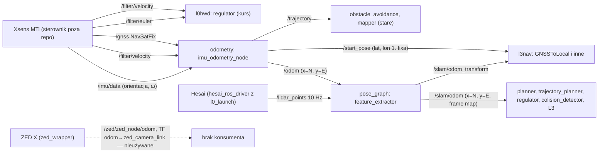

# L2 — odometria, sensory i fuzja

> [!skrot] W 30 sekund
> - `/odom` liczy węzeł `imu_odometry_node` z pakietu [[odometry]]. To 4-stanowy filtr Kalmana: predykcja z prędkości Xsensa `/filter/velocity`, korekcja z GNSS `/gnss`, orientacja przepisana bez zmian z `/imu/data`. **To nie jest odometria w sensie „dryfującej, gładkiej” — pozycja jest przyklejona do GNSS** (`R = diag(0.005, 0.005)` m², czyli σ ≈ 7 cm, `odometry/src/OdoCpp.cpp:242-243`).
> - [[pose_graph]] (węzeł `feature_extractor`) **nie konkuruje** z `/odom`. Bierze go jako predykcję i publikuje `/slam/odom` = `T_map_odom · T_odom_boat`, wygładzone filtrem korekcji (`feature_extractor.cpp:867-1028`). `/slam/odom` ma tę samą częstotliwość co `/odom`, bo powstaje w `odomCallback` (`feature_extractor.cpp:1574-1613`).
> - Sensory: Hesai `/lidar_points` (10 Hz, 128 000 punktów, pola `x y z intensity ring timestamp`, z baga), Xsens MTi (`/imu/data`, `/filter/velocity`, `/filter/euler`, `/gnss`; sterownik spoza `~/solar`). Na `origin/celka_odo` (Monako) jest SBG (`/sbg/*`). ZED ma własną odometrię wizualną, ale **nikt w L1–L3 jej nie czyta**.
> - Najważniejsze dla loop closure: SLAM poprawia pozę względem GNSS-owego `/odom`, a nie względem dryfującej odometrii. Pętla musi więc „wygrać” z GNSS-em albo GNSS musi wejść do grafu jako czynnik (zob. [[#Wnioski dla loop closure]]).

Powiązane: [[odometry]], [[pose_graph]], [[L2 — konsumenci pozy i mapy (co się stanie po korekcie)]], [[SLAM — TF map-odom-base]], [[SLAM — historia i gałęzie]], [[Drzewo TF i układy współrzędnych]].

Stan opisu: drzewo robocze `~/solar/l2dp_docking_fix` (`feat/dock_costmap_fix`, HEAD `0d444ff`). Pakiet `odometry` nie ma w drzewie roboczym żadnych zmian względem HEAD. Jest też identyczny z `~/solar/l2dp` (`diff -rq` nie pokazuje różnic) i z `origin/master` (`git diff` pusty).

## Przepływ danych

## Węzeł `imu_odometry_node` — co dokładnie liczy

Źródło: `odometry/src/OdoCpp.cpp`, `odometry/src/KalmanFilter.cpp`, `odometry/include/OdoCpp.h`.

### Interfejs
| kierunek | topik | typ | linia |
|---|---|---|---|
| sub | `/imu/data` | `sensor_msgs/Imu` | `OdoCpp.cpp:24-25` |
| sub | `/filter/velocity` | `geometry_msgs/Vector3Stamped` | `OdoCpp.cpp:27-28` |
| sub | `/gnss` | `sensor_msgs/NavSatFix` | `OdoCpp.cpp:31-32` |
| sub | `/gnss_pose` | `PoseStamped` — callback w całości zakomentowany | `OdoCpp.cpp:34-35`, `284-349` |
| pub | `/odom` | `nav_msgs/Odometry`, `frame_id = "odom"`, `child_frame_id` puste | `OdoCpp.cpp:38`, `203`, `269` |
| pub | `/start_pose` | `geometry_msgs/Point` (x = lat, y = lon pierwszego fixa) | `OdoCpp.cpp:41`, `223-227` |
| pub | `/trajectory` | `PoseArray`, `frame_id = "map"`, 10 punktów łuku | `OdoCpp.cpp:44`, `147-168` |

Wszystkie QoS mają domyślną głębokość 10 (reliable). Węzeł nie ma parametrów (`declare_parameter` nie występuje). Wszystkie szumy są wpisane na sztywno.

### Stan i równania (dokładnie jak w kodzie)

> [!definicja] Stan filtru
> $s = [x, y, v_x, v_y]^T$, gdzie $x$ to metry na północ od pierwszego fixa, $y$ to metry na wschód (`OdoCpp.cpp:229-236`). Start: $s_0 = 0$ (`OdoCpp.cpp:21`). Kowariancja startowa ma bloki pozaprzekątniowe:
> $P_0 = \begin{bmatrix}10&0&10&0\\0&10&0&10\\10&0&10&0\\0&10&0&10\end{bmatrix}$ (`KalmanFilter.cpp:5`). Jest osobliwa (det = 0), ale aktualizacja i tak działa, bo $H P H^T + R$ jest odwracalne.

> [!wzor] Predykcja w `velCallback` (`OdoCpp.cpp:132-182`, `KalmanFilter.cpp:10-16`)
> Wejście: $u = [u_N, u_E]^T$ = `[vector.y, vector.x]` z `/filter/velocity` (zamiana osi, `OdoCpp.cpp:134-135`; `frames.yaml` opisuje ten topik jako ENU, więc `vector.y` to północ). $\Delta t$ = różnica `this->now()` między wywołaniami (`OdoCpp.cpp:133`, `170`), a nie stempli wiadomości.
> $F = \begin{bmatrix}1&0&\Delta t&0\\0&1&0&\Delta t\\0&0&1&0\\0&0&0&1\end{bmatrix},\quad B = \begin{bmatrix}\Delta t&0\\0&\Delta t\\0&0\\0&0\end{bmatrix}$ (`OdoCpp.cpp:173-174`)
> $s^- = F s + B u,\qquad P^- = F P F^T + Q$
> $Q = \sigma^2\begin{bmatrix}\Delta t^2&0&\Delta t&0\\ 0&\Delta t^2&0&\Delta t\\ \Delta t&0&1&0\\ 0&\Delta t&0&1\end{bmatrix},\ \sigma^2 = 0.05$ (`OdoCpp.cpp:137-138`, `175-178`)
> Pozycja przyrasta więc o $\Delta t\,(v_x + u_N)$. Prędkość ze stanu dodaje się do zmierzonej.

> [!wzor] Korekcja w `gpsCallback` (`OdoCpp.cpp:217-248`, `KalmanFilter.cpp:19-26`)
> Pomiar: $z = [d_N, d_E]^T$, gdzie $d_N$ = haversine(lat0, lon0 → lat, lon0), a $d_E$ = haversine(lat0, lon0 → lat0, lon), ze znakiem ujemnym na południe/zachód (`OdoCpp.cpp:229-236`). Promień Ziemi to 6 371 000 m (`OdoCpp.cpp:3`).
> $H = \begin{bmatrix}1&0&0&0\\0&1&0&0\end{bmatrix}$, $R = \mathrm{diag}(0.005, 0.005)$ (`OdoCpp.cpp:242-243`)
> $K = P H^T (H P H^T + R)^{-1},\quad s = s + K(z - H s),\quad P = (I - K H) P$

> [!intuicja] Co naprawdę oznaczają $v_x, v_y$
> Zmierzona prędkość wchodzi przez $B u$, a nie jako pomiar. Składowe $v_x, v_y$ zmieniają się tylko w aktualizacji GNSS, przez korelację w $P$. Działają więc jak **błądzący bias prędkości** (model $\dot x = u + b$, $b$ = random walk). Do `/odom.twist.linear` trafia właśnie ten bias (`OdoCpp.cpp:209-210`), a nie prędkość łodzi. Na bagu `docking_regulator_2` mediana $|twist|$ to 0.084 m/s, a mediana prędkości liczonej z różnic pozycji to 0.34 m/s (skrypt `scratchpad/slam/bag/twist.py`, czyta sqlite bez ROS-a).

### Orientacja
- `imuCallback` przepisuje `msg->orientation` do `orientation` bez żadnej konwersji (`OdoCpp.cpp:70`). Ten kwaternion trafia do `/odom.pose.pose.orientation` (`OdoCpp.cpp:204`, `270`).
- `heading = -atan2(...)` w stopniach (`OdoCpp.cpp:71-74`) służy tylko do logu i łuku `/trajectory`.
- Kowariancje orientacji i prędkości kątowej są na sztywno ustawione na 0.05 we wszystkich 9 polach, także poza przekątną (`OdoCpp.cpp:77`, `79`).
- Prędkość kątowa `angular_velocity` z IMU jest kopiowana do `twist.angular` (`OdoCpp.cpp:78`, `212`).

### Częstotliwość i czas
- `/odom` jest publikowany w **obu** callbackach (`OdoCpp.cpp:215`, `281`), więc jego częstotliwość to suma częstotliwości `/filter/velocity` i `/gnss`. Stempel to `this->now()` w chwili publikacji (`OdoCpp.cpp:202`, `268`), **a nie czas pomiaru**.
- Bag `docking_regulator_2` (2026-08-08): 661 wiadomości `/odom` w 48.37 s, czyli **13.7 Hz**. Odstępy stempli: mediana 61 ms, maksimum 170 ms, minimum 0.3 ms (pary prędkość + GNSS). Komentarze w `pose_graph` zakładają „~400 Hz” (`feature_extractor.cpp:713-716`, `1607-1611`). **Niepewne:** czy na łodzi `/filter/velocity` szedł z wyższą częstotliwością, a bag gubił wiadomości (sqlite + 1.6 GB chmur), czy SLAM od początku działał na ~14 Hz.
- `/odom` jest jedynym źródłem pozy dla deskewu w SLAM-ie. Przy 14 Hz i skanie 100 ms deskewer interpoluje między ~1–2 próbkami na skan. To wystarcza przy wolnej łodzi, ale ogranicza dokładność na zakrętach (**niepewne**: nie mierzono).

### Podejrzane / do naprawy
> [!blad] Ryzyka w `odometry`
> 1. **`/odom` skacze razem z GNSS-em.** Przy $R$ = 0.005 m² filtr ufa każdemu fixowi prawie w 100%. Szum GNSS (σ = 0.5–2 m bez RTK, **niepewne**, jaki był odbiornik/tryb) przechodzi więc wprost do `/odom`. Dla SLAM-u oznacza to, że predykcja `T_odom_lidar` sama ma skoki, a scan matcher je „odkręca” w `T_map_odom`. Na bagu największy krok pozycji między próbkami to 0.25 m (t ≈ 44 s), czyli przy dobrym GNSS skoki są małe. Poprawka: `R` z `msg->position_covariance` (kod jest zakomentowany w `OdoCpp.cpp:239-240`) i bramkowanie innowacji (Mahalanobis).
> 2. **`twist` w `/odom` to bias, a nie prędkość** (wyżej). Jedyny czytelnik, `l3nav/basic_controller/src/breaking.cpp:13-18`, tylko loguje tę wartość. Każdy nowy konsument (np. czynnik prędkości w grafie) musi brać `/filter/velocity`, a nie `/odom.twist`.
> 3. **Stempel `now()` zamiast stempla pomiaru** (`OdoCpp.cpp:202`, `268`): opóźnienie DDS i executora wchodzi jako błąd czasu w deskewie i w buforze póz detekcji. Poprawka: `odometry_msg.header.stamp = msg->header.stamp`.
> 4. **Pierwszy fix = punkt zerowy na zawsze** (`OdoCpp.cpp:221-222`). Warunek `== 0` sprawia, że lat lub lon równe dokładnie 0 nie zainicjalizuje startu (w praktyce bez znaczenia). Restart węzła zmienia jednak początek układu `odom`, a SLAM o tym nie wie (`T_map_odom` z poprzedniej sesji staje się błędny).
> 5. **Brak zależności w `package.xml`** (tylko `ament_cmake`). Budowanie działa dzięki `find_package` w `CMakeLists.txt`.
> 6. `P_0` z jedynkami poza przekątną (`KalmanFilter.cpp:5`) oznacza pełną korelację pozycji z biasem prędkości na starcie. Lepszy byłby `diag(10, 10, 1, 1)`.

## Źródła sensorów — kto co publikuje na łodzi

| topik | producent | dowód | uwagi |
|---|---|---|---|
| `/lidar_points` | `hesai_ros_driver` (`launch/start.py`), dołączany przez `l0hwd/l0_launch/launch/l0hwd_launch.py:20-27` | `~/solar/log.log` (SDK Hesai 2.0, parser GPU) | bag: 10 Hz, `frame_id = hesai_lidar`, 128 000 punktów (h = 1), pola `x,y,z,intensity` (float32), `ring` (uint16, offset 16), `timestamp` (float64, offset 18). Stempel nagłówka ~13–19 ms przed czasem nagrania |
| `/imu/data`, `/filter/velocity`, `/filter/euler`, `/gnss`, `/filter/positionlla` | Xsens MTi (`xsens_mti_ros2_driver`) | `agh-dashboard-live/scripts/start_jetson_live.sh:53-70` (typy, w tym `xsens_mti_ros2_driver/msg/XsStatusWord`), `sbt_transforms/config/frames.yaml:26-39` | **sterownika nie ma w `~/solar`** i nie dołącza go `l0_launch`. Uruchamiany osobno na Jetsonie (**niepewne**, jak) |
| `/sbg/gps_hdt`, `/sbg/gps_pos`, `/sbg/gps_vel`, `/sbg/ekf_quat`, `/sbg/imu_data` | SBG (`sbg_driver`) | `origin/celka_odo:odometry/src/OdoCpp.cpp`, `start_jetson_live.sh:146` | tylko Monako 2026 (`celka_odo`) |
| `/zed/zed_node/odom`, `/zed/zed_node/pose`, TF `map→odom→zed_camera_link` | `zed_wrapper` (`zed-service/zed-pls-dont-die.sh:39-41`) | `common_stereo.yaml:101-105`: `pos_tracking_enabled: true`, `publish_tf: true`, `publish_map_tf: true` | grep po `l1od`, `l2dp_docking_fix`, `l3nav`, `l0hwd`: **żaden węzeł nie subskrybuje odometrii ZED**. ZED może jednak publikować TF `map→odom` (zob. [[SLAM — TF map-odom-base]]) |

Konwencje osi (z `sbt_transforms/config/frames.yaml:26-39`): kwaternion `/imu/data` jest w NWU, z adnotacją `status: mislabelled`. Stąd w całym stosie bierze się `-atan2(...)`. `/filter/velocity` jest w ENU.

## `origin/celka_odo` — fuzja z SBG (Monako 2026)

`git diff 74c473e origin/celka_odo -- odometry`: +229/−1 w 3 plikach.
- Nowe subskrypcje: `/sbg/gps_hdt` (`SbgGpsHdt`), `/sbg/gps_pos` (`SbgGpsPos`), `/sbg/gps_vel` (`SbgGpsVel`), `/sbg/ekf_quat` (`SbgEkfQuat`). Zależność `sbg_driver` w `CMakeLists.txt`.
- **Kurs z dwuantenowego HDT**: `hdtCallback` przy `status == 64` (dobry kurs) ustawia `orientation` jako czysty obrót wokół Z: `yaw = -true_heading·π/180`, `q = (0, 0, sin(yaw/2), cos(yaw/2))`. Roll i pitch są wyzerowane. Przy złym statusie `hdtGood = false`, a `ekfQuatCallback` bierze kwaternion EKF SBG z odwróconym znakiem `z` (`orientation.z *= -1`).
- `sbgGpsCallback` jest kopią `gpsCallback` (ten sam haversine i ten sam `R` = 0.005). `gpsVelCallback` jest kopią `velCallback`, ale **bez zamiany osi** (`velocity.x`, `velocity.y` wprost; SBG podaje prędkość w NED, więc x = północ — spójne z `/odom`, **niepewne**: nie sprawdzono konfiguracji SBG).
- Stare subskrypcje Xsensa zostały. Jeśli na łodzi szły oba `/imu/data` i `/sbg/*`, `imuCallback` i `hdtCallback` nadpisują sobie nawzajem `orientation` (wyścig, **niepewne**, czy `/imu/data` istniał na łodzi SBG).

> [!wazne] Konsekwencja dla SLAM-u
> Z HDT orientacja ma roll = pitch = 0. Deskewer i scan matcher dostają wtedy płaską orientację, a przechyły łodzi nie są kompensowane w chmurze. Na linii Njord (Xsens) roll i pitch są pełne. Przy przenoszeniu `pose_graph` na łódź z SBG trzeba brać pełny `ekf_quat`, a z HDT tylko yaw.

Inne gałęzie, które ruszają `odometry` (szczegóły w [[SLAM — historia i gałęzie]]): `origin/mapper_sim` (symulacja VRX: tematy `/wamv/...`, predykcja z przyspieszeń IMU zamiast prędkości, `KalmanFilter.cpp` z nadpisywaniem stanu prędkości wejściem).

## Jak `pose_graph` używa `/odom` (tylko interfejs)

- Subskrypcja `/odom` z `rclcpp::SensorDataQoS()` (best effort, depth 5), w osobnej grupie callbacków `odom_group_` (`feature_extractor.cpp:613-620`). Publisher w `odometry` jest reliable, co jest zgodne.
- `odomCallback` (`feature_extractor.cpp:1574-1613`):
  - zamienia osie pozycji na wewnętrzne (wschód, północ): `state.position = (pos.y, pos.x, pos.z)` (`1585-1588`);
  - kwaternion kopiuje bez zmian (`1590-1594`);
  - wkłada stan do bufora deskewera (`addMotionState`, `1596`);
  - od razu publikuje `/slam/odom` (`publishSlamOdometry`, `1613`).
- `/odom` jest więc predykcją (`T_odom_lidar` = `T_odom_imu · T_imu_lidar`, `deskewer.cpp:306`). Scan matcher liczy poprawkę `T_map_odom` = `alignment.pose · T_odom_lidar⁻¹` (`feature_extractor.cpp:2560-2562`) i ustawia ją przez `setMapToOdom` (`822-864`).
- Parametr `frames.convert_ned_odom_to_enu_map` (domyślnie `false`, w `slam.yaml:105-107` też `false` z komentarzem „use the coordinate setup that worked”). Przy `true` startowe `T_map_odom` byłoby stałym obrotem NED→ENU (`feature_extractor.cpp:44-78`).

## `/odom` kontra `/slam/odom` — kto czego używa

| topik | układ | częstotliwość | czytelnicy (drzewo robocze, Njord) |
|---|---|---|---|
| `/odom` | `odom`: x = N, y = E (metry od 1. fixa), kwaternion z IMU (NWU) | ~14 Hz w bagu | `pose_graph` (predykcja), `segment_scan` (subskrypcja zakomentowana, `segment_scan.cpp:101-112`), `mapper`, `obstacle_avoidance`, `ascii_map_viz2`, L3: `LookForGate`, `MoveAlongHeading`, `Breaking`, `Spin`, `Wait` i ~15 innych węzłów BT |
| `/slam/odom` | `map` (nagłówek), ten sam układ „wire”: x = N, y = E (`feature_extractor.cpp:1076-1085`) | jak `/odom` | `planner` (`planner.cpp:173-185`), `trajectory_planner` (`trajectory_planner.hpp:52`), `colision_detector` (`colision_detector.cpp:29-40`), `l0hwd/regulator` (`regulator.cpp:48-49`, drzewo robocze), `GlobalMapBuilder` (bufor dla wielokąta doku), L3: `NextWaypoint`, `SetBuoyWaypoints`, `DetectBuoy`, `WaypointMiddleOfCoords`, `SteerToDock` |
| `/slam/odom_transform` | `TransformStamped` jako wiadomość (nie TF): `slam_odom ← odom` | jak `/odom` | L3 `GNSSToLocal` (`gnss_to_local.cpp:22-28`, `294-317`) |

Dziś `T_map_odom` jest bliskie identyczności (SLAM poprawia o centymetry–decymetry), więc mieszanie obu topików „działa”. Po wdrożeniu loop closure różnica może urosnąć do metrów. Analizę skutków opisuje [[L2 — konsumenci pozy i mapy (co się stanie po korekcie)]].

## Wnioski dla loop closure

> [!wazne] Co wynika z odometrii
> 1. `/odom` jest zakotwiczony w GNSS. Bez GNSS (np. pod mostem, przy marinie) zostaje sama integracja `/filter/velocity` z biasem $v_x, v_y$. Dryf GNSS-u jest mały, ale szum i skoki duże. Dryf SLAM-u (narastające `T_map_odom`) to rozjazd „mapa LiDAR-owa vs GNSS”, a nie klasyczny dryf odometrii.
> 2. Loop closure w ramce `map` zmieni `T_map_odom`. Możliwy jest też drugi wariant: czynnik GNSS w grafie, który ściąga mapę do `/odom`. Oba warianty trzeba zaprojektować razem, inaczej GNSS w `/odom` i pętla będą się wzajemnie „przeciągać”.
> 3. Do grafu poz najlepiej brać: przyrosty `T_odom_imu` między keyframe'ami (krótkoterminowo dokładne), osobny czynnik GNSS z prawdziwą kowariancją (`NavSatFix.position_covariance`) oraz yaw z IMU jako prior. **Nie** należy brać `/odom` jako pozy absolutnej z $\sigma$ = 7 cm.
> 4. Stempel `now()` w `/odom` utrudni dopasowanie keyframe'ów do pomiarów GNSS. Przy grafie z czynnikiem GNSS najpierw trzeba poprawić stemple (punkt 3 w „Podejrzane”).

## Moje notatki
> [!ja] Tu piszesz ty — Albert tej sekcji nie rusza.
