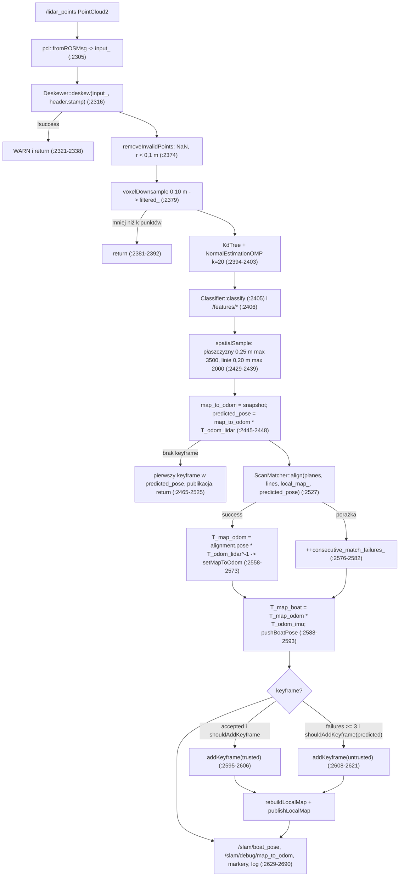

# SLAM — architektura węzła i przepływ danych

> [!skrot] W 30 sekund
> - Jeden proces `feature` (`pose_graph/src/main.cpp:12-22`): węzeł ROS `feature_extractor` (klasa `FeatureExtractor`) + doczepiony do niego obiekt `GlobalMapBuilder` (ta sama instancja `rclcpp::Node`), `MultiThreadedExecutor` z **3 wątkami**.
> - Front-end SLAM = `hesaiCallback` (`feature_extractor.cpp:2302-2691`): `/lidar_points` → deskew z bufora `/odom` → voxel 0,10 m → kNN + PCA → cechy płaszczyzna/linia → próbkowanie → predykcja `T_map_lidar = T_map_odom · T_odom_lidar` → `ScanMatcher::align` (3-DoF x, y, yaw) do lokalnej mapy voxelowej z ostatnich 10 keyframe’ów → nowe `T_map_odom` → `/slam/boat_pose`, keyframe, `/slam/local_map_points`.
> - Równolegle `odomCallback` (`:1574`) przy **każdej** próbce `/odom` publikuje `/slam/odom = wygładzone(T_map_odom · T_odom_boat)`, więc częstotliwość `/slam/odom` = częstotliwość `/odom`, niezależnie od lidaru.
> - **Nie ma TF** (żadnego `tf2_ros` w pakiecie), **nie ma grafu poz** ani optymalizacji, mimo nazwy pakietu. `map→odom` wychodzi tylko jako wiadomości: `/slam/debug/map_to_odom` (`Odometry`) i `/slam/odom_transform` (`TransformStamped`).
> - Globalna mapa (`GlobalMapBuilder`) dostaje dane z front-endu wyłącznie przez topiki (tego samego węzła), nie przez wywołania funkcji.

Opis wg drzewa roboczego `~/solar/l2dp_docking_fix` (`feat/dock_costmap_fix`, HEAD `0d444ff`). Pliki front-endu (`feature_extractor.*`, `deskewer.*`, `classifier.*`, `local_voxel_map.hpp`, `hesai_point.*`, `main.cpp`, `CMakeLists.txt`, `package.xml`) **nie różnią się** od HEAD (`git diff --stat HEAD -- pose_graph` pokazuje tylko `slam.yaml`, `global_map_builder.*`, `math_checks.py`). Ogólny opis pakietu: [[pose_graph]]. Pozostałe notatki tego cyklu: [[SLAM — deskewing]], [[SLAM — cechy i klasyfikacja]], [[SLAM — lokalna mapa voxelowa]], [[SLAM — predykcja pozy, keyframe’y i odporność]], [[SLAM — parametry front-endu]]; źródło `/odom`: [[L2 — odometria, sensory i fuzja]]; matcher: [[SLAM — scan matching (matematyka)]]; mapa globalna: [[SLAM — global map builder i costmapy]].

## Klasy i pliki

| klasa / struktura | plik | rola |
|---|---|---|
| `FeatureExtractor : rclcpp::Node` | `include/feature_extractor.hpp:64-474`, `src/feature_extractor.cpp` | cały front-end + śledzenie detekcji i klastrów (to też siedzi w tym węźle!) |
| `Deskewer` | `include/deskewer.hpp:86-122`, `src/deskewer.cpp` | bufor `MotionState` z `/odom` (5 s), kompensacja ruchu, `motionStateSnapshot` dla ekstrapolacji trajektorii |
| `Classifier` | `include/classifier.hpp:27-76`, `src/classifier.cpp` | PCA sąsiedztwa k=20 → `EDGE` / `PLANE` / `UNKNOWN` |
| `LocalVoxelMap`, `MapVoxel`, `VoxelKey(Hash)` | `include/local_voxel_map.hpp` (header-only) | mapa voxelowa 0,40 m z prymitywami płaszczyzna/linia, wyszukiwanie korespondencji |
| `ScanMatcher` | `include/scan_matcher.hpp:130-146`, `src/scan_matcher.cpp` | dopasowanie 3-DoF — [[SLAM — scan matching (matematyka)]], [[SLAM — degeneracja i jakość dopasowania]] |
| `Keyframe` | `feature_extractor.hpp:54-62` | `timestamp`, `pose` (= `T_map_lidar`), `cloud` (w układzie lidaru), `trusted` |
| `ScanVoxel` | `feature_extractor.hpp:45-52` | akumulator do `voxelDownsample` |
| `HesaiPoint` | `include/hesai_point.hpp:9-25` | `x,y,z` (float), `intensity` (float), `ring` (uint16), `timestamp` (**double, sekundy**) |
| `GlobalMapBuilder` | `include/global_map_builder.hpp`, `src/global_map_builder.cpp` | mapa trwała + costmapa — [[SLAM — global map builder i costmapy]] |

`hesai_point.cpp:15-22` jawnie instancjuje szablony PCL (`KdTree`, `NormalEstimation(OMP)`, `removeNaNFromPointCloud`) dla `HesaiPoint`, bo jest `#define PCL_NO_PRECOMPILE` (`hesai_point.hpp:3`).

## Wątki, grupy callbacków, synchronizacja

`main.cpp:18-22`: `MultiThreadedExecutor(ExecutorOptions(), 3)`. Grupy (wszystkie `MutuallyExclusive`, `feature_extractor.cpp:557-567`):

| grupa | co w niej jest | częstotliwość |
|---|---|---|
| `lidar_group_` | `hesaiCallback` (`/lidar_points`) | ~10 Hz (lidar, wg [[Sensory i sprzęt]]) |
| `odom_group_` | `odomCallback` (`/odom`) | komentarz w kodzie: „~400 Hz” (`feature_extractor.hpp:407`, `:1610`); [[odometry]] publikuje `/odom` z dwóch callbacków, więc to suma częstotliwości (niepewne: realna wartość na łodzi) |
| `detection_group_` | `DetectionCallback` (`/fused_detection`), timer `PublishTrackedDetectionsPeriodic` 10 Hz (`:766-773`) | wg detektora |
| `cluster_group_` | `ObstacleCallback` (`/l1/obstacle_detection`) | wg L1 |
| domyślna grupa węzła | subskrypcje `/used_detections`, `/deuse_detections` (`:623-638`, bez `SubscriptionOptions`), **wszystkie** subskrypcje i timer `GlobalMapBuilder` (`global_map_builder.cpp:696-815`, bez grupy) | — |

Pięć grup na trzy wątki: gdy lidar, `GlobalMapBuilder` (np. `localMapCallback` z dużą chmurą) i detekcje zajmą wątki, `odomCallback` czeka → opóźnienie `/slam/odom`. Patrz „Podejrzane”.

Mutexy (`feature_extractor.hpp:377-409`, `deskewer.hpp:121`):
- `map_odom_mutex_` — `T_map_odom_` (pisze lidar `setMapToOdom` `:822-865`, czyta odom `mapToOdomSnapshot` `:816-820`);
- `Deskewer::motion_mutex_` — bufor ruchu (pisze odom `addMotionState`, czyta lidar `deskew` — **kopiuje cały deque** pod mutexem, `deskewer.cpp:247-250`);
- `boat_pose_mutex_` — `boat_pose_buffer_` (poza SLAM-owa część: detekcje);
- `pending_detection_*`, `pending_obstacle_*`, `detection_mutex_`, `obstacle_mutex_` — kolejki detekcji.

Stan front-endu (`keyframes_`, `local_map_`, `input_`, `filtered_`, `normals_`, `tree_`, `classifier_`, `consecutive_match_failures_`, `last_keyframe_*`) jest dotykany **tylko** z `lidar_group_` → bez mutexów, poprawnie, dopóki nikt nie doda wywołań z innej grupy (ważne przy wpinaniu loop closure).

## Subskrypcje i publikacje front-endu

| kierunek | topik | typ | QoS | gdzie |
|---|---|---|---|---|
| wejście | `/lidar_points` | `sensor_msgs/PointCloud2` (pola `HesaiPoint`) | `KeepLast(1)`, reliable | `:603-611` |
| wejście | `/odom` | `nav_msgs/Odometry` | `SensorDataQoS` (best effort, depth 5) | `:613-621` |
| wyjście | `/slam/odom` | `Odometry`, frame `slam_odom.frame_id`=`map`, x=północ, y=wschód (!) | `KeepLast(20)` reliable | `:716-719`, `:1031-1141` |
| wyjście | `/slam/odom_transform` | `TransformStamped` `slam_odom` ← `odom` (w „przewodowej” konwencji x=N, y=E) | `KeepLast(20)` reliable | `:726-729`, `:1406-1485` |
| wyjście | `/slam/boat_pose` | `Odometry`, frame `map`, child `boat`, **x=wschód, y=północ** (wewnętrzna konwencja) | depth 10 | `:701-704`, `:2629-2633` |
| wyjście | `/slam/debug/map_to_odom` | `Odometry`, frame `map`, child `odom` = `T_map_odom_` | depth 10 | `:2635-2639` |
| wyjście | `/slam/debug/predicted_lidar_pose`, `/slam/debug/candidate_lidar_pose` | `Odometry` (`T_map_lidar` z predykcji / z matchera) | depth 10 | `:2450-2454`, `:2533-2537` |
| wyjście | `/features/edges`, `/features/planes`, `/features/debris` | `PointCloud2` w układzie lidaru na początek skanu | depth 10 | `:1845-1877`, `:2406` |
| wyjście | `/local_voxel_map` | `PointCloud2` centroidy voxeli (intensity 1 = płaszczyzna, 2 = linia) | `KeepLast(1)` transient_local | `:2134-2208` |
| wyjście | `/slam/local_map_points` | `PointCloud2` punkty keyframe’ów w `map` (intensity 1,0 trusted / 0,25 recovery) | `KeepLast(1)` transient_local | j.w. |
| wyjście | `/slam/trajectory_extrapolation` | `PoseArray` (konwencja jak `/slam/odom`) | `KeepLast(1)` reliable | `:1143-1404` |
| wyjście (viz) | `/slam/odom_marker`, `/slam/boat_marker`, `/slam/debug/frame_axes` | `Marker` | — | `:1487-2059` |
| wyjście (debug, gdy `debug.publish_clouds`) | `/slam/debug/raw_scan`, `/slam/debug/deskewed_scan`, `/slam/debug/predicted_scan_map`, `/slam/debug/candidate_scan_map` | `PointCloud2` | depth 2 | `:656-674` |

> [!wazne] Konwencje osi — trzy różne naraz
> - `/odom`: pozycja x = północ, y = wschód; kwaternion Xsensa względem NWU ([[Drzewo TF i układy współrzędnych]], [[odometry]]).
> - Wnętrze SLAM-u: `odomCallback` zamienia tylko pozycję, `state.position = (pos.y, pos.x, pos.z)` = (wschód, północ, góra) (`:1584-1587`), **kwaternion przepisany bez zmian** (`:1589-1593`). Kurs „nawigacyjny” liczony wszędzie jako `heading = -yaw(q)` (`:1245`, `:2993`).
> - `/slam/odom` i `/slam/trajectory_extrapolation`: pola x/y z powrotem zamienione (x = północ, y = wschód) dla zgodności ze starym subskrybentem (`:1081-1083`, `:1313-1314`), a `/slam/boat_pose`, chmury i markery — w konwencji wewnętrznej (x = wschód).

## Przetwarzanie jednej chmury (`hesaiCallback`)

Szczegóły kroków:
1. `fromROSMsg` do członka `input_` (`:2305`); pusty → return. Pierwszy skan: jednorazowy audyt zakresów XYZ i czasów (`logRawCloudAudit`, `:2210-2289`).
2. Deskew modyfikuje `input_` w miejscu, wynik `DeskewResult` zawiera `T_odom_lidar`, `T_odom_imu` i `reference_timestamp` = początek skanu ([[SLAM — deskewing]]). Nagłówek wyjściowy `lidar_header` = nagłówek wiadomości z `stamp = reference_timestamp` (`:2340-2346`) — więc **wszystkie wyjścia SLAM-u z lidaru mają stempel początku skanu, nie nagłówka drivera**.
3. Filtry i cechy: [[SLAM — cechy i klasyfikacja]].
4. Predykcja, dopasowanie, `T_map_odom`, keyframe’y: [[SLAM — predykcja pozy, keyframe’y i odporność]].
5. Mapa: [[SLAM — lokalna mapa voxelowa]].

## `odomCallback` → `/slam/odom` (ścieżka wysokiej częstotliwości)

`:1574-1640`: `MotionState{t = header.stamp, p = (y, x, z), q}` → `deskewer_->addMotionState` (bufor 5 s, sortowany wstawianiem, duplikaty < 1 ns nadpisywane, `deskewer.cpp:61-108`) → `publishSlamOdometry` (`:1031`):

$$T^{exact}_{map\_boat} = T_{map\_odom} \cdot T_{odom\_boat},\qquad T_{odom\_boat} = (q, p)$$

a potem filtr `updateStableSlamOdomPose` (`:867-1029`), który propaguje poprzednie wyjście pełnym przyrostem EKF i domyka tylko resztę błędu:

$$\Delta = (T^{raw}_{k-1})^{-1} T^{raw}_k,\quad P = T^{out}_{k-1}\Delta,\quad \alpha_0 = 1 - e^{-dt/\tau}$$

$$e_t = t^{exact} - t_P,\quad \alpha_t = \min\left(\alpha_0, \frac{v_{max}\,dt}{\lVert e_t \rVert}\right),\quad t^{out} = t_P + \alpha_t e_t$$

$$\theta = \angle(q_P^{*} q^{exact}),\quad \alpha_r = \min\left(\alpha_0, \frac{\omega_{max}\,dt}{\theta}\right),\quad q^{out} = \mathrm{slerp}(q_P, q^{exact}, \alpha_r)$$

gdzie $\tau$ = `slam_odom.correction_time_constant` (0,10 s), $v_{max}$ = `maximum_translation_correction_rate` (3,0 m/s), $\omega_{max}$ = `maximum_rotation_correction_rate_deg` (45°/s) — w `slam.yaml` **brak** sekcji `slam_odom`, działają domyślne z kodu (`:285-317`). Reset filtra przy $|dt|$ > `timestamp_reset_gap` (1,0 s, `:896-903`); $dt \le 10^{-9}$ → próbka pominięta (`:905-916`). Wynik: skok `T_map_odom` (np. przyszła korekta z loop closure) zostanie rozłożony w czasie z prędkością ≤ 3 m/s i ≤ 45°/s.

`/slam/odom_transform` (`:1433-1445`): $C = T^{out}_{map\_boat} (T_{odom\_boat})^{-1}$, w konwencji przewodowej $R_{wire} = S R_C S$, $t_{wire} = S t_C$, $S$ = zamiana x↔y. `frame_id = "slam_odom"`, `child_frame_id` = frame z `/odom` (domyślnie `odom`).

Ekstrapolacja trajektorii (`publishTrajectoryExtrapolation`, `:1143-1404`, max 20 Hz): z bufora deskewera (ostatnie 0,5 s) liczy średnią ważoną $dt$ prędkości do przodu/w prawo i prędkość zmiany kursu, potem całkuje model „unicycle + dryf boczny” krokiem ≤ 0,02 s na horyzont `trajectory_extrapolation.time` (domyślnie **6,0 s** w kodzie `:323`, choć inicjalizator w nagłówku ma 3,0 `feature_extractor.hpp:438`; w `slam.yaml` brak sekcji → 6,0 s), poza `dt` 0,10 s.

## Jak front-end woła scan matcher i jak oddaje dane globalnej mapie

- Jedyne wywołanie matchera: `matcher_.align(sampled_planes, sampled_lines, *local_map_, predicted_pose)` (`:2527-2531`), sygnatura `AlignmentResult ScanMatcher::align(const std::vector<Eigen::Vector3d>& plane_points, const std::vector<Eigen::Vector3d>& edge_points, const LocalVoxelMap& local_map, const Eigen::Isometry3d& initial_pose) const` (`scan_matcher.hpp:138-142`). Punkty są w **układzie lidaru na początek skanu** (po deskew, `filtered_`), `initial_pose` = `T_map_lidar` z predykcji. Z wyniku front-end używa: `success`, `pose` (refined `T_map_lidar`), a do logu: `status`, liczności, `match_ratio`, `trusted_match_fraction`, `rmse`, `correction_*`, `observable_translation_rank`, `translation_information_eigenvalues`, `weak_translation_direction`, `yaw_information` (`:2657-2690`). Konfiguracja matchera budowana raz w konstruktorze (`:353-521`).
- `GlobalMapBuilder(*node)` (`main.cpp:15`) subskrybuje wyjścia front-endu: `/slam/local_map_points` (transient_local), `/slam/boat_pose`, `/features/edges`, `/features/planes`, `/slam/debug/predicted_lidar_pose` (`global_map_builder.cpp:696-794`, nazwy z `slam.yaml:114-185`). Z intensywności `/slam/local_map_points` filtruje recovery-keyframe’y (`global_map.minimum_source_intensity: 0.50`, `slam.yaml:126`; recovery mają 0,25 `feature_extractor.cpp:2184`). Brak bezpośrednich wywołań między klasami.

## Podejrzane / do naprawy

1. **Za mało wątków na grupy.** 3 wątki na 5 grup, a `GlobalMapBuilder` siedzi w domyślnej grupie razem z `/used_detections`. Długi `localMapCallback`/`publishTimerCallback` + `hesaiCallback` + detekcje mogą zagłodzić `odomCallback` (~400 Hz) → opóźnienia `/slam/odom` (wejście regulatora). Propozycja: 5 wątków albo osobna grupa dla GMB; zmierzyć czas callbacków.
2. **Wyścig na `trackedDetections`**: lambdy `/used_detections` i `/deuse_detections` (`:623-638`) modyfikują wektor bez `detection_mutex_`, a `ProcessDetectionMessage` (`:3147`) i timer (`:3588`) z niego korzystają z innych grup. Propozycja: `std::lock_guard` w lambdach.
3. **Przetwarzanie detekcji w wątku lidaru**: `pushBoatPose` → `ProcessPendingDetections` (`:2845-2846`) wykonuje asocjację i publikację detekcji (z `RCLCPP_INFO` na każdą detekcję, `:3187-3190`) wewnątrz `hesaiCallback` → wydłuża pętlę SLAM.
4. **Obstacle’e nie są wybudzane nową pozą**: `pushBoatPose` drenuje tylko kolejkę detekcji, nie `pending_obstacles_` — klastry czekające na pozę zostaną przetworzone dopiero przy następnej wiadomości `/l1/obstacle_detection` (`:2845-2846` vs `:3410`).
5. **Niespójna konwencja klastrów**: `GetLocationOfCluster` używa `center.y` jako „do przodu” i `center.x` jako „w prawo” (`:2754-2762`), a `GetLocationOfDetection` — `position.x` do przodu (`:2721-2729`). Może być zamierzone (klastry w RFU lidaru), ale niezweryfikowane (niepewne).
6. **Brak TF**: konsumenci oczekujący `map→odom` w `/tf` go nie dostaną; jest tylko `/slam/debug/map_to_odom` i `/slam/odom_transform` w niestandardowej konwencji (to wybór projektowy, patrz [[Drzewo TF i układy współrzędnych]]).
7. `package.xml:19` deklaruje `vizualize_msgs` (literówka, powinno być `visualization_msgs`) i nie deklaruje `std_msgs`, `pcl_conversions`, `pcl_ros`; `CMakeLists.txt:14-17` wymusza `-O3 -march=native` (binarka nieprzenośna między Jetsonem a PC).

## Moje notatki
> [!ja] Tu piszesz ty — Albert tej sekcji nie rusza.
