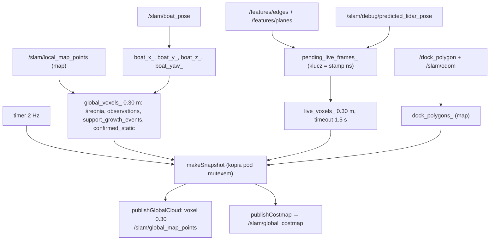

# SLAM — global map builder i costmapy

> [!skrot] W 30 sekund
> `GlobalMapBuilder` (`pose_graph/src/global_map_builder.cpp`, 3112 linii; `include/global_map_builder.hpp`, 471) to obiekt doczepiony do węzła `FeatureExtractor` (`src/main.cpp:12–15`). Buduje **trwałą mapę wokseli 0.30 m** z gęstej chmury lokalnej mapy `/slam/local_map_points` (już w ramce `map`), oraz **krótkotrwałą warstwę „żywą”** z cech bieżącego skanu. Z obu co 0.5 s (2 Hz) **od zera** liczy `nav_msgs/OccupancyGrid` `/slam/global_costmap` (0.20 m, rozmiar dynamiczny wg zasięgu przeszkód + 5 m, max 2000×2000), z inflacją wykładniczą do 1.0 m i ścinaniem kosztu w slipie z `/dock_polygon`. **Nie ma raycastingu ani log-odds** — „czyszczenie” to licznik nieobecności woksela w kolejnych lokalnych mapach w promieniu 12 m od łodzi. **Nie ma żadnej korekty wstecz**: woksele przechowują tylko uśrednione współrzędne w `map`, bez informacji, z którego keyframe’u/pozy pochodzą — po loop closure nie da się ich przeliczyć.

Stan: drzewo robocze `~/solar/l2dp_docking_fix` (gałąź `feat/dock_costmap_fix`, HEAD `0d444ff`) — **z niezacommitowanymi zmianami** w `global_map_builder.{hpp,cpp}` i `config/slam.yaml` (sekcja „Różnice względem HEAD”). Powiązane: [[pose_graph]], [[SLAM — parametry back-endu]], [[SLAM — scan matching (matematyka)]], [[segment_scan]], [[planner]], [[Mapa topików i serwisów]], [[Drzewo TF i układy współrzędnych]], [[SLAM — architektura węzła i przepływ danych]], [[L2 — konsumenci pozy i mapy (co się stanie po korekcie)]].

## Wejścia i wyjścia

| Kierunek | Topic (parametr) | Typ | QoS | Callback / miejsce |
|---|---|---|---|---|
| wej. | `/slam/local_map_points` (`global_map.input_topic`) | `PointCloud2`, ramka `map`, pole `intensity` 1.0 = zaufany keyframe, 0.25 = recovery | KeepLast(1) transient_local reliable | `localMapCallback` `:1238` |
| wej. | `/slam/boat_pose` (`global_map.boat_pose_topic`) | `Odometry` ($T_{map,boat}$) | KeepLast(10) reliable | `boatPoseCallback` `:1589` |
| wej. | `/features/edges`, `/features/planes` (`costmap.dynamic_*_topic`) | `PointCloud2`, ramka LiDAR (scan start) | KeepLast(20) reliable | `storeFeatureCloud` `:1787` |
| wej. | `/slam/debug/predicted_lidar_pose` (`costmap.dynamic_lidar_pose_topic`) | `Odometry` ($T_{map,lidar}$ **z predykcji**, przed matcherem) | KeepLast(20) | `lidarPoseCallback` `:1831` |
| wej. | `/dock_polygon` (`costmap.dock.polygon_topic`) | `PolygonStamped`, 4 punkty w ramce LiDAR-u (z [[segment_scan]]) | KeepLast(5) reliable | `dockPolygonCallback` `:1621` |
| wej. | `/slam/odom` (`costmap.dock.pose_topic`) — **nowe** | `Odometry` z zamienionym x↔y | SensorDataQoS | `dockPoseCallback` `:895` |
| wej. | `/choose_dock` (`costmap.dock.choose_dock_topic`) — **nowe** | `geometry_msgs/Point` (x = min, y = max szerokości) | 10 | `chooseDockCallback` `:971` |
| wyj. | `/slam/global_map_points` | `PointCloud2` (x,y,z,intensity = liczba obserwacji) | latched | `publishGlobalCloud` `:2273` |
| wyj. | `/slam/global_costmap` | `OccupancyGrid` | latched | `publishCostmap` `:2382` |
| wyj. | `/slam/dock_polygon_map`, `/slam/dock_corridor_map` (nowy) | `PolygonStamped` w `map` | KeepLast(5) | `publishDockPolygonMap` `:840` |

Producent `/slam/local_map_points`: `FeatureExtractor::publishLocalMap` (`feature_extractor.cpp:2136–2208`) — **wszystkie** punkty okna keyframe’ów (max `keyframes.maximum_count` = 10) przetransformowane `keyframe.pose * p` w chwili publikacji, z `intensity = trusted ? 1.0 : 0.25` (`:2184`). Publikowane tylko przy dodaniu keyframe’u (`:2623–2624`), czyli co ~0.8 m / 4° / 2 s ruchu.

## Warstwa trwała (global voxels)

`localMapCallback` (`:1238–1587`):

1. Odrzut, gdy `frame_id` ≠ `map` (bez TF, `:1244–1256`) lub brak pól x/y/z FLOAT32.
2. Agregacja punktów w woksele 0.30 m (`pointToGlobalVoxel` = `floor(x/0.30)` itd., `:1141–1166`): suma xyz i liczba punktów. Gdy `use_source_intensity` i jest pole `intensity`: punkty z `intensity < minimum_source_intensity` (0.5) **pomijane** — czyli keyframe’y recovery (0.25) **nie trafiają** do mapy globalnej (`:1304–1309`).
3. Pod `mutex_`: `source_update_sequence_++`; dla każdego woksela ramki (`:1392–1492`):
   - nowy: `observations = 1`, `support_growth_events = 1`, `confirmed_static` = (1 ≥ `minimum_support_growth_events`) ∧ (liczba punktów ≥ `minimum_static_source_points`). Gdy osiągnięto `maximum_voxels` (500 000) — **pomija** nowy woksel (`:1410–1414`).
   - istniejący: pozycja jako średnia krocząca o oknie `maximum_observations_per_voxel` (50):

> [!wzor] Aktualizacja pozycji woksela (`:1445–1461`)
> $$k = \min(\text{observations},\ 49),\qquad x \leftarrow \frac{k\,x + \bar x_{frame}}{k + 1}$$
> `observations` = min(50, +1). Jeśli liczba punktów w tej ramce > dotychczasowe maksimum → nowe maksimum i `support_growth_events++` („dowód statyczności” = coraz więcej keyframe’ów widzi to samo miejsce). `confirmed_static` raz ustawione nie wraca do `false`.

4. **Aktywne czyszczenie** (`:1494–1545`, gdy jest poza łodzi i `active_clearing_radius` > 0): dla każdego **potwierdzonego** woksela, którego nie ma w bieżącej ramce, a który leży w promieniu `active_clearing_radius` (slam.yaml **12 m**) od $(x, y)$ łodzi: `consecutive_active_misses++`; przy ≥ `confirmed_misses_before_removal` (10) — **usunięcie**. Obecny w ramce → licznik 0; poza promieniem → licznik 0.
5. `pruneTentativeGlobalVoxelsLocked` (`:2078–2104`): niepotwierdzone woksele niewidziane od > `tentative_stale_updates` (10) wiadomości — usuwane.
6. Ustawienie `global_cloud_dirty_`, `costmap_dirty_`.

> [!wazne] To nie jest mapa zajętości
> Nie ma promieni (raycasting) ani log-odds. „Wolne” nie jest nigdy obserwowane — `unknown_as_free: true` maluje wszystko bez przeszkody na 0. Usuwanie opiera się wyłącznie na tym, czy woksel jest w **oknie 10 ostatnich keyframe’ów** — przesłonięty lub poza polem widzenia LiDAR-u obiekt w promieniu 12 m też zbiera „pudła” i po 10 aktualizacjach znika.

## Warstwa żywa (dynamic / live)

- Bufor `pending_live_frames_` (`std::map` po `stamp_ns`) łączy krawędzie, płaszczyzny i pozę o **identycznym** znaczniku czasu (`:1807–1828`, `:1869–1880`); FE publikuje je z tym samym `reference_stamp` (`feature_extractor.cpp:2340–2346`, `:2406`, `:2450–2453`). Bufor przycinany do `dynamic_maximum_pending_frames` (12) najstarszych (`:2068–2076`).
- `processReadyLiveFrame` (`:1883–2066`): punkt w ramce LiDAR-u z zasięgiem $[0.5, 100]$ m transformowany pozą (kwaternion → macierz, `transformPoint` `:174–208`) do `map`, agregowany w woksele `dynamic_voxel_size` (0.30 m), łączony z `live_voxels_` (średnia krocząca okno 20, `scan_observations`, `maximum_scan_points`, `last_seen_stamp_ns`).
- Wygasanie: woksel starszy niż `dynamic_obstacle_timeout` (1.5 s) względem bieżącego stempla (`:2106–2139`), także w timerze względem `max(now, latest_live_stamp)` (`:2232–2243`).
- Poza = **predykcja** (`/slam/debug/predicted_lidar_pose`), więc przeszkody żywe są przesunięte o korektę matchera bieżącego skanu (≤ 0.35 m).

## Costmapa (`publishCostmap`, `:2382–3113`)

Liczona **od zera** przy każdej publikacji (nie ma stanu siatki między wywołaniami).

1. Odniesienie wysokości: $z_{ref}$ = `boat_z` gdy `obstacle_z_relative_to_boat` (slam.yaml: tak), inaczej 0 (`:2386–2390`). Punkt bierze udział, gdy $z - z_{ref} \in [-0.90, 3.00]$ m.
2. Statystyki komórek 0.20 m (klucz `floor(x/res)`): osobno statyczne (liczba wokseli, max `support_growth_events`, suma punktów, min/max z) i dynamiczne (`:2401–2469`).
3. Sąsiedztwo: dla każdej komórki suma/max po komórkach w promieniu `support_radius` (0.50 m → $\lceil 0.5/0.2\rceil = 3$, okno 7×7 z odcięciem po okręgu, `:2471–2560`).
4. Decyzja (`:2562–2600`):

> [!wzor] Komórka zajęta
> $$\text{static} = s_{seed} > 0 \wedge \Sigma s \ge 1 \wedge \max g \ge 1 \wedge \Sigma p \ge 1 \wedge \big(z_{max} - z_{min} \ge 0.05 \vee z_{max} \ge -0.45\big)$$
> $$\text{dynamic} = d_{seed} > 0 \wedge \Sigma d \ge 1 \wedge \max o \ge 2 \wedge \Sigma p_d \ge 2 \wedge \big(\Delta z_d \ge 0.08 \vee z_{d,max} \ge -0.45\big)$$
> (wartości z slam.yaml; $s$ — woksele statyczne, $g$ — support events, $p$ — punkty, $o$ — obserwacje skanów). Zajęta → 100.

5. Geometria siatki: `fixed_size: false` → prostokąt obejmujący zajęte komórki i łódź, ± `dynamic_padding` 5 m, wyrównany do siatki (`:2634–2746`); gdy > 2000 komórek w osi — okno 400 m wycentrowane na łodzi. `fixed_size: true` → origin (−100, −100), 200×200 m (nieużywane).
6. Tło: 0 (`unknown_as_free`) lub −1.
7. **Inflacja** (`:2836–2929`): offsety w promieniu `inflation_radius` (1.0 m → 5 komórek):

> [!wzor] Koszt inflacji (`:2873–2888`)
> $$c(d) = \begin{cases} 99 & d \le r_{ins} = 0.30\ \text{m} \\ \mathrm{clamp}\big(\mathrm{round}(1 + 98\, e^{-3.0\,(d - r_{ins})}),\ 1,\ 98\big) & r_{ins} < d \le 1.0\ \text{m}\end{cases}$$
> Policzone (`extra_checks.py`): $c(0.4) = 74$, $c(0.6) = 41$, $c(0.8) = 23$, $c(1.0) = 13$. Składanie przez maksimum; komórki 100 nienaruszone.

8. **Gaszenie slipu** (po inflacji, `:2931–3040`) — opis niżej.
9. `clear_radius_around_boat` (slam.yaml **0.0** = wyłączone) — zeruje okrąg wokół łodzi, łącznie z 100 (`:3042–3095`).

## Slip (dok): zerowanie inflacji

`dockPolygonCallback` (`:1621–1773`):

1. Wymaga 4 punktów, skończonych. **Nowe:** walidacja wymiarów w ramce LiDAR-u (`validateDockPolygon`, `:992–1069`): głębokości boków 1–0, 2–3 w $[1.8, 3.0] \pm 0.30$ m, szerokości tyłu 1–2 i wlotu 0–3 w $[1.0, 3.0] \pm 0.30$ m (zakres szerokości zmienialny w locie przez `/choose_dock`), narożniki 90° ± 20°, boki równoległe ± 20°.
2. **Nowe:** poza łodzi w chwili stempla wielokąta z bufora `/slam/odom` (10 s, interpolacja liniowa, maks. luka `pose_max_gap` 0.25 s — `:926–969`); fallback — ostatnia `/slam/boat_pose` z ostrzeżeniem.
3. Transformacja do `map` 2D (`:1687–1702`): $\psi$ = `-atan2(...)` z kwaternionu (konwencja odwróconego yaw, jak w subskrybentach `/slam/odom`):

> [!wzor] Wielokąt LiDAR → map (`:1700–1701`)
> $$x_i = x_b + p_{x,i}\cos\psi + p_{y,i}\sin\psi,\qquad y_i = y_b + p_{y,i}\cos\psi - p_{x,i}\sin\psi$$
> gdzie $(x_b, y_b)$ to pozycja **łodzi (IMU)**, nie LiDAR-u — ramię dźwigni `extrinsic.imu_lidar` (0.40, 0.05) m jest pominięte (patrz „Podejrzane”). Dla $\psi = -\psi_{q}$ jest to zwykły obrót o $\psi_q$.

   `/slam/odom` ma zamienione osie (`position.x` = map y, `position.y` = map x, `feature_extractor.cpp:1077–1079`), więc `east = position.y` = map x — **spójne** z fallbackiem `boat_x_` (sprawdzone).
4. **Nowe:** korytarz podejścia: oś od środka tylnej krawędzi (1–2) do środka wlotu (0–3); start = tył + `corridor_back_inset` (0.30 m), koniec = wlot + `corridor_approach` (3.0 m) na zewnątrz (`:1704–1723`).
5. `mouth_extension` (slam.yaml **0.0** w drzewie roboczym; w HEAD 1.5) — wydłuża boki 0←1, 3←2.
6. Scalanie: centroid w promieniu `merge_radius` 1.0 m od istniejącego → zastąpienie; inaczej dopisanie. `polygon_timeout` **0.0** → wielokąty **nigdy nie wygasają** (w HEAD 5.0 s); `last_seen_ns = node_.now()` (w HEAD — stempel wiadomości).

W `publishCostmap` (`:2931–3040`) dla każdego wielokąta w AABB (+ margines + korytarz):
- komórki 100 pomijane — **przeszkody letalne w slipie zostają**, gaszona jest tylko inflacja;
- środek komórki w wielokącie → koszt ≤ `dock.maximum_cost` (0); w pasie ≤ `dock.margin` (0.5 m) od krawędzi → ≤ `margin_cost` (25); w odległości ≤ `boat_width/2` (0.40 m) od odcinka korytarza → ≤ 0 (**nowe**, korytarz ma pierwszeństwo nad pasem marginesu).

## Synchronizacja z pozą

- Warstwa trwała **nie używa pozy** do transformacji — dostaje punkty już w `map` (transformowane w FE pozą keyframe’u z chwili jego dodania). `/slam/boat_pose` służy tylko do: promienia czyszczenia, $z_{ref}$, rozmiaru siatki, `clear_radius`, fallbacku slipu.
- Warstwa żywa: para (cechy, poza predykcji) po dokładnym stemplu.
- Slip: poza z bufora `/slam/odom` interpolowana do stempla wielokąta (wygładzona korekta SLAM — `/slam/odom` nie jest dokładnie `T_map_odom`, `feature_extractor.cpp:1037–1052`).

## Wątki i wydajność

- Wszystkie subskrypcje i timer buildera są w **domyślnej** grupie callbacków węzła (nie podano `callback_group`, `:696–814`) — MutuallyExclusive → callbacki buildera wykonują się **szeregowo** względem siebie, ale równolegle z grupami FE (lidar, odom, detekcje, klastry; `feature_extractor.cpp:557–579`) na `MultiThreadedExecutor` z 3 wątkami (`main.cpp:17–19`). W tej samej domyślnej grupie są też `/used_detections` i `/deuse_detections` FE (`feature_extractor.cpp:623–638`) — ciężki `publishCostmap` je opóźnia.
- `mutex_` chroni stan; `makeSnapshot` kopiuje **wszystkie** woksele pod mutexem ($O(G)$, $G \le 500\,000$).
- `boatPoseCallback` ustawia `costmap_dirty_` przy każdej pozie (gdy `obstacle_z_relative_to_boat`, `:1614–1618`) → costmapa jest przeliczana **zawsze** 2 Hz, mimo `publish_only_when_changed`.
- Koszt `publishCostmap`: statystyki $O(G + L)$, sąsiedztwo 49 odwołań/komórkę, inflacja ~80 offsetów/zajętą komórkę, alokacja do 4 mln komórek (int8). `localMapCallback`: dwa pełne przejścia po `global_voxels_` (czyszczenie + prune) na każdą lokalną mapę.
- Timer: `create_wall_timer` (`:810`) — przy odtwarzaniu bagów z `use_sim_time` okres liczony w czasie ściennym.

## Korekta wstecz i loop closure — co się stanie i co przebudować

> [!wazne] Stan obecny
> Brak jakiejkolwiek korekty wstecz. `GlobalVoxel` (`global_map_builder.hpp:97–120`) ma tylko $(x, y, z)$ w `map` i liczniki — bez id keyframe’u, bez pozy źródła. Raz wstawione punkty nie mogą być przeliczone po zmianie pozy.

Co się stanie po wprowadzeniu loop closure i skorygowaniu przeszłych póz (bez zmian w builderze):
1. Nowa korekta `T_map_odom` przesunie bieżące skany; stare woksele zostaną w starych (błędnych) miejscach → **podwójne ściany / „duchy”** w mapie i costmapie. Planner zobaczy przeszkody przesunięte o błąd dryfu (metry) — groźne przy wąskich przejściach i w slipie.
2. W promieniu 12 m od łodzi potwierdzone woksele, których nie ma w nowym oknie keyframe’ów, znikną po 10 lokalnych mapach (~8 m jazdy / ~20 s) — **częściowe samoleczenie tylko lokalnie**. Dalej — duchy na zawsze (do restartu).
3. Okno keyframe’ów FE (`keyframes_`, max 10) ma pozy z chwili dodania — po korekcie trzeba je też przeliczyć i przebudować `LocalVoxelMap` (front-end), inaczej `/slam/local_map_points` dalej będzie publikować stare współrzędne.
4. Warstwa żywa — samoleczy się w 1.5 s.
5. Wielokąty slipu (`dock_polygons_`, map, bez wygasania) — zostaną w starym miejscu: gaszenie inflacji w złym miejscu, slip „przesunięty”. Trzeba je zakotwiczyć do keyframe’u albo wyczyścić po korekcie.
6. Costmapa jest bezstanowa → wystarczy poprawić źródła (woksele, wielokąty), ale skok `origin` i przeszkód nastąpi naraz.

Co trzeba zmienić w builderze (propozycja):
- **Przechowywać chmury per keyframe/submapa w ramce lokalnej** (LiDAR lub submapy) + id + aktualna poza z grafu. Mapa globalna = funkcja póz. Nowy interfejs zamiast `/slam/local_map_points`: np. `/slam/keyframe` (id, stempel, `T_map_lidar`, chmura w ramce LiDAR-u) i `/slam/optimized_poses` (id → poza) po każdej optymalizacji.
- **Woksele per submapa**: każda submapa ma własną siatkę 0.30 m z licznikami; po optymalizacji transformujemy sztywno całe submapy i ponownie „rasteryzujemy” do globalnej siatki. Pełna przebudowa = $O(\text{liczba punktów})$ — można robić w osobnym wątku i podmieniać atomowo (`std::shared_ptr` snapshot).
- Liczniki statyczności (`support_growth_events`) dziś zależą od kolejności wiadomości — w nowym modelu liczyć je jako liczbę **różnych keyframe’ów** widzących woksel.
- Czyszczenie: przejść na raycasting (np. 2D Bresenham po komórkach costmapy albo OctoMap-owe log-odds) — wtedy przebudowa po pętli jest powtarzalna.
- Wielokąty slipu: zapisywać w ramce keyframe’u najbliższego w czasie (lub w `odom` + stempel) i przeliczać.
- Osobna grupa callbacków (MutuallyExclusive) dla buildera i osobna dla przebudowy, żeby nie blokować `/used_detections`.

## Różnice drzewa roboczego względem HEAD `0d444ff`

`git diff HEAD --stat` w `pose_graph`: `global_map_builder.cpp` +500/−69 (łącznie z hpp i yaml), `global_map_builder.hpp` +75, `config/slam.yaml` +17, `math_checks.py` tylko zmiana trybu 755→644. Treść:
- nowe parametry `costmap.dock.pose_topic`, `pose_max_gap`, `choose_dock_topic`, `min_width`, `max_width`, `min_depth`, `max_depth`, `size_tolerance`, `angle_tolerance_deg`, `boat_width`, `corridor_back_inset`, `corridor_approach` (`:622–689`);
- nowe subskrypcje `/slam/odom` (bufor póz) i `/choose_dock`, publikacja `/slam/dock_corridor_map` (`:714–753`);
- walidacja wymiarów/kątów wielokąta, poza z bufora zamiast ostatniej `/slam/boat_pose`, korytarz podejścia;
- `distanceToSegment` wydzielone z `distanceToPolygonEdge` (`:1071–1114`);
- ścinanie kosztu: wcześniej `cap` 0 lub 25, a reszta AABB pomijana; teraz `cap = 100` startowo i minimum z warunków wielokąt/margines/korytarz (`:3008–3036`);
- `last_seen_ns` = `node_.now()` zamiast stempla wiadomości;
- domyślne i yaml: `mouth_extension` 1.5 → 0.0, `polygon_timeout` 5.0 → 0.0; usunięto polskie komentarze z hpp.

## Podejrzane / do naprawy

> [!blad] 1. Wielokąt slipu transformowany pozą łodzi, nie LiDAR-u
> `/dock_polygon` jest w ramce LiDAR-u, a transformacja używa pozycji i yaw łodzi (IMU) (`:1662–1702`), pomijając `extrinsic.imu_lidar` (0.40, 0.05, −0.40) m. Błąd ≈ 0.40 m wzdłuż osi łodzi — tyle co pół szerokości korytarza (0.40 m). Pomija też roll/pitch. Propozycja: dodać do pozy łodzi obrócony offset `R_z(ψ)·[0.40, 0.05]` albo transformować pełnym $T_{map,lidar}$. [[segment_scan]] publikuje narożniki w kolejności lewy-przód, lewy-tył, prawy-tył, prawy-przód z `frame_id = "hesai_lidar"` i stemplem skanu, bez żadnej kompensacji offsetu (`segment_scan/src/segment_scan.cpp:379–389`). Niepewne: czy wejściowy skan [[segment_scan]] faktycznie ma początek w LiDAR-ze (zależy od [[pointcloud_to_laserscan]]).

> [!blad] 2. `polygon_timeout: 0.0` — wielokąty nieśmiertelne
> Przy błędnej detekcji slipu (np. pomost poza slipem o wymiarach w tolerancji) ścinanie inflacji zostaje na zawsze; przy dryfie/korekcie pozy — w złym miejscu. Propozycja: timeout > 0 albo wygaszanie po oddaleniu łodzi.

> [!blad] 3. Czyszczenie bez raycastingu usuwa przesłonięte przeszkody
> `:1500–1544`: woksel w promieniu 12 m nieobecny w oknie 10 keyframe’ów jest usuwany po 10 aktualizacjach, także gdy był tylko zasłonięty lub poza FOV. Propozycja: liczyć pudło tylko gdy promień z LiDAR-u do woksela przechodzi przez wolną przestrzeń bieżącego skanu.

> [!blad] 4. Limit 500 000 wokseli cicho zatrzymuje mapę
> Po osiągnięciu limitu nowe woksele są pomijane (`:1410–1414`) — nowe przeszkody (np. boja) nie trafią do warstwy trwałej. Tylko ostrzeżenie co 5 s. Propozycja: usuwać najdalsze/najstarsze.

> [!blad] 5. `static_geometry` praktycznie zawsze prawdziwe
> Warunek `z_max ≥ minimum_compact_obstacle_height` (−0.45 m względem łodzi) przepuszcza każdy punkt powyżej −0.45 m (`:2566–2571`), więc test `minimum_vertical_extent` jest prawie martwy; odblaski od wody powyżej −0.45 m przejdą. Zamierzone dla małych boi (komentarz `global_map_builder_parameters.yaml:73–76`), ale warto zmierzyć realny poziom wody względem `boat_z`.

> [!blad] 5b. Filtr trwałości wyłączony konfiguracją
> slam.yaml: `minimum_support_growth_events: 1`, `minimum_static_source_points: 1`, `costmap.minimum_static_support_events: 1` → nowy woksel jest potwierdzony przy pierwszej obserwacji (`:1425–1432`), a costmapa nie wymaga wzrostu wsparcia. Jednorazowe odblaski z zaufanych keyframe’ów trafiają od razu do warstwy trwałej i znikają dopiero po 10 „pudłach” w promieniu 12 m. Opis w [[SLAM — parametry back-endu]].

> [!blad] 6. Costmapa liczona zawsze 2 Hz
> `boatPoseCallback` ustawia `costmap_dirty_` przy każdej pozie (`:1614–1618`), więc `publish_only_when_changed` nie działa dla costmapy. Do tego pełna kopia wokseli pod mutexem (`:2141–2228`). Przy dużej mapie blokuje domyślną grupę callbacków.

> [!blad] 7. Warstwa żywa używa pozy z predykcji
> `dynamic_lidar_pose_topic: /slam/debug/predicted_lidar_pose` (slam.yaml:185) — poza sprzed korekty matchera. Przesunięcie przeszkód o korektę bieżącego skanu (do 0.35 m). Propozycja: publikować też finalną pozę (`candidate` tylko gdy zaakceptowana) i jej używać.

> [!blad] 8. `pending_live_frames_` wymaga identycznych stempli
> Klucz `std::map` = `stamp_ns` (`:1812`, `:1874`). Działa, bo FE publikuje cechy i pozę z tym samym `reference_stamp`, ale gdy predykcja nie zostanie opublikowana (np. wyjście przed `publishPose`), ramka czeka do wypchnięcia przez limit 12.

> [!blad] 9. `dockPoseCallback` czyści bufor przy cofnięciu czasu
> Każda próbka z mniejszym stemplem niż ostatnia czyści cały bufor (`:916–917`) — przy kolejności poza porządkiem (SensorDataQoS) bufor może się często zerować → fallback do ostatniej pozy.

## Moje notatki

> [!ja] Tu piszesz ty — Albert tej sekcji nie rusza.
