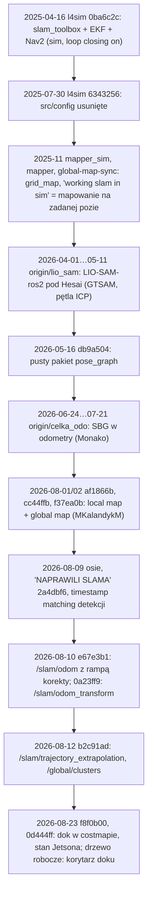

# SLAM — historia i gałęzie

> [!skrot] W 30 sekund
> - **W historii były dwie próby z loop closure**, obie porzucone, żadna nie trafiła na łódź:
>   1. `slam_toolbox` (Karto + Ceres, `do_loop_closing: true`) z `robot_localization` i Nav2 w symulacji VRX (`l4sim`, 2025-04-16…2025-07-30, potem usunięte);
>   2. **LIO-SAM** (GTSAM/iSAM2 + pętla po odległości + ICP) skonfigurowany pod Hesai na `origin/lio_sam` (2026-04-01…2026-05-11, jankusa/filnaw).
> - Dzisiejszy `pose_graph` mimo nazwy **nie ma grafu poz**. Jest to front-end scan-to-local-map z korektą `T_map_odom` i trwałą mapą wokselową. Autor sam pisze, że to „odometry fallback, not a loop-closure system” (`pose_graph/REVIEW_AND_TEST_PLAN.md:155`), a następnym krokiem mają być „immutable local submaps plus a pose graph” (`REVIEW_AND_TEST_PLAN.md:338`). Pakiet założono 2026-05-16 jako pusty szkielet `pose_graph.cpp` (0 linii) z klasami `Pose{x,y,heading}` i `LidarPose{}` (`db9a504`).
> - `origin/feature/global-map-sync` **nie synchronizuje map**. Usuwa tylko starą `UpdateGlobalMap` mappera (2 commity, listopad 2025). `origin/mapper*` to grid_map bez korekty pozy. `origin/celka_odo` zmienia tylko fuzję (SBG), nie SLAM. `origin/master` nie ma `pose_graph` w ogóle.
> - Pickaxe po całej historii `l2dp`: `gtsam`, `ISAM2`, `loopClosure`, `loop_closure` i `ScanContext` (wzmianka w README) pojawiają się **wyłącznie** w commitach LIO-SAM. `ceres`, `place_recognition`, `PoseGraph` nie dają trafień. `g2o` trafia tylko w plikach binarnych modeli (fałszywe trafienia).

Powiązane: [[Repozytoria/l2dp|l2dp]] (pełna tabela gałęzi), [[pose_graph]], [[L2 — odometria, sensory i fuzja]], [[SLAM — dane testowe i rosbagi]], [[SLAM — TF map-odom-base]], [[l4sim]].

Metoda: `git log --all -S<słowo>` w `~/solar/l2dp_docking_fix` (zawiera wszystkie zdalne gałęzie `origin/*` i `jetson/spirala_zjebania`), `git diff <merge-base> <gałąź> --stat -- pose_graph odometry mapper`, `git show <ref>:<plik>`. Repo tylko czytane.

## Oś czasu (SLAM i lokalizacja)

## Gałęzie — co dokładnie zmieniają w SLAM/odometrii

`merge-base` liczony z `feat/dock_costmap_fix`. Statystyki: `git diff --stat <merge-base> <gałąź> -- pose_graph odometry mapper`.

| gałąź | ostatni commit | merge-base | zmiany w `pose_graph` / `odometry` / `mapper` | znaczenie dla SLAM |
|---|---|---|---|---|
| `origin/master` | `6ae4389` 2026-08-01 Mateusz „poprawka na osie jazwieckiego” | `74c473e` | brak `pose_graph`; `mapper.cpp` +5/−4: zamiana `detection.position.x↔y` we wzorze detekcja → mapa | brak SLAM-u LiDAR; tylko oś w mapperze |
| `origin/celka_odo` | `6b02df0` 2026-07-21 juliadcz „kodzik po monaco2026” | `74c473e` | `odometry` +229/−1: SBG (HDT, pozycja, prędkość, EKF quat); brak `pose_graph` | inna fuzja kursu (roll = pitch = 0 z HDT); opis w [[L2 — odometria, sensory i fuzja]] |
| `origin/lio_sam` | `7f0930d` 2026-05-11 jankusa „fix deskewing” | `2010305` | 0 zmian w tych katalogach; nowy katalog `LIO-SAM-ros2/` (18 plików, +4971) | **jedyna próba grafu poz z loop closure na danych łodzi**, opis niżej |
| `origin/feature/global-map-sync` | `338794f` 2025-11-27 Mateusz „start task” | `209d1ec` | `mapper.cpp` −27/+1: ciało `UpdateGlobalMap()` zastąpione `;` (`07ce7c5` „WIP: Usunięcie starej implementacji UpdateGlobalMap przed refaktoryzacją”), plus pusty `mapper.cpp` w korzeniu | **żadnej synchronizacji**; porzucony WIP |
| `origin/mapper` | `47cc319` 2025-11-30 MKalandykM „fixed mapper” | = `47cc319` (zmergowana) | — | zawarta w linii głównej |
| `origin/mapper_multitype_fusion` | `ea12802` 2026-03-21 janSochaOfficial | `2e8397f` | `mapper` +84/−13: `detection_type_map` z sumą `confidence` per typ, `trackingThreshold 2.5 → 1.5` m | fuzja typów detekcji, bez korekty pozy |
| `origin/mapper_sim` | `cc0852f` 2026-03-11 MKalandykM „usa dump” | `47ffd96` | `mapper` +201, `odometry` ±114: tematy VRX `/wamv/...`, predykcja z przyspieszeń IMU, `velCallback` zakomentowany, w `KalmanFilter` usunięte nadpisywanie stanu prędkości | „working slam in sim” (`ee77f1a`, `3809c7f`) oznacza mapowanie grid_map na pozie z odometrii, bez dopasowania skanów (grep `icp/ndt/loop` w `mapper.cpp` gałęzi: brak) |
| `origin/scan_matching` | `ed210d2` 2026-08-09 Mateusz „kolorowanki” | zawarta w HEAD | pierwsze wersje `pose_graph` (`af1866b`, `cc44ffb`, `f37ea0b`, `9f7ed16`) | początek dzisiejszego SLAM-u |
| `origin/njord/tracked_timestamp_matching` | `db9caeb` 2026-08-09 | zawarta w HEAD | `e88037b`/`b1bff75` (UmarlyPoeta) „initial slam tracked detections timestamp matching” +291: bufor póz i dopasowanie detekcji po stemplu | detekcje w `map` liczone z pozy w chwili pomiaru |
| `jetson/spirala_zjebania` = `~/solar/l2dp` HEAD | `cb93270` 2026-08-12 | — | względem `0d444ff` w `pose_graph` brak `f8f0b00` i zmian roboczych (`git diff --stat jetson/spirala_zjebania HEAD -- pose_graph`: 8 plików, +491/−11, głównie `global_map_builder.cpp` +363) | stan Jetsona sprzed gaszenia inflacji |
| `~/solar/l2dp` drzewo robocze | — | — | `feature_extractor.cpp` +38, `feature_extractor.hpp` +8: okresowa publikacja `/tracked_detections` (`tracking.publish_rate` 10 Hz, `PublishTrackedDetectionsPeriodic`). `odometry`, `mapper` bez zmian | ta sama zmiana co w `0d444ff` |
| `~/solar/l2dp_docking_fix` drzewo robocze | — | — | `git diff --stat HEAD -- pose_graph`: `slam.yaml` 17, `global_map_builder.hpp` +75, `global_map_builder.cpp` +500/−68, `math_checks.py` (tryb pliku). `feature_extractor` i `odometry` bez zmian | korytarz doku, walidacja wielokąta, bufor `/slam/odom` (nie dotyczy pozy) |

`diff -rq ~/solar/l2dp/pose_graph ~/solar/l2dp_docking_fix/pose_graph`: różnią się `CMakeLists.txt`, `package.xml`, `slam.yaml`, `global_map_builder_parameters.yaml`, `global_map_builder.{hpp,cpp}`. **`feature_extractor.cpp` jest identyczny w obu kopiach z Jetsona**, więc front-end SLAM-u był na łodzi jeden.

### Historia `pose_graph` na linii Njord (`git log 74c473e..HEAD -- pose_graph`)
| commit | data, autor | +/− | co doszło (wg grepa po dodanych liniach) |
|---|---|---|---|
| `db9a504` „some tires” | 2026-05-16 MKalandykM | +102 | szkielet: `CMakeList.txt` (literówka, bez „s”) z `grid_map`, pusty `pose_graph.cpp`, klasy `Pose`, `LidarPose` |
| `af1866b`, `cc44ffb` „working local map” | 2026-08-01/02 MKalandykM | +2912, +11173/−1888 | deskewer, cechy, scan matcher, mapa lokalna |
| `f37ea0b` „working global map” | 2026-08-02 | +1668/−193 | `GlobalMapBuilder` |
| `9f7ed16` „quite cleanly working slam” | 2026-08-09 juliadcz | ±10 | parametry |
| `e88037b`, `b1bff75`, `5bcd14b`, `b22ef69` | 2026-08-09 UmarlyPoeta/patryk_kozlowski | +291 | dopasowanie detekcji po stemplu |
| `2a0b6e0`, `2a06b84`, `2a4dbf6` | 2026-08-09 Mateusz | +745/−226 | osie; `pushBoatPose`, `ProcessPendingDetections`; `slam.yaml` (+206) |
| `e67e3b1` „gdzie ja kurwa jestem” | 2026-08-10 MKalandykM | +470/−19 | **`/slam/odom`**: `setMapToOdom`, `updateStableSlamOdomPose`, parametry `slam_odom.*` |
| `b4ff42f` | 2026-08-10 MKalandykM | +106 | `/slam/odom_marker` |
| `0a23ff9` „marker and odom transformed added” | 2026-08-10 juliadcz | +114/−24 | **`/slam/odom_transform`** |
| `942cbe2` „FIXED DOCKING AFTER 1 YEAR” | 2026-08-11 juliadcz | +25 | dok |
| `b2c91ad` „Indiana jones i zagubiona os” | 2026-08-12 juliadcz | +729/−5 | `/slam/trajectory_extrapolation`, `/global/clusters`, `ObstacleCallback` |
| `f26cef0`, `f8f0b00`, `0d444ff` | 2026-08-14…23 patryk_kozlowski | +505/−25 | dok w costmapie, `/tracked_detections` okresowo |

Żaden z tych commitów nie dodaje optymalizacji grafu, wykrywania pętli ani zależności od GTSAM/g2o/Ceres (`pose_graph/CMakeLists.txt:19-29`: rclcpp, nav_msgs, sensor_msgs, l1/l2_interfaces, visualization_msgs, geometry_msgs, PCL, pcl_conversions, pcl_ros).

## Próba 1: LIO-SAM na `origin/lio_sam`

Commity: `6e67e7c` 2026-04-01 jankusa „add lio_sam files” (upstream LIO-SAM-ros2), `9df82ba`, `8ac01fb` 2026-04-21 „config lio-sam for hesai”, `093d0b8` 2026-04-22 filnaw „param file change”, `7f0930d` 2026-05-11 „fix deskewing”. Zmiany względem upstreamu (`git diff 6e67e7c origin/lio_sam`): 6 plików, +152/−44.

> [!definicja] Co tam jest (upstream LIO-SAM)
> - `imuPreintegration`: preintegracja IMU w GTSAM.
> - `mapOptmization`: `ISAM2` (`mapOptmization.cpp:17`, `58`, `157-160`), czynniki `BetweenFactor<Pose3>` odometrii (`1413`), GPS (`addGPSFactor`, `1418`), pętli (`addLoopFactor`, `1497-1514`), korekta póz (`correctPoses`, `1603-1632`).
> - Wykrywanie pętli: `loopClosureThread` (`511-520`), `performLoopClosure` (`537`). Najpierw zewnętrzne (`detectLoopClosureExternal`, topik `lio_loop/loop_closure_detection`), potem **po odległości** (`detectLoopClosureDistance`, `618`): najbliższy keyframe w promieniu `historyKeyframeSearchRadius` i starszy niż `historyKeyframeSearchTimeDiff`. Weryfikacja ICP (`568`, `setMaxCorrespondenceDistance(2·radius)`) z progiem `historyKeyframeFitnessScore`.
> - ScanContext tylko jako odnośnik w README (`LIO-SAM-ros2/README.md:193`, `277`), nie w kodzie.

Konfiguracja pod łódź (`origin/lio_sam:LIO-SAM-ros2/config/params.yaml`):
- `pointCloudTopic: /lidar_points`, `imuTopic: /imu/data`, `gpsTopic: odometry/gpsz`. GPS-u nikt nie publikuje (brak `navsat_transform`), więc czynnik GPS był martwy.
- `sensor: hesai`, `N_SCAN: 64`, `Horizon_SCAN: 2000`. Bag ma chmury nieuporządkowane (h = 1, 128 000 punktów), więc **niepewne**, czy `N_SCAN/Horizon_SCAN` odpowiadały modelowi lidaru.
- `lidarMinRange: 4.0` (upstream 1.0) — wycina bliskie ściany slipu.
- `extrinsicTrans: [0.0, 0.4, -0.45]`, `extrinsicRot` = obrót 90° wokół Z, `extrinsicRPY` = obrót przeciwny (−90°). Upstream wymaga, by Rot i RPY opisywały tę samą rotację dla IMU 9-osiowego, a tu mają przeciwne znaki. **Podejrzane**: to może być „fix” osi kwaternionu NWU, ale bez testu nie wiadomo.
- `loopClosureEnableFlag: true`, `loopClosureFrequency: 1.0`, `historyKeyframeSearchRadius: 15.0` m, `historyKeyframeSearchTimeDiff: 30.0` s, `historyKeyframeSearchNum: 25`, `historyKeyframeFitnessScore: 0.3`, `surroundingkeyframeAddingDistThreshold: 1.0` m, `surroundingkeyframeAddingAngleThreshold: 0.2` rad.

Zmiany zespołu w kodzie:
- `imageProjection.cpp`: struktura `HesaiPointXYZIT` (`x, y, z, intensity, double timestamp, uint16 ring`) i konwersja czasu punktu `timestamp − timestamp[0]`. Przy okazji przeniesiono ustawianie `timeScanCur/timeScanEnd` do gałęzi czujników. Dla Velodyne usunięto normalizację `min_time`.
- `mapOptmization.cpp`: próg degeneracji `eignThre` 100 → 10; brak `transformUpdate()` przy braku zbieżności; `globalMapVisualizationLeafSize ≤ 0` oznacza „bez downsamplingu”; **`laserOdomIncremental.pose.covariance` wypełniane marginalną kowariancją iSAM2** zamiast flagi degeneracji.
- `imuPreintegration.cpp`: poprawiony nagłówek TF (`stamp`, `frame_id`).

> [!blad] Błąd, który psuł LIO-SAM po zmianach
> Upstream `imuPreintegration` odczytuje degenerację jako `(int)odomMsg->pose.covariance[0] == 1` (`origin/lio_sam:LIO-SAM-ros2/src/imuPreintegration.cpp:305`) i dobiera wtedy szum korekcji (`414`). Po zmianie w `mapOptmization` (wypełnianie `covariance[0]` wariancją z iSAM2, ×10 przy degeneracji) flaga prawie nigdy nie wynosi dokładnie 1. W efekcie preintegracja IMU **nie wie o degeneracji** (np. na otwartej wodzie, w korytarzu), a mocniejsza korekcja zdegenerowaną pozą może rozjechać filtr. Jeśli kiedyś wracać do LIO-SAM: przywrócić flagę albo przenieść ją do osobnego pola.

> [!wazne] Model TF w LIO-SAM
> `map→odom` jest statyczną identycznością (`launch/run.launch.py:26-32`). Korekty, łącznie z pętlą, wchodzą w `odom→lidar_link` (`mapOptmization.cpp:1680-1681`) i w `/lio_sam/mapping/odometry` (frame `odom`). To odwrotność modelu `pose_graph`, który ma gładkie `odom` i korektę w `map→odom` (zob. [[SLAM — TF map-odom-base]]). Integracja LIO-SAM z L3 wymagałaby więc innego kontraktu z konsumentami.

Stan: nic w L2/L3 nie subskrybuje `lio_sam/*`. Gałąź jest „85 za / 5 przed” masterem ([[Repozytoria/l2dp|l2dp]]). Nie ma notatek z testów ani bagów z wynikami. Ostatni commit dotyczy deskewu, a pętli nie testowano jawnie (**niepewne**).

## Próba 2: `slam_toolbox` w symulacji (`l4sim`)

`~/solar/bash_do_uruchomienia/l4sim`, commit `0ba6c2c` 2025-04-16 filnaw „first working slam”, dalej `99fccf7`, `2ba9a93`, `ac09db0`, `4bc6361`, `ecdbfac`, `ab5f639`. Pliki usunięto w `6343256` 2025-07-30 (Blazej).

`git show 4bc6361:src/config/mapper_params_online_async.yaml`:
- `solver_plugin: solver_plugins::CeresSolver`, `ceres_linear_solver: SPARSE_NORMAL_CHOLESKY`, `mode: mapping`, `resolution: 0.05`;
- `scan_topic: /wamv/sensors/lidars/lidar_wamv_sensor/scan2`, `base_frame: wamv/wamv/base_link`;
- **`do_loop_closing: true`**, `loop_search_maximum_distance: 3.0`, `loop_match_minimum_chain_size: 10`, `loop_match_minimum_response_coarse: 0.35`, `loop_match_minimum_response_fine: 0.45`, `loop_search_space_dimension: 8.0`.

`ekf.yaml`: `robot_localization`, `two_d_mode`, IMU (orientacja) + GPS, `publish_tf: true`. Był też `nav2_params.yaml` (350 linii). To była jedyna konfiguracja w historii z prawdziwym TF i Nav2. Działała wyłącznie na WAM-V w Gazebo, na skanie 2D.

## Wnioski dla wdrożenia loop closure

> [!zadanie] Czego się nauczyć z historii
> 1. Gotowe systemy (slam_toolbox, LIO-SAM) porzucono na rzecz własnego front-endu. Powody w commitach nie są zapisane (**niepewne**). Z kodu widać: problemy z osiami (NWU, NEU), Hesai bez uporządkowanych pierścieni, statek o 3 stopniach swobody (`REVIEW_AND_TEST_PLAN.md:325-336`: „simpler and safer than allowing a six-degree-of-freedom LiDAR optimizer to compete with reliable Xsens Z/roll/pitch on a vessel”).
> 2. Front-end `pose_graph` ma już wszystko, czego graf potrzebuje na wejściu: keyframe'y (`keyframes.*` w `slam.yaml:97-103`), poza dokładna na skan, `T_map_odom` jako jedyne miejsce korekty, rampę dla konsumentów. Brakuje: trwałych keyframe'ów (dziś okno `maximum_count: 10`), back-endu (2D, $x, y, \psi$) i detektora pętli.
> 3. Wykrywanie pętli po odległości (jak w LIO-SAM) jest naturalne przy GNSS-owym `/odom`: kandydaci = keyframe'y w promieniu np. 10–15 m wg `/odom`, starsze niż N s, a weryfikacja przez istniejący scan matcher (scan-to-submap). ScanContext przydałby się dopiero przy złym GNSS-ie.
> 4. Pętla musi przejść te same bramki co korekty front-endu (obserwowalność, `minimum_translation_eigenvalue_ratio`, `maximum_rmse`). Na wodzie dominują degeneracje: jedna ściana nabrzeża daje 1 obserwowalny kierunek.

## Moje notatki
> [!ja] Tu piszesz ty — Albert tej sekcji nie rusza.
