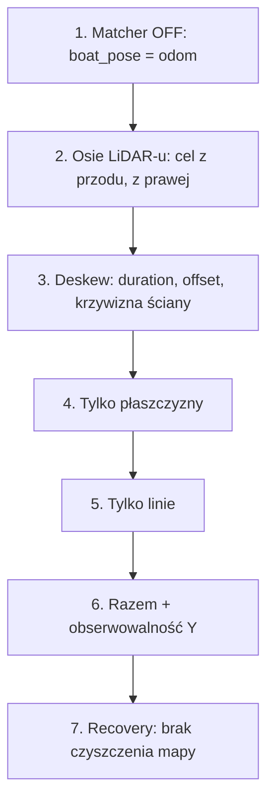

# SLAM — plan testów i weryfikacja

> [!skrot] W 30 sekund
> `pose_graph/REVIEW_AND_TEST_PLAN.md` (356 linii) to audyt autora poprzedniej wersji SLAM: 8 przyczyn złego działania (degeneracja matchera, czyszczenie keyframe’ów przy porażce, bookkeeping linii przy wadze 0, niespójna klasyfikacja, kotwiczenie czasu deskew, bootstrap 5 skanów, za mały promień przeszukiwania wokseli, niezweryfikowane osie) + 7 testów na wodzie w ustalonej kolejności. W kodzie drzewa roboczego **wszystkie 8 poprawek jest zaimplementowanych** (sprawdzone w kodzie, tabela niżej); testy 1–7 to procedury terenowe — w repo nie ma po nich śladu (logów, bagów, wyników), więc **status ich wykonania jest nieznany**. `math_checks.py` (3 testy numeryczne) przechodzi: 3× PASS. Brakuje testów automatycznych C++ (gtest) i testów regresji na bagach.

Powiązane: [[SLAM — scan matching (matematyka)]], [[SLAM — degeneracja i jakość dopasowania]], [[SLAM — global map builder i costmapy]], [[SLAM — parametry back-endu]], [[pose_graph]], [[Rosbagi]].

## Wynik `math_checks.py`

Uruchomione z kopii w scratchpadzie (`/tmp/claude-1000/.../scratchpad/slam/backend/`, venv z numpy — systemowy Python nie ma numpy), 2026-10-08:

```text
PASS deskew: inv(T_odom_l0) * T_odom_li * p_li
PASS Jacobians: direct map XY plus left yaw of rotation
PASS observability: one wall is rank-1 with weak Y; mixed normals constrain both XY directions
```

Co sprawdza (`math_checks.py`):
1. `deskew_check` (`:36–62`): punkt statyczny w `odom` widziany w chwili $i$ i przeniesiony $T_{odom,l_0}^{-1} T_{odom,l_i}\, p_{l_i}$ daje to samo, co bezpośrednio w ramce $l_0$ (tolerancja $10^{-10}$). Używa ekstrinsyki z obrotem (rz 0.17, ry −0.06) i $z = -0.30$ (w yaml jest −0.40 — dla testu bez znaczenia).
2. `jacobian_check` (`:65–123`): jakobiany płaszczyzny i linii vs różnice centralne ($\epsilon = 10^{-7}$, tol. $10^{-7}$) przy aktualizacji $t + [\delta x, \delta y, 0]$, $R_z(\delta\psi) R$ — dokładnie jak w `scan_matcher.cpp:809–822`.
3. `observability_check` (`:138–178`): 4 punkty, jedna ściana $n = (1,0,0)$ → $\lambda_0 < 10^{-9}$, słaby wektor $\pm Y$; mieszane normalne → $\lambda_0 > 0.01$. Replikuje tylko Schura translacji z `scan_matcher.cpp:152–176` (bez progów względnych, bez yaw, bez wag).

Czego **nie** sprawdza: krok w podprzestrzeni, prior, Huber, `yaw_information`, bramki akceptacji, liczenie `residual_dimensions` dla linii. Dopisałem własny skrypt `scratchpad/slam/backend/extra_checks.py` (poza repo): jedna ściana → krok $\delta y = 0$; skalowanie progów z wagami; wartości inflacji. Wyniki w [[SLAM — degeneracja i jakość dopasowania]] i [[SLAM — global map builder i costmapy]].

## Poprawki z audytu — stan w kodzie

| # | Problem (`REVIEW_AND_TEST_PLAN.md`) | Zrealizowane? | Dowód w kodzie |
|---|---|---|---|
| 1 | Degeneracja nie mierzona (`:29`) | **tak** | `computeObservability` `scan_matcher.cpp:140–289`; projekcja na bazę `:737–782`; log `obs_rank`, `eig`, `weak`, `yaw_info` `feature_extractor.cpp:2663–2683` |
| 2 | Recovery czyści keyframe’y (`:30`) | **tak** | brak `keyframes_.clear()` w `src/` (jedyne usuwanie: okno `pop_front`, `feature_extractor.cpp:2107–2108`); keyframe recovery z `trusted = false` `:2608–2621`; `trusted_fraction` w wokselu `local_voxel_map.hpp:66–108` |
| 3 | Bookkeeping linii przy wadze 0 (`:31`) | **tak** | niezależne gałęzie `scan_matcher.cpp:330`, `:418`; metryki po obu w `populateMetrics` `:521–580`; `enoughTypeSupport` `:291–319` |
| 4 | Niespójna klasyfikacja źródło/mapa, tylko pionowe linie (`:32`) | **tak (częściowo sprawdzone)** | brak filtra „vertical” w `local_voxel_map.hpp` i `feature_extractor.cpp`; jakość $q$ z tych samych definicji (`local_voxel_map.hpp:156`, `:163`). Szczegóły klasyfikacji — notatki front-endu |
| 5 | Kotwiczenie czasu deskew (`:33`) | **tak** | min/max znaczników `deskewer.cpp:191–215`, `deskew.header_stamp_reference` `:225–241`, odrzut za długiego skanu `:218–222` |
| 6 | Bootstrap 5 skanów (`:34`) | **tak** | jeden keyframe i `return` — log „Initialized local map with one keyframe” `feature_extractor.cpp:2465–2525` |
| 7 | Za mały promień przeszukiwania (`:35`) | **tak** | `neighborRadius` = $\lfloor d_{center}/v\rfloor + 1$ `local_voxel_map.hpp:458–467` |
| 8 | Niezweryfikowane osie (`:36`) | **tak (jako parametr)** | `extrinsic.imu_lidar.*` slam.yaml:11–19 (rotacja jednostkowa); tematy diagnostyczne `/slam/debug/frame_axes`, `/slam/boat_marker` `feature_extractor.cpp:744–749`; audyt pierwszego skanu `logRawCloudAudit` `:2210` |

Tematy diagnostyczne z planu (`REVIEW_AND_TEST_PLAN.md:268–296`) istnieją: `/slam/debug/raw_scan`, `deskewed_scan`, `predicted_scan_map`, `candidate_scan_map`, `predicted_lidar_pose`, `candidate_lidar_pose`, `map_to_odom` (`feature_extractor.cpp:658–708`), `/local_voxel_map`, `/slam/local_map_points` (`:681–690`).

## Testy terenowe (streszczenie i jak je czytać)



1. **Matcher wyłączony** (`plane_weight: 0`, `line_weight: 0`, `recovery_after_failures: 100000`) — `REVIEW_AND_TEST_PLAN.md:168–187`. Oczekiwane: `T_map_odom` stałe, `/slam/boat_pose` i marker podążają za `/odom` w X i Y. Uwaga z kodu: przy obu wagach 0 każdy skan kończy się `EMPTY_SOURCE` (`scan_matcher.cpp:643–648`), więc `consecutive_match_failures_` rośnie — dlatego wysoki `recovery_after_failures`.
2. **Osie LiDAR-u** (`:189–199`): stojąca łódź, cel z przodu / z prawej / góra-dół, `debug.publish_clouds: true`, odczyt z `/slam/debug/raw_scan`.
3. **Deskew** (`:201–219`): log duration/offset/motion; ściana mniej zakrzywiona po deskew; `header_stamp_reference: start` tylko przy dowodzie z drivera.
4. **Tylko płaszczyzny** (`:221–231`): `plane_weight: 1.0`, `line_weight: 0.0`; `match(P/L)` z linią 0.
5. **Tylko linie** (`:233–243`).
6. **Razem + obserwowalność Y** (`:245–255`): obserwować `weak=(vx,vy)`, `eig`, `corr`, `status`, `trusted`; przy słabym Y korekta Y powinna być 0.
7. **Recovery** (`:257–264`): brak czyszczenia deque, brak skoku `T_map_odom`, status `insufficient_trusted_reference` dla wyników opartych tylko o recovery.

Kolejność strojenia (`:298–307`): osie i czas → matcher off → liczby cech → bramki odległości → `minimum_translation_information` z logów → bramki RMSE/korekty → progi cech.

> [!wazne] Stan wykonania testów — niepewne
> W repo nie ma wyników testów 1–7 (bagi, logi, zrzuty). Pośrednio: komentarz „IMPORTANT: use the coordinate setup that worked” (slam.yaml:106–107) i wartości z baseline w slam.yaml sugerują, że baseline był użyty na wodzie; obrazy w `~/solar/docs/dock_costmap_check/` (wg [[pose_graph]]) dotyczą costmapy slipu, nie matchera. Do potwierdzenia z zespołem.

> [!wazne] Ograniczenie wpisane w projekt
> Okno keyframe’ów usuwa najstarsze bez względu na `trusted` (`feature_extractor.cpp:2107–2108`). Po ≥ 10 keyframe’ach recovery wszystkie zaufane wypadają, `trusted_match_fraction` → 0 i każdy wynik kończy się `INSUFFICIENT_TRUSTED_REFERENCE` — SLAM zostaje na samej odometrii **do końca przebiegu**. Autor to przyznaje (`REVIEW_AND_TEST_PLAN.md:155`: „This is an odometry fallback, not a loop-closure system”). To dokładnie miejsce na relokalizację / loop closure.

## Czego brakuje (proponowane testy)

> [!zadanie] Testy do dopisania
> 1. **gtest dla `ScanMatcher`** na syntetycznej mapie (`LocalVoxelMap` z ręcznie wstawionymi wokselami): (a) dwie prostopadłe ściany + przesunięcie (0.2, −0.1, 1°) → odzysk z dokładnością 1 cm / 0.05°; (b) jedna ściana → `obs_rank = 1`, $\delta$ wzdłuż ściany = 0; (c) wagi 0 → `EMPTY_SOURCE`; (d) za duża korekta → `EXCESSIVE_CORRECTION`.
> 2. **Test zbieżności z obcięciem kroku**: start 0.5 m od optimum → czy 8 iteracji wystarcza i czy `converged` jest prawdziwe.
> 3. **gtest dla `GlobalMapBuilder::publishCostmap`** (wydzielić funkcję czystą: snapshot → grid): wartości inflacji 99/74/41/23/13, gaszenie slipu (komórka 100 zostaje), korytarz.
> 4. **Test transformacji slipu**: wielokąt w ramce LiDAR-u, znana poza łodzi z offsetem LiDAR-u → porównanie z prawdą (wykryje pominięty offset 0.40 m).
> 5. **Regresja na bagu** z Njord: zapis `/slam/boat_pose` i statusów, porównanie trajektorii z GNSS (ATE/RPE) przed i po każdej zmianie parametrów.
> 6. **Pomiar czasu** callbacku LiDAR-u i `publishCostmap` na Jetsonie (dziś brak logów czasu).

## Moje notatki

> [!ja] Tu piszesz ty — Albert tej sekcji nie rusza.
