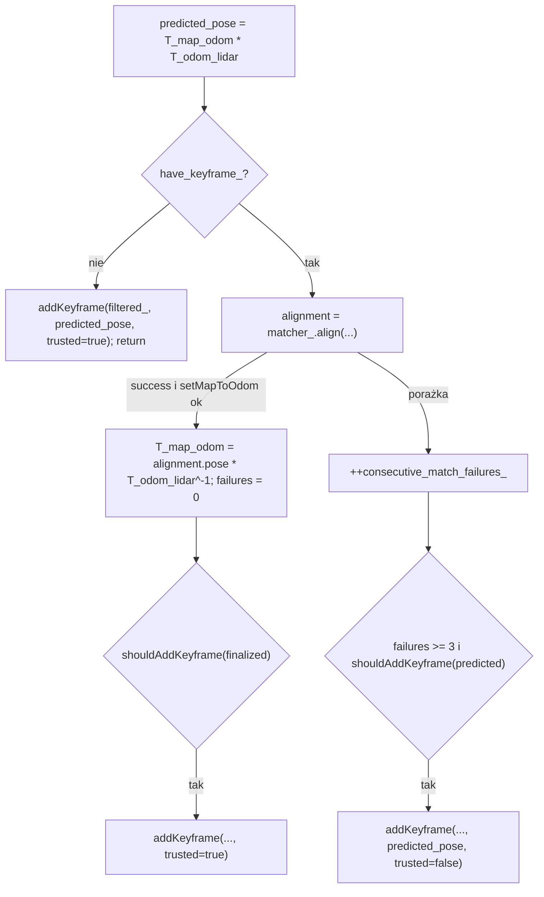

# SLAM — predykcja pozy, keyframe’y i odporność

> [!skrot] W 30 sekund
> - Predykcja **nie łączy** IMU z lidarem w żadnym filtrze: bierze pozę `/odom` w chwili początku skanu (z deskewera) i dokleja ostatnią korektę: $T^{pred}_{map\_lidar} = T_{map\_odom} \cdot T_{odom\_lidar}(t_0)$ (`feature_extractor.cpp:2445-2448`). Z, roll, pitch pochodzą zawsze z odometrii.
> - Zaakceptowane dopasowanie nadpisuje całą korektę: $T_{map\_odom} \leftarrow T^{ref}_{map\_lidar}\, T_{odom\_lidar}^{-1}$ (`:2560-2573`). Odrzucone — `T_map_odom` zostaje, łódź jedzie „na odometrii”.
> - Keyframe: gdy przesunięcie XY > 0,8 m, albo zmiana kursu > 4°, albo (> 2 s i > 0,25 m) od ostatniego. Przechowuje `timestamp`, `pose = T_map_lidar`, chmurę (0,18 m, **w układzie lidaru**), flagę `trusted`. Maksymalnie **10** w `std::deque` w RAM; najstarszy jest **bezpowrotnie kasowany**. Nic nie trafia na dysk.
> - Po ≥ 3 porażkach z rzędu skan dokładany jest jako **niezaufany** keyframe w pozie z odometrii. Gdy wszystkie zaufane wypadną z okna, matcher już nigdy nie zaakceptuje dopasowania (`INSUFFICIENT_TRUSTED_REFERENCE`) — front-end zamraża `T_map_odom` do restartu.
> - Grafu poz, optymalizacji, archiwum keyframe’ów, deskryptorów i mechanizmu relokalizacji **nie ma**. Sekcja „Gdzie wpiąć loop closure” niżej.

Kontekst: [[SLAM — architektura węzła i przepływ danych]], [[SLAM — deskewing]], [[SLAM — lokalna mapa voxelowa]], matematyka matchera: [[SLAM — scan matching (matematyka)]], bramki jakości: [[SLAM — degeneracja i jakość dopasowania]], mapa globalna: [[SLAM — global map builder i costmapy]], źródło `/odom`: [[L2 — odometria, sensory i fuzja]].

## Układy i transformacje (konwencja `T_A_B`: punkt z B do A)

| symbol w kodzie | znaczenie | skąd |
|---|---|---|
| `deskew_result.T_odom_imu` | poza łodzi/IMU z `/odom` w $t_0$ (wewn. x = wschód, y = północ) | `deskewer.cpp:297-311` |
| `deskew_result.T_odom_lidar` | `T_odom_imu · T_imu_lidar` w $t_0$ | `deskewer.cpp:305-312` |
| `T_map_odom_` | korekta SLAM-u, jedyny stan „globalny” front-endu | `feature_extractor.hpp:404-405`; init: jednostkowa albo stała NED→ENU, gdy `frames.convert_ned_odom_to_enu_map` (`feature_extractor.cpp:44-79`; w yaml `false`) |
| `predicted_pose` | $T_{map\_odom} T_{odom\_lidar}$ | `:2447-2448` |
| `alignment.pose` | refined $T_{map\_lidar}$ z matchera | `:2527-2531` |
| `T_map_boat` | $T_{map\_odom} T_{odom\_imu}$ → `/slam/boat_pose`, bufor detekcji | `:2588-2593` |

## Pętla decyzyjna na skan

- Pierwszy skan (`:2465-2525`): keyframe w `predicted_pose` (czyli `T_map_odom` = jednostkowa → mapa zaczepiona w układzie `/odom`), publikacje, `return` — dopasowanie od następnego skanu.
- `setMapToOdom` (`:822-865`) odrzuca NaN i zły kwaternion, **normalizuje rotację** (kwaternion z macierzy) i zapisuje pod `map_odom_mutex_`. Nie ma tu żadnego filtrowania ani ograniczenia skoku — ograniczenia są w matcherze (`maximum_correction_translation` 0,35 m, `maximum_correction_yaw_deg` 3°) i w wygładzaniu `/slam/odom` ([[SLAM — architektura węzła i przepływ danych]]).
- Korekta jest „pełnym nadpisaniem”: nowa `T_map_odom` nie jest ważona ze starą (brak filtru/kowariancji). Prior odometrii działa tylko wewnątrz matchera (`odometry_prior_sigma_xy` 0,30 m, `odometry_prior_sigma_yaw_deg` 2°).
- `pushBoatPose(T_map_boat, t_0)` (`:2792-2847`) — bufor 5 s do przypisywania detekcjom pozy w ich czasie; stempel wstawiany tylko rosnąco.

## Kryteria keyframe’u (`shouldAddKeyframe`, `:2061-2085`)

$$\Delta_{xy} = \lVert t_{xy} - t^{kf}_{xy} \rVert,\quad \Delta\psi = |\mathrm{wrap}(\psi - \psi^{kf})|,\quad \psi = \mathrm{atan2}(R_{10}, R_{00})$$

$$\text{nowy} \iff \Delta_{xy} > 0{,}8 \ \vee\ \Delta\psi > 4^\circ \ \vee\ (t - t^{kf} > 2{,}0\,\text{s} \wedge \Delta_{xy} > 0{,}25)$$

(parametry `keyframes.translation`, `yaw_deg`, `time`, `minimum_timed_translation`). Porównanie z **ostatnim** keyframe’em (`last_keyframe_pose_`), którym może być recovery. Pozy porównywane są w `T_map_lidar` (lidar, nie łódź). Kurs z rotacji wprost — przy dużych przechyłach to nie jest czysty yaw (do 3-DoF łodzi wystarcza).

## Co przechowuje keyframe (`addKeyframe`, `:2087-2117`)

- `voxelDownsample(filtered_, 0,18)` → `Keyframe{timestamp = t_0, pose = T_map_lidar (refined albo predicted), cloud (shared_ptr, układ lidaru na t_0), trusted}` (`feature_extractor.hpp:54-62`);
- `keyframes_.push_back`, potem `while (size > maximum_keyframes_) pop_front()` — **usunięte keyframe’y giną** (`:2105-2108`);
- `rebuildLocalMap()`, aktualizacja `last_keyframe_pose_`, `last_keyframe_time_`, `have_keyframe_` (`:2110-2114`).

Czego **nie** ma w keyframe’ie, a co byłoby potrzebne do grafu poz: `T_odom_lidar` (surowa poza z odometrii, potrzebna do krawędzi odometrycznych niezależnych od korekt), `T_odom_imu`, cech (płaszczyzny/linie z wynikami), statystyk dopasowania (`AlignmentResult`: rank, wartości własne, RMSE) — czyli informacji/kowariancji krawędzi, identyfikatora, deskryptora miejsca.

## Odporność i „recovery_after_failures”

- Licznik `consecutive_match_failures_` (`feature_extractor.hpp:451`): `++` przy każdym odrzuceniu (status ≠ SUCCESS albo odrzucone przez `setMapToOdom`), reset do 0 tylko przy sukcesie (`:2571`).
- Gdy licznik ≥ `keyframes.recovery_after_failures` (yaml **3**, kod 5, minimum 1) i spełnione kryterium keyframe’u względem `predicted_pose` → `addKeyframe(..., trusted=false)` (`:2608-2621`). Mapa i jej początek zostają (wersja sprzed audytu robiła `keyframes_.clear()`, `REVIEW_AND_TEST_PLAN.md` przyczyna 2).
- Niezaufane punkty: `MapVoxel::trusted_fraction` < 1, matcher wymaga `trusted_match_fraction ≥ 0,25` (`scan_matcher.cpp:908-913`); na `/slam/local_map_points` mają intensity 0,25 i `GlobalMapBuilder` je pomija (`global_map.minimum_source_intensity 0,50`).

> [!blad] Stan bez wyjścia
> Licznik nie jest zerowany po dodaniu recovery-keyframe’u, więc po 3 porażkach **każdy** kolejny skan spełniający kryterium ruchu dodaje niezaufany keyframe. Po ~10 takich (≈ 8 m drogi albo 40° obrotu bez udanego dopasowania) w oknie nie ma już zaufanych voxeli → `trusted_match_fraction` = 0 → każdy kolejny wynik to `INSUFFICIENT_TRUSTED_REFERENCE` → nowe recovery → … Front-end zostaje na stałe w trybie „czysta odometria + zamrożona `T_map_odom`”. Wyjście tylko przez restart węzła. Dokładnie tę lukę zamyka relokalizacja/loop closure (dopasowanie do zarchiwizowanych zaufanych keyframe’ów).

Inne bramki: dopasowanie i tak nie może przesunąć pozy o więcej niż 0,35 m / 3° względem predykcji (`scan_matcher.cpp:916-922`), więc **front-end nie umie wchłonąć dużego dryfu** — po dłuższym okresie na odometrii, gdy wraca w znane miejsce, różnica > 0,35 m daje `EXCESSIVE_CORRECTION`. Korekta z loop closure musi iść osobnym kanałem (bezpośrednio `setMapToOdom` + przesunięcie keyframe’ów), nie przez ten matcher z tymi bramkami.

## Publikacja „TF”

Brak `tf2_ros` w pakiecie (`grep` w `src/`, `include/`). Zamiast TF:
- `/slam/debug/map_to_odom` (`Odometry`, `map` → `odom`) — dokładne `T_map_odom_`, raz na skan (`:2635-2639`);
- `/slam/odom_transform` (`TransformStamped`, `slam_odom` ← `odom`) — **efektywna, wygładzona** korekta przy każdej próbce `/odom`, w konwencji x = N, y = E (`:1406-1485`);
- `/slam/boat_pose` (`map`, child `boat`) i `/slam/odom` (`map`, child z `/odom`).

## Gdzie wpiąć loop closure

Stan obecny — co **istnieje**: pozy keyframe’ów `T_map_lidar` + chmury w układzie lidaru (ale tylko 10 ostatnich), jeden punkt zapisu korekty `setMapToOdom`, wygładzanie skoków na `/slam/odom`, flaga `trusted`, matcher 3-DoF z diagnostyką obserwowalności (dobry weryfikator geometryczny), `LocalVoxelMap` jako budowalna z dowolnego zbioru chmur struktura. Czego **nie ma**: grafu poz (mimo nazwy `pose_graph`), optymalizatora (brak zależności GTSAM/g2o/Ceres w `CMakeLists.txt`/`package.xml`), archiwum keyframe’ów, deskryptorów, globalnej mapy w sensie SLAM (GMB to akumulacja voxeli w ustalonym `map`, bez możliwości przeliczenia historii), serwisu relokalizacji. Wzorzec z grafem i pętlą jest na gałęzi `origin/lio_sam` (`LIO-SAM-ros2/`, GTSAM).

Proponowane punkty wpięcia (konkretnie):

1. **Archiwum keyframe’ów** — w `addKeyframe` (`feature_extractor.cpp:2105-2108`), przed `pop_front`: kopiować keyframe do trwałego magazynu (`std::vector<ArchivedKeyframe>` + opcjonalnie zapis PCD/bin na dysk). Rozszerzyć `Keyframe` (`feature_extractor.hpp:54-62`) o `id`, `T_odom_lidar` (= `deskew_result.T_odom_lidar`), `T_odom_imu`, `AlignmentResult` (status, `translation_information_eigenvalues`, `yaw_information`, `rmse`) — z tego zbuduje się krawędzie odometryczne i ich informację. Uwaga: `addKeyframe` nie dostaje dziś `deskew_result` — trzeba dodać argument (wywołania `:2479`, `:2601`, `:2616`).
2. **Deskryptor miejsca** — liczyć w tym samym miejscu z chmury keyframe’u (`*filtered_`, układ lidaru, $t_0$). Dla Scan Context / polarnego histogramu wysokości najpierw wypoziomować chmurę rotacją roll/pitch z `T_map_lidar` (lidar na łodzi się kołysze). Na wodzie sensowne są głównie struktury brzegowe/nabrzeża w zasięgu cech (≤ kilkadziesiąt m, `features.maximum_neighbor_radius` ogranicza gęstość dalekich punktów) — deskryptor lepiej liczyć z `input_` po deskew (pełna chmura), a nie z cech.
3. **Wyszukiwanie kandydatów** — po `keyframe_added == true` (`:2601-2606`). W tym punkcie dostępne: `*filtered_`, `sampled_planes`, `sampled_lines` (układ lidaru), `finalized_lidar_pose`, `deskew_result` (`T_odom_lidar`, `T_odom_imu`, `reference_timestamp`), `alignment` (cała diagnostyka), `map_to_odom`. Kandydaci: keyframe’y z archiwum spoza bieżącego okna, blisko w XY wg bieżącej estymaty (odległość < promień niepewności) i/lub podobne deskryptorem. Wyszukiwanie i weryfikację robić **poza** `lidar_group_` (wątek roboczy albo nowa grupa callbacków), żeby nie wydłużać pętli SLAM; przekazywać przez kolejkę z mutexem.
4. **Weryfikacja geometryczna** — zbudować `LocalVoxelMap` (header-only, ta sama konfiguracja `map_config`) z chmur kilku archiwalnych keyframe’ów wokół kandydata i wywołać drugi egzemplarz `ScanMatcher` z **luźniejszą** konfiguracją (większe `maximum_correction_translation`/`yaw`, `maximum_center_distance`, słabszy prior) z `initial_pose` z deskryptora/odometrii. Akceptować przy rank 2, dobrym RMSE i `trusted_match_fraction`. Wynik = względna transformacja keyframe’ów (krawędź pętli).
5. **Optymalizacja** — mały graf 2D (x, y, yaw) na archiwalnych keyframe’ach: krawędzie kolejne z `T_odom_lidar` (albo z refined póz), krawędzie pętli z kroku 4, opcjonalnie prior GNSS (bo `/odom` jest już kotwiczone GNSS-em, [[L2 — odometria, sensory i fuzja]]). Po optymalizacji: $T^{new}_{map\_odom} = T^{opt}_{map\_lidar,k}\, T_{odom\_lidar,k}^{-1}$ dla najnowszego keyframe’u $k$.
6. **Zastosowanie korekty** — wyłącznie w `lidar_group_` (np. na początku `hesaiCallback`, przed snapshotem `:2445`): (a) `setMapToOdom(T_new, t)`; (b) przeliczyć `pose` wszystkich keyframe’ów w `keyframes_` ($T \leftarrow T_{corr} T$, $T_{corr} = T^{new}_{map\_odom} (T^{old}_{map\_odom})^{-1}$) i `rebuildLocalMap()` — inaczej następna predykcja nie zgodzi się z mapą o więcej niż 0,35 m i matcher odrzuci; (c) `last_keyframe_pose_` też przeliczyć; (d) wyzerować `consecutive_match_failures_`, recovery-keyframe’y można oznaczyć jako `trusted` dopiero po udanym dopasowaniu. `/slam/odom` sam wygładzi skok (≤ 3 m/s, ≤ 45°/s).
7. **Skutki uboczne** do obsłużenia: `boat_pose_buffer_` (detekcje w starym układzie, `:2792-2847`), `trackedDetections` (pozycje w `map`), mapa i costmapa `GlobalMapBuilder` (voxele w starym `map` — trzeba przebudować z archiwum albo przesunąć; patrz [[SLAM — global map builder i costmapy]]). Bez tego costmapa po korekcie będzie miała „dwie wersje” nabrzeża.

## Podejrzane / do naprawy

1. **Stan bez wyjścia po utracie zaufanej mapy** (callout wyżej): proponowane — po N recovery-keyframe’ach bez sukcesu awansować najstarsze recovery na `trusted` (świadomy reset lokalnej mapy) albo uruchomić relokalizację względem archiwum.
2. **Licznik porażek nie jest zerowany po recovery**, więc recovery-keyframe’y lecą seriami co 0,8 m; przy krótkim oknie (10) szybko wypierają zaufane. Rozważyć osobny licznik/odstęp dla recovery.
3. **Pierwszy keyframe = pierwszy skan**, nawet gdy łódź stoi przy nabrzeżu z ruchomymi obiektami — mapa startowa może być słaba; brak warunku jakości (np. min. liczby cech).
4. **Korekta bez pamięci**: każda akceptacja nadpisuje `T_map_odom` w całości; drobne błędy akceptowanych dopasowań kumulują się jak błądzenie losowe (dryf `map` względem GNSS-owego `/odom`). Brak priorytetu GNSS.
5. `/slam/boat_pose` i `/slam/debug/map_to_odom` mają stempel $t_0$ (początek skanu), a publikowane są ~0,1 s + czas przetwarzania później — odbiorca (GMB) musi o tym wiedzieć.
6. Dokument `START_HERE.md` mówi, że marker łodzi „uses the IMU/boat pose with no extra 90-degree rotation”, a kod obraca model o $+90^\circ$ (`feature_extractor.cpp:1954-1961`, `:1528-1533`) — rozbieżność dokument ≠ kod (kod jest zgodny z „setupem, który działał”).

## Moje notatki
> [!ja] Tu piszesz ty — Albert tej sekcji nie rusza.
