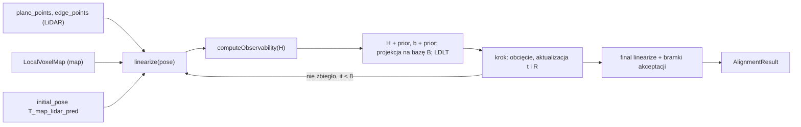

# SLAM — scan matching (matematyka)

> [!skrot] W 30 sekund
> `ScanMatcher::align` (`pose_graph/src/scan_matcher.cpp:623–937`) dopasowuje **jeden skan** (próbki punktów płaszczyznowych i krawędziowych w ramce LiDAR-u na początek skanu) do **lokalnej mapy wokselowej** (`LocalVoxelMap`, ramka `map`). Model ma tylko **3 stopnie swobody**: $t_x, t_y, \psi$ (yaw); $z$, roll, pitch zostają z odometrii. Koszt: punkt–płaszczyzna (1 residuum) + punkt–linia (3-wektor, liczony jako 2 wymiary), ważone Huberem, jakością woksela i „zaufaniem” woksela, plus **prior odometryczny**. Solver: **Gauss–Newton z priorem i stałym tłumieniem** (nie adaptacyjne LM), rozwiązywany LDLT **w podprzestrzeni obserwowalnych kierunków** (słabe kierunki Hessianu są wycinane). Ponowne kojarzenie korespondencji w każdej iteracji (ICP-owo), max 8 iteracji. Wynik: poza `T_map_lidar`, status i metryki — **bez kowariancji** (ważne dla przyszłego grafu póz).

Stan opisany: drzewo robocze `~/solar/l2dp_docking_fix` (gałąź `feat/dock_costmap_fix`, HEAD `0d444ff`). `scan_matcher.cpp`/`.hpp` **nie mają** niezacommitowanych zmian (`git diff HEAD` pusty dla tych plików). Powiązane: [[pose_graph]], [[SLAM — degeneracja i jakość dopasowania]], [[SLAM — parametry back-endu]], [[SLAM — global map builder i costmapy]], [[SLAM — plan testów i weryfikacja]], [[Drzewo TF i układy współrzędnych]]. Front-end (skąd biorą się punkty i mapa): [[SLAM — architektura węzła i przepływ danych]], [[SLAM — deskewing]], [[SLAM — cechy i klasyfikacja]], [[SLAM — lokalna mapa voxelowa]].

## Interfejs (co matcher dostaje i zwraca)

```cpp
// include/scan_matcher.hpp:138-142
AlignmentResult align(
    const std::vector<Eigen::Vector3d>& plane_points,   // ramka LiDAR (scan start)
    const std::vector<Eigen::Vector3d>& edge_points,    // ramka LiDAR (scan start)
    const LocalVoxelMap& local_map,                     // ramka map
    const Eigen::Isometry3d& initial_pose) const;       // T_map_lidar_pred
```

- Wywołanie: `feature_extractor.cpp:2527–2531` z `sampled_planes`, `sampled_lines` (próbkowanie przestrzenne `spatialSample`, liść `matcher.plane_sample_leaf` 0.25 m / `line_sample_leaf` 0.20 m, max 3500 / 2000 punktów — `feature_extractor.cpp:2429–2439`; parametry front-endu) i `predicted_pose = map_to_odom * deskew_result.T_odom_lidar` (`feature_extractor.cpp:2447–2448`).
- Konfiguracja: `ScanMatcherConfig` (`scan_matcher.hpp:78–128`) wypełniana z parametrów `matcher.*` w konstruktorze `FeatureExtractor` (`feature_extractor.cpp:353–521`). Jedna instancja `matcher_` (`feature_extractor.hpp:352`); `align` jest `const` i nie mutuje mapy → można bezpiecznie wywoływać z innego wątku na innej mapie (np. submapie do loop closure).
- Zwraca `AlignmentResult` (`scan_matcher.hpp:31–76`): `success`, `converged`, `status` (enum 13 wartości, `scan_matcher.hpp:12–27`), `pose` (= $T_{map,lidar}$ po korekcie), liczniki dopasowań, `initial_rmse`, `rmse`, współczynniki dopasowania, wartości własne informacji translacji, słaby kierunek, rząd, `yaw_information`, liczba uwarunkowania, korekta $(\Delta x, \Delta y, \Delta\psi)$ i ostatni krok.
- Użycie wyniku: tylko gdy `alignment.success`, liczona jest nowa korekta `T_map_odom = alignment.pose * T_odom_lidar^{-1}` (`feature_extractor.cpp:2558–2573`) i (jeśli bramka keyframe’u przepuści) dodawany zaufany keyframe w pozie `alignment.pose` (`:2595–2606`). Porażka → `consecutive_match_failures_++`, a po `keyframes.recovery_after_failures` porażkach keyframe „recovery” w pozie z predykcji (`:2608–2621`).



## Stan i aktualizacja (parametryzacja obrotu)

Stan optymalizacji to przyrost $\delta = [\delta x, \delta y, \delta\psi]^T$ w ramce `map`. Aktualizacja (`scan_matcher.cpp:809–829`):

> [!wzor] Aktualizacja pozy (lewy przyrost yaw, translacja „wprost”)
> $$t \leftarrow t + [\delta x, \delta y, 0]^T, \qquad R \leftarrow R_z(\delta\psi)\, R$$
> gdzie $R_z(\delta\psi)$ = `Eigen::AngleAxisd(yaw_increment, UnitZ)`. Translacja **nie** jest obracana wokół początku mapy. Po każdym kroku $R$ jest renormalizowane przez kwaternion (`:824–829`).

Konsekwencja: obrót jest „wokół LiDAR-u”, a nie wokół początku mapy. Punkt w mapie: $p_{map} = R\,p_{lidar} + t$. Pochodna względem $\delta\psi$ w $\delta = 0$:

> [!wzor] Pochodna punktu po yaw
> $$\frac{\partial p_{map}}{\partial \delta\psi} = \hat z \times (R\,p_{lidar}) = [-(Rp)_y,\ (Rp)_x,\ 0]^T$$
> W kodzie: `rotated_point = pose.linear() * point_lidar`, `yaw_derivative = (-rotated_point.y(), rotated_point.x(), 0)` (`scan_matcher.cpp:358–364`, `:453–459`).

Roll, pitch i $z$ nie są stanem: zostają takie, jak w `initial_pose` (czyli z odometrii Xsens przez `T_odom_lidar`). Kąt yaw do priora i raportów: `poseYaw = atan2(R(1,0), R(0,0))` (`:86–91`), zawijanie `wrapAngle = atan2(sin, cos)` (`:93–96`).

## Residuum i jakobian: punkt–płaszczyzna

Dla każdego `point_lidar` z `plane_points` (`scan_matcher.cpp:330–416`), tylko gdy `plane_weight > 0`:

1. $p_{map} = $ `pose * point_lidar`.
2. Korespondencja: `local_map.findNearestPlane(p_map, c, maximum_plane_distance, maximum_center_distance)` — woksel typu PLANE z normalną $n$ i centroidem $c$ (front-end, `local_voxel_map.hpp:310–376`).
3. Odrzuć, gdy $\|n_{xy}\| <$ `minimum_plane_horizontal_normal` (0.08) — płaszczyzna pozioma nie wiąże $x, y, \psi$ (`:348–352`).

> [!wzor] Residuum i jakobian płaszczyzny (`scan_matcher.cpp:354–369`)
> $$r = n^T (p_{map} - c) \quad [\text{m}],\qquad J = \begin{bmatrix} n_x & n_y & n^T(\hat z \times R\,p_{lidar}) \end{bmatrix} \in \mathbb{R}^{1\times 3}$$
> Kolumny $J$: $\partial r/\partial\delta x$ [–], $\partial r/\partial\delta y$ [–], $\partial r/\partial\delta\psi$ [m/rad]. Odrzut, gdy $\|J\|^2 <$ `minimum_effective_jacobian_norm` = $10^{-8}$ (stała w kodzie, **brak parametru ROS**).

Wkład: `H += w J^T J`, `b += w J^T r`, `squared_error_sum += r^2`, `residual_dimensions += 1` (`:400–414`).

## Residuum i jakobian: punkt–linia

Dla `edge_points` (`scan_matcher.cpp:418–516`), tylko gdy `line_weight > 0`. Korespondencja `findNearestLine` → kierunek $d$ (normalizowany, odrzut gdy niefinity lub $\|d\|^2 < 10^{-12}$) i centroid $c$.

> [!wzor] Residuum i jakobian linii (`scan_matcher.cpp:445–467`)
> $$P = I_3 - d\,d^T,\qquad r = P\,(p_{map} - c) \in \mathbb{R}^3,\qquad J = P\,\begin{bmatrix} e_x & e_y & \hat z \times R\,p_{lidar} \end{bmatrix} \in \mathbb{R}^{3\times 3}$$
> $r$ to wektor prostopadły od linii do punktu [m]. Ponieważ $\mathrm{rank}\,P = 2$, kod liczy `residual_dimensions += 2` (`:507`), a do RMSE dodaje $\|r\|^2$ (`:506`).

Wkład: `H += w J^T J`, `b += w J^T r` (`:500–504`). Ponieważ $P^T P = P$, $J^T J = [\ldots]^T P [\ldots]$ — poprawne.

## Wagi

> [!wzor] Waga pojedynczej korespondencji (`scan_matcher.cpp:377–398`, `:477–498`)
> $$w = w_{typ}\cdot w_{Huber}(|r|\ \text{lub}\ \|r\|,\ \delta)\cdot \mathrm{clamp}(q, 0.25, 1)\cdot (0.25 + 0.75\,\mathrm{clamp}(f_{trusted}, 0, 1))$$
> - $w_{typ}$ = `plane_weight` (slam.yaml 0.5) lub `line_weight` (0.5);
> - $w_{Huber}(r,\delta) = 1$ dla $|r| \le \delta$ lub $\delta \le 0$, inaczej $\delta/|r|$ (`robustHuberWeight`, `:98–106`) — klasyczny IRLS Hubera; $\delta$ = `plane_huber_delta` 0.10 m / `line_huber_delta` 0.15 m;
> - $q$ = `correspondence.quality` = planarność·(1−rozproszenie) albo liniowość·(1−rozproszenie) woksela mapy (`local_voxel_map.hpp:156`, `:163`);
> - $f_{trusted}$ = ułamek punktów woksela z zaufanych keyframe’ów (`local_voxel_map.hpp:108`). Woksel tylko z keyframe’ów „recovery” ma wagę 0.25×.

Zakres wagi: od $0.5\cdot 0.25\cdot 0.25 \approx 0.031$ do $0.5$ (przy wagach z slam.yaml, bez Hubera).

## Prior odometryczny i układ równań

W każdej iteracji (`scan_matcher.cpp:701–735`):

> [!wzor] Prior (MAP z predykcją odometrii)
> $$e_{prior} = \begin{bmatrix} t_x - t^{0}_x \\ t_y - t^{0}_y \\ \mathrm{wrap}(\psi - \psi^{0}) \end{bmatrix},\quad \Lambda = \mathrm{diag}\!\left(\tfrac{1}{\sigma_{xy}^2}, \tfrac{1}{\sigma_{xy}^2}, \tfrac{1}{\sigma_{\psi}^2}\right)$$
> $$H_{tot} = H + \Lambda,\qquad b_{tot} = b + \Lambda\, e_{prior}$$
> $t^0, \psi^0$ z `initial_pose`; $\sigma_{xy}$ = `odometry_prior_sigma_xy` (0.30 m, min $10^{-6}$), $\sigma_\psi$ = `odometry_prior_sigma_yaw_deg` (2°→rad, min $10^{-6}$).

Minimalizowany koszt (w przybliżeniu Gaussa–Newtona, z wagami IRLS zamrożonymi w danej iteracji):

> [!wzor] Funkcja kosztu
> $$F(\delta) = \tfrac12 \sum_{i\in\text{pl}} w_i\, r_i^2 + \tfrac12 \sum_{j\in\text{lin}} w_j\, \|r_j\|^2 + \tfrac12\, e_{prior}^T \Lambda\, e_{prior}$$

Liczbowo: $\Lambda_{xx} = 1/0.09 \approx 11.1\ \text{m}^{-2}$, $\Lambda_{\psi\psi} = 1/(0.0349)^2 \approx 821\ \text{rad}^{-2}$. Dane: przy ~1000 dopasowań z wagą ~0.1–0.5 $H_{xx}$ jest rzędu $10^2$, więc **prior jest słaby** w kierunkach dobrze obserwowalnych; w słabych kierunkach i tak decyduje projekcja na bazę (niżej).

### Rozwiązanie w podprzestrzeni

`computeObservability` zwraca macierz bazową $B \in \mathbb{R}^{3\times k}$, $k$ = `basis_columns` (szczegóły w [[SLAM — degeneracja i jakość dopasowania]]): kolumny to obserwowalne wektory własne translacji (osadzone w $[x,y]$) i ewentualnie $e_\psi$.

> [!wzor] Krok (`scan_matcher.cpp:737–782`)
> $$\tilde H = B^T H_{tot} B + \lambda I_k,\qquad \tilde b = B^T b_{tot},\qquad \tilde\delta = -\tilde H^{-1}\tilde b\ \ (\text{LDLT}),\qquad \delta = B\,\tilde\delta$$
> $\lambda$ = `damping` = $10^{-4}$ **stałe** (Tikhonov), nie adaptacyjne jak w Levenbergu–Marquardcie — brak odrzucania kroku przy wzroście kosztu w trakcie iteracji.

Składowe $\delta$ prostopadłe do $B$ są **zerowe** → w słabych kierunkach poza zostaje taka, jak w predykcji odometrii (pomijając wpływ poprzednich iteracji z inną bazą — baza jest liczona od nowa w każdej iteracji).

### Obcięcie kroku i stop

- Translacja: jeśli $\|\delta_{xy}\| >$ `maximum_translation_step` (0.20 m) — skalowana do tej długości (`:789–798`).
- Yaw: `clamp(δψ, ±maximum_rotation_step_deg)` (1.5°) (`:800–807`).
- Zbieżność: $\|\delta_{xy}\| <$ `translation_convergence` (0.002 m) **i** $|\delta\psi| <$ `rotation_convergence_deg` (0.02°) → `converged = true`, wyjście (`:839–846`). Kroki mierzone **po** obcięciu.
- Max `maximum_iterations` = 8 (`:650–652`). Brak zbieżności **nie** jest powodem odrzucenia (flaga `converged` nie jest sprawdzana w bramkach — patrz „Podejrzane”).

Po pętli: jeszcze jedna `linearize` + `computeObservability` w końcowej pozie (`:849–863`) — z niej pochodzą raportowane metryki i bramki. Łącznie do 9 linearyzacji na skan.

## Kryteria akceptacji / porażki

Kolejność sprawdzania (pierwsza niespełniona daje status):

| # | Warunek porażki | Status | Miejsce |
|---|---|---|---|
| 0a | `local_map.size() == 0` | `EMPTY_MAP` | `:634–638` |
| 0b | brak źródeł w włączonych typach | `EMPTY_SOURCE` | `:643–648` |
| 1 | w iteracji: `plane+line < minimum_total_matches` lub `!enoughTypeSupport` | `NOT_ENOUGH_MATCHES` | `:668–682` |
| 2 | w iteracji: `translation_rank < minimum_observable_translation_rank` lub `basis_columns == 0` | `DEGENERATE_GEOMETRY` | `:687–699` |
| 3 | LDLT `info != Success` | `SOLVER_FAILURE` | `:751–763` |
| 4 | przyrost niefinity | `NONFINITE_INCREMENT` | `:765–779` |
| 5 | końcowo: jak 1 | `NOT_ENOUGH_MATCHES` | `:881–886` |
| 6 | końcowo: rząd < min | `DEGENERATE_GEOMETRY` | `:888–893` |
| 7 | `rmse` niefinity lub > `maximum_rmse` (0.20 m) | `HIGH_RMSE` | `:895–900` |
| 8 | `match_ratio < minimum_match_ratio` (0.10) | `LOW_MATCH_RATIO` | `:902–906` |
| 9 | `trusted_match_fraction < minimum_trusted_match_fraction` (0.25) | `INSUFFICIENT_TRUSTED_REFERENCE` | `:908–914` |
| 10 | $\|\Delta t_{xy}\|$ > 0.35 m lub $|\Delta\psi|$ > 3° (względem `initial_pose`) | `EXCESSIVE_CORRECTION` | `:916–923` |
| 11 | `rmse > initial_rmse · 1.05` | `COST_INCREASED` | `:925–932` |

`enoughTypeSupport` (`:291–319`): gdy oba typy włączone — wystarczy **jeden** z warunków `plane_matches ≥ 40` **lub** `line_matches ≥ 20`; gdy tylko jeden typ — jego próg; gdy żaden — `false`.

Definicje metryk (`populateMetrics`, `:521–580`):

> [!definicja] Metryki dopasowania
> - $\mathrm{rmse} = \sqrt{\sum r^2 / N_{dim}}$ — **bez wag** (`Linearization::rmse`, `:30–38`), $N_{dim}$ = liczba płaszczyzn + 2·liczba linii.
> - `match_ratio` = (dopasowania) / (źródła włączonych typów).
> - `trusted_match_fraction` = średnie $f_{trusted}$ po dopasowaniach.
> - `correction_*` = różnica końcowej pozy i `initial_pose` (x, y, norma, yaw w stopniach).

## Kowariancja / informacja — czego NIE ma

Wynik **nie zawiera** macierzy $H$ ani kowariancji. Dostępne są tylko: wartości własne znormalizowanej informacji translacji (2), słaby kierunek, `yaw_information`, `normalized_condition_number` (`scan_matcher.hpp:57–67`). Do grafu póz trzeba będzie dodać do `AlignmentResult` np. `Eigen::Matrix3d information` (= `final_linearization.H` bez priora) i oszacowanie wariancji residuów — patrz [[SLAM — degeneracja i jakość dopasowania]] → „Kowariancja do grafu póz”.

## Wydajność

- Koszt jednej linearyzacji: $(N_{pl} + N_{lin}) \times$ zapytanie do mapy. Zapytanie przegląda $(2\rho+1)^3$ wokseli, gdzie $\rho$ = `neighborRadius` = $\lfloor 0.80/0.40\rfloor + 1 = 3$ (`local_voxel_map.hpp:458–467`) → **343 odwołania do hash-mapy na punkt**. Przy 3500 + 2000 punktach i 9 linearyzacjach: rzędu $1.7\cdot 10^7$ odwołań na skan. Działa w callbacku LiDAR-u (`lidar_group_`, `feature_extractor.cpp:557`) — jeden wątek, blokuje kolejny skan (QoS KeepLast(1), więc stare skany są gubione, nie kolejkowane: `feature_extractor.cpp:604–611`).
- Rozwiązanie 3×3 / LDLT — pomijalne.
- Niepewne: rzeczywisty czas na Jetsonie (brak logów czasu w kodzie matchera).

## Podejrzane / do naprawy

> [!blad] 1. `converged` nie wpływa na akceptację
> Po 8 iteracjach bez zbieżności wynik może przejść wszystkie bramki (`scan_matcher.cpp:878–936`). Przy obcinaniu kroku do 0.20 m / 1.5° zbieżność nie jest gwarantowana. Propozycja: dodać opcjonalną bramkę `require_convergence` albo przynajmniej logować `converged` w linii `SLAM status=` (`feature_extractor.cpp:2657–2690` jej nie loguje).

> [!blad] 2. `COST_INCREASED` porównuje RMSE na różnych zbiorach korespondencji
> `initial_rmse` liczone z korespondencji w pozie startowej, `rmse` — z innych korespondencji w pozie końcowej, oba **bez wag** i **bez priora** (`:661–662`, `:925–932`). Spadek RMSE może wynikać z utraty trudnych dopasowań (wypadają za bramkę 0.25/0.35 m), a nie z lepszej pozy. Propozycja: porównywać ważony koszt $F$ (z priorem) na tych samych korespondencjach lub dodać bramkę na spadek `match_ratio`.

> [!blad] 3. Stałe tłumienie zamiast LM
> `damping` jest stałe (`:749`), brak sprawdzenia, czy krok zmniejszył koszt. Przy złej inicjalizacji krok może oscylować (obcinanie 0.2 m to jedyne zabezpieczenie). Propozycja: proste LM (zwiększ $\lambda$ ×10 i odrzuć krok, gdy $F$ rośnie).

> [!blad] 4. Baza obserwowalności zmienia się między iteracjami
> Baza $B$ jest liczona od nowa w każdej iteracji (`:684–685`). Jeśli kierunek był obserwowalny w iteracji 1 (i został „poprawiony”), a w końcowej pozie już nie, korekta w tym kierunku zostaje. Propozycja: zamrozić bazę z pierwszej iteracji albo z przecięcia baz.

> [!blad] 5. Brak parametru dla `minimum_effective_jacobian_norm`
> Pole jest w `ScanMatcherConfig` (`scan_matcher.hpp:98`), ale nie ma `declare_parameter` (`feature_extractor.cpp:353–521`). Drobne — działa domyślne $10^{-8}$.

> [!blad] 6. Bramka korekty 0.35 m / 3° względem predykcji
> To dobre dla odometrii skan–mapa, ale **uniemożliwia** użycie tej samej konfiguracji do loop closure (błąd dryfu po pętli to zwykle metry). Patrz „Co zmienić pod loop closure” w [[SLAM — degeneracja i jakość dopasowania]].

## Moje notatki

> [!ja] Tu piszesz ty — Albert tej sekcji nie rusza.
