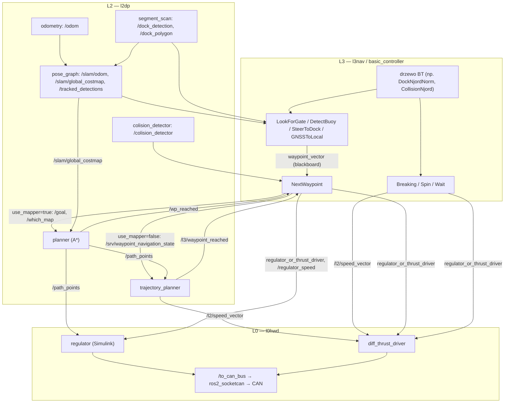

# Nawigacja i autonomia — przepływ

> [!skrot] W 30 sekund
> - **Co to:** jak waypoint z misji staje się obrotami śrub. Misja = drzewo zachowań w [[basic_controller]] ([[l3nav]]); planowanie i regulacja = [[planner]] / [[trajectory_planner]] ([[l2dp]]); wykonanie = `regulator` albo `diff_thrust_driver` w [[l0hwd]], które piszą ramkę CAN na `/to_can_bus`. **Nie ma Nav2 ani `cmd_vel` w ścieżce autonomicznej** — `cmd_vel` używa tylko `new_diff_thrust_driver` ([[new_diff_thrust_driver]]) i teleop w symulacji.
> - **Wejście → wyjście:** detekcje + poza → `waypoint_vector` (blackboard) → `/goal` lub serwis `/srv/waypoint_navigation_state` → `/path_points` lub `/l2/speed_vector` → `/to_can_bus` (ramka `BARKA_MOTOR_SPEED_SP_HL`).
> - **Stan opisany:** zawody Njord 2026 — [[l2dp]] `feat/dock_costmap_fix@0d444ff`, [[l3nav]] `waypoint_first` + niezacommitowane drzewo robocze, [[l0hwd]] `master` (tak jak jest w `~/solar/l0hwd`).

## Dwie drogi waypointa (zwrotnica `NextWaypoint`)
`NextWaypoint` (`l3nav/basic_controller/src/next_waypoint_node.cpp`) bierze pierwszy punkt z `waypoint_vector` i w zależności od portów wybiera drogę:

| Port | Wartość | Skutek |
|---|---|---|
| `use_mapper` | `true` | `/goal` (`PoseArray`) → [[planner]] (A* na `/slam/global_costmap`) → `/path_points`; koniec = `/wp_reached` od planera |
| `use_mapper` | `false` | serwis `/srv/waypoint_navigation_state` → [[trajectory_planner]] (regulator kursu 200 ms) → `/l2/speed_vector`; koniec = `/l3/waypoint_reached` |
| `steering` | brak / `regulator` | `regulator_or_thrust_driver = "regulator"` → [[regulator]] w [[l0hwd]] steruje, `diff_thrust_driver` milczy |
| `steering` | `thrust_driver` | `"diff_thrust_driver"` → [[diff_thrust_driver]] wysyła na CAN to, co dostaje z `/l2/speed_vector` |
| `slam_costmap` | `true`/`false` | `/which_map` → planer mnoży koszt komórek przez 1/0 (`false` = prosta linia, wjazd do slipu) |
| `speed_regulator` | np. `0.7` | `/regulator_speed` → zadana prędkość regulatora (`rtU.desired_vel`) |

Dane: `l0hwd/diff_thrust_driver/src/diff_thrust_driver.cpp:43–65` (`use` tylko przy `"diff_thrust_driver"`, timer wysyła ramkę), `l0hwd/regulator/src/regulator.cpp:44–75` (subskrypcje `/slam/odom`, `/filter/velocity`, `/imu/data` lub `/wamv/sensors/imu/imu/data` w symulacji, `/filter/euler`, `/path_points`, `/regulator_or_thrust_driver`, `/regulator_speed`; `use` tylko przy `"regulator"`).

> [!wazne] Spójność trybów
> Regulator jedzie po `/path_points`, które publikuje tylko planer, czyli tylko przy `use_mapper=true`. `trajectory_planner` publikuje `/l2/speed_vector`, które trafia na CAN tylko gdy `steering="thrust_driver"` (albo gdy inny węzeł BT, np. `Breaking`/`Spin`/`Wait`, przełączy na `diff_thrust_driver`). W aktywnych `NextWaypoint` drzew Njord portu `steering` nie ustawiono (`steering="thrust_driver"` występuje tylko w zakomentowanych fragmentach `normal_docking_njord.xml`). **Niepewne:** co steruje silnikami w drzewach Njord z `use_mapper=false` — z kodu wynika, że regulator dostałby wtedy stare `/path_points`.

## Diagram

## Krok po kroku (tryb `use_mapper=true`, steering = regulator)
1. Węzeł percepcyjny BT (np. `LookForGate` z `/tracked_detections` od [[pose_graph]], `GNSSToLocal` z `/start_pose` + `/slam/odom_transform`, `SteerToDock` z `/dock_detection`) dopisuje punkty do `waypoint_vector` — przez **blackboard**, nie topik (widać to tylko w TUI `bt_tui_viewer`).
2. `NextWaypoint.onStart`: `/which_map`, `/regulator_speed`, `regulator_or_thrust_driver="regulator"`, `/goal` z jednym punktem.
3. [[planner]] przy najbliższej `/slam/global_costmap` (2 Hz) liczy A* od pozy `/slam/odom` i publikuje `/path_points` (kilkanaście punktów załamań).
4. [[regulator]] (L0) jedzie po `/path_points` i wysyła nastawy na `/to_can_bus`.
5. Gdy łódź jest <1.0 m od celu (`planner.h:39`), planer publikuje `/wp_reached` → `NextWaypoint` zdejmuje punkt → `SUCCESS` → drzewo idzie dalej.

## Krok po kroku (tryb `use_mapper=false`, steering = thrust_driver)
1–2. Jak wyżej, ale serwis `/srv/waypoint_navigation_state` (x, y, `reverse`).
3. [[trajectory_planner]] co 200 ms: `Δ` kursu, `angular = Δ/180`, `linear = exp(0.015·d) − 0.95` (0 przy `|Δ|>90°`) → `/l2/speed_vector`.
4. [[diff_thrust_driver]]: `lewa = linear + angular`, `prawa = linear − angular`, skalowanie ×1000, ramka `BARKA_MOTOR_SPEED_SP_HL_FRAME_ID` na `/to_can_bus` (`diff_thrust_driver.cpp:58–100`).
5. `dist ≤ 1.5 m` → `/l3/waypoint_reached` i prędkość (0,0).

## Gdzie przechodzi do L0
Granicą jest topik **`/to_can_bus`** (`can_msgs/Frame`) w [[l0hwd]] — piszą go `regulator` i `diff_thrust_driver` (oraz `peripherals_handler`, `can_sequence`), a `ros2_socketcan` przekazuje na magistralę ([[ros2_socketcan]], [[Magistrala CAN]]). Wejściem L0 od strony L2/L3 są `/l2/speed_vector` (`l0_interfaces/SpeedVector`), `/path_points`, `regulator_or_thrust_driver`, `/regulator_speed`, `melody`. W symulacji `/to_can_bus` odbiera [[sim_can_adapter]], a `/l2/speed_vector` — [[sim_thrust_driver]] ([[l4sim]]).

## Tryby pracy
- **Killed / manual / auto** — tryb łodzi przychodzi z CAN: `can_driver` dekoduje ramkę `BARKA_VESSEL_OP_MODE` (0 = `killed`, 1 = `manual`, 2 = `auto`) i publikuje `/robot/state` (`std_msgs/String`) (`l0hwd/can_driver/src/can_driver.cpp:244–266`, [[can_driver]]). W przejrzanym kodzie L2/L3 jedynym odbiorcą `/robot/state` jest raport [[message_protobuf]] — **stos ROS nie blokuje komend w trybie manual/killed**; to, czy nastawy z ROS są ignorowane w trybie manualnym, rozstrzyga firmware (**nie ustalono** — [[embedded-system]] poza moją grupą). Kanały pilota RC `can_driver` publikuje na `/rc_chan` (`can_driver.cpp:128–130`), ale żaden węzeł L2/L3 ich nie używa — sterowanie ręczne idzie poza stosem ROS (**niepewne**, szczegóły w firmware). W symulacji tryb ręczny = [[boat_teleop]] (`/cmd_vel`) → `vel_to_thrusters` ([[cpp_nodes]]).
- **Autonomiczny** — działa `basic_controller_exec` z wybranym drzewem (`main_tree_name`). Zadanie (`SetTask` → `/robot/task`) to tylko etykieta dla raportu.
- **Dokowanie** — nie jest osobnym trybem węzłów, tylko drzewem (`DockNjordNorm`, `DockNjordParl`): `SelectDock` → `/choose_dock` ([[segment_scan]] zmienia wymiary slipu) → podejście z omijaniem (`slam_costmap=true`) → `SteerToDock` (≥2 zgodne detekcje `/dock_detection`) → wjazd prosto (`slam_costmap=false`, `speed_regulator=0.7`) → `Breaking` (bieg wsteczny −1.0 przez 100 ticków, `diff_thrust_driver`) → postój 10 s. Równolegle [[pose_graph]] „gasi” inflację wewnątrz wykrytego slipu (`/dock_polygon`). Materiały: `~/solar/docs/dock_costmap_check/`, bag `~/solar/rosbagi/docking_regulator_2` (opis w [[l2dp]]).
- **Unikanie kolizji** — [[colision_detector]] → `/colision_detector`, `/colision_direction` → `NextWaypoint` wystawia `colision=true` → dekorator `RetryWithRecoveryUntilSuccess` uruchamia obejście (`SetBuoyWaypoints` wokół punktu kolizji, `side_offset 5.0`) — drzewo `CollisionNjord`. Przeszkody statyczne omija A* na costmapie.

## Maszyna stanów
Nie ma klasycznej maszyny stanów — rolę tę pełni drzewo zachowań BehaviorTree.CPP (`SequenceWithMemory`, `ReactiveFallback`, `KeepRunningUntilFailure`, `RetryUntilSuccessful`), tyknięcia 10 Hz w `my_bt_node.cpp:125–155`, restart drzewa flagą `restart_tree`. Topik `/mission_state/data` (`l0_interfaces/MissionState`: mission/state/transition) publikują `trajectory_planner` i `SteerToDock`, ale logika, która z niego korzystała (omijanie w `trajectory_planner.cpp:168–194`), jest zakomentowana. Stara maszyna stanów `VesselHandler`/`StateMachine<RbTaskID,…>` istnieje tylko w opisie `l3nav/ros_guide/docs/l3docs.md` (zakomentowany) i na tagu `archive/archived_main`.

## Źródła
- `l3nav/basic_controller/src/next_waypoint_node.cpp`, `my_bt_node.cpp`, `steer_to_dock.cpp`, `select_dock.cpp`, `breaking.cpp`, `config/njord_trees/normal_docking_njord.xml`, `collision_njord.xml`
- `l2dp_docking_fix@0d444ff`: `planner/src/planner.cpp`, `trajectory_planner/src/trajectory_planner.cpp`, `segment_scan/src/segment_scan.cpp`, `pose_graph/src/global_map_builder.cpp`, `colision_detector/src/colision_detector.cpp`
- `l0hwd/diff_thrust_driver/src/diff_thrust_driver.cpp`, `l0hwd/regulator/src/regulator.cpp`, `l0hwd/can_driver/src/can_driver.cpp`
- `bash_do_uruchomienia/l4sim/README.md`, `src/sim_can_adapter`, `src/sim_thrust_driver`

## Moje notatki
> [!ja] Tu piszesz ty — Albert tej sekcji nie rusza.
