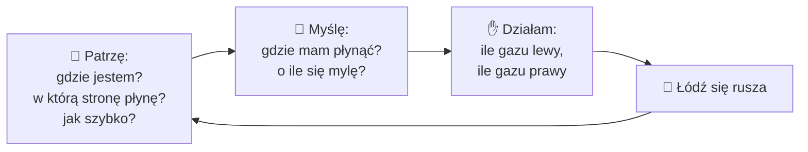
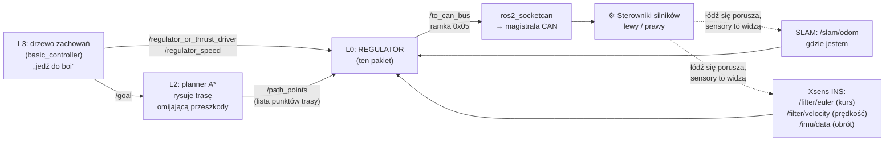
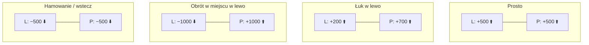
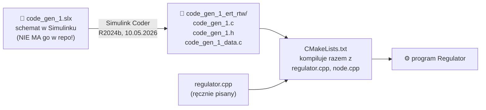
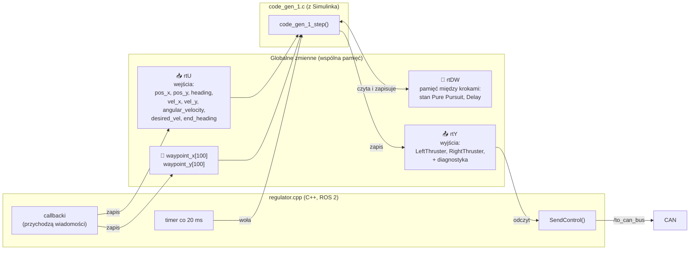
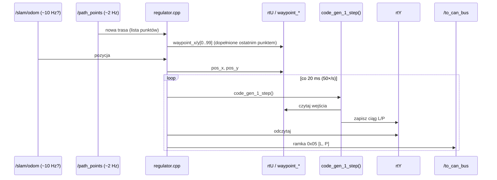
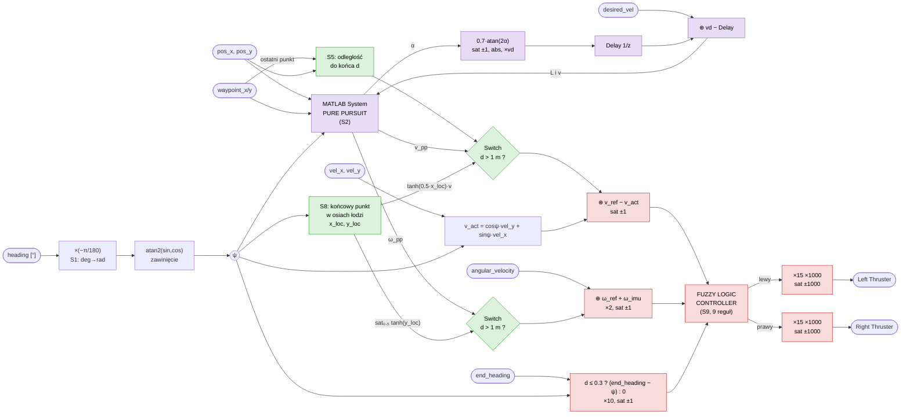
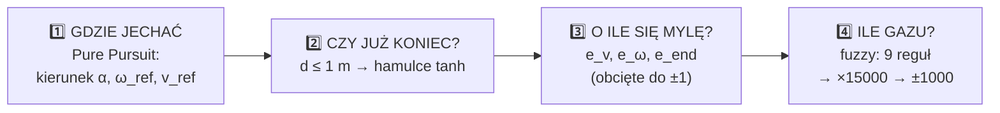

# Regulator od zera — 1. Co to jest i jak działa Simulink

> [!skrot] W 30 sekund
> - **Regulator to automatyczny kierowca.** Co 20 ms patrzy, gdzie jest łódź i gdzie ma jechać, i decyduje, ile „gazu” dać lewemu i prawemu silnikowi.
> - **Mózg regulatora narysowano w Simulinku** (program z MATLAB-a, w którym rysuje się schemat z klocków), a potem Simulink sam wygenerował z rysunku kod w C. My mamy tylko ten wygenerowany kod.
> - **Kod C++ wokół to „listonosz”:** odbiera wiadomości ROS, wkłada liczby do skrzynki `rtU`, każe modelowi policzyć krok, wyjmuje wynik ze skrzynki `rtY` i wysyła go na magistralę CAN.
>
> Seria: **1. Co to jest i Simulink** → [[Regulator od zera — 2. Matematyka]] → [[Regulator od zera — 3. Logika rozmyta]] → [[Regulator od zera — 4. Dlaczego się buja]]

## 1. Regulator jako kierowca

Wyobraź sobie, że prowadzisz łódkę z dwoma silnikami i nie masz steru. Robisz w kółko to samo:

Regulator robi dokładnie to, tylko **50 razy na sekundę** (co 20 ms). Taka pętla „patrz → myśl → działaj → patrz” to **sprzężenie zwrotne**. Regulator nie musi wiedzieć, jak działa woda i wiatr: poprawia się na bieżąco na podstawie tego, co mierzy.

## 2. Gdzie regulator siedzi w całej łodzi

- **Planner** mówi *którędy* jechać (rysuje trasę jako listę punktów).
- **Regulator** mówi *jak* jechać tą trasą (ile gazu w każdym silniku).
- Przełącznik `/regulator_or_thrust_driver` decyduje, czy steruje regulator, czy [[diff_thrust_driver]]. Nigdy oba naraz.

## 3. Jak się skręca łodzią z dwoma silnikami

Łódź nie ma steru. Skręca się różnicą ciągu, jak czołg albo wózek inwalidzki:

Każda komenda dla silnika to liczba od **−1000** (pełny wstecz) do **+1000** (pełny naprzód). Myśl o tym jak o dwóch składnikach:

| Składnik | Wzór intuicyjny | Co robi |
|---|---|---|
| **wspólny** (jazda) | L i P dostają to samo | do przodu / do tyłu |
| **różnicowy** (skręt) | L dostaje −x, P dostaje +x | obrót |

Regulator rozmyty (notatka 3) dokładnie tak myśli: osobno „za wolno/za szybko” (wspólny) i osobno „za mało/za dużo obrotu” (różnicowy).

## 4. Co to jest Simulink

**Simulink** to część MATLAB-a, w której zamiast pisać kod **rysujesz schemat z klocków** połączonych strzałkami. Strzałki to sygnały (liczby, które płyną), a klocki to operacje.

Najczęstsze klocki w naszym modelu:

| Klocek Simulinka | Symbol | Co robi | Przykład w regulatorze |
|---|---|---|---|
| **Inport / Outport** | `⟶▢` / `▢⟶` | wejście / wyjście modelu | `pos_x`, `Left Thruster` |
| **Gain** | `▷ k` | mnoży przez stałą | `×15`, `×1000`, `×2`, `×10` |
| **Sum** | `⊕` | dodaje / odejmuje | błąd = zadane − zmierzone |
| **Product** | `⊗` | mnoży dwa sygnały | `cos ψ · vel_y` |
| **Saturation** | `▢ ⟋` | obcina do zakresu | do ±1, do ±1000 |
| **Switch** | `⇄` | wybiera jeden z dwóch sygnałów wg warunku | „jeśli do końca > 1 m, to…” |
| **Delay** | `1/z` | oddaje wartość **z poprzedniego kroku** (pamięć) | lookahead z poprzedniego α |
| **Trigonometry** | `sin`, `cos`, `atan2`, `tanh` | funkcje matematyczne | kierunki, hamulce |
| **MATLAB System** | `▢ PP` | gotowy algorytm z biblioteki | **Pure Pursuit** |
| **Fuzzy Logic Controller** | `▢ FIS` | regulator rozmyty | 9 reguł → ciąg silników |

### Od rysunku do programu

> [!wazne] Ważne praktycznie
> W repo jest **tylko wygenerowany kod C**, nie ma pliku `.slx`. Żeby zmienić coś w środku regulatora (np. lookahead albo wzmocnienie), trzeba albo zdobyć model `.slx` od autora (`package.xml`: filip, `filip.nawalaniec@solarboat.agh.edu.pl`) i wygenerować kod na nowo, albo ręcznie edytować `code_gen_1.c` (da się, ale następna generacja to nadpisze), albo przepisać model do C++.

## 5. Jak kod C++ rozmawia z kodem z Simulinka

Wygenerowany kod nie wie nic o ROS. Komunikacja idzie przez **trzy globalne „skrzynki”**:

A tak wygląda jedna sekunda pracy w czasie:

Częstotliwości `/slam/odom` w diagramie to założenie, nie pomiar. `/path_points` przychodzi tak często, jak [[pose_graph]] publikuje costmapę (~2 Hz).

### Dlaczego „krok” (`step`)
Komputer nie liczy w sposób ciągły. Simulink zamienia schemat na funkcję, którą woła się co stały odstęp czasu (tu 20 ms). Każde wywołanie to jeden „kadr filmu”: weź aktualne wejścia, policz wyjścia, zapamiętaj co trzeba na następny kadr (`rtDW`).

## 6. Cały schemat modelu (odtworzony z kodu C)

To jest „rysunek Simulinka” odtworzony z `code_gen_1.c`. Szczegóły każdego klocka w [[Regulator od zera — 2. Matematyka]].

Kolory w głowie: **fioletowe** to „gdzie jechać” (Pure Pursuit), **zielone** to „hamuj przy końcu”, **czerwone** to „ile gazu” (fuzzy).

## 7. Słowniczek
| Termin | Po ludzku |
|---|---|
| **sprzężenie zwrotne** | mierzysz skutek swojej decyzji i poprawiasz następną |
| **wartość zadana** (ref) | to, co *chcę* (np. 1 m/s) |
| **wartość zmierzona** (act) | to, co *jest* (np. 0.7 m/s) |
| **błąd** (e) | zadana − zmierzona (tu: 0.3 m/s „za wolno”) |
| **wzmocnienie** (gain) | mnożnik: jak mocno reagować na błąd |
| **saturacja** | obcięcie do zakresu, „więcej się nie da” |
| **lookahead** | jak daleko przed siebie na trasie patrzy regulator |
| **kurs** (heading, ψ) | w którą stronę patrzy dziób |
| **fuzzy** (logika rozmyta) | reguły słowne typu „jeśli trochę za wolno, to trochę gazu” |

## Powiązane
[[regulator]] · [[Regulator — hierarchia i działanie]] (wersja techniczna) · [[Regulator — TODO, błędy i oscylacje]]

## Moje notatki
> [!ja] Tu piszesz ty — Albert tej sekcji nie rusza.
