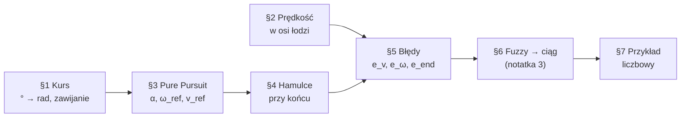
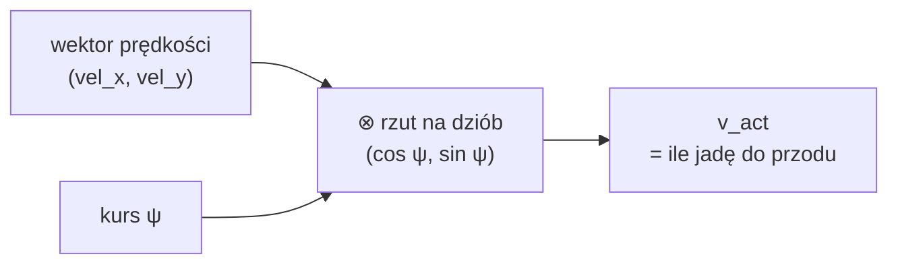
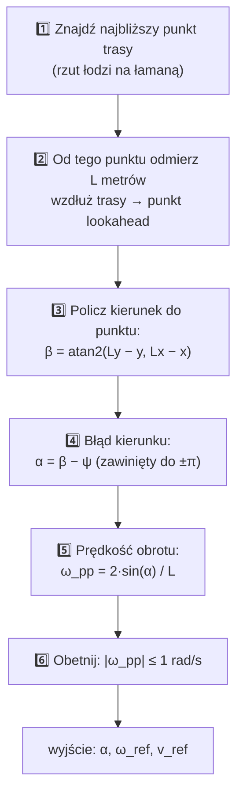
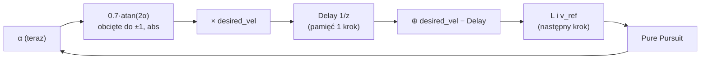
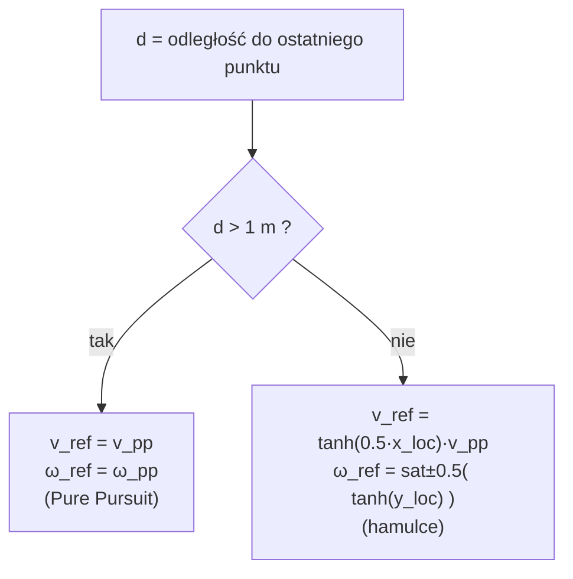
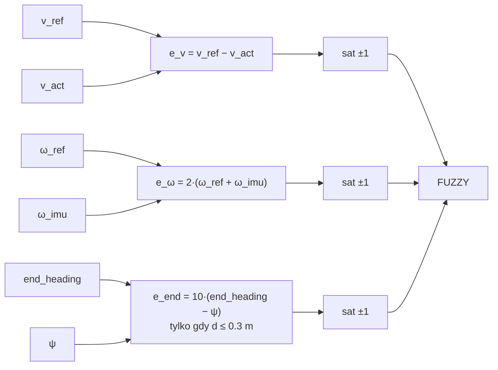
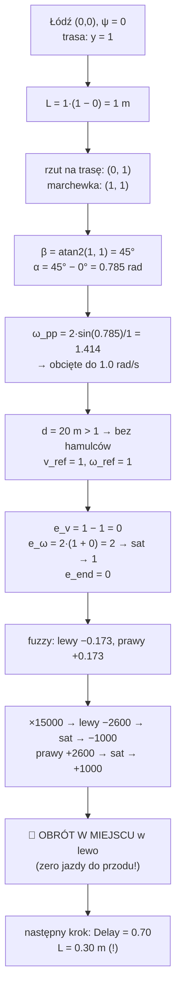

# Regulator od zera — 2. Matematyka krok po kroku

> [!skrot] W 30 sekund
> - Cała matematyka regulatora to: **kąty** (stopnie → radiany, zawijanie), **kierunek do punktu** (`atan2`), **Pure Pursuit** („goń marchewkę oddaloną o L”), **hamulce** przy końcu trasy (`tanh`), **błędy** obcięte do ±1 i na końcu **fuzzy** (osobna notatka).
> - Na końcu jest **pełny przykład liczbowy** jednego kroku, od pozycji łodzi do ciągu silników.
>
> Seria: [[Regulator od zera — 1. Co to jest i Simulink]] → **2. Matematyka** → [[Regulator od zera — 3. Logika rozmyta]] → [[Regulator od zera — 4. Dlaczego się buja]]

Mapa tej notatki (każdy krok to jeden rozdział):



## §0. Narzędzia, które trzeba znać

### Radiany
Pełny obrót = 360° = 2π rad ≈ 6.28 rad. Czyli **1 rad ≈ 57.3°**, a 90° = π/2 ≈ 1.57 rad. Komputer liczy `sin`, `cos` zawsze w radianach.

$$\text{rad} = \text{stopnie} \cdot \frac{\pi}{180}$$

### Sinus i cosinus = rozkład strzałki na x i y
Strzałka o długości 1 pod kątem θ ma składowe:

```
        y
        ▲
        │     ↗ (cos θ, sin θ)
  sin θ │   ╱
        │ ╱ θ
        └──────────► x
          cos θ
```

### `atan2(dy, dx)` = „w którą stronę jest punkt?”
Dostajesz przesunięcie do punktu (dx, dy), a `atan2` zwraca kąt tej strzałki w zakresie −π…+π. Zwykłe `atan(dy/dx)` myli ćwiartki (nie odróżnia „przód-lewo” od „tył-prawo”), `atan2` nie myli.

| dx | dy | atan2(dy, dx) | czyli |
|---|---|---|---|
| 1 | 0 | 0 | prosto wzdłuż x |
| 0 | 1 | +π/2 (90°) | w lewo (wzdłuż y) |
| −1 | 0 | ±π (180°) | do tyłu |
| 1 | 1 | π/4 (45°) | po skosie |

### Saturacja i `tanh`
- **sat(x)** = obetnij do zakresu, np. ±1. Jak ogranicznik prędkości.
- **tanh(x)** = „miękka” saturacja: dla małych x działa jak x, dla dużych dąży łagodnie do ±1.

![[04_saturacja_tanh.png]]

## §1. Kurs łodzi: stopnie → radiany i zawijanie

Xsens (`/filter/euler`) podaje kurs w **stopniach**. Model robi:

$$\text{heading\_raw} = -\,\text{heading} \cdot \frac{\pi}{180}, \qquad \psi = \operatorname{atan2}(\sin(\text{heading\_raw}),\ \cos(\text{heading\_raw}))$$

1. **Minus** zmienia kierunek liczenia kąta (Xsens liczy w jedną stronę, model w drugą; więcej w [[Drzewo TF i układy współrzędnych]]).
2. **atan2(sin, cos)** to sztuczka na „zawinięcie” kąta do −π…+π. 390° i 30° to ten sam kierunek, a regulator musi widzieć jedną liczbę.

![[01_kat_kursu.png]]

> [!wazne] Dlaczego zawijanie jest ważne
> Bez zawijania łódź skierowana na 179° i cel na −179° dawałyby błąd 358° („obróć się prawie w kółko”) zamiast 2°.

## §2. Prędkość łodzi „do przodu”

Xsens daje prędkość jako wektor w układzie świata (`vel_x`, `vel_y`). Regulator chce wiedzieć tylko **ile z tego to jazda do przodu**. Bierzemy rzut wektora prędkości na kierunek dziobu (iloczyn skalarny):

$$v_\text{act} = \cos\psi \cdot \text{vel\_y} + \sin\psi \cdot \text{vel\_x}$$



Uwaga: x i y są tu **zamienione miejscami** (`cos ψ` stoi przy `vel_y`). To ta sama zamiana osi co w [[planner]]. Jeśli łódź płynie bokiem (dryf), ta część prędkości jest pomijana.

## §3. Pure Pursuit — „goń marchewkę”

### Idea
Wyobraź sobie, że ktoś trzyma marchewkę na kiju **L metrów przed tobą, ale na trasie**. Ty zawsze skręcasz w stronę marchewki. Gdy jesteś obok trasy, marchewka jest „na ukos” i skręcasz w stronę trasy. Gdy jesteś na trasie, marchewka jest prosto przed tobą i jedziesz prosto.

![[02_pure_pursuit_geometria.png]]

### Algorytm krok po kroku



### Skąd wzór `2·sin α / L`?
Szukamy łuku okręgu, który **zaczyna się w łodzi, jest styczny do dziobu i przechodzi przez marchewkę**. Prosta geometria trójkąta równoramiennego daje promień:

$$R = \frac{d}{2\sin\alpha} \quad\Rightarrow\quad \text{krzywizna } \kappa = \frac{1}{R} = \frac{2\sin\alpha}{d}$$

gdzie d to odległość w linii prostej do marchewki (≈ L). Duże α albo mała odległość → ciasny łuk → szybki obrót. Kod liczy `ω_pp = 2·sin(α)/L` (`code_gen_1.c:854`).

```
        marchewka ★
                ╱ ⌒
             d ╱    ⌒   łuk o promieniu R
              ╱ α     ⌒
   łódź ●────────────► dziób
```

### Lookahead L: najważniejszy (i problematyczny) parametr

W naszym modelu **L = v_zadane = desired_vel − Delay**, gdzie Delay pamięta α z poprzedniego kroku:

$$L_k = v_d \cdot \big(1 - |\operatorname{sat}_{\pm1}(0.7 \cdot \arctan(2\alpha_{k-1}))|\big)$$



Po ludzku: **im bardziej łódź jest skręcona względem trasy, tym krótszy lookahead i tym wolniej jedzie.** Wolniej w zakręcie jest OK. Krótszy lookahead w zakręcie jest szkodliwy (patrz [[Regulator od zera — 4. Dlaczego się buja]]).

![[03_lookahead_omega.png]]

Odczyt z wykresu przy `desired_vel = 1`:
- jadąc prosto L = 1 m,
- przy α = 45° L ≈ 0.30 m,
- ω_ref wpada w ograniczenie 1 rad/s już od ~18° błędu.

| | Duże L (np. 5 m) | Małe L (np. 0.5 m) |
|---|---|---|
| Zachowanie | płynnie, ścina zakręty | ciasno trzyma trasę |
| Wada | ścina narożniki | nerwowo, oscyluje |
| Analogia | patrzysz daleko przed maskę | patrzysz pod koła |

## §4. Hamulce przy końcu trasy

Gdy łódź jest **bliżej niż 1 m od ostatniego punktu** trasy, Pure Pursuit przestaje mieć sens (nie ma już trasy „przed” łodzią). Model przełącza się na prostsze reguły.



`x_loc`, `y_loc` to położenie końca trasy **widziane z łodzi** (x = do przodu, y = w bok). Liczy się je obrotem układu współrzędnych o kąt ψ:

$$x_\text{loc} = dx\cos\psi + dy\sin\psi, \qquad y_\text{loc} = dy\cos\psi - dx\sin\psi$$

![[05_hamulce_osie_lodzi.png]]

- Koniec trasy **przed** łodzią (x_loc > 0) → jedź do przodu, ale coraz wolniej, im bliżej.
- Koniec trasy **za** łodzią (x_loc < 0) → `tanh` daje minus → cofaj.
- Koniec **z boku** → obracaj w jego stronę, maksymalnie 0.5.

## §5. Błędy, które idą do fuzzy

Fuzzy dostaje trzy liczby, każdą obciętą do ±1:



| Błąd | Znaczenie | Kiedy pełne ±1 |
|---|---|---|
| `e_v` | za wolno (+) / za szybko (−) | błąd ≥ 1 m/s |
| `e_ω` | za mało / za dużo obrotu | błąd ≥ **0.5 rad/s** (×2) |
| `e_end` | końcowy kurs (np. przy wjeździe do slipu) | błąd ≥ 0.1 (×10) |

Dlaczego `ω_ref + ω_imu`, a nie minus? IMU liczy obrót w przeciwną stronę niż model (stąd też `omega_act = −ω_imu` w logu). Plus z minusem = minus.

> [!blad] Pułapka jednostek
> `end_heading` przychodzi z `PathCallback` w **stopniach**, a ψ jest w **radianach**. Różnica 30° − 0.5 rad = 29.5, razy 10, obcięte do 1. Czyli w strefie 0.3 m przed końcem `e_end` jest prawie zawsze ±1 → łódź kręci się na końcu. Opisane w [[Regulator — TODO, błędy i oscylacje]].

## §6. Fuzzy → ciąg silników (skrót)

Fuzzy zamienia trzy błędy na dwie liczby od −1 do 1 (lewy, prawy). Potem:

$$\text{Thruster} = \operatorname{sat}_{\pm1000}(15 \cdot 1000 \cdot \text{wyjście\_fuzzy})$$

Jak działa fuzzy w środku: [[Regulator od zera — 3. Logika rozmyta]].

## §7. Pełny przykład liczbowy (jeden krok)

**Sytuacja:** łódź w (0, 0), dziób wzdłuż osi x (ψ = 0). Trasa to prosta y = 1 (czyli **1 m na lewo** od łodzi), długa na 20 m. `desired_vel = 1`, w poprzednim kroku α = 0. Łódź płynie 1 m/s i się nie obraca.



Wnioski z przykładu:
1. Łódź jest **tylko 1 m** obok trasy, a regulator daje **pełny obrót w miejscu** (lewy −1000, prawy +1000). Nie ma w tym nic „łagodnego”.
2. W następnym kroku lookahead spada z 1 m do 0.3 m, więc reakcja będzie jeszcze ostrzejsza.
3. Mimo że `e_v = 0` (chcemy jechać 1 m/s i jedziemy 1 m/s), na jazdę do przodu nie zostało nic, bo skręt zabrał cały zakres.

Szczegóły, skąd fuzzy wzięło ±0.173: [[Regulator od zera — 3. Logika rozmyta#Przykład 1 — duży błąd obrotu]].

## Ściąga wzorów

| Co | Wzór | Gdzie w `code_gen_1.c` |
|---|---|---|
| kurs | ψ = wrap(−heading·π/180) | `:568-574` |
| prędkość do przodu | v_act = cosψ·vel_y + sinψ·vel_x | `:608` |
| lookahead | L = v_d − v_d·\|sat(0.7·atan(2α_prev))\| | `:625-644`, `:1313-1328` |
| błąd kierunku | α = wrap(atan2(Ly−y, Lx−x) − ψ) | `:822-852` |
| obrót zadany | ω_pp = sat±1(2·sinα / L) | `:854-879` |
| odległość do końca | d = √(dx² + dy²) | `:902-914` |
| hamulec v | tanh(0.5·x_loc)·v_pp | `:930` |
| hamulec ω | sat±0.5(tanh(y_loc)) | `:945-952` |
| błąd v | sat±1(v_ref − v_act) | `:960-967` |
| błąd ω | sat±1(2·(ω_ref + ω_imu)) | `:974-981` |
| błąd kursu końcowego | sat±1(10·(end_heading − ψ)) gdy d ≤ 0.3 | `:988-1004` |
| ciąg | sat±1000(15000·fuzzy) | `:1233-1264` |

## Moje notatki
> [!ja] Tu piszesz ty — Albert tej sekcji nie rusza.
