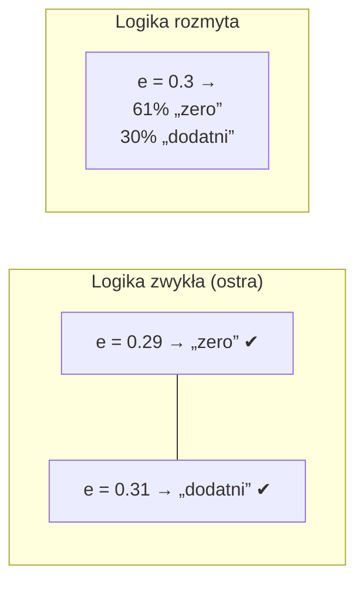
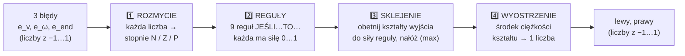
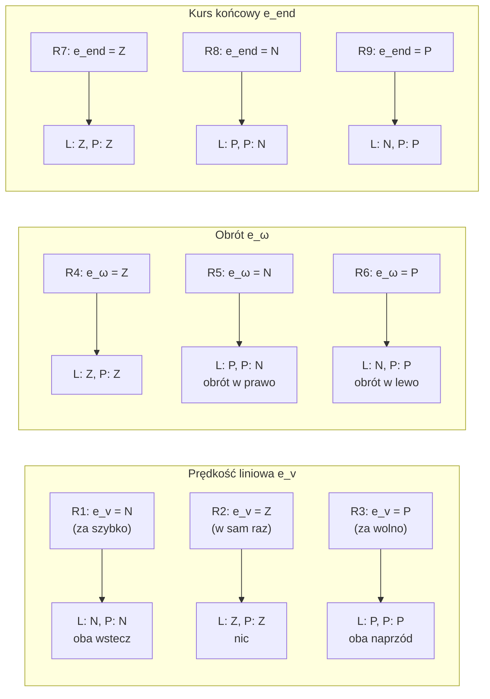
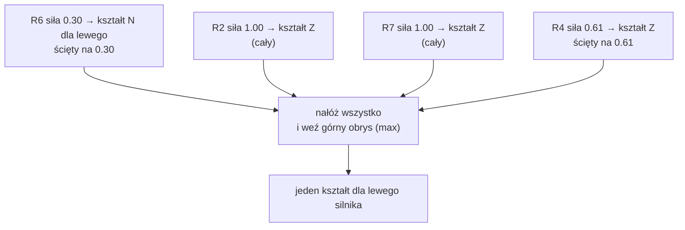
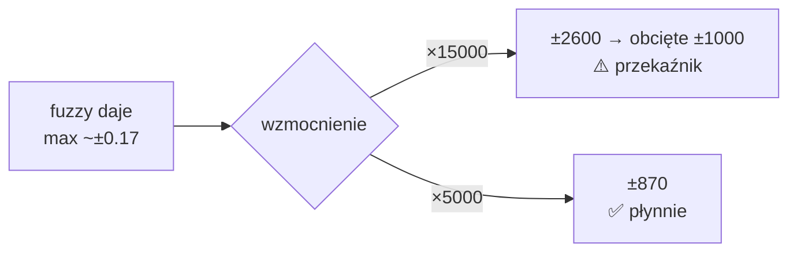

# Regulator od zera — 3. Logika rozmyta (fuzzy)

> [!skrot] W 30 sekund
> - **Fuzzy = reguły słowne zamiast wzoru.** „Jeśli za wolno, to oba silniki naprzód. Jeśli za mało obrotu w lewo, to lewy wstecz, prawy naprzód.”
> - **Rozmyte**, bo błąd może być „trochę dodatni i trochę zerowy” jednocześnie (np. 30% „dodatni”, 61% „około zera”). Reguły działają wtedy z odpowiednią siłą i wynik jest płynny.
> - **4 kroki:** rozmycie → reguły → sklejenie → wyostrzenie (środek ciężkości). Na końcu wynik razy 15000 i obcięcie do ±1000.
> - **Problem:** przez ×15000 już mały błąd obrotu (0.2 rad/s) daje pełny ciąg. Fuzzy jest płynne, ale wzmocnienie robi z niego włącznik.
>
> Seria: [[Regulator od zera — 1. Co to jest i Simulink]] → [[Regulator od zera — 2. Matematyka]] → **3. Logika rozmyta** → [[Regulator od zera — 4. Dlaczego się buja]]

## 1. Po co fuzzy?

Zwykły regulator (np. P) to wzór: `ciąg = K · błąd`. Fuzzy to **zestaw reguł jak u człowieka**:

> Jak jadę **za wolno**, dodaję gazu. Jak jadę **w sam raz**, nic nie zmieniam. Jak się **za mało obracam w lewo**, daję lewym wstecz, prawym naprzód.

Kłopot: co to znaczy „za wolno”? 0.1 m/s za wolno? 0.5? Fuzzy odpowiada: **„za wolno” to nie tak/nie, tylko stopień od 0 do 1.**

Przy logice ostrej mała zmiana błędu (0.29 → 0.31) przeskakuje regułę i wyjście skacze. Przy fuzzy wyjście zmienia się płynnie.

## 2. Cztery kroki fuzzy

W kodzie Simulinka to są bloki `S11 Evaluate Rule Antecedents` (kroki 1–2), `S12 Evaluate Rule Consequents` (krok 3) i `S10 Defuzzify Outputs` (krok 4).

## 3. Krok 1: rozmycie (funkcje przynależności)

Każdy błąd dostaje trzy „etykiety” z siłą od 0 do 1:
- **N** (negative, ujemny) — trójkąt z wierzchołkiem w −1,
- **Z** (zero, około zera) — dzwon Gaussa w 0,
- **P** (positive, dodatni) — trójkąt z wierzchołkiem w +1.

![[06_mf_wejscia.png]]

**Jak czytać wykres:** weź wartość błędu na osi x, idź pionowo w górę i odczytaj, na jakiej wysokości przecinasz każdą krzywą.

| błąd | N | Z | P | po ludzku |
|---|---|---|---|---|
| −1.0 | 1.00 | 0.004 | 0 | „zdecydowanie ujemny” |
| −0.3 | 0.30 | 0.61 | 0 | „raczej zero, trochę ujemny” |
| 0.0 | 0 | 1.00 | 0 | „idealnie” |
| +0.3 | 0 | 0.61 | 0.30 | „raczej zero, trochę dodatni” |
| +1.0 | 0 | 0.004 | 1.00 | „zdecydowanie dodatni” |

Dzwon dla `e_end` jest węższy (σ = 0.2 zamiast 0.3), czyli ten błąd szybciej przestaje być „zerem”.

Wzory (z `code_gen_1.c:1007-1035`):

$$\mu_N(e) = \text{trójkąt}(-2, -1, 0), \quad \mu_Z(e) = e^{-e^2 / 0.18}, \quad \mu_P(e) = \text{trójkąt}(0, 1, 2)$$

## 4. Krok 2: reguły

Jest **9 reguł**, po 3 na każdy błąd. Każda reguła patrzy tylko na **jeden** błąd:

(Kierunki „w lewo / w prawo” zależą od konwencji kąta, ważne jest, że R5 i R6 kręcą w przeciwne strony.)

**Siła reguły** = stopień przynależności jej warunku. Np. jeśli `e_ω = 0.3`, to R4 ma siłę 0.61, R6 ma siłę 0.30, R5 ma siłę 0.

> [!wazne] Haczyk: reguły „Z” zawsze coś mówią
> Gdy np. tylko obrót jest zły, a prędkość OK i nie jesteśmy przy końcu, to R2 (e_v = Z) i R7 (e_end = Z) mają siłę **1.0** i krzyczą „nic nie rób!”. Reguła obrotu musi się z nimi „przekrzyczeć”. Dlatego wynik fuzzy rzadko przekracza **±0.17**, a nie ±1. I dlatego ktoś dał ×15 na wyjściu.

## 5. Krok 3: sklejenie (obcinanie i nakładanie)

Wyjście (lewy i prawy silnik osobno) ma też trzy kształty:

![[07_mf_wyjscia.png]]

Dla każdej reguły bierzemy jej kształt wyjściowy i **ścinamy go na wysokości siły reguły** (jak nożem). Potem nakładamy wszystkie ścięte kształty i bierzemy **górny obrys** (max).

## 6. Krok 4: wyostrzenie (środek ciężkości)

Mamy kształt, a silnik potrzebuje **jednej liczby**. Bierzemy **środek ciężkości** kształtu: wyobraź sobie, że kształt jest wycięty z tektury, i szukasz punktu, w którym da się go wyważyć na palcu.

$$\text{wynik} = \frac{\sum_i x_i \cdot \mu(x_i)}{\sum_i \mu(x_i)}$$

Kod liczy to na 101 punktach od −1 do 1 (`code_gen_1.c:1202-1225`).

### Przykład 1 — duży błąd obrotu
`e_v = 0`, `e_ω = +1`, `e_end = 0` (to jest przykład z [[Regulator od zera — 2. Matematyka#§7. Pełny przykład liczbowy (jeden krok)]]).

| Reguła | Siła | Lewy | Prawy |
|---|---|---|---|
| R2 (e_v Z) | 1.00 | Z | Z |
| R4 (e_ω Z) | 0.004 | Z | Z |
| R6 (e_ω P) | **1.00** | **N** | **P** |
| R7 (e_end Z) | 1.00 | Z | Z |
| reszta | 0 | — | — |

![[08_defuzyfikacja_przyklad.png]]

Lewy: kształt Z w środku + pełny kształt N po lewej → środek ciężkości lekko w lewo: **−0.173**. Razy 15000 = −2600 → obcięte do **−1000**. Prawy symetrycznie: **+1000**. Obrót w miejscu.

### Przykład 2 — mały błąd obrotu
`e_v = 0`, `e_ω = +0.2` (czyli rzeczywisty błąd obrotu 0.1 rad/s ≈ 6°/s), `e_end = 0`.

| Reguła | Siła |
|---|---|
| R2 (e_v Z) | 1.00 |
| R4 (e_ω Z) | 0.80 |
| R6 (e_ω P) | 0.20 |
| R7 (e_end Z) | 1.00 |

![[08b_defuzyfikacja_maly_blad.png]]

Kształt N jest ścięty na 0.2, więc tylko mały „ząbek” po lewej. Środek ciężkości **−0.020**. Razy 15000 = **−304**. Prawie 1/3 pełnego ciągu przy błędzie 6°/s!

## 7. Co robi wzmocnienie ×15000

![[09_ciag_vs_blad.png]]

- Linia ciągła (×15, tak jest teraz): ciąg rośnie bardzo stromo i od ~0.2 rad/s błędu jest **ściana** na ±1000. To prawie włącznik: „albo nic, albo full”.
- Linia przerywana (×5, propozycja): od zera do maksimum przechodzi łagodnie w całym zakresie błędu.

## 8. Dwa wyjścia, ale skąd jazda + skręt naraz?

Reguły prędkości (R1–R3) dają **taki sam** kierunek dla obu silników, a reguły obrotu (R4–R6) **przeciwny**. Przy kroku sklejania oba wpływy się nakładają:

| Sytuacja | Reguły aktywne | Lewy | Prawy | Efekt |
|---|---|---|---|---|
| za wolno, obrót OK | R3 | + | + | prosto naprzód |
| prędkość OK, trzeba w lewo | R6 | − | + | obrót w miejscu |
| za wolno i trzeba w lewo | R3 + R6 | ~0 | + | łuk w lewo |

Uwaga: ponieważ agregacja to `max`, a nie suma, to przy dużym błędzie obrotu reguła obrotu „wygrywa” i z jazdy do przodu niewiele zostaje (przykład 1).

## Ściąga
| Pojęcie | Tu w regulatorze |
|---|---|
| typ | Mamdani |
| wejścia | 3: e_v, e_ω, e_end (każde ±1) |
| funkcje wejść | N trójkąt, Z Gauss (σ 0.3 / 0.2), P trójkąt |
| reguły | 9, każda z 1 warunkiem |
| AND / implikacja | min |
| agregacja | max |
| wyostrzenie | środek ciężkości na 101 punktach |
| wyjścia | 2: lewy, prawy (±1) → ×15000 → sat ±1000 |

## Moje notatki
> [!ja] Tu piszesz ty — Albert tej sekcji nie rusza.
