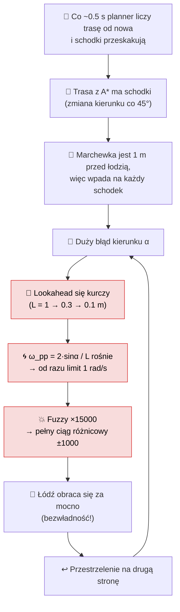
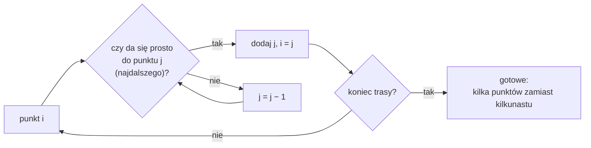
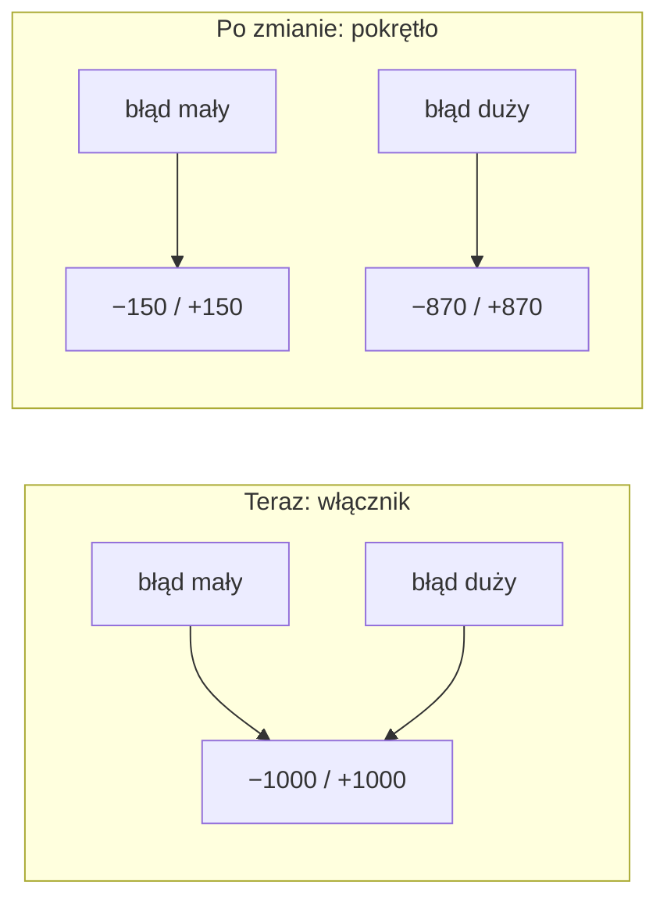
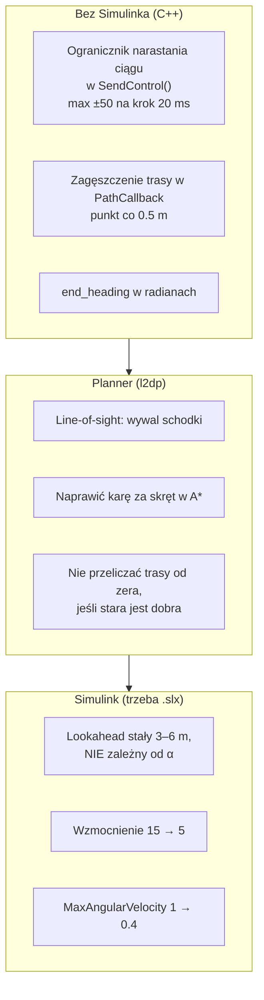

# Regulator od zera — 4. Dlaczego łódź się buja

> [!skrot] W 30 sekund
> - Łódź „pływa wężykiem” przez **trzy rzeczy naraz**: schodkową trasę z plannera, za krótki lookahead (≤ 1 m, a przy błędzie jeszcze krótszy) i wzmocnienie ×15000, które robi z regulatora włącznik.
> - **Każda z nich osobno** byłaby do przeżycia. Razem tworzą pętlę: przestrzelenie → większy błąd → ostrzejsza reakcja → większe przestrzelenie.
> - **Naprawa w skrócie:** prostsza trasa (line-of-sight), dłuższy i stały lookahead (3–6 m), mniejsze wzmocnienie (×5), ogranicznik narastania ciągu.
>
> Seria: [[Regulator od zera — 1. Co to jest i Simulink]] → [[Regulator od zera — 2. Matematyka]] → [[Regulator od zera — 3. Logika rozmyta]] → **4. Dlaczego się buja**
> Wersja techniczna z kodem poprawek: [[Regulator — TODO, błędy i oscylacje]].

## 1. Analogia: jazda rowerem, patrząc pod przednie koło

Jak jedziesz rowerem i patrzysz **metr przed siebie**, każdy kamyczek i każda krzywa linia na asfalcie powoduje szarpnięcie kierownicą. Jak patrzysz **10 metrów przed siebie**, jedziesz płynnie. Nasz regulator patrzy metr przed siebie, a jak się przestraszy (duży błąd), to patrzy jeszcze bliżej.

## 2. Błędne koło

Czerwone klocki to miejsca w samym regulatorze. Pierwszy klocek (schodki) to planner.

## 3. Problem 1: trasa ze schodkami

Planner liczy trasę algorytmem A* na siatce kratek. Z każdej kratki można iść tylko w 8 kierunkach (co 45°). Trasa pod kątem np. 30° wychodzi jako schodki. Potem planner wrzuca do `/path_points` **każde** miejsce zmiany kierunku.

![[11_sciezka_schodki_vs_los.png]]

Po prawej propozycja „line-of-sight” (przycinanie po linii widzenia): z każdego punktu skacz do najdalszego punktu, do którego da się dojechać prosto bez wjeżdżania w przeszkodę. Zostają tylko punkty naprawdę potrzebne.

Dodatkowo w A* jest błąd: kara za skręt miała zniechęcać do schodków, ale przez dzielenie całkowite (`/5` zamiast `/5.0`) zawsze wynosi 0.

## 4. Problem 2: za krótki lookahead

![[03_lookahead_omega.png]]

Lewy wykres: im większy błąd, tym krótszy lookahead. Prawy: ω_ref jest w limicie już od ~18° błędu. Czyli przy prawie każdym skręcie regulator „krzyczy” na maksa.

Zabawkowa symulacja: ten sam prosty model łodzi (z opóźnieniem w obrocie, bo prawdziwa łódź też nie obraca się natychmiast), ta sama schodkowa trasa, dwa ustawienia:

![[10_symulacja_schodki.png]]

![[10b_symulacja_omega.png]]

- **Czerwona** (jak teraz): łódź wiernie odtwarza każdy schodek, a prędkość obrotu skacze lewo-prawo-lewo-prawo co ~2 s.
- **Zielona** (L = 4 m): łódź jedzie po „uśrednionej” linii, prędkość obrotu prawie zero.

> [!wazne] To tylko ilustracja
> Model łodzi w symulacji jest wymyślony (prosty model kinematyczny z opóźnieniem τ = 0.8 s, bez fuzzy, bez wody i wiatru). Pokazuje mechanizm, nie prawdziwe liczby. Prawdziwe strojenie trzeba robić w [[l4sim]] i na wodzie.

## 5. Problem 3: włącznik zamiast pokrętła

![[09_ciag_vs_blad.png]]

Przy ×15 ciąg różnicowy jest pełny już przy błędzie obrotu ~0.2 rad/s. Łódź ma bezwładność: zanim zacznie się obracać, regulator już daje full, a zanim przestanie, już przestrzeliła. To klasyczny przepis na oscylacje.

## 6. Co zmienić (od najłatwiejszego)

| Zmiana | Trudność | Zysk | Gdzie |
|---|---|---|---|
| line-of-sight w plannerze | średnia | ⭐⭐⭐ | `l2dp/planner/src/planner.cpp` |
| lookahead 3–6 m, niezależny od α | wymaga `.slx` | ⭐⭐⭐ | model Simulink, blok `Delay` / Pure Pursuit |
| wzmocnienie 15 → 5 | wymaga `.slx` | ⭐⭐ | `S6/Gain`, `S6/Gain1` |
| ogranicznik narastania ciągu | łatwa | ⭐ (łagodzi objawy) | `regulator.cpp`, `SendControl` |
| end_heading w radianach | łatwa | ⭐ (koniec trasy) | `regulator.cpp`, `PathCallback` |

Kod gotowych poprawek: [[Regulator — TODO, błędy i oscylacje]].

## Moje notatki
> [!ja] Tu piszesz ty — Albert tej sekcji nie rusza.
