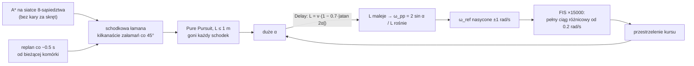

# Regulator: TODO, błędy i oscylacje

> [!skrot] W 30 sekund
> - **Skąd oscylacje:** to nie jeden błąd, tylko trzy sprzężone. (1) [[planner]] daje schodkową ścieżkę z siatki 8-sąsiedztwa i przelicza ją od zera co ~0.5 s. (2) Pure Pursuit w regulatorze ma lookahead **≤ 1 m**, który dodatkowo **maleje przy dużym błędzie kursu**, więc goni każdy schodek. (3) Fuzzy ×15000 daje pełny ciąg różnicowy już przy ~0.2 rad/s błędu, czyli działa jak przekaźnik.
> - **Najtańsza poprawa ścieżki:** przycinanie po linii widzenia (line-of-sight) w plannerze plus zagęszczenie co ~0.5 m. Na otwartej wodzie zostaje 1–2 odcinki zamiast kilkunastu załamań.
> - **Najtańsza poprawa regulatora:** lookahead niezależny od błędu (np. 3–6 m), wzmocnienie wyjścia 15 → ~5, ogranicznik narastania ciągu w `SendControl`.
> - Kod opisany w [[Regulator — hierarchia i działanie]].

## 1. TODO i błędy w kodzie

Jedyny dosłowny `TODO` w pakiecie to `package.xml:8` (`<license>TODO: License declaration</license>`). Reszta to rzeczy znalezione przy czytaniu kodu.

### Pewne (widać wprost w kodzie)
- [ ] **`use` niezainicjalizowane** (`regulator.cpp:30`): `bool use = true;` tworzy zmienną lokalną, a pole klasy ma wartość nieokreśloną. Do pierwszej wiadomości `/regulator_or_thrust_driver` regulator może sterować albo nie. Poprawka: `use = true;` albo inicjalizacja w liście konstruktora / `bool use{true};` w nagłówku.
- [ ] **Jednostki `end_heading`:** `PathCallback` liczy yaw w **stopniach** (`QuaternionToYawDegrees`), a model odejmuje od tego ψ w **radianach** (`code_gen_1.c:991`) i nie zawija różnicy. Po wejściu w strefę 0.3 m od końca `e_end` jest praktycznie zawsze nasycone (×10), więc łódź kręci się na końcu ścieżki. Poprawka po stronie C++: podać radiany w tej samej konwencji co ψ (czyli `−yaw`, zob. [[Drzewo TF i układy współrzędnych]]).
- [ ] **Nieświeże dane nie zatrzymują łodzi:** `CheckTopicsStatus` tylko loguje. Jeśli `/slam/odom` albo `/path_points` przestaną przychodzić, regulator dalej wysyła ciąg na podstawie ostatnich wartości. Brak też kontroli `/filter/velocity`, `/filter/euler` i IMU. Poprawka: przy timeoucie wysłać `{0, 0}` i pominąć `code_gen_1_step()`.
- [ ] **Brak `std_msgs` w zależnościach:** nowe subskrypcje używają `std_msgs/String` i `Float64`, ale nie ma ich ani w `package.xml`, ani w `find_package`/`ament_target_dependencies`. Kompiluje się tylko dzięki zależnościom przechodnim.
- [ ] **Zamiana lewy/prawy** (`regulator.cpp:185`): `MotorSetpoints{right_thrust, left_thrust}` wkłada prawy ciąg do pola `left`. Jeżeli to celowe (kolejność w ramce lub okablowanie), warto dopisać komentarz albo nazwać pola zgodnie z [[Magistrala CAN]]. Do tego zawężająca konwersja `double → int16` w inicjalizacji klamrowej (ostrzeżenie `-Wnarrowing`).
- [ ] **Nieużywane pola:** `is_initialized_`, `last_cmd_time_`, zakomentowany `GoalCallback`/`goal_sub_`, nieużywany include `tf2_geometry_msgs` (yaw liczony ręcznie).
- [ ] **Niespójne ścieżki include:** `#include "../../can-msgs/src/barka.h"` w nagłówku, `../can-msgs/src` w `include_directories` i `../../can-msgs/src` w `target_include_directories`.
- [ ] **`create_wall_timer`** w symulacji z `use_sim_time` biegnie w czasie ściennym, a `get_clock()->now()` w czasie symulacji, więc timeouty i throttle logów mogą się rozjechać.
- [ ] **Poprawka do notatki [[regulator]]:** „brak przycinania do ±1000” jest nieaktualne, bo model ma saturację ±1000 na wyjściu (`code_gen_1.c:1236-1264`).

### W modelu Simulink (wymaga regeneracji `code_gen_1`)
- [ ] **Lookahead = prędkość zadana** (`code_gen_1.c:625-644`): ta sama liczba służy za prędkość [m/s] i za lookahead [m].
- [ ] **Lookahead maleje z błędem kursu** przez blok `Delay` (`:1313-1328`). To dodatnie sprzężenie zwrotne, opisane niżej.
- [ ] **Wzmocnienie wyjścia 15 × 1000** zamienia FIS w przekaźnik.
- [ ] Próg „hamulca” 1 m jest równy `goalThreshold = 1.0` m w [[planner]], więc łódź wchodzi w tryb hamowania mniej więcej wtedy, gdy planner przełącza cel i publikuje nową ścieżkę.

### Po stronie [[planner]] (`l2dp_docking_fix@0d444ff`, `planner/src/planner.cpp`)
- [ ] **Kara za skręt nie działa** (`:135`): `(std::abs(current.pastMoveIndex - i) % 5) / 5` to dzielenie całkowite, więc zawsze 0. Do tego nowe węzły są wkładane jako `{nx, ny, f}` (`:148`), więc `pastMoveIndex` i tak zawsze wynosi 0. A* nie ma żadnego powodu, żeby wybierać ścieżkę z mniejszą liczbą skrętów.
- [ ] **Do sprawdzenia:** awaryjny punkt przy pustej ścieżce (`:303-306`) to `(start.y, end.x)` w **indeksach komórek**, a nie w metrach, i miesza start z celem. Wygląda na błąd zamiany osi.
- [ ] `path_points` zawierają tylko punkty załamań (`|Δyaw| > 10°`, `:48`). Pozycji startowej łodzi nie ma, a cel trafia tylko pośrednio. Marker rysowany jest w `poseOld`, a punkt wysyłany w `pose` (przesunięcie o jedną komórkę).

## 2. Dlaczego łódź oscyluje



### 2.1. Ścieżka
- 8-sąsiedztwo daje tylko kierunki co 45°. Odcinek pod np. 30° to mieszanka kroków prostych i ukośnych, a ponieważ kara za skręt wynosi 0, kolejność kroków zależy od remisów w kolejce priorytetowej.
- `reconstructPath` próbuje wycinać zygzaki ukośne (serie ≥ 3), ale każda zmiana kierunku o 45° i tak przekracza próg 10°, więc zostaje punkt.
- Każda nowa costmapa (~2 Hz) wyzwala pełne przeplanowanie od komórki, w której akurat jest łódź. Schodki „przeskakują” między kolejnymi wersjami, a regulator przy każdej nowej tablicy resetuje `ProjectionLineIndex`.

### 2.2. Pure Pursuit z kurczącym się lookaheadem
Przy `desired_vel = 1`:

| α [rad] | 0 | 0.1 | 0.25 | 0.5 | 1.0 | 1.57 |
|---|---|---|---|---|---|---|
| L [m] | 1.00 | 0.86 | 0.68 | 0.45 | 0.23 | 0.12 |
| ω_ref [rad/s] | 0 | 0.23 | 0.73 | **1 (sat)** | 1 | 1 |

Krótki lookahead to agresywne, „nerwowe” śledzenie. Kurczenie się `L` przy dużym błędzie jest gorsze, bo właśnie wtedy łódź potrzebuje łagodniejszego powrotu na ścieżkę, a dostaje ostrzejszy. Dla łodzi z dużą bezwładnością sensowny lookahead to raczej 2–3 długości kadłuba.

### 2.3. Przekaźnikowe wyjście
Szczegóły w [[Regulator — hierarchia i działanie#3.6. Wyjście i nasycenie]]: przy wzmocnieniu 15 ciąg różnicowy osiąga ±1000 przy błędzie ω ≈ 0.2 rad/s. Nie ma też żadnego ograniczenia narastania ciągu między kolejnymi krokami 20 ms.

## 3. Jak uprościć ścieżkę

Kolejność od największego zysku przy najmniejszym ryzyku.

### 3.1. Przycinanie po linii widzenia (planner, po A*)
Zamiast wybierać punkty po kącie załamania, z pełnej listy komórek A* zostawiamy tylko te, między którymi nie da się przejechać prosto:

```cpp
// cells: komórki ścieżki A* w kolejności start → cel
bool LineFree(const nav_msgs::msg::OccupancyGrid& map, Cell a, Cell b, int8_t max_cost) {
  // Bresenham: każda komórka na odcinku a→b musi mieć koszt < max_cost
  int dx = std::abs(b.x - a.x), sx = a.x < b.x ? 1 : -1;
  int dy = -std::abs(b.y - a.y), sy = a.y < b.y ? 1 : -1;
  int err = dx + dy;
  while (true) {
    if (map.data[a.y * map.info.width + a.x] >= max_cost) return false;
    if (a.x == b.x && a.y == b.y) return true;
    int e2 = 2 * err;
    if (e2 >= dy) { err += dy; a.x += sx; }
    if (e2 <= dx) { err += dx; a.y += sy; }
  }
}

std::vector<Cell> Prune(const std::vector<Cell>& cells, const nav_msgs::msg::OccupancyGrid& map) {
  std::vector<Cell> out{cells.front()};
  size_t i = 0;
  while (i + 1 < cells.size()) {
    size_t j = cells.size() - 1;
    while (j > i + 1 && !LineFree(map, cells[i], cells[j], /*max_cost=*/50)) --j;
    out.push_back(cells[j]);
    i = j;
  }
  return out;  // na otwartej wodzie: {start, cel}
}
```

Efekt: na otwartej wodzie ścieżka to jeden odcinek łódź → cel, a przy przeszkodach tylko punkty na ich narożnikach. Znika cała kategoria oscylacji „od schodka do schodka”. Próg `max_cost` trzeba dobrać do inflacji z [[pose_graph]].

Alternatywa o podobnym efekcie: Ramer–Douglas–Peucker z ε ≈ 0.5–1 m na pełnym `path.poses` (bez sprawdzania kolizji, więc ε musi być mniejsze niż margines inflacji).

### 3.2. Naprawić karę za skręt w A*
```cpp
// :135 — kara za każdą zmianę kierunku; :148 — zapamiętać ruch
double turn = (i == current.pastMoveIndex) ? 0.0 : turn_penalty;  // np. 0.5
double newCost = gCost[oIndex] + moves[i].cost + costmap.data[nIndex] * slam_costmap + turn;
...
open.push({nx, ny, newCost + euclideanHeuristic(temp, end), i});
```
Sama ta zmiana zmniejsza liczbę schodków. Z przycinaniem z 3.1 nie jest konieczna, ale nic nie kosztuje.

### 3.3. Stabilna ścieżka między przeplanowaniami
- Przeplanować tylko gdy zmienił się cel albo obecna ścieżka koliduje z nową costmapą (sprawdzenie `LineFree` po odcinkach). W innym wypadku publikować starą.
- Albo histereza: nową ścieżkę przyjąć tylko, gdy jest wyraźnie tańsza (np. < 0.9 × kosztu starej).
- Pierwszy punkt ścieżki: aktualna pozycja łodzi (w metrach, nie środek komórki), a ostatni: dokładnie cel z `/goal`.

### 3.4. Zagęszczenie dla Pure Pursuit (planner albo `PathCallback` w regulatorze)
Po przycięciu punktów jest mało, a regulator ma na nie 100 miejsc. Próbkowanie co 0.5 m (i opcjonalnie 1–2 iteracje wygładzania Chaikina na narożnikach) daje ciągłą krzywiznę i stabilniejszy rzut. To da się zrobić **w samym regulatorze**, w `PathCallback`, bez ruszania l2dp i Simulinka:

```cpp
// PathCallback: łamana → punkty co step metrów, maks. 100
std::vector<std::pair<double,double>> pts;
for (size_t k = 0; k + 1 < msg->poses.size(); ++k) {
  auto &a = msg->poses[k].position, &b = msg->poses[k + 1].position;
  double len = std::hypot(b.x - a.x, b.y - a.y);
  int n = std::max(1, static_cast<int>(len / step));
  for (int s = 0; s < n; ++s) pts.emplace_back(a.x + (b.x - a.x) * s / n, a.y + (b.y - a.y) * s / n);
}
pts.emplace_back(msg->poses.back().position.x, msg->poses.back().position.y);
```
Uwaga: przy 100 punktach co 0.5 m zasięg to 50 m. Dla dłuższych ścieżek `step` trzeba zwiększyć albo obciąć ścieżkę do najbliższych 50 m.

## 4. Jak uspokoić sam regulator

| Zmiana | Gdzie | Efekt |
|---|---|---|
| Lookahead niezależny od α, np. `L = clamp(k·v, 3 m, 6 m)` | Simulink (`S2`) | największy pojedynczy zysk: łagodny powrót na ścieżkę |
| Prędkość nadal może maleć z α, ale osobnym sygnałem | Simulink | zwalnianie w zakrętach bez skracania L |
| Wzmocnienie wyjścia 15 → ~5 | Simulink (`S6/Gain`, `Gain1`) | przy maks. centroidzie ~0.17 wciąż prawie pełny zakres, ale bez przekaźnika przy małych błędach |
| `MaxAngularVelocity` 1.0 → ~0.4 rad/s | Simulink | mniejsze ω_ref, mniej nasyceń |
| `end_heading` w radianach, zawinięty, wzmocnienie 10 → ~2 | C++ + Simulink | koniec obracania się w kółko na końcu |
| Ogranicznik narastania ciągu (np. ±50 na krok 20 ms) i filtr 1. rzędu | C++ `SendControl` | gładsze nastawy bez regeneracji modelu |
| Zatrzymanie przy nieświeżych danych | C++ `ControlLoop` | bezpieczeństwo |

Ogranicznik narastania w `SendControl` (bez zmiany modelu):
```cpp
static double prev_l = 0.0, prev_r = 0.0;
constexpr double kMaxStep = 50.0;  // na 20 ms → 0…1000 w 0.4 s
auto slew = [](double target, double& prev) {
  prev += std::clamp(target - prev, -kMaxStep, kMaxStep);
  return prev;
};
double left_thrust  = slew(rtY.LeftThruster,  prev_l);
double right_thrust = slew(rtY.RightThruster, prev_r);
```
To nie usuwa przyczyny (krótki lookahead), ale tłumi szarpanie silników. Prawdziwa poprawka to lookahead w Simulinku. Model jest na tyle mały (~150 linii właściwej logiki), że alternatywą jest przepisanie go do C++ z parametrami ROS, co pozwoli stroić `L`, wzmocnienia i progi bez MATLAB-a.

## 5. Plan działania (propozycja)
1. Szybkie poprawki C++ w regulatorze: `use`, `end_heading` w radianach, stop przy nieświeżych danych, ogranicznik narastania, `std_msgs` w zależnościach.
2. Planner: przycinanie po linii widzenia + start z pozycji łodzi + dokładny cel. Sprawdzić na bagu `~/solar/rosbagi/docking_regulator_2` (porównać `/path_points` przed i po).
3. Simulink: lookahead niezależny od α (3–6 m), wzmocnienie 15 → ~5, `MaxAngularVelocity` ↓. Regeneracja `code_gen_1`.
4. Dopiero potem strojenie w symulacji ([[l4sim]], `sim:=true`) i na wodzie.

## Powiązane
[[regulator]] · [[Regulator — hierarchia i działanie]] · [[planner]] · [[pose_graph]] · [[Nawigacja i autonomia — przepływ]] · [[Znane problemy i ryzyka]]

## Moje notatki
> [!ja] Tu piszesz ty — Albert tej sekcji nie rusza.
