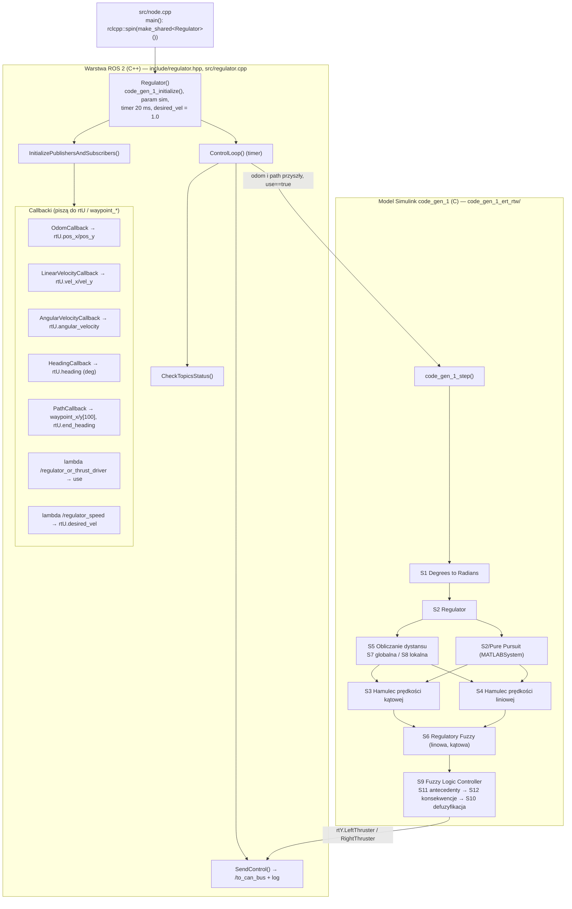
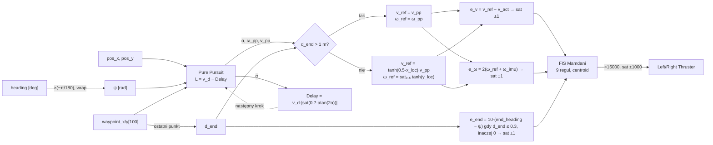

# Regulator: hierarchia i działanie kodu

> [!skrot] W 30 sekund
> - **Co to:** rozbiór pakietu [[regulator]] ([[l0hwd]]) od `main()` aż do pojedynczych bloków modelu Simulink `code_gen_1`. Uzupełnia notatkę [[regulator]], która mówi *co* węzeł robi. Ta notatka mówi *jak*.
> - **Dwie warstwy:** cienka powłoka ROS 2 w C++ (`Regulator`, ~210 linii) plus wygenerowany kod C z Simulinka (`code_gen_1.c`, ~800 linii właściwej logiki). Rozmawiają przez **zmienne globalne** `rtU` (wejścia), `rtY` (wyjścia) i `waypoint_x/y[100]`.
> - **Łańcuch sterowania (co 20 ms):** Pure Pursuit → (blisko końca) „hamulce” `tanh` → błąd prędkości liniowej i kątowej → regulator rozmyty Mamdaniego (3 wejścia, 9 reguł) → ×15000 → nasycenie ±1000 → ramka CAN `0x05`.
> - **Problemy i oscylacje:** [[Regulator — TODO, błędy i oscylacje]].
> - Stan: `l0hwd` `master@fd33338` plus niezacommitowane zmiany w drzewie roboczym (`/slam/odom`, `use`, `/regulator_speed`).

## 1. Hierarchia komponentów

Hierarchia systemów Simulinka pochodzi z komentarza w `code_gen_1.h:195-207` (polskie znaki są tam w Latin-2, stąd `pr�dko��`):

| ID | Ścieżka w modelu | Rola |
|---|---|---|
| `<Root>` | `code_gen_1` | wejścia `rtU`, wyjścia `rtY`, stałe `waypoint_x/y` |
| `<S1>` | Degrees to Radians | kurs ze stopni na radiany (z minusem) |
| `<S2>` | Regulator | cały regulator: Pure Pursuit, `Delay`, sumatory |
| `<S3>` | Regulator/Hamulec prędkości kątowej | ω zadane przy końcu ścieżki |
| `<S4>` | Regulator/Hamulec prędkości liniowej | v zadane przy końcu ścieżki |
| `<S5>` | Regulator/Obliczanie dystansu | odległość do ostatniego waypointu |
| `<S7>`, `<S8>` | …/Odległość globalna, …/Odległość lokalna | odległość euklidesowa i rzut na oś łodzi |
| `<S6>` | Regulator/Regulatory Fuzzy | normalizacja błędów, wzmocnienia, saturacje |
| `<S9>`–`<S12>` | …/Fuzzy Logic Controller | FIS Mamdaniego: antecedenty, konsekwencje, defuzyfikacja |

## 2. Warstwa ROS 2 (C++)

### Pliki i budowanie
- `src/node.cpp`: `main` tylko tworzy węzeł i woła `spin` (executor jednowątkowy, więc callbacki i timer nigdy nie biegną równolegle i globalne `rtU` nie wymagają mutexu).
- `include/regulator.hpp`: klasa `Regulator : rclcpp::Node` i struktura `MotorSetpoints` (`int16 left`, `int16 right`, `int32 padding`, `packed`, razem 8 B).
- `src/regulator.cpp`: cała logika ROS. `code_gen_1.h` jest dołączony w `extern "C"`.
- `CMakeLists.txt`: jeden executable `Regulator` z `regulator.cpp`, `node.cpp`, `../can-msgs/src/barka.c`, `code_gen_1.c`, `code_gen_1_data.c`.

### Cykl życia
1. **Konstruktor** (`regulator.cpp:16-42`): `code_gen_1_initialize()` (zeruje stan Pure Pursuit, `WaypointsInternal = NaN`), parametr `sim`, czasy `last_*_time_ = 0`, subskrypcje, timer 20 ms (`create_wall_timer`, czyli czas ścienny nawet w symulacji), `rtU.desired_vel = 1.0`.
2. **Callbacki** tylko przepisują dane do `rtU` (bez filtrowania i bez sprawdzania ramki/stempla):

| Callback | Topik | Co zapisuje |
|---|---|---|
| `OdomCallback` | `/slam/odom` | `rtU.pos_x/pos_y`, `last_odom_time_` |
| `LinearVelocityCallback` | `/filter/velocity` | `rtU.vel_x/vel_y` |
| `AngularVelocityCallback` | `/imu/data` (sim: `/wamv/sensors/imu/imu/data`) | `rtU.angular_velocity = ω_z` |
| `HeadingCallback` | `/filter/euler` | `rtU.heading = vector.z` (stopnie) |
| `PathCallback` | `/path_points` | `waypoint_x/y[0..99]`; brakujące miejsca dopełnia ostatnim punktem; `rtU.end_heading` = yaw ostatniej pozy **w stopniach** |
| lambda | `/regulator_or_thrust_driver` | `use = (data == "regulator")` |
| lambda | `/regulator_speed` | `rtU.desired_vel` |

3. **`ControlLoop`** (`:77-93`): ostrzeżenia o braku danych (`CheckTopicsStatus`, timeout 1 s, tylko log). Jeżeli odometria i ścieżka przyszły **choć raz** i `use == true`, woła `code_gen_1_step()` i `SendControl()`.
4. **`SendControl`** (`:171-214`): bierze `rtY.LeftThruster/RightThruster` (już przycięte do ±1000 w modelu), składa `MotorSetpoints{right, left}`, czyli pole `left` dostaje **prawy** ciąg (zamiana celowa albo pomyłka, patrz TODO), kopiuje 4 B (`BARKA_MOTOR_SPEED_SP_HL_LENGTH = 4`) do ramki `id = 0x05`, `dlc = 8` i publikuje na `/to_can_bus`. Co 1 s loguje pełny stan.

## 3. Model Simulink: `code_gen_1_step()` krok po kroku

Wszystkie odwołania do `code_gen_1_ert_rtw/code_gen_1.c`.

### 3.1. Kurs i prędkość rzeczywista (`:568-608`)
- `heading_raw = −heading·π/180`, potem `ψ = atan2(sin, cos)` (zawinięcie do ±π). Minus zmienia konwencję kursu z `/filter/euler` (zob. [[Drzewo TF i układy współrzędnych]]).
- `actual_vel = cos ψ · vel_y + sin ψ · vel_x`, czyli rzut prędkości na oś łodzi przy zamienionych osiach x/y (taka sama zamiana jak w [[planner]]).

### 3.2. Pure Pursuit (`<S2>/Pure Pursuit`, `:625-891`)
To jest blok `nav.slalgs.internal.PurePursuit` z Navigation Toolbox, rozwinięty do C.
- **Lookahead i prędkość zadana to ta sama liczba:** `L = v_lin = desired_vel − Delay_DSTATE` (`:625-644`), gdzie `Delay = desired_vel·|sat(0.7·atan(2α_poprzednie))|` (`:1313-1328`). Przy `desired_vel = 1` i jadąc prosto `L = 1 m`. Przy dużym błędzie kursu `L` maleje prawie do zera.
- **Reset przy nowej ścieżce:** jeśli tablica waypointów różni się od poprzedniej, `ProjectionLineIndex = 0` i szukanie rzutu zaczyna się od pierwszego segmentu (`:650-669`). [[planner]] publikuje nową ścieżkę co ~0.5 s, więc reset jest częsty.
- **Rzut i punkt lookahead:** szuka najbliższego segmentu (`closestPointOnLine`), od rzutu odmierza `L` wzdłuż łamanej i interpoluje punkt lookahead (`:705-818`).
- **Kąt i krzywizna:** `α = wrap(atan2(Ly − y, Lx − x) − ψ)`, `ω_pp = 2·sin α / L`, nasycone do `MaxAngularVelocity = 1.0 rad/s` (`:822-879`).
- Wyjście `target_dir = α` (w logu jako `Err: … deg`).

### 3.3. Odległość do końca i „hamulce” (`<S5>`, `<S3>`, `<S4>`, `:896-955`)
- `d_end` = odległość do `waypoint[99]`, czyli do ostatniego punktu `/path_points` (dzięki dopełnianiu w `PathCallback`).
- `d_end > 1 m`: `v_ref = v_pp`, `ω_ref = ω_pp`.
- `d_end ≤ 1 m`: rzut wektora do końca na oś łodzi. `v_ref = tanh(0.5·x_loc)·v_pp` (zwalnia, a za punktem cofa), `ω_ref = sat_{±0.5}(tanh(y_loc))` (skręca w stronę punktu).

### 3.4. Normalizacja błędów (`<S6>`, `:960-1004`)
| Wejście FIS | Wzór | Saturacja |
|---|---|---|
| `e_v` (liniowy) | `v_ref − actual_vel` | ±1 |
| `e_ω` (kątowy) | `2·(ω_ref − (−ω_imu))` | ±1, czyli pełne już przy 0.5 rad/s błędu |
| `e_end` (kurs końcowy) | `10·(end_heading − ψ)` tylko gdy `d_end ≤ 0.3 m`, inaczej 0 | ±1 |

### 3.5. Regulator rozmyty (`<S9>`, `:1006-1227`)
- **Funkcje przynależności wejść:** N = `trimf[−2,−1,0]`, Z = Gauss (σ = 0.3 dla `e_v` i `e_ω`, σ = 0.2 dla `e_end`), P = `trimf[0,1,2]`.
- **Wyjścia** (lewy, prawy), próbkowane w 101 punktach na [−1, 1]: N = `[−2,−1,0]`, Z = `[−1,0,1]`, P = `[0,1,2]`.
- **Reguły** (każda ma jeden warunek; tablice `b_1` i `b_2` w `:554-558`):

| # | Warunek | Lewy | Prawy | Sens |
|---|---|---|---|---|
| 1 | `e_v` N | N | N | za szybko, oba wstecz |
| 2 | `e_v` Z | Z | Z | prędkość OK |
| 3 | `e_v` P | P | P | za wolno, oba naprzód |
| 4 | `e_ω` Z | Z | Z | obrót OK |
| 5 | `e_ω` N | P | N | obrót w jedną stronę |
| 6 | `e_ω` P | N | P | obrót w drugą stronę |
| 7 | `e_end` Z | Z | Z | kurs końcowy OK (poza strefą 0.3 m zawsze w pełni aktywna) |
| 8 | `e_end` N | P | N | obrót do kursu końcowego |
| 9 | `e_end` P | N | P | obrót do kursu końcowego |

- AND = min, implikacja = min (obcięcie), agregacja = max, defuzyfikacja = środek ciężkości.
- **Uwaga praktyczna:** reguły „Z” z nieaktywnych wejść zawsze strzelają z wagą ~1, więc centroid rzadko przekracza ±0.17. Dlatego dalej stoi ogromne wzmocnienie.

### 3.6. Wyjście i nasycenie
Kod: `code_gen_1.c:1233-1264`. `Thruster = sat_{±1000}(15·centroid·1000)`. Nasycenie następuje już przy |centroid| > 0.067. Symulacja numeryczna FIS (FIS odtworzony w Pythonie 1:1 z kodu, 2026-10-05):

| błąd ω [rad/s] | 0.01 | 0.05 | 0.1 | **0.2** | 0.5 |
|---|---|---|---|---|---|
| ciąg różnicowy L/R | ∓6 | ∓87 | ∓304 | **∓1000** | ∓1000 |

| błąd v [m/s] | 0.05 | 0.1 | 0.3 | 1.0 |
|---|---|---|---|---|
| ciąg wspólny | 27 | 87 | 623 | 1000 |

Czyli dla obrotu regulator działa prawie jak przekaźnik: od ~0.2 rad/s (11°/s) błędu jest pełny ciąg różnicowy.

### 3.7. Wyjścia diagnostyczne `rtY`
`target_dir` (α), `actual_vel`, `heading_act` (ψ), `heading_raw`, `omega_act = −ω_imu`, `v_x = vel_y`, `v_y = vel_x` (zamienione), `x`, `y`. Wszystkie lądują tylko w logu `SendControl`.

## 4. Dane domyślne w modelu
`waypoint_x/y` w `code_gen_1.c:31-75` to trasa testowa: prosta 0…6 m, potem sinusoida o amplitudzie 1 m do x = 29.7 m. Nie ma znaczenia w praktyce, bo `ControlLoop` nie startuje przed pierwszą ścieżką z `/path_points`.

## Powiązane
- [[regulator]] (opis pakietu), [[Regulator — TODO, błędy i oscylacje]]
- [[planner]] (źródło `/path_points`), [[diff_thrust_driver]] (alternatywne sterowanie), [[Nawigacja i autonomia — przepływ]], [[Magistrala CAN]]

## Moje notatki
> [!ja] Tu piszesz ty — Albert tej sekcji nie rusza.
