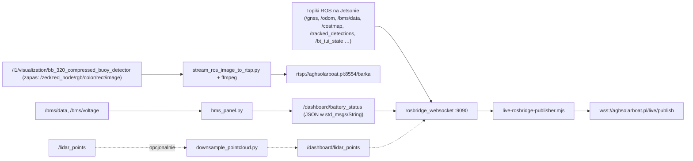

# agh-dashboard-live

> [!skrot] W 30 sekund
> - **Co to:** strona „łodzi” podglądu na żywo dla dashboardu AGH Solar Boat. To nie jest sam dashboard (frontendu tu nie ma), tylko zestaw skryptów, które na łodzi zbierają topiki ROS i wysyłają je na serwer `aghsolarboat.pl`.
> - **Wejście → wyjście:** topiki ROS → `rosbridge_server` (`ws://127.0.0.1:9090`) → `live-rosbridge-publisher.mjs` → WebSocket `wss://aghsolarboat.pl/live/publish`; obraz z kamery → `stream_ros_image_to_rtsp.py` → ffmpeg → `rtsp://aghsolarboat.pl:8554/barka`. Nie używa MQTT ani [[dongle-service]] bezpośrednio; łącze 5G z modemu daje tylko internet.
> - **Gdzie w łodzi:** Jetson („`start_jetson_live.sh`”); dwie łodzie: `BOAT_ID=barka` (domyślnie) albo `celka`.

## Struktura katalogów
```
~/solar/agh-dashboard-live/          (brak .git, brak README)
├── node_modules/                    212 kB — tylko pakiet ws 8.21.0 (+ .package-lock.json)
└── scripts/
    ├── package.json                 "agh-dashboard-live-publisher", type: module, zależność ws ^8.18.0
    ├── start_jetson_live.sh         start całego stosu podglądu
    ├── live-rosbridge-publisher.mjs most rosbridge → przekaźnik WebSocket (Node.js)
    ├── stream_ros_image_to_rtsp.py  węzeł ROS: obraz → ffmpeg → RTSP
    ├── downsample_pointcloud.py     węzeł ROS: przerzedzanie PointCloud2
    ├── bms_panel.py                 węzeł ROS: JSON stanu baterii (klasa BatteryStatusPublisher)
    └── __pycache__/                 pyc dla downsample i rtsp (CPython 3.13)
```
Ta sama zawartość leży w `~/ros2-humble-gpu/ws/src/agh-dashboard-live` (data 9.08.2026).

## Pakiety ROS
Brak `package.xml` — to luźne skrypty Pythona (`rclpy`) i Node.js. Korzystają z typów z [[ros-sbt-interfaces]] (`l0_interfaces/msg/BmsData`, `BmsVoltages`, `l2_interfaces/msg/TrackedDetectionsVector`, `l1_interfaces/msg/VectorOfDetections`) i ze sterownika Xsens (`xsens_mti_ros2_driver/msg/XsStatusWord`).

## Jak to się łączy

Powiązane warstwy: [[l0hwd]] (BMS, `/robot/state`), [[l1od]] (wizualizacja detekcji, kamera), [[l2dp]] (`/odom`, `/costmap`, `/tracked_detections`, `/start_pose`, `/scan`), [[l3nav]] (`/bt_tui_state`).

## Budowanie i uruchamianie
```bash
# na Jetsonie, z ROS-em Humble i rosbridge_server
cd ~/…/agh-dashboard-live
BOAT_ID=barka BOAT_WORKSPACE_SETUP=<ws>/install/setup.bash ./scripts/start_jetson_live.sh
```
Co robi `start_jetson_live.sh` po kolei:
1. `source /opt/ros/${ROS_DISTRO:-humble}/setup.bash` i opcjonalnie `$BOAT_WORKSPACE_SETUP` (potrzebny do typów `l0_interfaces` itd.).
2. Ustawia domyślne `TOPIC_*`/`TYPE_*` dla `BOAT_ID` (`barka` albo `celka`, inaczej `exit 2`) — każdy można nadpisać zmienną środowiskową; pusty topik = nieprzekazywany.
3. Jeśli port 9090 wolny: `ros2 launch rosbridge_server rosbridge_websocket_launch.xml`.
4. Jeśli `ENABLE_BATTERY_STATUS_PUBLISHER=1` (domyślnie dla barki): `python3 scripts/battery_status_publisher.py --mock` (domyślnie `BATTERY_STATUS_MOCK=1`, `--capacity-wh 1200`) albo wersja z prawdziwym BMS.
5. Jeśli ustawione oba `TOPIC_POINT_CLOUD_RAW` i `TOPIC_POINT_CLOUD`: `downsample_pointcloud.py` (domyślnie wyłączone).
6. `stream_ros_image_to_rtsp.py --topic $IMAGE_TOPIC --fallback-topic $FALLBACK_IMAGE_TOPIC --primary-timeout 1.5 --rtsp $RTSP_URL --width 640 --height 360 --fps 10 --bitrate 500k`.
7. `npm run live:rosbridge` (= `node scripts/live-rosbridge-publisher.mjs`).
8. `trap cleanup` — przy Ctrl+C zabija procesy, `rosbridge_websocket`, `ffmpeg` itd.

Zależności systemowe (z kodu): `ros-humble-rosbridge-server`, `ffmpeg` z `libx264`, Node.js + `npm`, Python `rclpy`, `numpy`/`cv_bridge` (**niepewne** — nie sprawdzono importów poza `rclpy`/`sensor_msgs`).

## Konfiguracja
Najważniejsze domyślne wartości (`start_jetson_live.sh`, barka):

| Zmienna | Barka | Celka |
|---|---|---|
| `IMAGE_TOPIC` | `/l1/visualization/bb_320_compressed_buoy_detector` | to samo |
| `TOPIC_GPS` | `/gnss` (`sensor_msgs/msg/NavSatFix`) | `/sbg/gps_pos` (`sbg_driver/msg/SbgGpsPos`) |
| `TOPIC_ODOM` | `/odom` | `/odom` |
| Xsens | `/filter/positionlla`, `/filter/euler`, `/filter/velocity`, `/status` | — |
| BMS | `/bms/data` (`l0_interfaces/msg/BmsData`), `/bms/voltage` | `/celka/bms/data`, `/celka/battery_pack_temp` (`Float64MultiArray`) |
| Mapa | `/costmap`, `/boat_mark`, `/map_detections`, `/map_trajectory` | + `/path`, `/path_markers` |
| Detekcje | `/tracked_detections` (`l2_interfaces/msg/TrackedDetectionsVector`) | `/tracked_detections` (`l1_interfaces/msg/VectorOfDetections`) |
| Stan | `/robot/state` (`String`) | `/celka/state_id` (`Int8`) |
| `TOPIC_SCAN` | `/scan` | — |
| wspólne | `/bt_tui_state` (typ wykrywany `ros2 topic type`), `/start_pose` (`geometry_msgs/msg/Point`: x = szerokość, y = długość geogr.) | |
| Sieć | `ROSBRIDGE_URL=ws://127.0.0.1:9090`, `LIVE_PUBLISH_URL=wss://aghsolarboat.pl/live/publish`, `RTSP_URL=rtsp://aghsolarboat.pl:8554/barka` (celka: `/camera`) | |

`live-rosbridge-publisher.mjs`: łączy się z rosbridge i przekaźnikiem, wysyła `{"type":"hello","role":"publisher","source":"rosbridge","boat":…}`, a dopiero gdy oba połączenia są otwarte, robi `subscribe` każdego topiku z `throttle_rate` (np. `odom` 100 ms, `costmap` 1000 ms, `detections` 100 ms) i `queue_length: 1`. Każdą wiadomość przekazuje jako `{boat, topic, type, msg}`. Ponawia połączenie co 3 s; topiki bez typu (np. `/bt_tui_state`) subskrybuje ponownie co 5 s, dopóki nie przyjdą dane. Uwierzytelniania w kodzie nie ma.

## Branche
Brak — kopia bez `.git`. **Niepewne:** z którego repozytorium/gałęzi pochodzi (w `~/solar` nie ma jego remote’u).

## Kopie lokalne
| Ścieżka | Stan |
|---|---|
| `~/solar/agh-dashboard-live` | bez `.git`, pliki z 1.10.2026 |
| `~/ros2-humble-gpu/ws/src/agh-dashboard-live` | bez `.git`, katalog z 9.08.2026 |

## Znane problemy / TODO
- **Brak `battery_status_publisher.py`.** Skrypt startowy go szuka (`scripts/battery_status_publisher.py`), a w katalogu jest `bms_panel.py` z dokładnie tą klasą (`BatteryStatusPublisher`, węzeł `battery_status_publisher`) i tymi samymi argumentami. W tej kopii skrypt wypisze `WARNING … not found` i `/dashboard/battery_status` nie będzie publikowany. **Niepewne:** czy plik zmieniono nazwę celowo.
- **`package.json` jest w `scripts/`, a `npm run live:rosbridge` jest wołane z katalogu projektu** (`cd "$PROJECT_ROOT"`), gdzie `package.json` nie ma. Do tego skrypt npm wskazuje `scripts/live-rosbridge-publisher.mjs` względem katalogu z `package.json`. W tej kopii krok 7 najpewniej się nie powiedzie; obejście: `node scripts/live-rosbridge-publisher.mjs` z katalogu głównego (tam też jest `node_modules/ws`). **Niepewne:** w oryginale `package.json` był pewnie w katalogu głównym.
- `IMAGE_TOPIC` ma w nazwie „compressed”, a węzeł subskrybuje `sensor_msgs/msg/Image` (`stream_ros_image_to_rtsp.py:38-43`) — przy `CompressedImage` subskrypcja nie zadziała.
- Komentarz w skrypcie mówi, że dla barki domyślnie startuje **mock** baterii („For testing”) — prawdziwy BMS wymaga `BATTERY_STATUS_MOCK=0`.
- `docs/architektura.html` §10 opisuje to jako „most rosbridge, panel BMS, downsampling chmury, strumień RTSP” — zgodne z kodem.

## Źródła
- `~/solar/agh-dashboard-live/scripts/start_jetson_live.sh`
- `~/solar/agh-dashboard-live/scripts/live-rosbridge-publisher.mjs`
- `~/solar/agh-dashboard-live/scripts/{stream_ros_image_to_rtsp.py,downsample_pointcloud.py,bms_panel.py,package.json}`
- `~/solar/agh-dashboard-live/node_modules/.package-lock.json`

## Moje notatki
> [!ja] Tu piszesz ty — Albert tej sekcji nie rusza.
