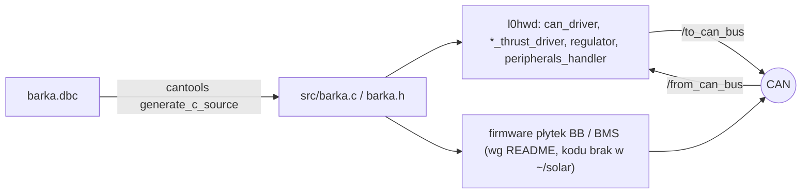

# can-msgs

> [!skrot] W 30 sekund
> - **Co to:** „CAN Messages Barka” (`can-msgs/README.md`), czyli jedno źródło prawdy o ramkach CAN łodzi autonomicznej: plik `barka.dbc` i kod C (`src/barka.c`, `src/barka.h`) wygenerowany z niego przez `cantools`.
> - **Wejście → wyjście:** edytujesz `barka.dbc` → `generate.sh`/`generate.py` → `src/barka.{c,h}` z funkcjami `barka_<ramka>_pack/unpack/encode/decode` i stałymi `BARKA_<RAMKA>_FRAME_ID`. Kod trafia do węzłów [[l0hwd]] (Jetson) i według README do firmware płytek (przykład „control-board-2/Libs/can-messages”).
> - **Gdzie w łodzi:** wspólna biblioteka po obu stronach magistrali. W `~/solar` istnieje tylko jako submoduł `l0hwd/can-msgs` (osobnego klonu nie ma).

## Struktura katalogów
```
l0hwd/can-msgs/
├── barka.dbc                         definicja ramek (402 linie), węzły BU_: BARKA SBG BB HL BMS_MASTER BMS_SLAVE_LEFT BMS_SLAVE_RIGHT XSENS
├── src/barka.c, src/barka.h          kod wygenerowany przez cantools (--use-float), ~6.3k + 9.3k linii
├── generate.sh                       rm src; cantools generate_c_source barka.dbc -o src --use-float; opcjonalnie gcc test
├── generate.py                       to samo w Pythonie + barka_enum_generator.py
├── barka_enum_generator.py           generuje src/barka_dbc_enumeration.h z linii VAL_ (Damian Brzana 2024)
├── SBG_BARKA_CONFIG.bin              konfiguracja INS SBG (1756 B, binarna)
├── SBG_BARKA_CONFIG_higher_freq_of_messages.bin   wariant z wyższą częstotliwością (1756 B)
└── README.md
```

## Pakiety ROS
Brak. To nie jest pakiet ROS. Z ROS korzysta się przez `#include "../../can-msgs/src/barka.h"` i kompilację `../can-msgs/src/barka.c` w pakietach [[can_driver]], [[new_diff_thrust_driver]], [[diff_thrust_driver]], [[regulator]], [[peripherals_handler]], [[can_sequence]].

## Jak to się łączy



Tabela ramek, nadawcy i mapowanie na ROS: [[Magistrala CAN]].

## Budowanie i uruchamianie
Z `README.md` → „Workflow”:
1. Załóż gałąź, najlepiej z issue.
2. Zmień DBC.
3. Uruchom `generate.sh` (`start generate.sh` albo dwuklik).
4. Commit i push.
5. Test w projekcie firmware: `control-board-2/Libs/can-messages`, `git checkout <twoja-gałąź>`.
6. Merge request.

Wymagania: `python`, pakiet `cantools`, `git`. `generate.sh` w aktualnej wersji nie wywołuje `barka_enum_generator.py` (linia zakomentowana), a `generate.py` wywołuje.

## Konfiguracja
- Zakresy ID (README, „CAN structure”):
  - `0x00–0x0f` — najważniejsze: nastawy, bezpieczeństwo, sterowanie;
  - `0x10–0x1f` — SBG IMU;
  - `0x20–0x34` — XSENS IMU;
  - `0x35–0x3f` — wolne;
  - `0x40–0x48` — pomiary (temperatury, prądy, napięcia);
  - `0x49–0xef` — rezerwa;
  - `0xf0–0xff` — przestarzałe.
- RC: aparatura Radiomaster TX16S z TBS Crossfire Micro TX i odbiornik TBS Crossfire Nano RX, protokół CRSF. Według README pokrywa „~~16~~ 12, 11-bit channels”, a przełączniki idą tymi samymi kanałami co drążki. Telemetria odsyła do nadajnika trzy napięcia baterii. W DBC kanały mają zakres 0–2047.
- README ostrzega: „`SBG_BARKA_CONFIG.bin` is not configured properly yet, The distances between COM, IMU, antennas are not set yet”.
- Maintainer: @DamianTadziu.

## Branche
`.git/modules/can-msgs` nie ma `FETCH_HEAD`, więc data ostatniego fetch jest nieznana. HEAD jest **odłączony na `27a40a6`**, czyli commicie przypiętym w [[l0hwd]]. Lokalnie dodatkowo istnieje gałąź `main` @ `021049a`.

| gałąź | ostatni commit | przed/za main | zmergowana | uwagi |
|---|---|---|---|---|
| `origin/main` | `021049a` 2025-03-02 Damian Brzana „added can message for calculated yaw heading” | 0/0 | — | główna |
| `origin/njord_2025` | `27a40a6` 2025-08-07 Michał Zawada „fixed state od charge values” | +1/0 | nie | **przypięta w l0hwd/master** (stan zawodów Njord 2025) |
| `origin/BMS_V3.0` | `5937bfa` 2026-07-15 gyzmaul „forgor to generate source files” | +2/0 | nie | najnowsza, BMS na 4 baterie |
| `origin/sbg-info` | `575dda5` 2025-06-02 filnaw „add sbg info” | +1/0 | nie | przypięta w `l0hwd/sbg-info` |
| `origin/Njord` | `bacc89b` 2024-08-20 Michal „zmiana jakichś … nazw z repo, na te śmigające na BMSie” | +2/−30 | nie | martwa (2024) |
| `origin/master` | `de0495d` 2024-01-21 treborsky „updated naming so there are no conflicts” | +1/−33 | nie | martwa (początki repo) |

### njord_2025 (przypięta)
Zmienia tylko skalę `SOC` w `BMS_*_DATA` (0x41/0x43/0x45) z `0.001` na `0.01` % (`barka.dbc:304,317,330`) i regeneruje `src/`.

### BMS_V3.0
Commity `fb3ee5c` „adjusted CAN frames for 4 batteries” i `5937bfa`:
- zmiana nazw `BMS_CENTRAL_*` / `BMS_SLAVE_LEFT_*` / `BMS_SLAVE_RIGHT_*` (0x40–0x45) na `BMS_LEFT_1_*`, `BMS_LEFT_2_*`, `BMS_RIGHT_1_*`;
- nowe `BMS_RIGHT_2_CELL_VOLTAGES` (0x46) i `BMS_RIGHT_2_DATA` (0x47);
- **przesunięcie ID**: `BB_CURRENT_MEAS` 0x46→0x48, `BB_GPIO_STATUS` 0x47→0x49, `BB_PWM_OUT` 0x48→0x4A;
- SOC zostaje ze skalą `0.001`.

Niekompatybilna z obecnym [[can_driver]], który używa nazw `BMS_CENTRAL_*`. Opiera się na `main`, nie na `njord_2025`.

### sbg-info
- Dodaje `GPS1_VEL_INFO` (0x4A, „74”), `GPS1_VEL_ACC` (ID **17**, kolizja z `IMU_ACCEL`, który przeniesiono na 0x4B = 75), `GPS1_POS_INFO` (0x4D) i `GPS1_POS_ACC` (0x4F).
- Kolidowałaby z `BMS_V3.0` (0x4A).

### Njord, master
Stare gałęzie z 2024 z innym nazewnictwem (np. „fixed a bunch of namings - backwards incompatible”).

## Kopie lokalne
- `~/solar/l0hwd/can-msgs`: submoduł, odłączony HEAD `27a40a6`. Niezacommitowane są tylko zmiany trybu (755→644) `generate.py` i `generate.sh`. To jedyna kopia.

## Znane problemy / TODO
- Komentarze `CM_` w DBC są przesunięte względem ramek: `CM_ BO_ 0 "Remote kill switch status"`, a ramka 0 to `BMS_STATUS`; `CM_ BO_ 3 "Fault event indication"`, a ramka 3 to `VESSEL_OP_MODE` (`barka.dbc:355-365`).
- `BU_` definiuje `BMS_MASTER`, ale ramki 0x40/0x41 mają nadawcę `BMS_CENTRAL` (`barka.dbc:35, 293`).
- `MOTOR_SPEED_SP_HL` ma w DBC 4 bajty, a węzły L0 wysyłają `dlc = 8` (patrz [[Magistrala CAN]]).
- Sygnał `CANNON_CTRL.DIRECTION` ma jednostkę `"barka_pump_set_t"` (`barka.dbc:80`), prawdopodobnie przez kopiuj-wklej.
- README: „SBG_BARKA_CONFIG.bin is not configured properly yet” (cytat wyżej).

## Źródła
`l0hwd/can-msgs/README.md`, `barka.dbc`, `generate.sh`, `generate.py`, `barka_enum_generator.py`, `git log`/`git diff` gałęzi w submodule.

## Moje notatki
> [!ja] Tu piszesz ty — Albert tej sekcji nie rusza.
