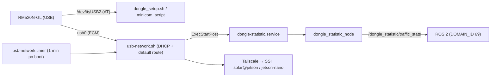

# dongle-service

> [!skrot] W 30 sekund
> - **Co to:** skrypty i usługi systemd do modemu **5G Quectel RM520N-GL na USB** (dongle; w repo jest PDF z dokumentacją). Modem daje łodzi łącze z internetem, a przez Tailscale zdalny SSH do Jetsonów. Na gałęzi `Dongle-Statistic` dochodzi węzeł ROS 2 z licznikami transferu.
> - **Wejście → wyjście:** komendy AT po `/dev/ttyUSB2` (tryb `usbnet`, APN, restart) → interfejs `usbX` (ECM) → DHCP (`dhclient`/`udhcpc`) i trasa domyślna. `vnstat` → węzeł `dongle_statistic_node` → topik `dongle_statistic/traffic_stats`.
> - **Gdzie w łodzi:** na Jetsonie (użytkownik `solar`, ścieżki `/home/solar/dongle-service` w `dongle-statistic.service`). `dongle-cli.sh` z gałęzi QoL opisuje to jako „the RM520N-GL 5G USB dongle used on the AGH Solar Boat autonomous boat (Njord 2026)”.

## Struktura katalogów
Stan wymeldowanej gałęzi `Dongle-Statistic` razem z nieśledzonymi plikami:
```
dongle-service/
├── README.md                          instrukcja: minicom/AT, Tailscale, usb-network, ROS2 node
├── RM520N-GL 5G USB Dongle Documentation.pdf
├── dongle_setup.sh                    czeka na /dev/ttyUSB2 i odpala minicom ze skryptem
├── minicom_script                     AT, AT+QCFG="usbnet",1, AT+CGDCONT=1,"IPV4V6","internetipv6", AT+CFUN=1,1
├── usb-network.sh                     szuka /sys/class/net/usb*, ip link up, dhclient/udhcpc (10 s), route add default
├── usb-network.service / .timer       oneshot 1 min po starcie; ExecStartPost uruchamia dongle-statistic.service
├── dongle-statistic.service           systemd: ros2 launch dongle_statistic … (User=solar)
├── dongle_statistic/                  pakiet ROS 2 → [[dongle_statistic]]
└── (nieśledzone, = gałąź QoL) dongle-cli.sh, dongle-doctor.sh, usb-network-watchdog.{sh,service,timer}, 99-usb-network-hotplug.rules
```

## Pakiety ROS
- [[dongle_statistic]] — `dongle_statistic_node`: co 5 s (0.2 Hz) publikuje statystyki `vnstat` dla interfejsu i liczbę sesji SSH.

## Jak to się łączy



## Budowanie i uruchamianie
Z `README.md`:
```bash
sudo minicom -D /dev/ttyUSB2   # po +CPIN: READY, +QIND: SMS DONE:
#   AT+QCFG="usbnet",1 ; AT+CGDCONT=1,"IPV4V6","<apn>" ; AT+CFUN=1,1
./dongle_setup.sh               # automatycznie („Use only in extreme situations”)
sudo mv usb-network.sh /usr/local/bin/ && sudo chmod +x /usr/local/bin/usb-network.sh
sudo mv usb-network.service usb-network.timer /etc/systemd/system/
sudo systemctl daemon-reload && sudo systemctl enable --now usb-network.timer
colcon build && source install/setup.bash
ros2 launch dongle_statistic dongle_statistic_launch.py interface:=usb0 publish_rate:=0.5
sudo mv dongle-statistic.service /etc/systemd/system/ && sudo systemctl enable --now dongle-statistic.service
```
Tailscale: `sudo tailscale up --ssh --auth-key=‹ukryte›`. Hosty `solar@jetson` (Jetson Orin, `100.97.3.45`) i `solar@jetson-nano` (`100.77.51.123`), adresy tailnetu z README.

## Konfiguracja
- **`dongle-statistic.service`:**
  - w commicie: `ROS_DOMAIN_ID=0`;
  - w drzewie roboczym (niezacommitowane): `ROS_DOMAIN_ID=69`, `ROS_LOCALHOST_ONLY=0`, `RMW_IMPLEMENTATION=rmw_cyclonedds_cpp`, `CYCLONEDDS_URI=file:///home/solar/cyclonedds_lo.xml`;
  - `ExecStart` sourcuje `/opt/ros/humble` i `/home/solar/dongle-service/dongle_statistic/install/setup.bash`;
  - `Restart=on-failure`, `RestartSec=10`.
- Usługa nie przekazuje `interface:=usb0`, więc węzeł monitoruje domyślne **`wlan0`** (`dongle_statistic_launch.py`).
- APN w `minicom_script:71`: `internetipv6` (README: zmienić pod kartę SIM).
- QoL (`usb-network-watchdog.sh`): ping `1.1.1.1`/`8.8.8.8`, przy braku łączności `systemctl restart usb-network.service`. Timer: 3 min po starcie, potem co 2 min. Reguła udev `ACTION=="add", SUBSYSTEM=="net", KERNEL=="usb*"` → `SYSTEMD_WANTS=usb-network.service`.

## Branche
`.git/FETCH_HEAD` mtime 2026-10-01 17:58 (prawdopodobnie czas kopiowania, **niepewne**). Wymeldowana: **`Dongle-Statistic` @ `67505b4`**. Drzewo robocze ma 8 zmian: 2 zmodyfikowane (`dongle-statistic.service`, tryb `usb-network.sh`) i 6 nieśledzonych, identycznych z plikami gałęzi QoL.

| gałąź | ostatni commit | przed/za main | zmergowana | status |
|---|---|---|---|---|
| `main` (lok.+origin) | `cbfd591` 2025-09-25 Przemysław Domagała „Merge branch 'New_IP_for_Jetson'” | 0/0 | — | główna, tylko skrypty |
| `Dongle-Statistic` (lok.+origin) | `67505b4` 2025-10-21 „Your Name” „ROS2 Node for dongle statistic” | +2/0 | nie | **wymeldowana**, węzeł ROS 2 |
| `QoL/fixes_hotplug_watchdog_doctor` (lok.+origin) | `f261e26` 2026-07-30 patryk_kozlowski „wizard cli + diagnostics” | +2/0 | nie | **najnowsza** (autor: Patryk) |

### Dongle-Statistic vs main
Dwa commity (WinterWollf i „Your Name”, 2025-10-21). Dodają pakiet `dongle_statistic/` (`TrafficStats.msg`, węzeł, launch), `dongle-statistic.service`, rozdział README „Dongle Statistics Collection (ROS2 Node)” i `ExecStartPost` w `usb-network.service`. Diff: 11 plików, +426.

### QoL/fixes_hotplug_watchdog_doctor vs main
Gałąź odchodzi od `main`, nie od `Dongle-Statistic`, więc nie ma w niej węzła ROS. Commity `291be7d` (2026-07-16, „QoL: fix default route, hotplug via udev, connection watchdog, dongle-doctor, APN as argument”) i `f261e26`:
- `dongle-cli.sh` (855 linii, menu i podkomendy `wizard|detect|configure|net|install|tailscale|doctor|monitor|logs`);
- `dongle-doctor.sh`, watchdog, reguła udev;
- `usb-network.sh` z wymogiem roota i `nullglob`;
- `dongle_setup.sh` wymaga APN jako argumentu;
- ostrzejsze CI: `shellcheck` bez `|| true`, test „requires an APN argument”, test unitów systemd.

Diff: 11 plików, +1223/−39. `usb-network.sh` w drzewie roboczym to wersja z `Dongle-Statistic`, a nie z QoL.

## Kopie lokalne
| ścieżka | gałąź | HEAD | zmiany |
|---|---|---|---|
| `~/solar/dongle-service` | `Dongle-Statistic` | `67505b4` | 8 (wyżej) |
| `~/solar/bash_do_uruchomienia/dongle-service` | `main` | `cbfd591` (2025-09-25) | 0; brak FETCH_HEAD; nie ma węzła ROS ani plików QoL |

## Znane problemy / TODO
- Usługa nie ustawia `interface:=usb0`, więc statystyki dotyczą `wlan0`, a nie modemu (README podaje przykład z `usb0`).
- `usb-network.sh` (wersja z `Dongle-Statistic`) woła `sudo` w środku i `route add -net 0.0.0.0` (QoL: „fix default route”).
- Węzeł bierze tylko pierwszy interfejs z JSON-a `vnstat` (`break`) i liczy sesje SSH po unikalnych IP z `who`.

## Źródła
`README.md`, `dongle_setup.sh`, `minicom_script`, `usb-network.{sh,service,timer}`, `dongle-statistic.service`, `dongle_statistic/**`, `git show QoL/fixes_hotplug_watchdog_doctor:{dongle-cli.sh,.gitlab-ci.yml}`, `usb-network-watchdog.*`, `99-usb-network-hotplug.rules`.

## Moje notatki
> [!ja] Tu piszesz ty — Albert tej sekcji nie rusza.
