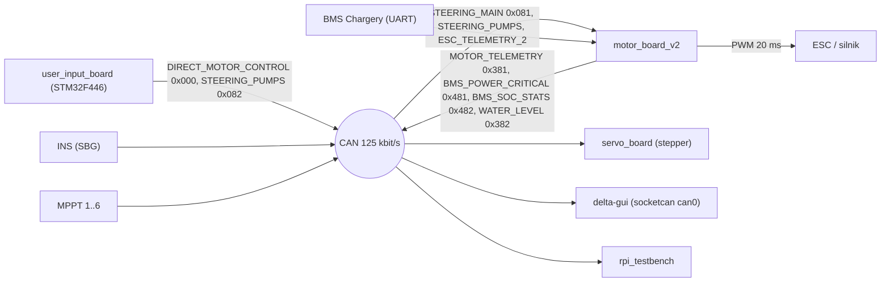

# embedded-system

> [!skrot] W 30 sekund
> - **Co to:** firmware i narzędzia dla **innej łodzi koła**, solarnego hydroskrzydłowca „Delta”/„Celka”. README: „Delta hydrofoil solar boat embedded system source code repository … ecosystem for the "Celka" solar hydrofoil boat”. Z łodzią autonomiczną (barka, [[l0hwd]], [[can-msgs]]) **nie dzieli** ani DBC, ani kodu.
> - **Wejście → wyjście:** płytki STM32 na Zephyr RTOS rozmawiają po własnej magistrali CAN (`communication/delta.dbc`, 125 kbit/s). Joystick i pokrętło z `user_input_board` → `DIRECT_MOTOR_CONTROL` → `motor_board_v2` → PWM do ESC. Telemetria (BMS, ESC, MPPT, INS) wraca na CAN, gdzie czyta ją `delta-gui` (FastAPI + python-can).
> - **Gdzie w łodzi:** MCU **STM32F446** (`socs: stm32f446xx` w `boards/solarboat/*/board.yml`), toolchain **Zephyr v4.2.0 + west** (`west.yml`), symulacja `native_sim`, testbench na Raspberry Pi.

## Struktura katalogów
```
embedded-system/
├── boards/solarboat/          własne płytki Zephyr: base_board, user_input_board (STM32F446, can1 PA11/PA12, 125 kbit/s)
├── zephyr/module.yml          moduł Zephyr: board_root=., dts_root=. (to nie jest kod RTOS)
├── west.yml                   manifest: zephyr v4.2.0 → zephyr-rtos/, moduły cmsis, cmsis_6, hal_stm32, lvgl
├── communication/             delta.dbc + wygenerowane delta.c/h, delta_sim_shm.h, generate_can_report.py, check_diff.sh
├── motor_board_v2/            firmware płytki silnika: PWM ESC, pompy, BMS po UART (Chargery BMS16T), temperatury, czujniki wody, testy
├── servo_board/               serwa/stepper hydroskrzydeł, pompa zęzowa, ADC
├── user_input_board/          pulpit sternika: joystick, pokrętło, przyciski, LED bar, buzzer, wyświetlacz LVGL, CAN TX
├── can_test_board/            prosty test CAN (nucleo_f446re / base_board overlay)
├── validate_display/          test wyświetlacza UC1698U (nucleo_l476rg)
├── radar_master/              pusty (.gitkeep)
├── modules/uc1698u/           sterownik wyświetlacza UC1698U
├── dts/bindings/led-bar.yaml  binding DTS
├── delta-sim/                 symulator fizyki C++ (HIL/SIL przez pamięć współdzieloną z native_sim)
├── rpi_testbench/             Python: testy pętli/sekwencji po CAN (Robert Koziarski)
├── delta-gui/                 FastAPI „Delta CAN Hub Server” + web UI (python-can, cantools, websockets)
├── docker/agh_sbt_zephyr_ci.Dockerfile   obraz CI
├── external/unity/            submoduł Unity (testy jednostkowe C), @860062d
├── justfile                   zadania: build/flash/run/test/delta-sim/vcan
├── vcan0_fuzz.py              fuzzing vcan0
└── README.md, GEMINI.md, RUNNER_SETUP.md
```

## Pakiety ROS
Brak. To nie jest repo ROS.

## Jak to się łączy



## Budowanie i uruchamianie
Z `README.md` (repo klonuje się do workspace Zephyra):
```bash
cd zephyrproject
git clone git@gitlab.com:agh-solar-boat/delta/embedded-system.git
cd embedded-system
west config manifest.path embedded-system
west update
cd motor_board_v2
west build -p -b motor_board .
west flash -d build/
sudo minicom -b 115200 -D /dev/ttyACM0
```
W README jest `-b motor_board`, ale w `boards/solarboat` istnieją tylko `base_board` i `user_input_board`. `justfile` używa `hw_default := "base_board"`.

`justfile`:
- `just setup-vcan` → `vcan0`;
- `just build [hw] [board]` → `west build -b {{hw}} {{board}} -d build/{{hw}}/{{board}}`;
- `just flash`;
- `just run` → `native_sim`;
- `just test [board] [name]` → `rpi_testbench/rpitb_main.py -d communication/delta.dbc -t {{board}}/test/{{name}}.yaml`;
- `just run-delta-sim` (`-DCONFIG_SIM_HARNESS=y`, SHM `/delta_sim_motor_board_v2_shm`).

## Konfiguracja
- `boards/solarboat/base_board/base_board.dts`:
  - SoC `stm32f446Xe`, HSE 8 MHz, PLL do 144 MHz (`:69`, `:85`);
  - `zephyr,canbus = &can1`, piny `can1_rx_pa11`/`can1_tx_pa12`, `bus-speed = <125000>` (`:42-46`).
- `motor_board_v2/prj.conf`: `CONFIG_CAN`, `PWM`, `ADC(_ASYNC)`, `GPIO`, `SERIAL`, `LOG`, `POLL`.
- **Wątki motor_board_v2:**
  - `MotorControlThread`: PWM o okresie 20 ms, bieg jałowy 1200 µs, timeout nastawy 100 ms, pętla co 40 ms (`src/thread_motor_control.c`);
  - `PumpControlThread`, `TemperatureReadThread`, `WaterLevelSensorsThread`;
  - wątek BMS UART (protokół Chargery BMS16T: nagłówek `0x24`, komendy `0x56`/`0x57`, `inc/bms16t_uart_proto.h`);
  - wysyłka CAN (`src/thread_can_send.c`).
- Filtry RX w `main.c`: `STEERING_MAIN`, `STEERING_PUMPS`, `ESC_TELEMETRY_2`.
- **`communication/delta.dbc`:**
  - węzły `USER_INPUT_BOARD MOTOR_BOARD ESC HEIGHT_SENSOR BMS LEFT_SERVO RIGHT_SERVO BACK_SERVO INS RPI_TB MPPT_1..6`;
  - ramki m.in. `DIRECT_MOTOR_CONTROL` (0), `ESC_TELEMETRY_1..7` (1–7), `STEERING_MAIN` (129), `STEERING_PUMPS` (130), `HEIGHT_DATA` (767), `BMS_POWER_CRITICAL` (1153), `BMS_SOC_STATS` (1154), `*_SERVO_STATUS` (385/513/641), `MOTOR_TELEMETRY` (897), `WATER_LEVEL_SENSORS` (898), ramki INS `GPS1_*`/`EKF_*`/`IMU_*` (257–273), `MPPT_n_STATUS/POWER` (0x501…0x782);
  - `communication/delta.dbc` i `delta-gui/delta.dbc` są identyczne.
- `delta-gui/app/config.py`: `CAN_INTERFACE` (domyślnie `socketcan`), `CAN_CHANNEL` (domyślnie `can0`), `BASE_URL` (domyślnie `http://localhost:8000`), opcjonalny SMTP (dane ‹ukryte› w zmiennych środowiskowych).
- `GEMINI.md`: konwencje projektu („Communication as Source of Truth… Never manually hardcode CAN IDs”, „justfile is the primary entry point”).

## Branche
Brak `.git/FETCH_HEAD`, więc data ostatniego fetch jest nieznana. Wymeldowana: **`main` @ `d34894f`** (2026-06-10, treborsky, „rm CI for now...”). Historia ma 410 commitów od 2025-06-10.

| gałąź | ostatni commit | przed/za main | zmergowana | status |
|---|---|---|---|---|
| `main` | `d34894f` 2026-06-10 treborsky „rm CI for now...” | 0/0 | — | główna |
| `origin/user-input-board` | `5cf5325` 2026-07-08 Kacper Ślusarczyk „add project for testing the encoder in isolation” | +14/−3 | nie | **najnowsza, aktywna** |

### user-input-board
Commity z 2026-06-18…07-08 (thorns_ripping, Kacper Ślusarczyk):
- sterowanie przednimi hydroskrzydłami po CAN („add front hydrofoils steering over CAN”, „add proper hydrofoil homing request can frame”);
- enkoder;
- poprawki filtra średniej ruchomej i histerezy;
- „fix display always black”, „fix can tx framerate too slow”;
- nowy projekt `validate_encoder/` (nucleo_l476rg).

Zmienia `communication/delta.dbc` (+12/−…) i regeneruje `delta.c/h`, plus `user_input_board/src/*`. Diff: 24 pliki, +3468/−246.

### main — ostatnie zmiany
2026-06-07…10 (treborsky):
- sieć i backend/frontend dla `delta-web` („works end to end … networking mostly vibe coded”);
- „will be moved to a different repo (telemetry)”: katalogu `delta-web/`, o którym wspomina README, w drzewie już nie ma;
- usunięcie pipeline'ów CI.

## Kopie lokalne
- `~/solar/embedded-system`: `main` @ `d34894f`. Drzewo robocze ma **25 zmian**, wszystkie w `delta-gui/`:
  - 6 zmodyfikowanych: `app/can_manager.py`, `app/main.py`, `run.py`, `static/css/style.css`, `static/index.html`, `static/js/app.js`;
  - 19 nieśledzonych: m.in. `app/auth.py`, `db.py`, `recorder.py`, `routes_*.py`, `Dockerfile`, `WHAT_I_DID.md`, `static/dashboard.html`, `login.html`, `tools/sim.py`. To rozbudowa GUI o logowanie, nagrywanie i dashboard.
- Dodatkowo nieśledzony venv `delta-gui/.venv` (34 MB) i `delta-gui/data` (108 KB).
- Brak kopii w `bash_do_uruchomienia`.

## Znane problemy / TODO
- `servo_board/src/task_can_rx.c:53-55` używa `DELTA_LEFT_FOIL_CONTROL_DATA_FRAME_ID` / `RIGHT_…`. W `communication/delta.h` na `main` jest tylko jedno wystąpienie „FOIL”, a w `delta.dbc` brak takich ramek, więc `servo_board` prawdopodobnie się nie zbuduje na `main` (**niepewne**).
- `motor_board_v2/src/thread_motor_control.c`: „TODO(hardware): replace startup PWM with SAFE_STOP_USEC after bench tests…”.
- `user_input_board/TODO.md`: plik z listą zadań (nie cytowany).
- README wymienia `delta-web/`, którego nie ma, i board `motor_board`, którego nie ma.

## Źródła
`README.md`, `west.yml`, `justfile`, `GEMINI.md`, `zephyr/module.yml`, `boards/solarboat/*/board.yml`, `base_board.dts`, `communication/delta.dbc`, `motor_board_v2/src/main.c`, `thread_motor_control.c`, `thread_can_send.c`, `delta-sim/README.md`, `delta-gui/app/config.py`, `delta-gui/requirements.txt`.

## Moje notatki
> [!ja] Tu piszesz ty — Albert tej sekcji nie rusza.
