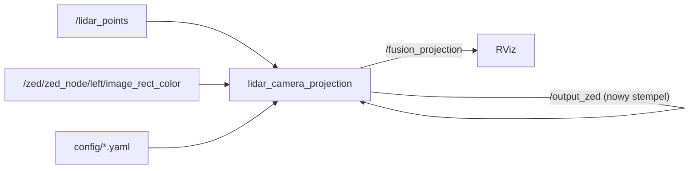

# fusion_camera_lidar

> [!skrot] W 30 sekund
> - **Co to:** kopia otwartego pakietu `ros2_camera_lidar_fusion` (Clemente Donoso, CDonosoK/ros2_camera_lidar_fusion, licencja MIT — `README.md`, `LICENSE`) dostosowana w styczniu 2025 do łodzi: narzędzia do kalibracji intrinsics kamery i extrinsics lidar→kamera oraz rzut chmury na obraz.
> - **Wejście → wyjście:** `/lidar_points` + `/zed/zed_node/left/image_rect_color` → przestemplowane `/output_lidar_points`, `/output_zed` → `/fusion_projection` (obraz z naniesionymi punktami); pliki kalibracji YAML.
> - **Gdzie w łodzi:** narzędzie offline/kalibracyjne; ścieżki `/home/solar/fusion_ws/...` i commit „init” autora `JetsonOrin` wskazują, że uruchamiano je na Jetsonie Orin.

## Struktura katalogów
```
fusion_camera_lidar/
├── config/                       general_configuration.yaml, camera_extrinsic_calibration_24_01.yaml, plik korespondencji 25_01
├── data_elektryka/               4 pary .pcd + .png z 2025-01-24 19:22 i pliki korespondencji punktów
├── docker/                       Dockerfile (nvidia/cuda:11.8.0-cudnn8-devel-ubuntu22.04), build.sh, run.sh
├── ros2_camera_lidar_fusion/     węzły Python (kalibracja, zapis danych, wybór punktów, projekcja)
├── assets/                       GIF-y z README upstreamu
└── package.xml, setup.py         pakiet ament_python `ros2_camera_lidar_fusion`
```

## Pakiety ROS
- [[ros2_camera_lidar_fusion]] — 5 executables: `get_intrinsic_camera_calibration`, `get_extrinsic_camera_calibration`, `save_data`, `extract_points`, `lidar_camera_projection`.

## Jak to się łączy
Relacja do [[l1od]]: format plików kalibracji (`extrinsic_matrix` 4×4, `camera_matrix`, `distortion_coefficients`, szachownica 7×9) jest identyczny jak `l1od/config/camera_*_calibration.yaml`, a `l1od/fusion_visualization` to niemal ten sam kod co `lidar_camera_projection.py` (ta sama funkcja `load_extrinsic_matrix`, `ApproximateTimeSynchronizer(queue_size=5, slop=0.07)`, mapa `coolwarm_r`). Macierze się jednak różnią (`camera_extrinsic_calibration_24_01.yaml` tu vs plik „8 luty” w l1od). Aktualna fuzja ([[detection_pointcloud_fusion]]) nie używa żadnej z tych kalibracji.



## Budowanie i uruchamianie
`README.md`: `cd docker && sh build.sh` (obraz `ros2_camera_lidar_fusion`), `sh run.sh` (kontener z X11, `--net host --privileged`, montuje repo do `/ros2_ws/src/ros2_camera_lidar_fusion`), potem `ros2 run ros2_camera_lidar_fusion <node>`. Kolejność: intrinsics → `save_data` → `extract_points` → extrinsics → `lidar_camera_projection`.

## Konfiguracja
`config/general_configuration.yaml`: `lidar.lidar_topic /output_lidar_points`, `frame_id hesai_lidar`; `camera.image_topic /output_zed`, `projected_topic /fusion_projection`, `image_size 640×640`, `frame_id zed_left_camera_optical_frame`; szachownica 7×9, bok 0,025 m; `general.config_folder/data_folder` = `/home/solar/fusion_ws/src/ros2_camera_lidar_fusion/{config,data}`, `slop 0.1`, `max_file_saved 20`.

## Branche
Tylko `main` (= `origin/main`, `9c91863` 2025-01-25 Szymon Nowak „Merge branch 'branch' into 'main'”). 4 commity (2025-01-25): „Initial commit”, „init” (JetsonOrin), dwa merge. Brak innych gałęzi zdalnych.

## Kopie lokalne
| Ścieżka | Gałąź | HEAD | Niezacommitowane | Ostatni fetch |
|---|---|---|---|---|
| `~/solar/bash_do_uruchomienia/fusion_camera_lidar` | `main` | `9c91863` | brak | brak `.git/FETCH_HEAD` |

## Znane problemy / TODO
- Topiki obrazu `/zed/zed_node/left/image_rect_color` (`lidar_camera_projection.py:117`, `save_sensor_data.py:27`) to stara konwencja nazw — w wrapperze ZED v5.1.0 zmieniono je na `~/left/color/rect/image` (`zed-ros2-wrapper-humble-v5.1.0/CHANGELOG.rst`). Z obecnym wrapperem narzędzie nie dostanie obrazu bez remapu.
- Przestemplowanie (`header.stamp = now()`) w `zed_callback`/`lidar_callback` maskuje brak synchronizacji czasu sensorów.
- `.pcd` w `data_elektryka/` — rozmiar 1 536 174 B każdy (nie czytano).

## Źródła
`README.md`, `config/general_configuration.yaml`, `config/camera_extrinsic_calibration_24_01.yaml`, `ros2_camera_lidar_fusion/lidar_camera_projection.py`, `save_sensor_data.py`, `setup.py`, `docker/run.sh`, `git log`.

## Moje notatki
> [!ja] Tu piszesz ty — Albert tej sekcji nie rusza.
