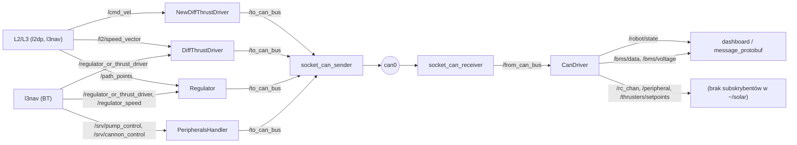

# l0hwd

> [!skrot] W 30 sekund
> - **Co to:** warstwa L0 („Layer 0 - Hardware Drivers”, `l0hwd/README.md`) — węzły ROS 2, które tłumaczą świat ROS na magistralę CAN łodzi i z powrotem, plus sterowniki peryferiów (pompa, działko, sonar) i regulator ruchu wygenerowany z Simulinka.
> - **Wejście → wyjście:** z góry `/cmd_vel`, `/l2/speed_vector`, `/path_points`, serwisy `/srv/pump_control` i `/srv/cannon_control` → ramki `can_msgs/msg/Frame` na `/to_can_bus` → `ros2_socketcan` → `can0`. Z dołu `can0` → `/from_can_bus` → `CanDriver` → `/robot/state`, `/rc_chan`, `/peripheral`, `/thrusters/setpoints`, `/bms/voltage`, `/bms/data`.
> - **Gdzie w łodzi:** na Jetsonie (ostatni commit na `master` to „jetson changes”, a launch dołącza sterownik lidaru Hesai, `l0hwd/l0_launch/launch/l0hwd_launch.py:20-27`). Po drugiej stronie CAN są płytki z węzłami `BB`, `BMS_*`, `SBG`, `XSENS` z [[can-msgs]].

## Struktura katalogów
```
l0hwd/
├── can_driver/            pakiet: CAN → ROS (dekodowanie barka.dbc), węzeł CanDriver
├── can_msgs/              pakiet: własna definicja can_msgs/msg/Frame (kopia API ros-humble-can-msgs)
├── can_sequence/          pakiet: testowa sekwencja nastaw silników prosto na CAN
├── diff_thrust_driver/    pakiet: SpeedVector → MOTOR_SPEED_SP_HL (stary sterownik, z przełącznikiem „kto steruje”)
├── new_diff_thrust_driver/pakiet: /cmd_vel (Twist) → MOTOR_SPEED_SP_HL — ten jest w launchu
├── peripherals_handler/   pakiet: serwisy pompy i działka → ramki CAN
├── regulator/             pakiet: regulator Pure Pursuit + fuzzy z Simulink Coder (code_gen_1_ert_rtw/)
├── swim_sequence/         pakiet: testowa sekwencja „pływania” na /l2/speed_vector
├── sonar/                 pakiet Python: echosonda ECT400 (NMEA po UART) + logger CSV głębokość+GNSS
├── l0_launch/             pakiet: launch/l0hwd_launch.py — start całej warstwy
├── can-msgs/              SUBMODUŁ: definicje ramek CAN (barka.dbc + wygenerowane barka.c/h) → [[can-msgs]]
├── ros2_socketcan/        SUBMODUŁ: most SocketCAN ↔ ROS 2 (Autoware) → [[ros2_socketcan]]
├── echosounderapi-python/ SUBMODUŁ: API echosondy Echologger (lokalnie pliki usunięte, nieużywany)
├── .gitlab-ci.yml, .gitlab/gitlab-ci.yml   CI (colcon build w obrazie althack/ros2:humble-full)
├── .clang-format-l0, gitenv.sh            styl kodu; alias l0_format
└── README.md
```

## Pakiety ROS
- [[can_driver]] — `CanDriver`: subskrybuje `/from_can_bus`, dekoduje ramki z `barka.h` i publikuje stan łodzi, kanały RC, peryferia, BMS.
- [[new_diff_thrust_driver]] — `NewDiffThrustDriver`: `/cmd_vel` → nastawy lewego/prawego silnika (ID `0x05`) co 50 ms; uruchamiany przez launch.
- [[diff_thrust_driver]] — `DiffThrustDriver`: `/l2/speed_vector` → ID `0x05`; w drzewie roboczym wysyła tylko gdy `/regulator_or_thrust_driver` = `diff_thrust_driver`.
- [[regulator]] — `Regulator`: śledzenie ścieżki `/path_points` modelem Simulink (Pure Pursuit + regulator rozmyty) → ID `0x05`.
- [[peripherals_handler]] — `PeripheralsHandler`: serwisy `/srv/pump_control`, `/srv/cannon_control` → ramki `PUMP_CTRL` (`0x07`) i `CANNON_CTRL` (`0x09`).
- [[can_sequence]] — `can_sequence`: test silników — sekwencja nastaw z parametrów prosto na `/to_can_bus`.
- [[swim_sequence]] — `SwimSequence`: test — sekwencja `SpeedVector` z czekaniem na wytracenie prędkości.
- [[sonar]] — `ect400_driver` (echosonda → `/echologger/depth`) i `depth_logger` (CSV z głębokością i pozycją GNSS).
- [[can_msgs]] — interfejs `can_msgs/msg/Frame` budowany z repo.
- [[l0_launch]] — launch warstwy L0.
- Submoduł: [[ros2_socketcan]] (pakiety `ros2_socketcan`, `ros2_socketcan_msgs`).
- Interfejsy własne łodzi pochodzą z [[ros-sbt-interfaces]] → [[l0_interfaces]].

## Jak to się łączy



Szczegóły ramek: [[Magistrala CAN]]. Interfejsy: [[Interfejsy (msg, srv, action)]].

- Tylko `NewDiffThrustDriver`, `CanDriver`, `PeripheralsHandler`, most SocketCAN i sterownik Hesai są w launchu (`l0hwd/l0_launch/launch/l0hwd_launch.py:29-46`). `Regulator`, `DiffThrustDriver`, `can_sequence`, `swim_sequence` i `sonar` uruchamia się ręcznie.
- Cztery węzły (`NewDiffThrustDriver`, `DiffThrustDriver`, `Regulator`, `can_sequence`) wysyłają tę samą ramkę `MOTOR_SPEED_SP_HL` (`0x05`). Przełącznik `/regulator_or_thrust_driver` (wartości `"regulator"` / `"diff_thrust_driver"`, publikowane przez `l3nav/basic_controller/src/next_waypoint_node.cpp:174-182`, `wait.cpp:46-53`, `breaking.cpp:34`) obsługują tylko `Regulator` i `DiffThrustDriver`. `NewDiffThrustDriver` z launchu wysyła zawsze, co 50 ms (`new_diff_thrust_driver.cpp:47-50`). Jeśli `Regulator` działa obok launchu, dwa węzły nadają nastawy naraz.

## Budowanie i uruchamianie
Z `l0hwd/README.md`:
```bash
git clone --recursive git@gitlab.com:agh-solar-boat/ab/l0hwd.git
# albo: git submodule update --init --recursive
sudo apt install ros-humble-can-msgs ros-humble-nmea-msgs ros-humble-geographic-msgs \
  ros-humble-diagnostic-updater ros-humble-robot-localization ros-humble-pcl-ros
ros2 run diff_thrust_driver DiffThrustDriver
ros2 run can_driver CanDriver
ros2 run peripherals_handler PeripheralsHandler
ros2 launch ros2_socket_can socket_can_bridge.xml      # tak w README
ros2 launch l0_launch l0hwd.py                          # tak w README
source gitenv.sh && l0_format                           # clang-format
```
> [!blad] README nie zgadza się z plikami
> Plik launch nazywa się `l0hwd_launch.py` (`l0hwd/l0_launch/launch/l0hwd_launch.py`), więc poprawnie: `ros2 launch l0_launch l0hwd_launch.py`. Pakiet mostu to `ros2_socketcan`, a launch to `socket_can_bridge.launch.xml` (`l0hwd/ros2_socketcan/ros2_socketcan/launch/`).

Pozostałe pliki wykonywalne (z `CMakeLists.txt`/`setup.py`): `NewDiffThrustDriver`, `Regulator`, `can_sequence`, `SwimSequence`, `ect400_driver`, `depth_logger`, plus `ros2 launch sonar sonar.launch.py`.

CI (`l0hwd/.gitlab-ci.yml`): obraz `althack/ros2:humble-full`, apt jak wyżej, `git submodule update`, klon [[ros-sbt-interfaces]] (token CI ‹ukryte›), `colcon build`; reguły: gałąź `master` i merge requesty.

Budowanie wymaga [[ros-sbt-interfaces]] (`l0_interfaces`) w tym samym workspace. Pakiety C++ kompilują `../can-msgs/src/barka.c` bezpośrednio do własnych plików wykonywalnych (np. `l0hwd/can_driver/CMakeLists.txt`).

## Konfiguracja
W repo nie ma plików YAML. Parametry są w kodzie albo w launchach:
- `l0hwd_launch.py`: dołącza `ros2_socketcan/launch/socket_can_bridge.launch.xml` z domyślnymi argumentami (`interface=can0`, `receiver_interval_sec=0.01`, `sender_timeout_sec=0.01`, `enable_can_fd=false`) i `hesai_ros_driver/launch/start.py`. Pakietu `hesai_ros_driver` nie ma w `~/solar`. Według `~/solar/log.log` driver jest budowany na Jetsonie w `/home/solar/lidar_ws/HesaiLidar_ROS_2.0`.
- `sonar/launch/sonar.launch.py`: parametry `depth_logger` (patrz [[sonar]]).
- `regulator`: parametr `sim` (domyślnie `false`) przełącza topik IMU.
- `can_sequence`, `swim_sequence`: sekwencje jako parametry-wektory (patrz notatki pakietów).

## Branche
Stan zdalny pochodzi z ostatniego fetch. `.git/FETCH_HEAD` ma mtime 2026-10-01 17:58, ale wszystkie katalogi w `~/solar` mają czasy z 2026-10-01, więc to może być moment skopiowania (**niepewne**). Wymeldowana gałąź: **`master`** (`fd33338`). Drzewo robocze ma **7 zmian**: 5 plików (`diff_thrust_driver/` ×2, `regulator/` ×2, zmiana trybu `l0_launch/launch/l0hwd_launch.py`) i 2 brudne submoduły (`can-msgs`, `echosounderapi-python`).

| gałąź | ostatni commit | przed/za master | zmergowana | status |
|---|---|---|---|---|
| `master` (lok.+origin) | `fd33338` 2026-08-05 juliadcz „jetson changes” | 0/0 | — | **produkcyjna, najnowsza** |
| `music` (lok.+origin) | `1873814` 2026-08-03 juliadcz „music in CanDriver” | +1 / −3 | nie | aktywna, mała |
| `origin/sim_controller` | `8c481dc` 2026-02-12 filnaw „working controller in simulation” | +1 / −6 | nie | prawdopodobnie zastąpiona przez master |
| `origin/next_gen_drive_controller` | `63f086d` 2025-10-20 Mikslo „Initial commit” | +1 / −13 | nie | martwa (szkielet) |
| `origin/sbg-info` | `9ba0e0c` 2025-06-26 akzceluj „jetson changes” | +7 / −28 | nie | martwa (stara architektura L1) |
| `origin/old_architecture` | `0a4b961` 2024-11-27 przemekdomagala „readme” | +2 / −67 | nie | archiwum |

### master
Historia: nazwa „Layer 1 → Layer 0” od `86e0047`/`3fa3275` (2025-10-15). Potem regulator (`1cd97f4` 2025-11-30 „first kicajacy regulator”, `55c0b6f` 2026-04-18 „WORKING CONTROLLER”), `swim_sequence` (`cc69320`), zmiany CAN/BMS (`69b6357` 2026-07-21 „can changes”) i `fd33338` „jetson changes”.

Niezacommitowane zmiany w drzewie roboczym:
- `diff_thrust_driver`: subskrypcja `/regulator_or_thrust_driver`, flaga `use`, nadaje tylko gdy `use`.
- `regulator`: odometria z `/odom` na `/slam/odom`, subskrypcje `/regulator_or_thrust_driver` i `/regulator_speed` (ustawia `rtU.desired_vel`), obsługa `use`.
- Submoduł `can-msgs`: tylko zmiana trybu `generate.py`/`generate.sh` (755→644). Submoduł `echosounderapi-python`: wszystkie pliki usunięte w indeksie submodułu.

### music
Jeden commit. W `CanDriver` dodaje subskrypcję `/melody` (`std_msgs/msg/UInt16`) i publisher `/to_can_bus`. `MelodyCallback` wysyła ramkę ID 10 (`BUZZER_CTRL`): `data[0]=2` (2BMSM), `data[1]=1` (PLAY), `data[2..3]` = numer tonu (`git diff origin/master...origin/music`).
> [!blad] Niezgodność typu
> `l3nav` publikuje `melody` jako `std_msgs/msg/Int16` (`l3nav/basic_controller/src/melody.cpp:17`, `wait.cpp:26`, `next_waypoint_node.cpp:69`), a `CanDriver` z gałęzi `music` subskrybuje `UInt16`. Przy różnych typach ROS 2 ich nie połączy.

### sim_controller
Regulator w wersji „działa w symulacji”: subskrybuje `/odom`, ma zakomentowaną subskrypcję `/filter/velocity`, przebudowane pliki Simulinka (`code_gen_1_ert_rtw/*.html`, `.mat`, `ert_main.c`) i małą zmianę w `swim_sequence`. Diff obejmuje 19 plików, +1197/−655.

### next_gen_drive_controller
Tylko szkielet pakietu `drive_controller` z `main()` wypisującym „hello world” (`drive_controller/src/DriveController.cpp`).

### sbg-info
Architektura sprzed zmiany nazwy (pakiety `l1_launch`, `l1_interfaces`). `CanDriver` subskrybuje topiki `sbg_driver` (`SbgGpsVel`, `SbgImuData`, `SbgEkfQuat`, `SbgEkfEuler`, `SbgEkfNav`, `SbgShipMotion`, `SbgUtcTime`) i wysyła je na CAN („gimbal on sbg”). Submoduł `can-msgs` przypięty do `575dda5` (gałąź `sbg-info` w [[can-msgs]]).

### old_architecture
Stan z 27.11.2024: README mówi „outdated codebase of layer 1 which is not used since 27 nov 2024”. Zawiera pakiety `can_data_logger`, `gui`, `libs`, `zed-ros2-wrapper`.

## Submoduły (odłączony HEAD)
Przypięcia z `git ls-tree HEAD` w superprojekcie są zgodne z HEAD submodułów:

| submoduł | URL (`.gitmodules`) | przypięty commit | odpowiada | stan lokalny |
|---|---|---|---|---|
| `can-msgs` | `git@gitlab.com:agh-solar-boat/embedded-software-development/autonomous-boat/can-msgs.git` | `27a40a6` (2025-08-07, Michał Zawada, „fixed state od charge values”) | `origin/njord_2025`; `git describe`: `last-main-version-before-CI-31-g27a40a6`; **nie** `origin/main` (`021049a`) | zmiana trybu 2 skryptów |
| `ros2_socketcan` | `https://github.com/autowarefoundation/ros2_socketcan` | `8996cdb` (2023-03-04, „1.2.0 (#34)”) | tag `1.2.0` | czysty |
| `echosounderapi-python` | `https://github.com/Echologger/echosounderapi-python.git` | `1c4a4be` (2025-11-04, ultrasonics-kr) | `heads/main` | **wszystkie pliki usunięte** (staged `D`) |

- **ros2_socketcan** (zewnętrzny, Autoware): daje dwa węzły lifecycle, `socket_can_receiver` (publikuje `from_can_bus`, QoS depth 500) i `socket_can_sender` (subskrybuje `to_can_bus`). Launch sam je konfiguruje i aktywuje (`auto_configure`/`auto_activate` = `true`). Wszystkie węzły L0 rozmawiają z CAN przez te dwa topiki. Szczegóły: [[ros2_socketcan]].
- **echosounderapi-python** (zewnętrzny): biblioteka `echosndr.py` (`SingleEchosounder`, `DualEchosounder`) do echosond Echologger po porcie szeregowym (`git show HEAD:README.md`). **Nic w `~/solar` jej nie importuje.** [[sonar]] parsuje NMEA (`$xxDPT`/`$xxDBT`) samodzielnie przez `pyserial`.

## Kopie lokalne
- `~/solar/l0hwd`: jedyna kopia, `master` @ `fd33338`, 7 niezacommitowanych zmian (wyżej). W `bash_do_uruchomienia/` nie ma kopii `l0hwd`.

## Znane problemy / TODO
- `can_driver.cpp:577`: `euler_pub->publish(euler_msg)` dla ramki `EULER_ANGLES_XSENS` (`0x27`), ale tworzenie `euler_pub` jest zakomentowane (`can_driver.cpp:105`). Pierwsza taka ramka na magistrali wywoła publish na pustym `shared_ptr`, co najpewniej zakończy węzeł (**niepewne**, czy XSENS nadaje dziś na CAN).
- `can_driver.cpp:231-234`: `magnetic_field_to_heading` nie ma `return` (UB, funkcja nieużywana). `can_driver.cpp:264-266`: `default: { "unknown"; }`, więc dla nieznanego trybu publikuje pusty string.
- `new_diff_thrust_driver.cpp:58`: `angular/=1,5;` to operator przecinka, czyli dzielenie przez 1, a nie przez 1,5 (komentarz mówi „maks rotation speed 1,5 rad/s”).
- `regulator.cpp:30`: `bool use = true;` to zmienna lokalna, która przesłania pole `use`. Pole zostaje niezainicjalizowane, dopóki nie przyjdzie `/regulator_or_thrust_driver`.
- `regulator.cpp:185`: `MotorSetpoints motor_power{right_thrust, left_thrust}`, czyli prawy ciąg trafia do pola `left`. Może to być celowe, zależnie od okablowania (**niepewne**). Brak przycinania do ±1000.
- `new_diff_thrust_driver/package.xml` deklaruje tylko `rclcpp`, choć CMake szuka `can_msgs`, `std_msgs`, `geometry_msgs`.
- `can_driver.cpp:165`, `:181`, `:196`: `//TODO: wyjebac`, `//TODO: /gnss ...`, `//TODO: /filer/velocity ...`. Publikacja IMU/GNSS przez CAN jest wyłączona: „currently unused, will be used if INS through CAN again” (`can_driver.hpp`).
- `DiffThrustDriver`/`NewDiffThrustDriver`/`Regulator`/`can_sequence` wysyłają `dlc = 8`, a DBC definiuje `MOTOR_SPEED_SP_HL` jako 4 bajty (`can-msgs/barka.dbc:59`). `memcpy` kopiuje tylko 4 bajty, pozostałe są zerami z konstruktora wiadomości.

## Źródła
`l0hwd/README.md`, `.gitmodules`, `.gitlab-ci.yml`, `l0_launch/launch/l0hwd_launch.py`, `can_driver/src/can_driver.cpp`, `can_driver/include/can_driver.hpp`, `new_diff_thrust_driver/src/new_diff_thrust_driver.cpp`, `diff_thrust_driver/src/diff_thrust_driver.cpp`, `regulator/src/regulator.cpp`, `regulator/code_gen_1_ert_rtw/code_gen_1.h`, `peripherals_handler/src/peripherals_handler.cpp`, `sonar/sonar/*.py`, `ros2_socketcan/ros2_socketcan/launch/*.launch.*`.

## Moje notatki
> [!ja] Tu piszesz ty — Albert tej sekcji nie rusza.
