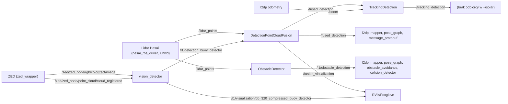

# l1od

> [!skrot] W 30 sekund
> - **Co to:** warstwa L1 „Object Detection” — percepcja łodzi: detekcja obiektów na obrazie z kamery ZED (YOLO przez Ultralytics), klasteryzacja chmury z lidaru (PCL, Euclidean), fuzja kamera–lidar, nadawanie ID obiektom (`README.md`).
> - **Wejście → wyjście:** `/zed/zed_node/rgb/color/rect/image` + `/zed/zed_node/point_cloud/cloud_registered` (ZED) i `/lidar_points` (lidar Hesai) → `/l1/detection_<detektor>` (`VectorOfDetections`), `/l1/obstacle_detection` (`VectorOfClusters`), `/fused_detection` (`VectorOfFusedDetections`), `/tracking_detection`. Odbiorcy: [[l2dp]] (`mapper`, `pose_graph`, `obstacle_avoidance`, `colision_detector`, `message_protobuf`).
> - **Gdzie w łodzi:** Jetson (detektor wizyjny w kontenerze Docker `Dockerfile_jetson` na bazie `nvcr.io/nvidia/l4t-jetpack:r36.2.0`); README każe łączyć się `ssh solar@jetson` (`README.md`, sekcja Foxglove).

## Struktura katalogów
```
l1od/
├── config/                         kalibracja kamery (intrinsics) i macierz lidar→kamera (extrinsics), styczeń/luty 2025
├── vision_detector/                pakiet Python: detektor YOLO (Ultralytics), Docker, modele
│   ├── docker/                     Dockerfile_cpu / _gpu / _jetson, build.sh, run.sh, entrypoint.sh, cyclonedds_lo.xml
│   ├── model/                      ~1,4 GB wag (.pt/.onnx w gicie, .engine ignorowane) — Bagry, Celka, RB25, RB26, njord*, roboboat, base_models…
│   ├── pub_test_imgs/              publikator obrazów testowych + notebook sprawdzania ONNX
│   └── vision_detector/            kod węzła (detector.py, model.py, detector_utils.py, detector_mapper.py, detector_config.py, nodes.py)
├── obstacle_detector/              C++: klasteryzacja chmury lidaru (CropBox → VoxelGrid → Euclidean)
├── detection_pointcloud_fusion/    C++: NOWA fuzja — rzut chmury lidaru na bboxy YOLO (tylko na refined-fusion/vlm-detection)
├── detection_fusion/               C++: STARA fuzja — dopasowanie klastrów lidaru do detekcji YOLO po pozycji
├── detection_fusion_projection/    C++: fuzja przez rzut środka klastra na obraz (extrinsics z config/)
├── fusion_visualization/           Python: rzut punktów lidaru na obraz → /lidar_camera_projection
├── tracking_detection/             C++: nadawanie ID obiektom w układzie globalnym (z /odom)
├── images_collector/               Python: zbieranie zdjęć do datasetów, serwisy /srv/*
├── l1_launch/                      pliki launch (yaml i py) dla łodzi i symulacji
├── env_setup.sh                    zmienne środowiskowe: ścieżki modeli, alias l1_format
└── .gitlab-ci.yml                  CI: colcon build w obrazie althack/ros2:humble-full
```

## Pakiety ROS
- [[vision_detector]] — detektor YOLO (Ultralytics, TensorRT/ONNX/PyTorch), uruchamiany w Dockerze; publikuje `/l1/detection_<nazwa>`.
- [[obstacle_detector]] — klasteryzacja chmury z lidaru, publikuje `/l1/obstacle_detection`.
- [[detection_pointcloud_fusion]] — fuzja „refined”: punkty lidaru rzutowane na bbox → pozycja 3D obiektu, `/fused_detection` (tylko na gałęziach `refined-fusion`, `vlm-detection`).
- [[detection_fusion]] — stara fuzja klaster↔detekcja po odległości/pozycji, też `/fused_detection`.
- [[detection_fusion_projection]] — wariant fuzji przez projekcję środka klastra na obraz (z kalibracji w `config/`).
- [[fusion_visualization]] — wizualizacja rzutu lidaru na obraz kamery.
- [[tracking_detection]] — śledzenie/ID obiektów w układzie globalnym.
- [[images_collector]] — narzędzie do zbierania zdjęć i robienia filmów.
- [[l1_launch]] — launch całej warstwy L1.
- [[zed_controller]] — regulator ekspozycji ZED przy odblaskach słońca (tylko gałąź `zed_exposure_controller`).
- Interfejsy (`l1_interfaces`) leżą w [[ros-sbt-interfaces]].

## Jak to się łączy

Stan gałęzi `refined-fusion` (wymeldowanej lokalnie). `l1od_launch.py` uruchamia tylko detektor (Docker) i `DetectionPointCloudFusion`; `ObstacleDetector` i `TrackingDetection` trzeba odpalić osobno.



Konsumenci potwierdzeni grepem: `l2dp/mapper/src/mapper.cpp:144-149`, `l2dp/pose_graph/src/feature_extractor.cpp:591-600`, `l2dp/obstacle_avoidance/src/obstacle_avoidance.cpp:12`, `l2dp/colision_detector/src/colision_detector.cpp:12`, `l2dp/message_protobuf/message_protobuf/protobuf.py:58`. Nikt w `~/solar` nie subskrybuje `/tracking_detection`.

## Budowanie i uruchamianie
Z `README.md`:
```bash
sudo apt-get install ros-humble-pcl-ros ros-humble-rmw-cyclonedds-cpp
export ROS_DOMAIN_ID=69
export ROS_LOCALHOST_ONLY=0
export DEV_WS_DIR=/home/{user}/dev_ws
export VISION_DETECTOR_DOCKER_DEVICE={CPU|GPU|JETSON}
export RMW_IMPLEMENTATION=rmw_cyclonedds_cpp
src/l1od/vision_detector/docker/build.sh          # buduje obraz vision_detector_image
cd src/l1od/vision_detector/docker && ./run.sh buoy_detector [CB=1] [CT=0.5]
ros2 launch l1_launch l1od_launch.py <parametr>:=<wartość>   # łódź
ros2 launch l1_launch sim_launch.py                         # symulacja (WAM-V)
source env_setup.sh && l1_format                            # formatowanie C++ (clang-format)
```
Foxglove na Jetsonie: `ros2 run foxglove_bridge foxglove_bridge --ros-args -p port:=8765 -p address:=0.0.0.0`, tunel `ssh -L 8765:localhost:8765 solar@jetson` (`README.md`).

CI (`.gitlab-ci.yml`): obraz `althack/ros2:humble-full`, doinstalowuje m.in. `ros-humble-pcl-ros`, klonuje `ros-sbt-interfaces` tokenem CI (`‹ukryte›`) i robi `colcon build`.

## Konfiguracja
- `env_setup.sh` (refined-fusion): `BUOY_MODEL_PATH=…/model/njord26/navier30k.pt` (lokalnie istnieje `navier30k.engine`, więc ładowany jest silnik TensorRT — zob. [[vision_detector]]), `BUOY_SIMULATION_MODEL_PATH=…/RB25/simulation/simulation.engine`, `BASE_DETECTOR_MODEL_PATH=…/yolo11n.engine`, modele Celka (`.onnx`), `CAMERA_FOV=1.76278254` (komentarz: „not used anymore due to calculating it from camera matrix”). Zmienne `BUOY_ROBOBOAT_MODEL_PATH` i `BUOY_BAGRY_MODEL_PATH` są eksportowane, ale żaden wariant w `detector_config.py` ich nie czyta.
- Na `master`: `BUOY_MODEL_PATH=…/RB26/roboboat_lights_plackards.engine`, `BASE_DETECTOR_MODEL_PATH=…/yolo11s.engine`.
- `config/camera_intrinsic_calibration.yaml`: data kalibracji 2025-01-22, macierz K (fx≈526,3, fy≈525,9, cx≈613,4, cy≈372,9), 5 współczynników dystorsji, szachownica 7×9 o boku 0,41 m, `image_size` 720×1280.
- `config/camera_extrinsic_calibration.yaml`: macierz 4×4 lidar→kamera, komentarz „dzien przed testami barki 8 luty, w 106”. Używana przez [[fusion_visualization]] i [[detection_fusion_projection]]; NOWA fuzja ([[detection_pointcloud_fusion]]) jej nie używa (osie zakodowane na sztywno).
- DDS: CycloneDDS, `ROS_DOMAIN_ID=69` (w `Dockerfile_gpu` jest `68` — niespójność), w kontenerze Jetson `cyclonedds_lo.xml` ogranicza ruch do interfejsu `lo`, `WhcHigh 20MB`.

## Branche
Stan zdalnych gałęzi z ostatniego `fetch`: plik `.git/FETCH_HEAD` z 2026-10-01 18:01. Uwaga: `FETCH_HEAD` wskazuje `refined-fusion` na `3959b42`, a `origin/refined-fusion` = `52dabf2` (nowszy, potomek) — ref zdalny zaktualizowano po tym fetchu (np. push/pull). Wymeldowana: **`refined-fusion`**, zgodna z `origin/refined-fusion`. Drzewo robocze: 5 zmodyfikowanych plików (`vision_detector/docker/{build,entrypoint,run}.sh` — tylko bity uprawnień, `vision_detector/model/RB25/all_5_epoch.onnx` — ten sam rozmiar, `vision_detector/package.xml` — zmiana maintainera).

| Gałąź | Ostatni commit | Za / przed `master` | W `master`? | Uwagi |
|---|---|---|---|---|
| `master` | `55ded22` 2026-04-27 Mateusz „Refine running models on CPU.” | 0 / 0 | — | gałąź główna |
| **`refined-fusion`** (wymeldowana) | `52dabf2` 2026-08-12 juliadcz „Obstacle avoidance changes to obstacle detector.” | 2 / 26 | nie | najnowsza; nowa fuzja, stan po Monako/Norwegii |
| `vlm-detection` | `1d89c9f` 2026-07-10 juliadcz | 2 / 14 | nie | odbita z `refined-fusion` (e4b68b4); detekcja VLM |
| `zed_exposure_controller` | `01677ee` 2026-08-05 UmarlyPoeta „dodanie brakującego analyze_bag.py” | 11 / 21 | nie | `zed_controller` + commity z `dbscan_clustering` |
| `dbscan_clustering` | `c4f951f` 2026-05-11 NSTMS „Adaptive DBSCAN…” | 11 / 14 | nie | nowy pipeline klasteryzacji |
| `auto_fov_camera` | `d1a524f` 2026-02-14 jankusa | 19 / 6 | nie | FOV z `camera_info` |
| `fix/docker-optimization` | `04a04fd` 2026-03-17 Aleksander Młynarski | 3 / 5 | nie | odchudzenie obrazu Jetson |
| `quantized_model` | `518420e` 2026-03-10 juliadcz „minor env_setup change” | 9 / 1 | nie | 1 linia w `env_setup.sh` |
| `depth-in-simulation` | `9c39c68` 2026-03-10 Mateusz „Resolve conflicts.” | 4 / 0 | **tak** | martwa (zmergowana) |

### refined-fusion (najnowsza, wymeldowana)
Baza `975aa0e` (2026-03-19). 26 commitów 2026-03-24 → 2026-08-12 (Mateusz, juliadcz, Aleksander Młynarski), m.in. „Merge changes from Monaco”, „Monaco changes”, „Rotate axes so l2 is happy”, „X do przodu, Y w prawo”, „Publishing fusion with a pointcloud stamp”. `git diff master...refined-fusion`: 27 plików, +1090/−327.
- Nowy pakiet [[detection_pointcloud_fusion]] (412 linii C++) — zastępuje w launchu [[detection_fusion]].
- [[vision_detector]]: `detector.py` przepisany — dokładna synchronizacja obraz+chmura ZED (`TimeSynchronizer`), QoS BEST_EFFORT depth 1, zero-copy widok `PointCloud2`, pozycja 3D z mediany ROI 21×21 wokół środka bboxa (`detector_utils.py:81-167`), publikacja podglądu 320×320; `model.py` uproszczone ładowanie (engine → .pt→eksport TensorRT → .onnx).
- `l1_launch/launch/l1od_launch.py` i `sim_launch.py` skrócone do: Docker z detektorem + `DetectionPointCloudFusion`.
- [[obstacle_detector]]: ostatni commit zmienia domyślne parametry (`y_axis_min` −10→0, `cluster_size_min` 50→5, `cluster_x/y_max` 3→4), wyłącza publikację `/filtered_cloud`, zmienia warunek zielonego markera.
- `Dockerfile_jetson`: CycloneDDS z `cyclonedds_lo.xml`, `onnxruntime_gpu-1.18.0` z lokalnego wheela, `ultralytics<8.3.237`.
- Nowe modele: `Bagry/bagry_buoys.onnx`, `Celka/monaco_green.{onnx,pt}`, `Celka/monaco_zlote_gacie.{onnx,pt}`, `njord26/navier30k.{onnx,pt}`; usunięte z gita `yolo11n.onnx`, `RB26/roboboat_lights_plackards.onnx`.

### vlm-detection
Odbita z `refined-fusion` w `e4b68b4` (2026-06-04), 6 własnych commitów 2026-07-07…07-10 (juliadcz, MKalandykM; m.in. „Setup VLM.”, „monaco water trials”). `model.py` zastępuje YOLO modelem VLM z Hugging Face: `AutoModel/AutoProcessor/AutoTokenizer` z `transformers`, prompt z kategoriami (`LOCATE_ANYTHING_CATEGORIES`, `LOCATE_ANYTHING_PROMPT`), parsowanie tekstu odpowiedzi na bboxy. `docker/download_vlm.sh` pobiera `nvidia/LocateAnything-3B` do `/home/solar/dev_ws/src/l1od/vision_detector/model/locate-anything-3b`. Dodaje 11 zdjęć testowych `pub_test_imgs/boje/MRO0318x.JPG` (~17–20 MB każde). Ostatni commit: „Jak ktoś to postawi kiedyś to postawię mu flaszke” — **niepewne:** czy kiedykolwiek działało na łodzi.

### zed_exposure_controller
Baza `01734b9` (2026-02-23). Zawiera commity NSTMS z `dbscan_clustering` (do `d15bfe3`, 2026-04-30) + 6 commitów Patryka (`patryk_kozlowski`/`UmarlyPoeta`, 2026-05-06…08-05). Dodaje pakiet [[zed_controller]] (`zed_controller.cpp` 766 linii, README 270 linii, `scripts/analyze_bag.py`, launch+yaml): wykrywanie „solar flare” w ROI obrazu i regulator PI ekspozycji ZED przez serwis `set_parameters` węzła ZED.

### dbscan_clustering
11 commitów (NSTMS, 2026-02-25…05-11) + commity z master sprzed bazy. Rozbija [[obstacle_detector]] na trzy węzły: `PclPreprocess` (CropBox `/lidar_points` → `/l1/obstacle_detection/pcl_preprocessed`), `DbscanClustering` (adaptacyjny DBSCAN w 4 strefach odległości 5/10/15/20 m, eps 0,20–0,60 → `/l1/obstacle_detection/dbscan/clusters` + markery), `EuclideanClustering` (→ `/l1/obstacle_detection/euclidean/clusters`). Konfiguracja `obstacle_detector/config/{dbscan,euclidean,pcl_preprocess}_config.yaml`, 4 pliki RViz. Biblioteka DBSCAN jako gitlink `obstacle_detector/src/dbscan` (`https://github.com/Eleobert/dbscan.git` w `src/.repos`), bez wpisu w `.gitmodules`. Commit „Code ready for PR.” — niezmergowane. **Niepewne:** jaki typ wiadomości publikują węzły DBSCAN (nie sprawdzono, czy `VectorOfClusters`).

### auto_fov_camera
6 commitów (jankusa, 2026-01-28…02-14), 2 pliki. [[detection_fusion]] subskrybuje `/zed/zed_node/rgb/color/rect/camera_info` i liczy `camera_fov = 2·atan(width / (2·fx))` raz, przy pierwszej wiadomości; do tego czasu pomija callback fuzji. Zestarzała (19 commitów za master).

### fix/docker-optimization
Alek / Aleksander Młynarski, 2026-03-10…03-17: `.dockerignore`, `Dockerfile_jetson` przerobiony na bazę ROS 2 (−77/+…), zmiany w `build.sh`/`run.sh`. Niezmergowane.

### quantized_model
Jedyna różnica: `BUOY_MODEL_PATH` z `roboboat_lights_plackards.engine` na `.onnx`. Martwa.

### depth-in-simulation
Zmergowana do `master` (commit `d43b074`/`9c39c68`, 2026-03-10). Martwa.

## Kopie lokalne
| Ścieżka | Gałąź | HEAD | Niezacommitowane | Ostatni fetch |
|---|---|---|---|---|
| `~/solar/l1od` | `refined-fusion` | `52dabf2` | 5 plików (j.w.) + ignorowane `.engine`, `yolo11{n,s}.onnx`, `__pycache__` | `.git/FETCH_HEAD` 2026-10-01 |
| `~/solar/bash_do_uruchomienia/l1od` | `master` | `55ded22` | brak | brak `FETCH_HEAD`; refy zdalne starsze: `origin/refined-fusion`=`96f8081` (2026-07-29), `origin/zed_exposure_controller`=`c8e660e` |

Lokalne pliki `.engine` (TensorRT, gitignorowane, `.gitignore`: `*.engine`, `*.onnx` — ale wiele `.onnx` jest mimo to w gicie): `model/yolo11n.engine`, `model/yolo11s.engine`, `model/Bagry/bagry_buoys.engine`, `model/RB26/roboboat_lights_plackards.engine`, `model/njord26/navier30k.engine`.

## Znane problemy / TODO
- [[detection_pointcloud_fusion]] nigdy nie ustawia `is_fused_angle`, a [[tracking_detection]] przepuszcza tylko detekcje z `is_fused_angle == true` (`tracking_detection.cpp:45`) → przy nowej fuzji tracking nic nie publikuje (wniosek z kodu; nieprzetestowane).
- `detection_fusion.cpp:168` porównuje dwa razy `x` (`std::abs(yolo_center_x - obstacle_center_x) < 0.3` dwukrotnie) — warunek na `y` nie działa.
- `sbt_transforms/config/frames.yaml` (repo [[sbt_transforms]]) opisuje `/fused_detection` jako `status: inconsistent` — gałąź „real” zamienia x↔y (odbicie) i stempluje `hesai_lidar`, w symulacji zostaje FLU.
- `pub_test_imgs` publikuje tylko obraz, a detektor na `refined-fusion` czeka na dokładnie zsynchronizowaną parę obraz+chmura (`detector.py:103-111`) — testowe obrazy nie wywołają detekcji (wniosek z kodu).
- `obstacle_detector/config/sim_config.yaml` używa kluczy małymi literami (`point_cloud_topic`), a węzeł deklaruje `POINT_CLOUD_TOPIC` — topiki z tego pliku są ignorowane.
- `images_collector.py:169` — `preprocess()` używa `self.convNeuralNet`/`self.model_input_shape`, których nigdzie nie inicjalizuje → serwis `/srv/make_detections` się wywali.
- `Dockerfile_cpu` buduje `l2_interfaces` zamiast `l1_interfaces` (`Dockerfile_cpu:29`).
- `README.md`: „idk what this is, ask mkslo” (parametry `ground_tolerance`, `tolerance`); w `l1od.yaml`/`sim.yaml` nadal jest `gps_calculator` (pakiet z [[l2dp]]).
- Komentarze o FOV kamery są sprzeczne: `detection_fusion.hpp:28` („1.4825 – 110°, ACTUAL”; „1.76278254 – 101°, FAKE”) vs `env_setup.sh` i `l1od_launch.py` (1.76278254 jako „new zed2i”).

## Źródła
- `README.md`, `env_setup.sh`, `.gitlab-ci.yml`, `.gitignore`
- `vision_detector/vision_detector/{detector,model,detector_utils,detector_mapper,detector_config,nodes}.py`, `vision_detector/docker/*`
- `obstacle_detector/src/obstacle_detector.cpp`, `detection_pointcloud_fusion/src/detection_pointcloud_fusion.cpp`, `detection_fusion/src/detection_fusion.cpp`, `tracking_detection/src/tracking_detection.cpp`
- `l1_launch/launch/*`, `config/*.yaml`
- `git log`/`git diff` wszystkich gałęzi `origin/*`

## Moje notatki
> [!ja] Tu piszesz ty — Albert tej sekcji nie rusza.
