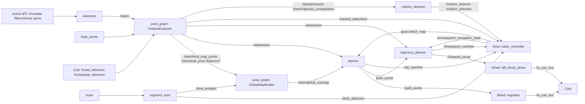

# l2dp

> [!skrot] W 30 sekund
> - **Co to:** warstwa L2 — lokalizacja (odometria GNSS+IMU, SLAM LiDAR), mapa/costmapa, planowanie ścieżki (własne A*), regulacja kursu do waypointa, wykrywanie slipu (dokowanie), wykrywanie kolizji z inną łodzią, raport protobuf dla sędziów. **Nie używa Nav2** — w żadnej gałęzi kod nie odwołuje się do Nav2 (jedyne trafienie `nav2` to `Docker/Dockerfile.l2` na `origin/docker_l2`).
> - **Wejście → wyjście:** `/imu/data`, `/filter/velocity`, `/gnss`, `/lidar_points`, `/fused_detection`, `/l1/obstacle_detection` → `/odom`, `/slam/odom`, `/slam/global_costmap`, `/path_points`, `/l2/speed_vector`, `/tracked_detections`, `/dock_detection`, `/colision_detector`.
> - **Gdzie w łodzi:** na Jetsonie — świadczy o tym remote `jetson` w kopii `l2dp_docking_fix` (`/home/umarly-poeta/ros2_ws/src/l2dp`) i commit `0d444ff` „Niezacommitowane zmiany z Jetsona (stan po zawodach)”.

Kontekst całej autonomii: [[Nawigacja i autonomia — przepływ]]. Sąsiednie warstwy: [[l1od]] (percepcja), [[l3nav]] (decyzja), [[l0hwd]] (napęd/CAN), [[l4sim]] (symulacja), interfejsy [[ros-sbt-interfaces]].

## Struktura katalogów
Stan gałęzi zawodów `feat/dock_costmap_fix@0d444ff` (16 pakietów ROS 2, każdy w osobnym katalogu w korzeniu repo):

```
l2dp/
├── odometry/                filtr Kalmana GNSS+prędkość → /odom, /start_pose, /trajectory
├── pose_graph/              SLAM LiDAR (FeatureExtractor) + GlobalMapBuilder → /slam/odom, /slam/global_costmap
│   ├── config/slam.yaml     parametry SLAM i costmapy (nieinstalowany przez CMake)
│   ├── START_HERE.md, REVIEW_AND_TEST_PLAN.md, baseline_params.yaml, math_checks.py, changes.patch
├── planner/                 A* na /slam/global_costmap → /path_points, /path, /wp_reached
├── trajectory_planner/      regulator kursu do punktu (200 ms) → /l2/speed_vector, /l3/waypoint_reached
│   └── utils/               stałe (THRESHOLD_WAYPOINT=1.5 m), GetHeadingTo, Clamp
├── segment_scan/            linie z LaserScan → detekcja slipu /dock_detection, /dock_polygon; mariny
│   ├── config/segment_scan_params.yaml, launch/segment_scan.launch.py
├── colision_detector/       ekstrapolacja toru obcej łodzi vs „tunel” własnej trajektorii → /colision_detector
├── obstacle_avoidance/      starsza wersja tego samego (na /trajectory i /l1/obstacle_detection)
├── mapper/                  starsza mapa grid_map → costmap, global_map, local_map, tracked_detections
├── fast_scan/               PointCloud2 → LaserScan z klasteryzacją (domyślnie /debug/deskewed → /scan)
├── pointcloud_to_laserscan/ upstream ROS (przepisany na master w „hand written pcl to laserscan”)
├── gps_calculator/          NavSatFix → MetricPosition + serwisy SetHome (relikt)
├── blast_detection/         mikrofon (PortAudio) → spektrogram → detected_signals (BlastDetection)
├── signals_detector/        Pythonowa wersja wykrywania sygnałów dźwiękowych
├── message_protobuf/        raport dla sędziów (protobuf, TCP 127.0.0.1:50000)
├── viz_correction/          republisher zamieniający x↔y w /path i markerach (RViz)
├── ascii_map_viz2/          podgląd costmapy w terminalu (ASCII)
├── .gitlab-ci.yml           build w obrazie althack/ros2:humble-full z klonem ros-sbt-interfaces
├── .clang-format-l2, .gitmodules (pusty), README.md (żartobliwy, bez instrukcji)
```
Na gałęziach starszych niż ~2025-12 (np. `origin/mapper_sim`, `origin/marina_lookout`, `origin/quantize_model`) repo zawierało też pakiety percepcji (`vision_detector`, `obstacle_detector`, `detection_fusion`, `tracking_detection`, `l2_launch`) — dziś są w [[l1od]].

## Pakiety ROS
- [[odometry]] — Kalman 4-stanowy `[x,y,vx,vy]`: predykcja z `/filter/velocity`, korekcja z `/gnss`; publikuje `/odom` (pozycja NEU w metrach od pierwszego fixa).
- [[pose_graph]] — SLAM na cechach LiDAR (deskew, krawędzie/płaszczyzny, scan matching, keyframe’y) + globalna mapa wokselowa i costmapa `/slam/global_costmap` z inflacją i „gaszeniem” slipu; publikuje skorygowaną `/slam/odom` i `/tracked_detections`.
- [[planner]] — A* 8-sąsiedztwo na `/slam/global_costmap`, wyzwalany przyjściem costmapy; `/goal` → `/path_points`.
- [[trajectory_planner]] — regulator P kursu + profil prędkości `exp(0.015·d)−0.95`; serwis `/srv/waypoint_navigation_state`.
- [[segment_scan]] — detektor slipu (U z trzech ścian) i wejścia do mariny z LaserScan.
- [[colision_detector]] — wykrywanie kolizji z poruszającym się obiektem (zawody Njord, zadanie collision).
- [[obstacle_avoidance]] — poprzednik `colision_detector`.
- [[mapper]] — starsza ścieżka mapowania (grid_map), publikuje `costmap` (nie czyta jej planer).
- [[fast_scan]] — chmura 3D → LaserScan `/scan` dla `segment_scan`.
- [[pointcloud_to_laserscan]] — standardowy konwerter `cloud_in` → `scan`.
- [[gps_calculator]] — `/gps/nav_sat_fix` → `/gps/metric_position` (relikt).
- [[blast_detection]] — detektor gwizdków (600 Hz ±5%) → `detected_signals`.
- [[signals_detector]] — Pythonowy detektor sygnałów dźwiękowych.
- [[message_protobuf]] — raport RoboBoat (heartbeat 1 Hz, wiadomości 4 Hz) przez TCP.
- [[viz_correction]] — zamiana osi do wizualizacji.
- [[ascii_map_viz2]] — ASCII-podgląd costmapy, ścieżki i detekcji.

## Jak to się łączy
Stan `feat/dock_costmap_fix@0d444ff` (tryb `use_mapper=true` z L3 — tak jeżdżą drzewa Njord):



Szczegóły przepływu, trybów i sterowania: [[Nawigacja i autonomia — przepływ]].

## Budowanie i uruchamianie
- Brak pakietu launch dla L2 — w repo jest tylko `segment_scan/launch/segment_scan.launch.py` i przykładowe launche `pointcloud_to_laserscan`. Węzły uruchamia się przez `ros2 run`. Komendy z README [[l4sim]] (symulacja): `ros2 run odometry odo_cpp_node`, `ros2 run mapper mapper`, `ros2 run planner planner`, `ros2 run TrajectoryPlanner TrajectoryPlannerNode` (uwaga: pakiet nazywa się `trajectory_planner`, executable `TrajectoryPlannerNode` — `trajectory_planner/CMakeLists.txt`).
- Executables (z `CMakeLists.txt`/`setup.py`): `odometry/odo_cpp_node`, `pose_graph/feature`, `planner/planner`, `trajectory_planner/TrajectoryPlannerNode`, `segment_scan/segment_scan`, `colision_detector/colision_detector`, `obstacle_avoidance/obstacle_avoidance`, `mapper/mapper`, `fast_scan/fast_scan`, `gps_calculator/GpsConverter`, `blast_detection/blast_detector`, `message_protobuf/protobuf`, `signals_detector/start_listening`, `viz_correction/viz_correction`, `ascii_map_viz2/ascii_map_viz2`.
- `pose_graph/config/slam.yaml` nie jest instalowany (`pose_graph/CMakeLists.txt` instaluje tylko target `feature`) — trzeba go podać ścieżką: `ros2 run pose_graph feature --ros-args --params-file <repo>/pose_graph/config/slam.yaml` (**niepewne:** dokładnej komendy nie ma w repo; sekcja YAML nazywa się `feature_extractor`, tak jak węzeł — `feature_extractor.cpp:37`).
- `segment_scan`: `ros2 launch segment_scan segment_scan.launch.py [params_file:=…]` (domyślnie `config/segment_scan_params.yaml`).
- CI (`.gitlab-ci.yml`): `apt-get install ros-humble-can-msgs ros-humble-nmea-msgs ros-humble-geographic-msgs ros-humble-diagnostic-updater ros-humble-robot-localization ros-humble-pcl-ros`, klon [[ros-sbt-interfaces]] z tokenem CI (`‹ukryte›`), `colcon build`.
- Zależności zewnętrzne z `package.xml`: PCL/`pcl_ros` (pose_graph), `grid_map_*` (mapper), Boost.Geometry (colision_detector, obstacle_avoidance), PortAudio + FFTW (blast_detection, w `package.xml` zakomentowane), `python3-protobuf`, `python3-pyaudio`.

## Konfiguracja
| Plik | Co ustawia | Kluczowe wartości |
|---|---|---|
| `pose_graph/config/slam.yaml` | SLAM + mapa globalna + costmapa | ekstrynsyka IMU→LiDAR `x=0.40 y=0.05 z=-0.40`, kwaternion jednostkowy; keyframe co 0.8 m / 4° / 2 s; costmapa `resolution 0.20`, `inflation_radius 1.0`, `inscribed_radius 0.30`, `inflation_cost_scaling_factor 3.0`, `unknown_as_free true`, `dock.maximum_cost 0`, `dock.margin 0.50`, `dock.margin_cost 25`, `dock.mouth_extension 1.5`, `dock.polygon_timeout 5.0` |
| `pose_graph/global_map_builder_parameters.yaml`, `baseline_params.yaml` | alternatywne zestawy parametrów (113 i 116 linii) | opis w [[pose_graph]] |
| `segment_scan/config/segment_scan_params.yaml` | wymiary slipu | `min_dock_width 1.0`, `max_dock_width 3.0` (na `0d444ff`; wcześniej 2.5), `min_dock_depth 1.8`, `max_dock_depth 3.0` |
| `trajectory_planner/utils/include/utils.hpp` | stałe regulatora | `THRESHOLD_WAYPOINT = 1.5` m, `TIMEOUT_30_S = 30` |

## Branche
Stan remote = ostatni `git fetch` w `~/solar/l2dp` (`.git/FETCH_HEAD` z 2026-10-01 18:05). Gałąź główna `origin/master` = `6ae4389` (2026-08-01, Mateusz, „poprawka na osie jazwieckiego”). Wszystkie gałęzie Njord odbijają od `master~1` = `74c473e` (2026-04-29, „fast_scan config”), stąd „1 za master”.

| Gałąź | Ostatni commit | za/przed master | Zmergowana | Status |
|---|---|---|---|---|
| `master` / `origin/master` | `6ae4389` 2026-08-01 Mateusz — poprawka na osie jazwieckiego | 0/0 | — | główna, ale **starsza niż stan zawodów** |
| `feat/dock_costmap_fix` (lokalna w `l2dp_docking_fix`, HEAD) | `0d444ff` 2026-08-23 patryk_kozlowski — Niezacommitowane zmiany z Jetsona (stan po zawodach) | 1/33 | nie | **stan po zawodach Njord** — najnowsza |
| `origin/feat/dock_costmap_fix` | `b27f9c6` 2026-08-14 patryk_kozlowski — wszyscy pijani zasneli na kac vegas | 1/29 | nie | wypchnięta wersja sprzed gaszenia inflacji, gałąź równoległa (na `3b73cff`, bez `55312ce`/`cb93270`) |
| `spirala_zjebania` (lokalna w `l2dp`, HEAD) = `jetson/spirala_zjebania` | `cb93270` 2026-08-12 juliadcz — colision avoidance smigaaaaa… | 1/30 | nie | stan Jetsona z Njord (commit), drzewo robocze `l2dp` = niezacommitowane zmiany Jetsona |
| `origin/spirala_zjebania` | `3b73cff` 2026-08-12 juliadcz — ekstrapolacja … | 1/28 | nie | wypchnięta część Njord, zawarta w `feat/dock_costmap_fix` |
| `spirala_zjebania` (lokalna w `l2dp_docking_fix`) | `b27f9c6` | 1/29 | nie | = `origin/feat/dock_costmap_fix` |
| `origin/njord/tracked_timestamp_matching` (+lokalna) | `db9caeb` 2026-08-09 Mateusz — Merge … | 1/13 | nie | dopasowanie znaczników czasu detekcji w SLAM; wmergowana do spirali |
| `origin/scan_matching` | `ed210d2` 2026-08-09 Mateusz — kolorowanki | 1/7 | nie | wprowadzenie `pose_graph` (SLAM); wmergowana do spirali |
| `scan_matching` (lokalna `l2dp`) | `b858a54` 2026-08-10 juliadcz — Merge … | 1/10 | nie | zawarta w spirali |
| `scan_matching` (lokalna `l2dp_docking_fix`) | `b1bff75` 2026-08-09 UmarlyPoeta — initial slam tracked detections timestamp matching | 1/7 | nie | zawarta w spirali |
| `workingDockingBackup` (lokalna `l2dp`) | `5c07476` 2026-08-10 juliadcz — mergowansko | 1/8 | nie | kopia zapasowa dokowania; zawarta w spirali |
| `origin/celka_odo` | `6b02df0` 2026-07-21 juliadcz — kodzik po monaco2026 | 1/7 | nie | **stan po Monako 2026**, NIE wmergowany do Njord |
| `origin/formatting` | `87dded7` 2026-06-10 janSochaOfficial — README z lintingiem | 1/4 | nie | formatowanie całego repo + `.h→.hpp`; niezmergowane |
| `origin/jenkinsfile` | `72d36f2` 2026-04-26 Filnaw — fix Jenkinsfile | 2/3 | nie | martwa (Jenkinsfile) |
| `origin/mapper_multitype_fusion` | `ea12802` 2026-03-21 janSochaOfficial — confidence for tracked detections | 5/2 | nie | martwa |
| `origin/point2cloud` | `2995dc4` 2026-03-18 Natalia Guzdek — rewrite pointcloud_to_laserscan | 5/1 | nie | martwa (master ma własny rewrite) |
| `origin/communication_protobuf` | `8a2fd80` 2026-02-13 Piotr Kędziora | 29/0 | **tak** | zmergowana |
| `origin/mapper` | `47cc319` 2025-11-30 MKalandykM — fixed mapper | 52/0 | **tak** | zmergowana |
| `origin/signals_detector` | `030a17d` 2026-02-10 Blazej | 115/0 | **tak** | zmergowana |
| `origin/costmap_viewer` | `f3f3a31` 2026-01-21 Natalia Guzdek — OccupancyGrid plot | 85/1 | nie | martwa |
| `origin/lio_sam` | `7f0930d` 2026-05-11 jankusa — fix deskewing | 85/5 | nie | martwa (eksperyment LIO-SAM) |
| `origin/pipeline-testing` | `b332e42` 2026-01-06 witNie | 85/1 | nie | martwa (CI) |
| `origin/temp_` | `e1a520a` 2026-01-27 witNie — test ci wrong formatting cpp | 85/16 | nie | martwa (testy CI/pre-commit) |
| `origin/docker_l2` | `58441ab` 2025-12-11 Alek — tmux w Dockerze | 88/6 | nie | martwa (Docker dla L2) |
| `origin/feature/global-map-sync` | `338794f` 2025-11-27 Mateusz — start task | 100/2 | nie | martwa |
| `origin/mapper_sim` | `cc0852f` 2026-03-11 MKalandykM — usa dump | 106/14 | nie | martwa (stary układ z percepcją) |
| `origin/mapper_sim_l2_divided_fix` | `205f82e` 2025-11-19 patryk_kozlowski — wreszcie sie mapper buduje | 106/6 | nie | martwa |
| `origin/marina_lookout` | `ca4351e` 2025-12-13 MKalandykM — unbuilding marina detection | 106/8 | nie | martwa |
| `origin/quantize_model` | `f73c6e0` 2025-10-31 filnaw | 128/12 | nie | martwa (kwantyzacja YOLO) |
| `origin/tracking_debug` | `359883b` 2025-01-17 szymon_nowak — fix | 306/3 | nie | martwa |

Tagi archiwalne (we wszystkich kopiach): `archive/24-accelerated-vision-detector`, `archive/cpp_detector_archive`, `archive/service_detection_approach`, `archive/three_different_nodes_approach`, `archive/x-video-streaming` (2024–2025, percepcja).

### Linia zawodów Njord (sierpień 2026)
Historia `feat/dock_costmap_fix` (od `74c473e`): `db9a504` „some tires” → `af1866b`…`f37ea0b` „working local/global map” (MKalandykM, 2026-08-01/02) → `9f7ed16` „quite cleanly working slam” → `2451028` „w starej ci zadokuje” → `origin/scan_matching` → `njord/tracked_timestamp_matching` → `2a0b6e0`…`2a4dbf6` „…NAPRAWILI SLAMA” (osie) → merge `scan_matching` → `b4ff42f` „flashback njord 24 5 rano” → `942cbe2` „FIXED DOCKING AFTER 1 YEAR” (2026-08-11) → `3b73cff` „ekstrapolacja …” → `cb93270` „colision avoidance smigaaaaa” (2026-08-12) → `f26cef0` (2026-08-14; jak `b27f9c6`, ale na `cb93270`) → `f8f0b00` „Gaszenie inflacji wewnatrz wykrytego slipu” (2026-08-23) → `0d444ff` „Niezacommitowane zmiany z Jetsona (stan po zawodach)”.

Co zmienia względem `master` (`git diff origin/master...feat/dock_costmap_fix`, 48+ plików, ~17,7 tys. linii): nowy pakiet `pose_graph` (SLAM, ~15 tys. linii), `viz_correction`, zmiany w `segment_scan` (wielokąt slipu, parametry, `/choose_dock`), `colision_detector` (wejście z SLAM: `/global/clusters`, `/slam/trajectory_extrapolation`, `/slam/odom`), `trajectory_planner` i `planner` (subskrypcja `/slam/odom`, przełącznik `/which_map`), `fast_scan`, `mapper`.

Treść `0d444ff` wg opisu commita i diffu: `planner` — `/which_map` ustawia `slam_costmap`, który mnoży koszt komórki w A* (`planner/src/planner.cpp:135`), „przy false planer ignoruje costmapę — tak dziś wjeżdża się do slipu”; `segment_scan` — `/choose_dock` ustawia `min/max_dock_width` w locie (węzeł `SelectDock` w drzewach Njord, [[basic_controller]]); `feature_extractor` — okresowa publikacja `/tracked_detections` (`tracking.publish_rate` 10 Hz); `trajectory_planner` — odometria z `/slam/odom` zamiast `/odom`; `segment_scan_params.yaml` — `max_dock_width 2.5 → 3.0`.

`f8f0b00`: `segment_scan` publikuje 4 narożniki slipu jako `PolygonStamped` na `/dock_polygon`; `GlobalMapBuilder` przelicza go do ramki map, scala po centroidzie, wygasza po timeoucie i w `publishCostmap` po pętli inflacji obcina koszt wewnątrz wielokąta do `costmap.dock.maximum_cost` (pomija komórki 100); dodatkowo `/slam/dock_polygon_map`; usunięta zależność `grid_map`, dodany `nav_msgs`.

### `origin/celka_odo` — Monako 2026 (niezmergowane)
7 commitów 2026-06-24…2026-07-21 („chat odometry + changed trajectory planner”, „sbg odo + tp for controller”, „regulator looking more like regulator”, „greater leeway in odom…”, „monaco water trials”, „dziala?”, „kodzik po monaco2026”). Zmiany: `odometry` obsługuje IMU/GNSS **SBG** (`/sbg/gps_hdt`, `/sbg/gps_pos`, `/sbg/gps_vel`, `/sbg/ekf_quat`, zależność `sbg_driver`), nowe pakiety `buoy_mock` i `obstacle_filter`, zmiany `colision_detector`, `segment_scan`, `trajectory_planner` (+121 linii). Linia Njord odbiła od `74c473e` i tego nie zawiera.

### Pozostałe
- `origin/formatting` — skrypty formatowania i lintingu, zmiana rozszerzeń nagłówków na `.hpp` (63 pliki). Niezmergowane — nazwy plików na gałęziach zawodów nadal `.h`.
- `origin/lio_sam` — import LIO-SAM-ros2 skonfigurowanego pod Hesai (porzucony na rzecz własnego `pose_graph`).

## Kopie lokalne
| Ścieżka | Wymeldowana gałąź | HEAD | Drzewo robocze | Remote / fetch |
|---|---|---|---|---|
| `~/solar/l2dp` | `spirala_zjebania` | `cb93270` 2026-08-12 | 10 zmodyfikowanych plików (`planner`, `pose_graph/feature_extractor`, `segment_scan`, `trajectory_planner/include`, `ascii_map_viz2`, `pose_graph/math_checks.py` — 2 ostatnie tylko tryb pliku) + nieśledzony `COLCON_IGNORE` (colcon ignoruje tę kopię) | `origin` = GitLab; FETCH_HEAD 2026-10-01 18:05 |
| `~/solar/l2dp_docking_fix` | `feat/dock_costmap_fix` | `0d444ff` 2026-08-23 | 7 zmodyfikowanych: `pose_graph/src/global_map_builder.cpp` (+~500 linii), `global_map_builder.hpp`, `config/slam.yaml`, `segment_scan` (stempel czasu skanu w wielokącie), 2 pliki tylko tryb | `origin` = GitLab, `jetson` = `/home/umarly-poeta/ros2_ws/src/l2dp`; FETCH_HEAD 2026-10-01 18:07 (fetch z `jetson`, gałąź `spirala_zjebania`) |
| `~/solar/bash_do_uruchomienia/l2dp` | `master` | `74c473e` 2026-04-29 „fast_scan config” | czyste | `origin` = GitLab; brak FETCH_HEAD; `origin/master` widziany jako `74c473e` (fetch sprzed 2026-08-01); brak `pose_graph`, `viz_correction`, launchu `segment_scan` |

Porównanie (przez `diff -rq` na eksporcie `git archive 0d444ff`):
- Drzewo robocze `~/solar/l2dp` = `0d444ff` **minus** zmiany z `f8f0b00` (różni się tylko plikami ruszonymi przez gaszenie inflacji). Czyli niezacommitowane zmiany w `l2dp` to te same „zmiany z Jetsona”, które w `l2dp_docking_fix` zostały zacommitowane jako `0d444ff`.
- Drzewo robocze `l2dp_docking_fix` = `0d444ff` + dalsza praca nad dokowaniem (niezacommitowana): w `GlobalMapBuilder` korytarz podejścia `/slam/dock_corridor_map`, subskrypcje `/choose_dock` i `/slam/odom` (bufor póz do interpolacji w czasie skanu), walidacja wielokąta (`min/max_width 1.0/3.0`, `min/max_depth 1.8/3.0`, `size_tolerance 0.30`, `angle_tolerance_deg 20`, `boat_width 0.80`, `corridor_back_inset 0.30`, `corridor_approach 3.0`), a w `slam.yaml` `mouth_extension 0.0`, `polygon_timeout 0.0`.
- `bash_do_uruchomienia/l2dp` (master z kwietnia) różni się od stanu zawodów w `colision_detector`, `fast_scan`, `mapper`, `planner`, `segment_scan`, `trajectory_planner`, brak `pose_graph`/`viz_correction`.

### Materiały o dokowaniu poza repo
- `~/solar/docs/dock_costmap_check/` — obrazy z analizy gaszenia inflacji w slipie: `before_after.png` (costmapa przed/po, zielony wielokąt slipu), `dock_check.png` i `F.png` (costmapa w ramce map, różowy `/slam/dock_polygon_map`, biały przerywany „wzór ludzki”, czerwona łódka przy detekcji; na `F.png` dodatkowo cyjanowy prostokąt — korytarz), `rviz_przed_po.png` (3 kadry: „przed detekcją: slip zalany inflacją”, „po detekcji + lidar: wielokąt i korytarz”, „koniec baga: slip i korytarz wolne”), `lid12.png`, `s12_crop.png`. Korytarz odpowiada niezacommitowanemu kodowi w `l2dp_docking_fix`.
- `~/solar/rosbagi/docking_regulator_2/` — bag sqlite3 (`scan_08082026_bag_0.db3`, ~1,67 GB), start 2026-08-08 03:23:51 CEST, 48,4 s, 2193 wiadomości: `/path` (84), `/trajectory` (480), `/odom` (661), `/lidar_points` (484), `/costmap` (484), `/map_detections` (0). Topik `/costmap` (z [[mapper]]) a nie `/slam/global_costmap` — **niepewne**, czy to oznacza, że 8.08 dokowanie szło jeszcze przez mappera.
- `~/solar/docs/architektura.html` — wcześniejszy opis stosu (odniesienia na 2026-08-11). Część faktów nieaktualna dla `0d444ff`: np. planer i trajectory_planner czytają już `/slam/odom`, nie `/odom`.

## Znane problemy / TODO
- `planner/src/planner.cpp:135` — człon „kosztu zmiany kierunku” `(std::abs(current.pastMoveIndex-i)%5)/5` to dzielenie całkowite → zawsze 0; dodatkowo węzły dokładane do kolejki nie dostają `pastMoveIndex` (`planner.cpp:148`). Efektywnie A* nie karze skrętów.
- `planner.cpp:135` — koszt komórki jest dodawany (`+ costmap.data[nIndex]*slam_costmap`), komórki 100 nie są blokowane; przy `/which_map=false` costmapa jest całkowicie ignorowana.
- `planner.cpp:240` — planowanie nie startuje, gdy poza łodzi = (0,0); planowanie wyzwala przyjście costmapy (`planner.cpp:195–199`), nie `/goal`.
- `trajectory_planner.cpp:290–295` — `Timeout()` robi `sleep_for(30 s)` w callbacku timera (jednowątkowy executor) przy `stay_in_this_wp_for_30s`.
- `trajectory_planner.cpp:299` subskrybuje `/slam/odom` (od `0d444ff`) — bez działającego `pose_graph` regulator nie dostaje pozy.
- `fast_scan.cpp:53–55` domyślne wejście `/debug/deskewed`, a `pose_graph` publikuje `/slam/debug/deskewed_scan` (i tylko przy `debug.publish_clouds`); **niepewne**, jak na łodzi zasilano `/scan`.
- `segment_scan` subskrybuje `/scan_high` (marina) — w przejrzanych repo nie znaleziono publishera.
- `mapper` subskrybuje `/scanchuj` — brak publishera.
- `obstacle_avoidance/src/obstacle_avoidance_algorithm.cpp:6` „//USUN TO BLAGAM!!!!1111” przy globalnym `nodePtr`.
- `pose_graph/START_HERE.md`: rotacja LiDAR→IMU celowo jednostkowa do czasu testu na wodzie; obrazek `pose_graph/config/NIEruszacBOslamSPIERDOLI.jpeg` i README to ostrzeżenia, nie dokumentacja.
- README pakietów `odometry`, `colision_detector`, `obstacle_avoidance`, `segment_scan` to niezmieniony szablon GitLaba.
- Brak drzewa TF — `frame_id` to tylko etykiety (`f8f0b00`: „stos nie ma TF i inaczej nie da sie go obejrzec razem z costmapa w RViz”).

## Źródła
- `l2dp_docking_fix` @ `0d444ff`: `planner/src/planner.cpp`, `trajectory_planner/src/trajectory_planner.cpp`, `trajectory_planner/include/trajectory_planner.hpp`, `trajectory_planner/utils/include/utils.hpp`, `segment_scan/src/segment_scan.cpp`, `segment_scan/config/segment_scan_params.yaml`, `pose_graph/src/feature_extractor.cpp`, `pose_graph/src/global_map_builder.cpp`, `pose_graph/include/global_map_builder.hpp`, `pose_graph/config/slam.yaml`, `colision_detector/src/colision_detector.cpp`, `odometry/src/OdoCpp.cpp`
- `git log`/`git diff` wszystkich gałęzi w trzech kopiach; `.git/FETCH_HEAD`
- `~/solar/docs/dock_costmap_check/*.png`, `~/solar/rosbagi/docking_regulator_2/metadata.yaml`, `~/solar/docs/architektura.html`

## Moje notatki
> [!ja] Tu piszesz ty — Albert tej sekcji nie rusza.
